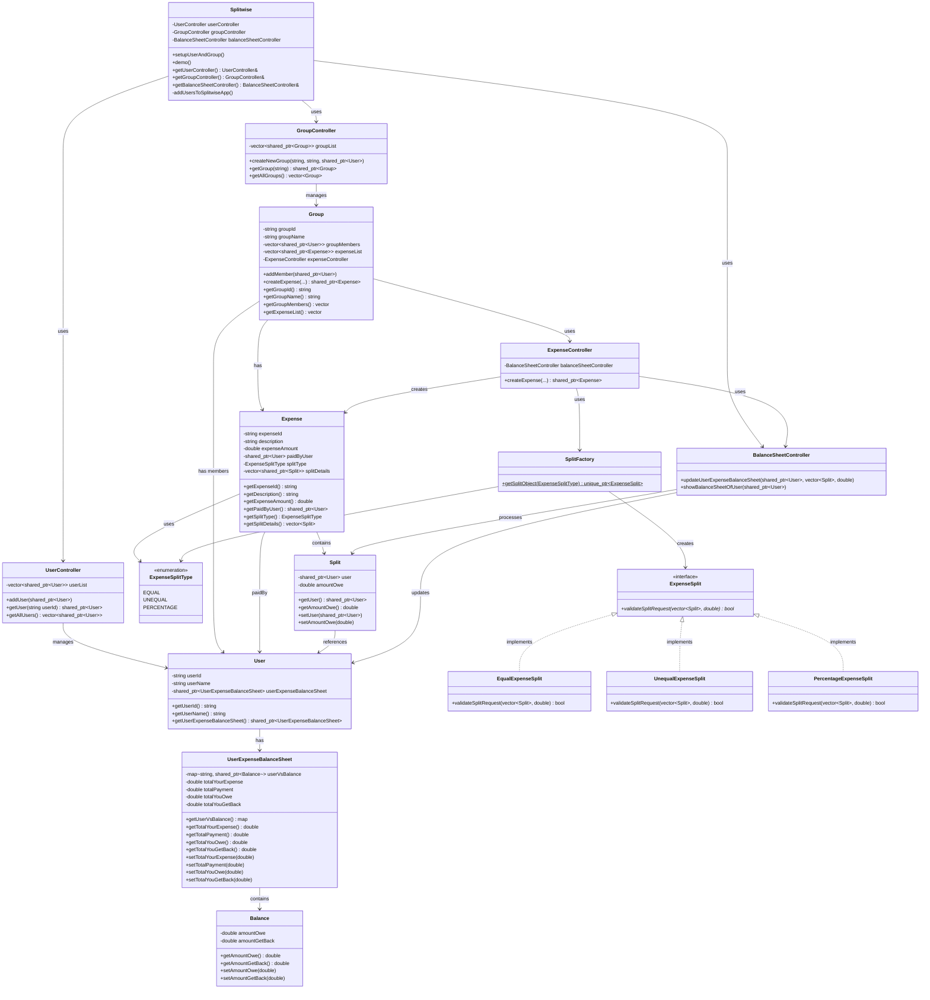

# Splitwise - UML Class Diagram

## Class Diagram (Mermaid)



## Component Overview

### Core Components

| Component | Responsibility |
|-----------|----------------|
| **Splitwise** | Main facade class that orchestrates the entire application |
| **User** | Represents a user with their balance sheet |
| **Group** | Container for members and shared expenses |
| **Expense** | Represents a single expense with split details |

### Controllers

| Controller | Responsibility |
|------------|----------------|
| **UserController** | CRUD operations for users |
| **GroupController** | CRUD operations for groups |
| **ExpenseController** | Creates and validates expenses |
| **BalanceSheetController** | Updates and displays balance sheets |

### Strategy Pattern Components

| Component | Role |
|-----------|------|
| **ExpenseSplit** | Strategy interface |
| **EqualExpenseSplit** | Concrete strategy for equal splits |
| **UnequalExpenseSplit** | Concrete strategy for unequal splits |
| **PercentageExpenseSplit** | Concrete strategy for percentage splits |
| **SplitFactory** | Factory to create strategy objects |

## Data Flow

```
User creates expense
        ↓
ExpenseController receives request
        ↓
SplitFactory creates appropriate ExpenseSplit strategy
        ↓
Strategy validates the split (Equal/Unequal/Percentage)
        ↓
Expense object is created
        ↓
BalanceSheetController updates all user balance sheets
        ↓
Users can view their updated balances
```
