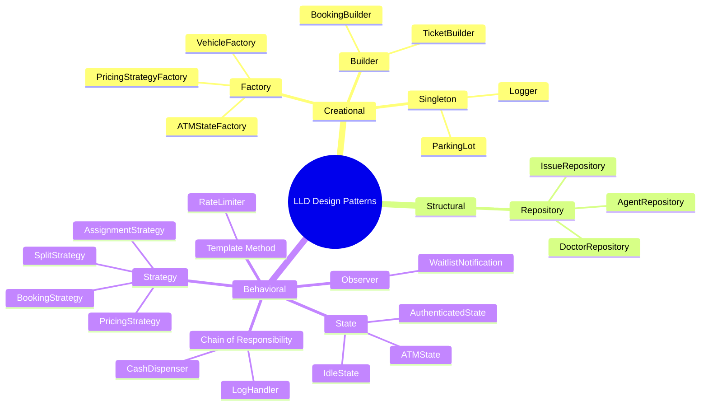
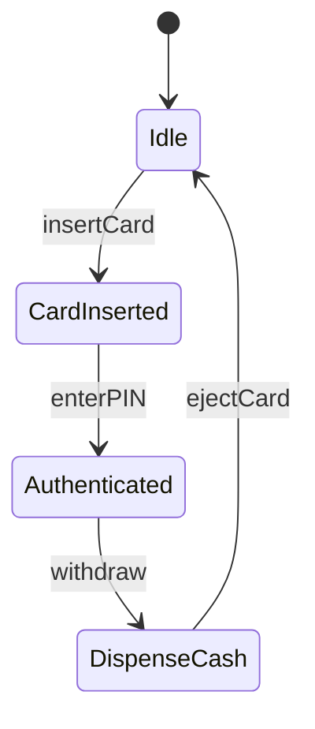
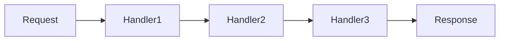
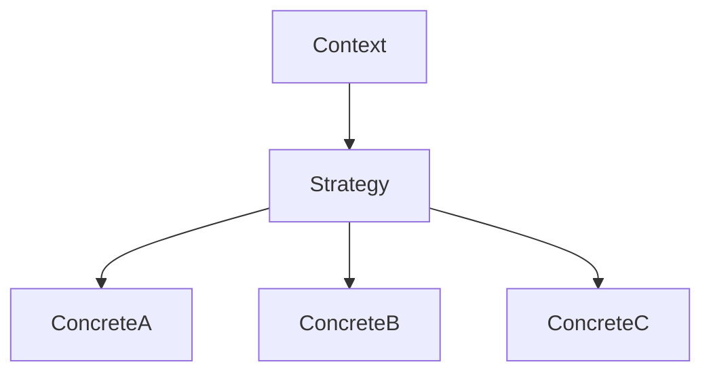
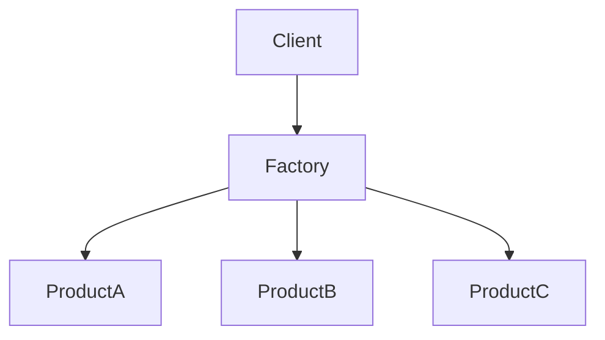
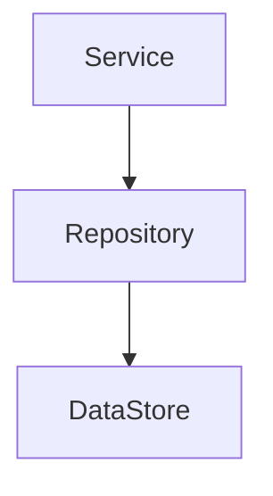

# Low Level Design (LLD) - C++ Implementations

This repository contains C++ implementations of common Low Level Design problems, converted from Java. Each implementation includes comprehensive Mermaid diagrams for visual understanding.

## Projects Overview

| # | Project | Design Patterns | Key Concepts |
|---|---------|-----------------|--------------|
| 1 | [ATM](./atm/) | State, Chain of Responsibility, Factory | State machine, Cash dispensing chain |
| 2 | [Parking Lot](./parking_lot/) | Singleton, Factory, Strategy | Multi-floor parking, Payment strategies |
| 3 | [Logger](./logger/) | Chain of Responsibility, Observer | Log levels, Multiple appenders |
| 4 | [Rate Limiter](./rate_limiter/) | Strategy, Factory | Token bucket, Sliding window |
| 5 | [Snakes & Ladder](./snakes_and_ladder/) | Factory, Template Method | Board game, Obstacle handling |
| 6 | [Splitwise](./splitwise/) | Strategy, Repository | Expense splitting, Debt simplification |
| 7 | [HashMap](./hashmap/) | Data Structure | Separate chaining, Rehashing |
| 8 | [Car Rental](./car_rental/) | Strategy, Factory, Repository | Vehicle booking, Pricing strategies |
| 9 | [Customer Support](./customer_support/) | Strategy, Repository | Agent assignment, Waitlist management |
| 10 | [Doctor Appointment](./doctors_appointment/) | Strategy, Repository | Slot booking, Waitlist notification |

## Design Patterns Summary



## Common C++ Features Used

- **C++17 Features**: `std::optional`, `inline static`, structured bindings
- **Smart Pointers**: `std::unique_ptr`, `std::shared_ptr` for memory management
- **Threading**: `std::mutex`, `std::atomic` for thread safety
- **STL Containers**: `std::unordered_map`, `std::vector`, `std::queue`, `std::priority_queue`
- **Templates**: Generic implementations (HashMap, etc.)

## Project Structure

Each project follows this structure:
```
project_name/
├── enums/           # Enumeration types
├── model/           # Domain models
├── strategy/        # Strategy pattern implementations
├── factory/         # Factory pattern implementations
├── repository/      # Data access layer
├── service/         # Business logic
├── README.md        # Design documentation with Mermaid diagrams
└── main.cpp         # Demo/entry point
```

## How to Compile

Each project can be compiled using a C++17 compatible compiler:

```bash
# Navigate to project directory
cd atm

# Compile with g++
g++ -std=c++17 -o main main.cpp

# Run
./main
```

## Mermaid Diagrams

Each project's README.md contains:
- **Class Diagram**: Shows relationships between classes
- **Sequence Diagram**: Illustrates flow of operations
- **State Diagram**: For state machine implementations
- **Flowchart**: Process flow visualizations

To view Mermaid diagrams:
1. Open README.md in VS Code with Mermaid extension
2. View in GitHub (native support)
3. Use Mermaid Live Editor: https://mermaid.live

## Design Pattern Details

### 1. State Pattern (ATM)


### 2. Chain of Responsibility (Logger, ATM Cash Dispenser)


### 3. Strategy Pattern (Pricing, Booking, Assignment)


### 4. Factory Pattern (Vehicle, State, Strategy creation)


### 5. Repository Pattern (Data Access)


## Learning Objectives

After studying these implementations, you will understand:

1. **SOLID Principles** applied in real scenarios
2. **Design Pattern** selection and implementation
3. **Thread Safety** considerations in concurrent systems
4. **Clean Architecture** with separation of concerns
5. **Modern C++** idioms and best practices

## Contributing

Feel free to:
- Add new LLD problems
- Improve existing implementations
- Enhance Mermaid diagrams
- Add unit tests

## License

MIT License - Feel free to use for learning and interviews!
