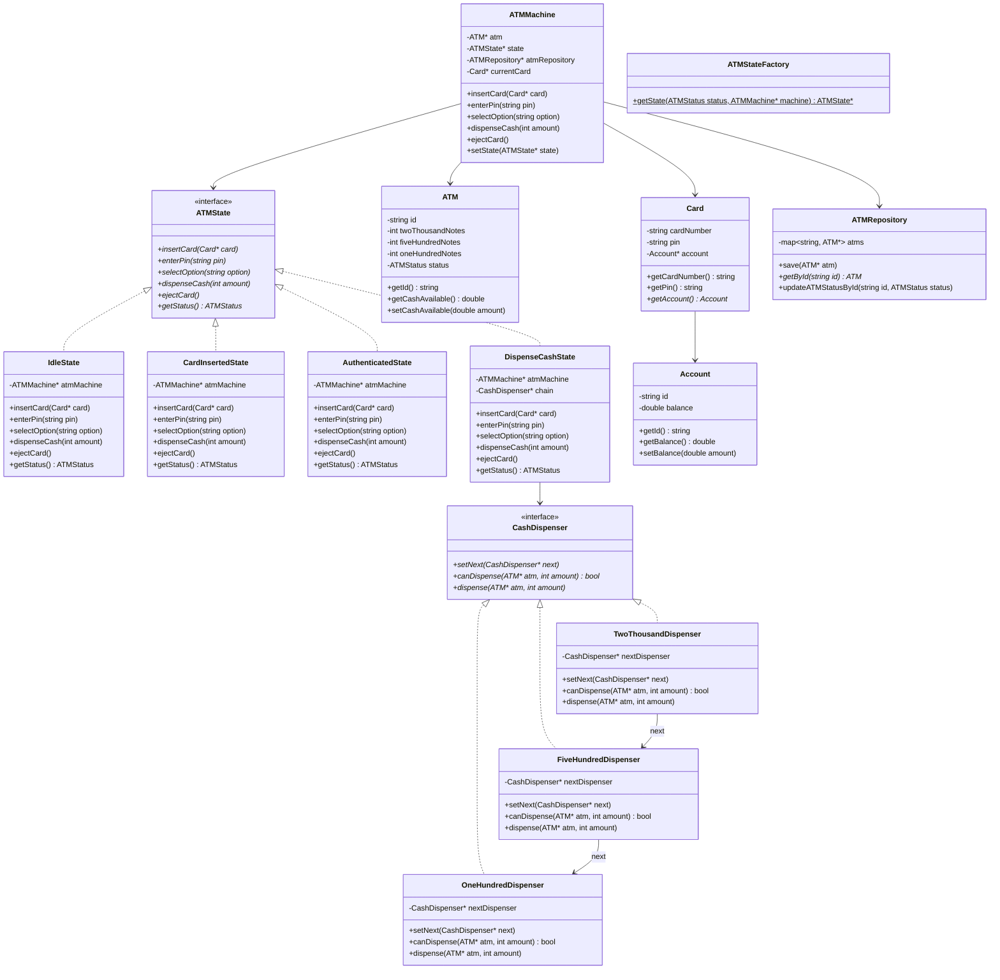
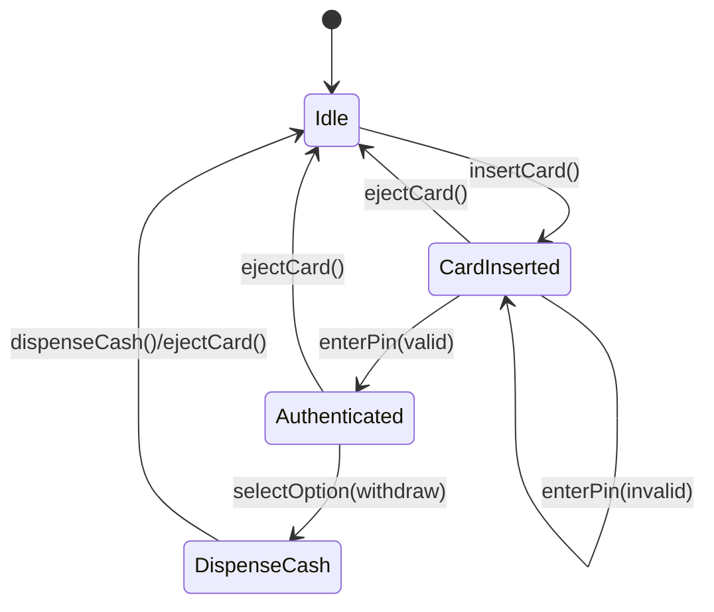
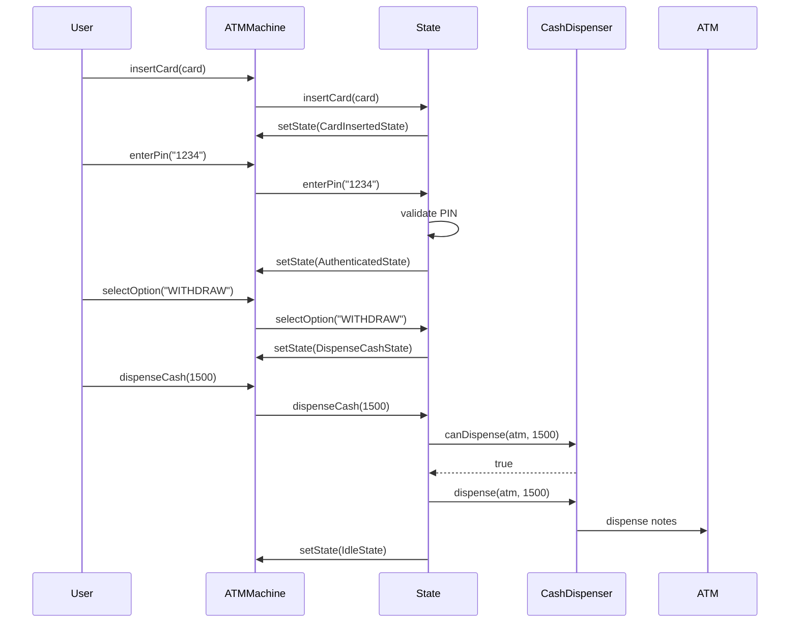

# ATM Machine - Low Level Design (C++)

## Design Patterns Used
- **State Pattern**: ATM transitions between different states (Idle, CardInserted, Authenticated, DispenseCash)
- **Chain of Responsibility**: Cash dispensing through denomination-specific dispensers
- **Factory Pattern**: ATMStateFactory creates appropriate state objects
- **Repository Pattern**: ATMRepository provides data access abstraction

## Class Diagram



## State Diagram



## Sequence Diagram



## Files Structure
```
atm/
├── enums/
│   └── ATMStatus.hpp
├── model/
│   ├── Account.hpp
│   ├── ATM.hpp
│   └── Card.hpp
├── cor/
│   ├── CashDispenser.hpp
│   ├── TwoThousandDispenser.hpp
│   ├── FiveHundredDispenser.hpp
│   ├── OneHundredDispenser.hpp
│   └── CashDispenserChainBuilder.hpp
├── state/
│   ├── ATMState.hpp
│   ├── IdleState.hpp
│   ├── CardInsertedState.hpp
│   ├── AuthenticatedState.hpp
│   └── DispenseCashState.hpp
├── factory/
│   └── ATMStateFactory.hpp
├── repository/
│   └── ATMRepository.hpp
├── service/
│   └── ATMMachine.hpp
└── main.cpp
```
