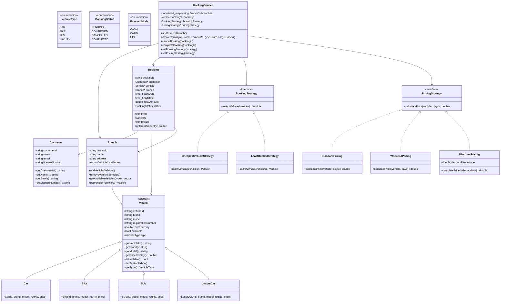
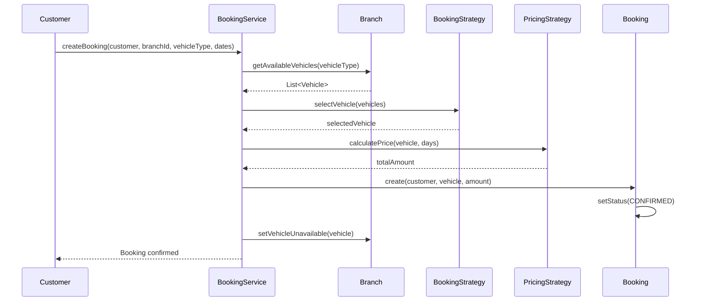
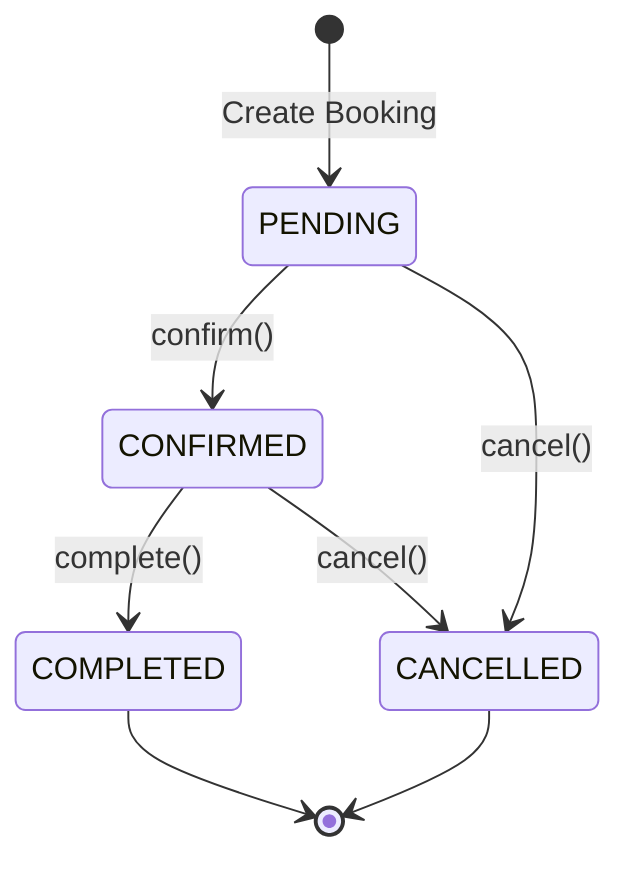
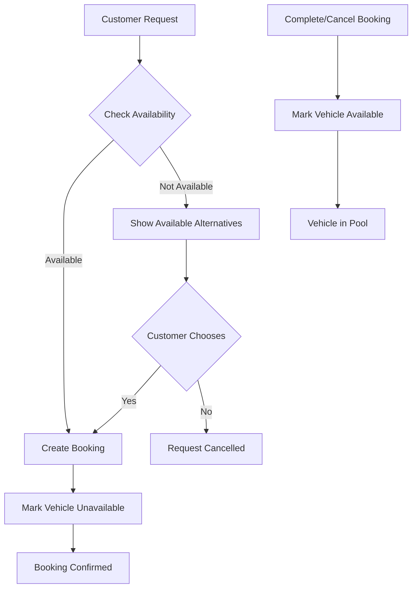

# Car Rental System - Low Level Design (C++)

## Design Patterns Used
- **Strategy Pattern**: For booking selection and pricing strategies
- **Factory Pattern**: For creating vehicles and payment strategies
- **Singleton Pattern**: For managing vehicle inventory (optional)
- **Builder Pattern**: For constructing bookings
- **Repository Pattern**: For managing vehicle and booking data

## Class Diagram



## Booking Flow



## Strategy Selection

```mermaid
flowchart TD
    A[Select Vehicle] --> B{Which Strategy?}
    
    B -->|Cheapest| C[CheapestVehicleStrategy]
    C --> D[Sort by pricePerDay ascending]
    D --> E[Return first vehicle]
    
    B -->|Least Booked| F[LeastBookedStrategy]
    F --> G[Get booking counts per vehicle]
    G --> H[Return vehicle with least bookings]
    
    I[Calculate Price] --> J{Which Pricing?}
    
    J -->|Standard| K[StandardPricing]
    K --> L[price = pricePerDay × days]
    
    J -->|Weekend| M[WeekendPricing]
    M --> N[price = pricePerDay × days × 1.5]
    
    J -->|Discount| O[DiscountPricing]
    O --> P[price = pricePerDay × days × (1 - discount)]
```

## Booking State Diagram



## Vehicle Availability Flow



## Files Structure
```
car_rental/
├── enums/
│   ├── VehicleType.hpp
│   ├── BookingStatus.hpp
│   └── PaymentMode.hpp
├── model/
│   ├── Vehicle.hpp
│   ├── Car.hpp
│   ├── Bike.hpp
│   ├── SUV.hpp
│   ├── LuxuryCar.hpp
│   ├── Customer.hpp
│   ├── Branch.hpp
│   └── Booking.hpp
├── strategy/
│   ├── booking/
│   │   ├── BookingStrategy.hpp
│   │   ├── CheapestVehicleStrategy.hpp
│   │   └── LeastBookedStrategy.hpp
│   └── pricing/
│       ├── PricingStrategy.hpp
│       ├── StandardPricing.hpp
│       ├── WeekendPricing.hpp
│       └── DiscountPricing.hpp
├── service/
│   └── BookingService.hpp
├── README.md
└── main.cpp
```
