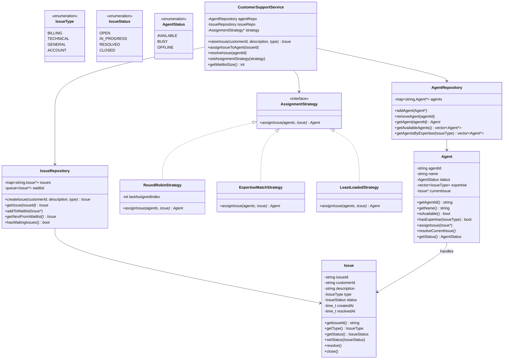
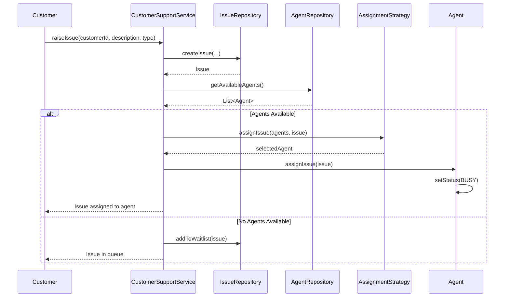
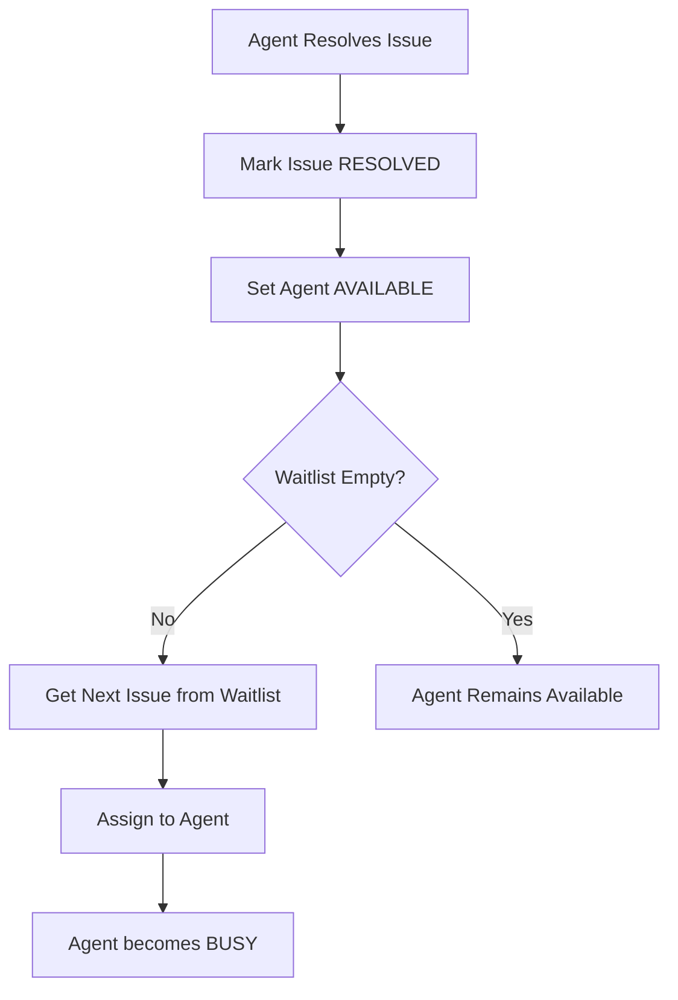
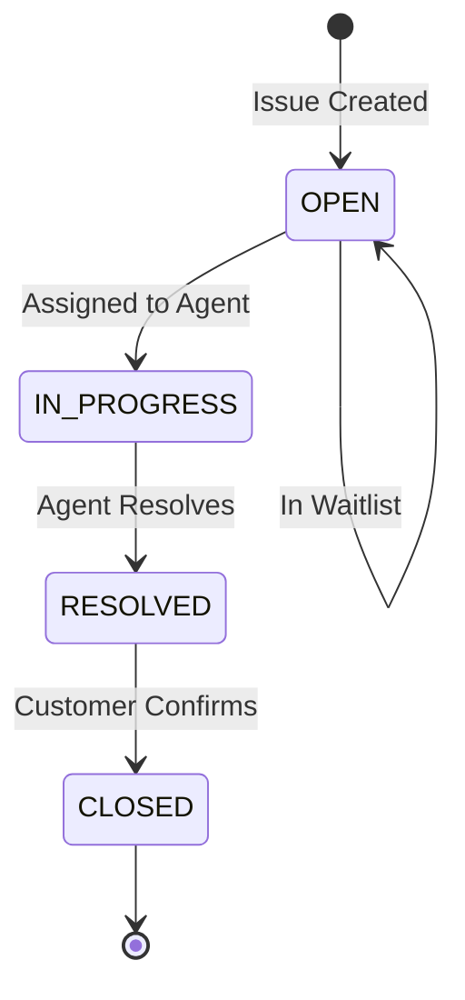
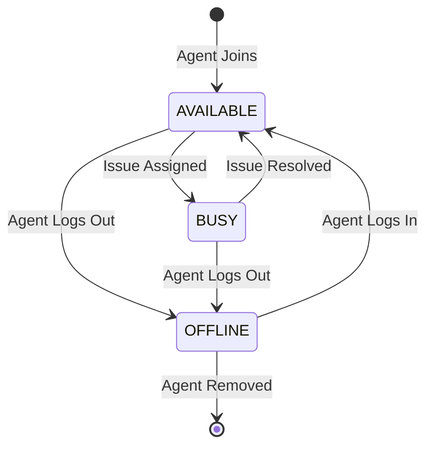
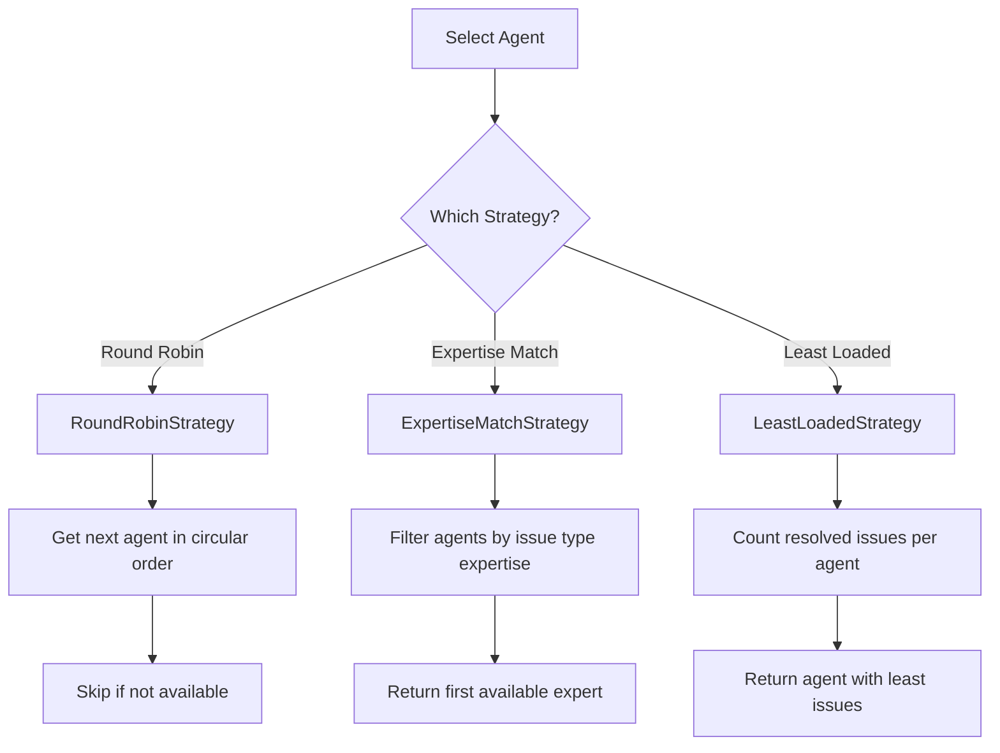

# Customer Support System - Low Level Design (C++)

## Design Patterns Used
- **Strategy Pattern**: For agent assignment strategies
- **Factory Pattern**: For creating agents and issues
- **Observer Pattern**: For notifying agents about new issues (optional)
- **Repository Pattern**: For managing agents and issues

## Class Diagram



## Issue Assignment Flow



## Issue Resolution and Waitlist Processing



## State Diagram - Issue Lifecycle



## State Diagram - Agent Status



## Assignment Strategies



## Files Structure
```
customer_support/
├── enums/
│   ├── IssueType.hpp
│   ├── IssueStatus.hpp
│   └── AgentStatus.hpp
├── model/
│   ├── Issue.hpp
│   └── Agent.hpp
├── strategy/
│   ├── AssignmentStrategy.hpp
│   ├── RoundRobinStrategy.hpp
│   ├── ExpertiseMatchStrategy.hpp
│   └── LeastLoadedStrategy.hpp
├── repository/
│   ├── AgentRepository.hpp
│   └── IssueRepository.hpp
├── service/
│   └── CustomerSupportService.hpp
├── README.md
└── main.cpp
```
