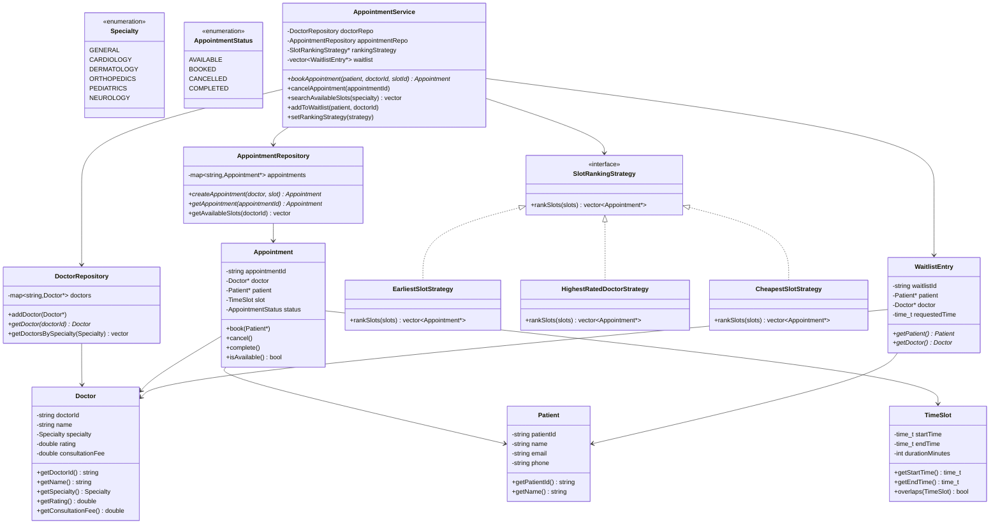
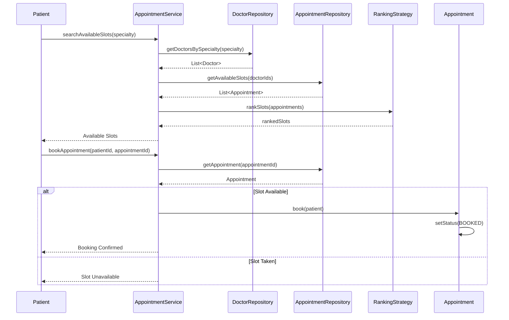
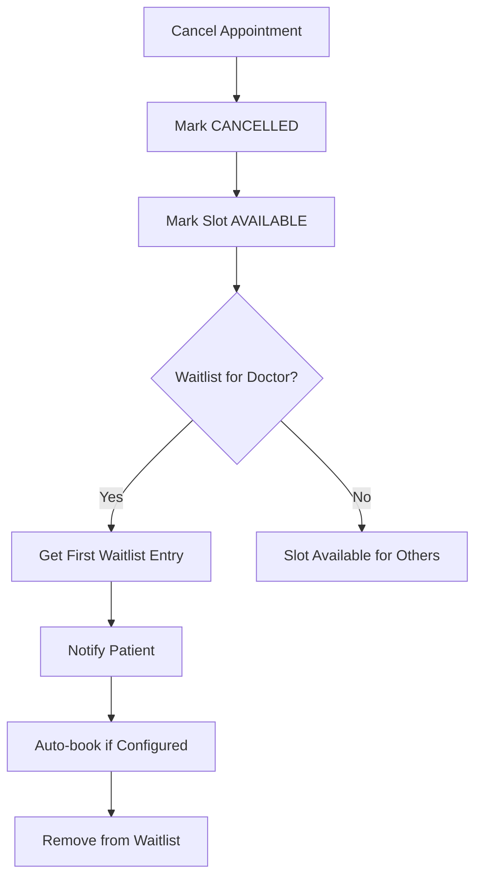
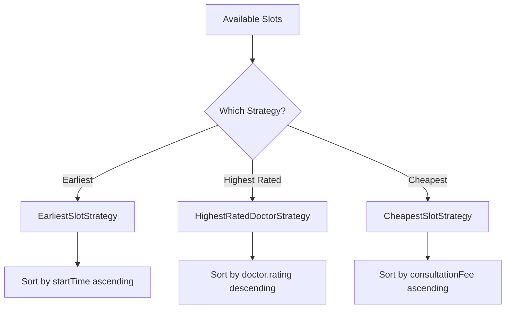
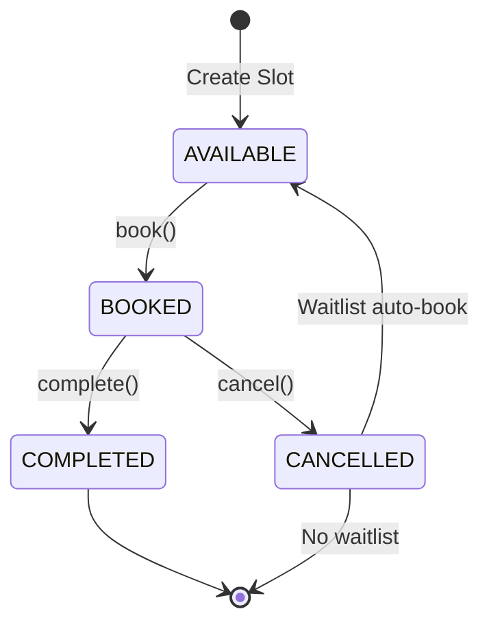
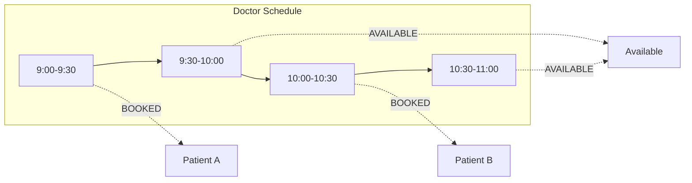

# Doctor Appointment System - Low Level Design (C++)

## Design Patterns Used
- **Strategy Pattern**: For slot ranking/prioritization strategies
- **Factory Pattern**: For creating appointments
- **Repository Pattern**: For managing doctors, patients, and appointments
- **Observer Pattern**: For waitlist notifications (optional)

## Class Diagram



## Appointment Booking Flow



## Cancellation and Waitlist Processing



## Slot Ranking Strategies



## Appointment State Diagram



## Time Slot Management



## Files Structure
```
doctors_appointment/
├── enums/
│   ├── Specialty.hpp
│   └── AppointmentStatus.hpp
├── model/
│   ├── Doctor.hpp
│   ├── Patient.hpp
│   ├── TimeSlot.hpp
│   ├── Appointment.hpp
│   └── WaitlistEntry.hpp
├── strategy/
│   ├── SlotRankingStrategy.hpp
│   ├── EarliestSlotStrategy.hpp
│   ├── HighestRatedDoctorStrategy.hpp
│   └── CheapestSlotStrategy.hpp
├── repository/
│   ├── DoctorRepository.hpp
│   └── AppointmentRepository.hpp
├── service/
│   └── AppointmentService.hpp
├── README.md
└── main.cpp
```
