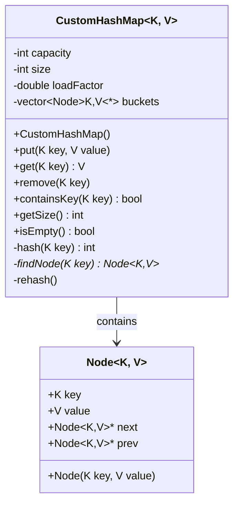
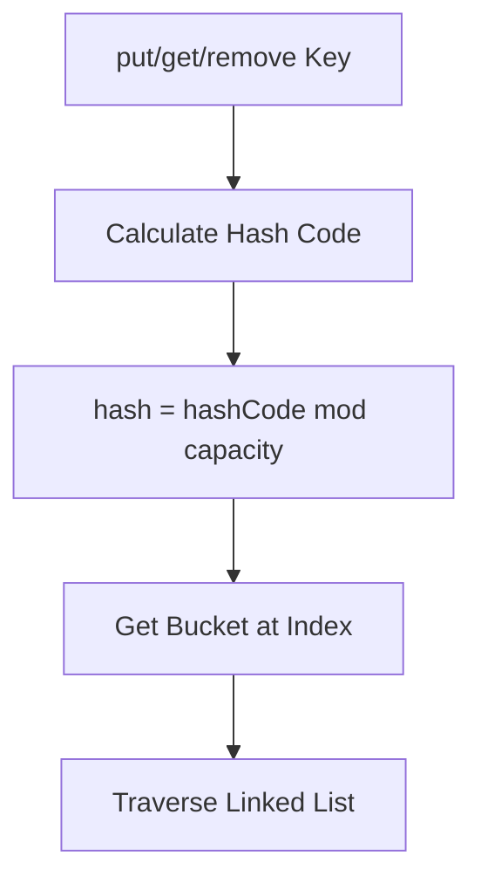
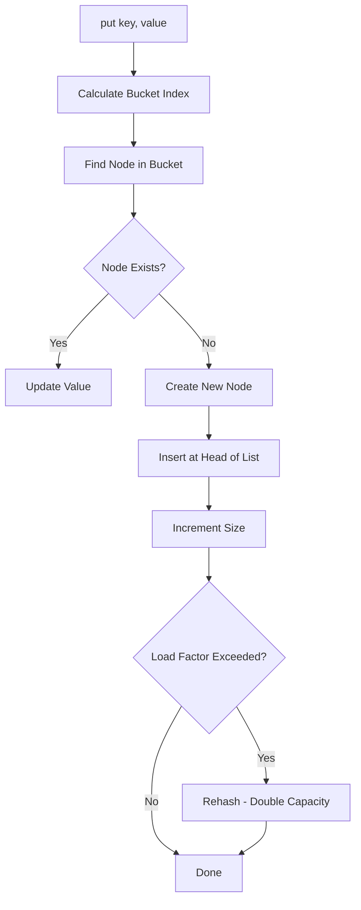
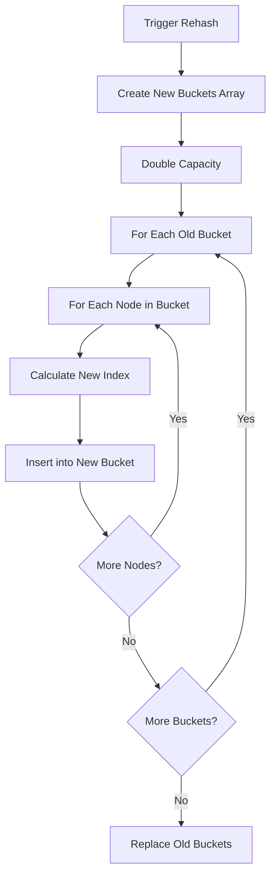
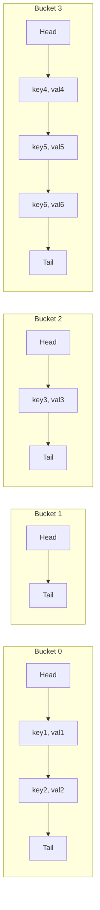
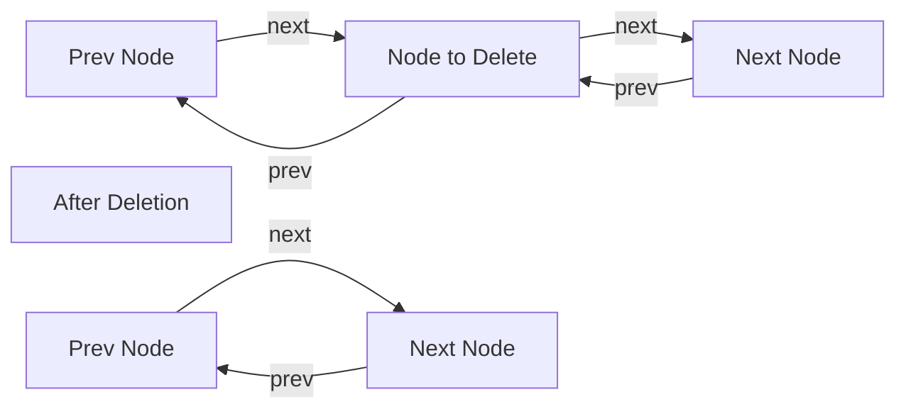

# Custom HashMap - Low Level Design (C++)

## Design Patterns Used
- **Data Structure Pattern**: Separate chaining with doubly-linked lists
- **Iterator Pattern**: For traversing the hash map (optional enhancement)

## Implementation Details
- **Initial Size**: 4 buckets
- **Max Capacity**: 2^30 buckets
- **Load Factor**: 0.75 (rehash threshold)
- **Collision Handling**: Separate chaining with doubly-linked lists
- **Sentinel Nodes**: Each bucket has dummy head and tail nodes for easier insertion/deletion

## Class Diagram



## Hash Function and Bucket Selection



## Put Operation Flow



## Rehashing Process



## Collision Handling with Separate Chaining



## Deletion with Doubly-Linked List



## Time Complexity Analysis

| Operation | Average Case | Worst Case |
|-----------|--------------|------------|
| put()     | O(1)         | O(n)       |
| get()     | O(1)         | O(n)       |
| remove()  | O(1)         | O(n)       |

*Worst case occurs when all keys hash to the same bucket*

## Files Structure
```
hashmap/
├── CustomHashMap.hpp
└── main.cpp
```
