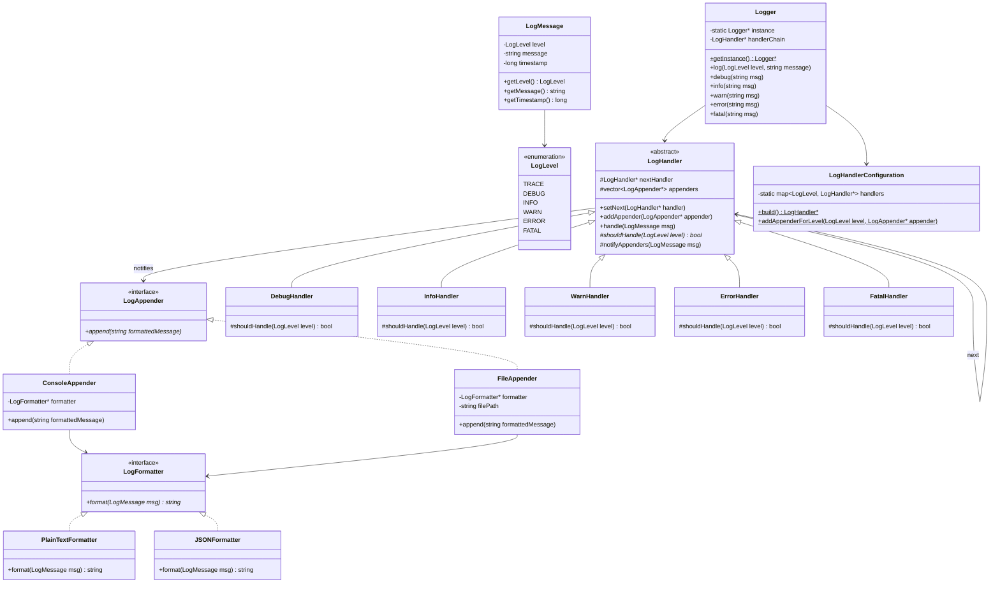
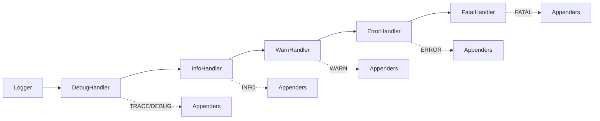
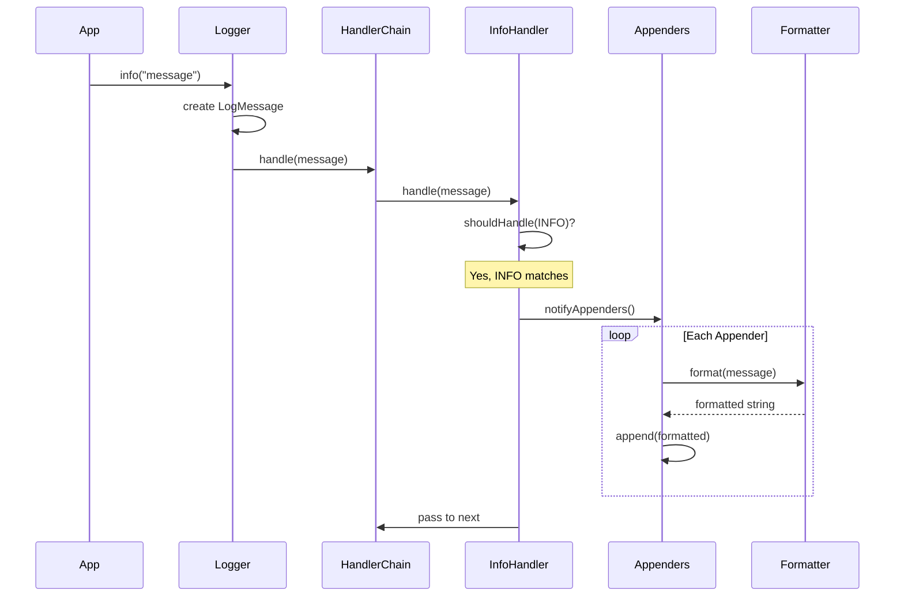
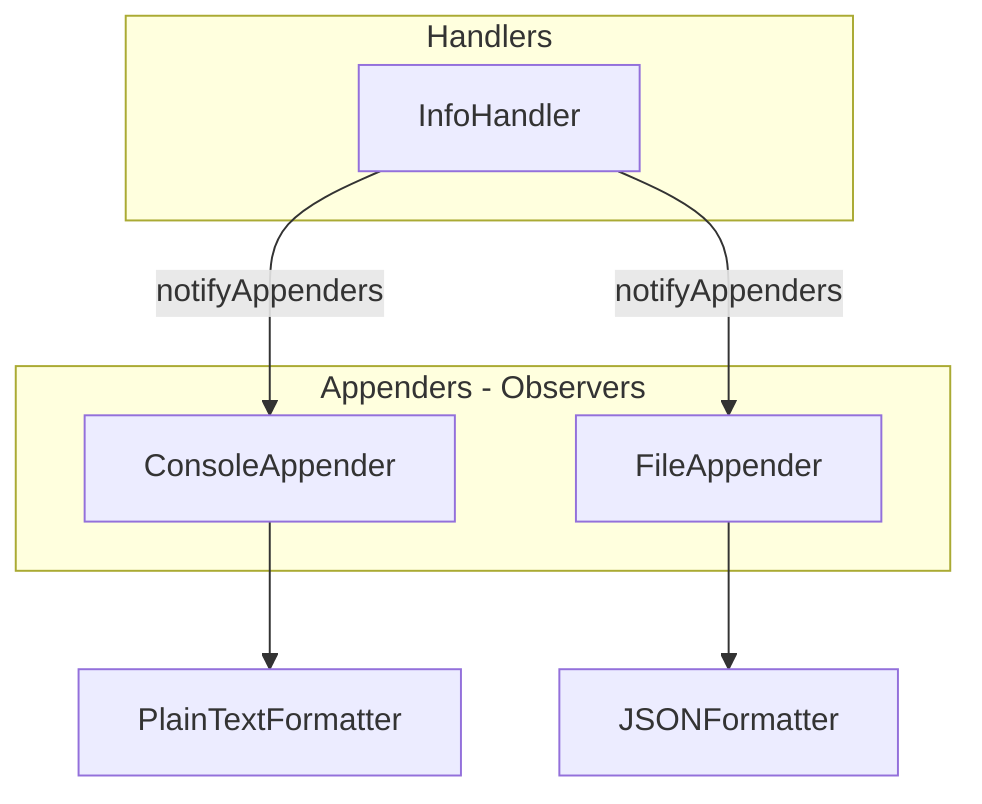

# Logger System - Low Level Design (C++)

## Design Patterns Used
- **Singleton Pattern**: Logger class has single instance
- **Chain of Responsibility**: Log handlers chain (Debug → Info → Warn → Error → Fatal)
- **Observer Pattern**: Appenders observe handlers and receive log messages
- **Strategy Pattern**: LogFormatter (PlainTextFormatter, JSONFormatter)

## Class Diagram



## Chain of Responsibility Flow



## Sequence Diagram



## Observer Pattern Detail



## Files Structure
```
logger/
├── enums/
│   └── LogLevel.hpp
├── model/
│   └── LogMessage.hpp
├── formatter/
│   ├── LogFormatter.hpp
│   ├── PlainTextFormatter.hpp
│   └── JSONFormatter.hpp
├── appenders/
│   ├── LogAppender.hpp
│   ├── ConsoleAppender.hpp
│   └── FileAppender.hpp
├── handlers/
│   ├── LogHandler.hpp
│   ├── DebugHandler.hpp
│   ├── InfoHandler.hpp
│   ├── WarnHandler.hpp
│   ├── ErrorHandler.hpp
│   └── FatalHandler.hpp
├── LogHandlerConfiguration.hpp
├── Logger.hpp
└── main.cpp
```
