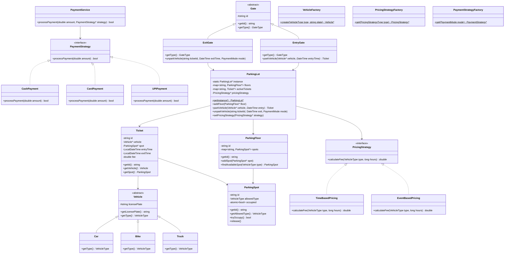
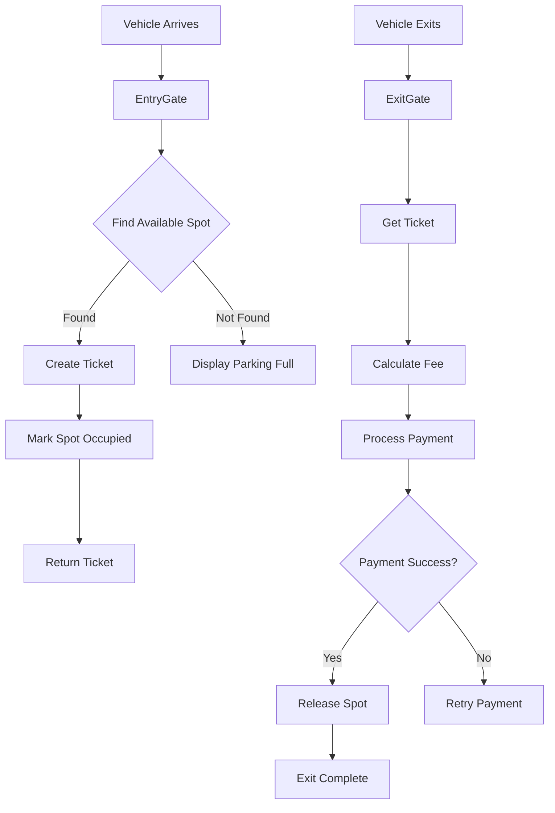
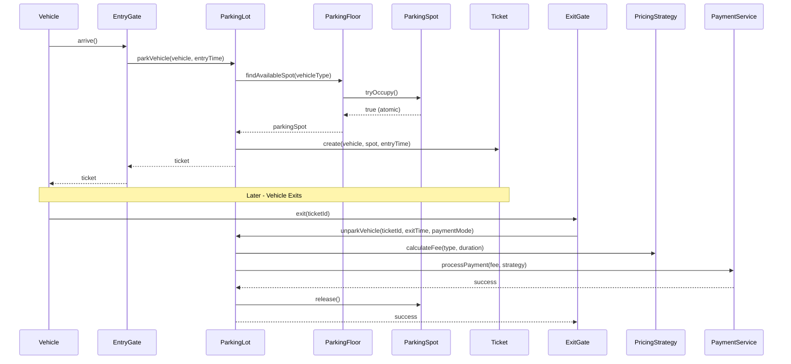

# Parking Lot System - Low Level Design (C++)

## Design Patterns Used
- **Singleton Pattern**: ParkingLot class has single instance
- **Factory Pattern**: VehicleFactory, PricingStrategyFactory, PaymentStrategyFactory
- **Strategy Pattern**: PricingStrategy (TimeBasedPricing, EventBasedPricing), PaymentStrategy (Cash, Card, UPI)
- **Builder Pattern**: Ticket construction
- **Template Method**: Vehicle abstract class with getType() as abstract method

## Class Diagram



## Flow Diagram



## Sequence Diagram



## Files Structure
```
parking_lot/
├── enums/
│   ├── VehicleType.hpp
│   ├── GateType.hpp
│   ├── PaymentMode.hpp
│   ├── PaymentStatus.hpp
│   └── PricingStrategyType.hpp
├── model/
│   ├── Vehicle.hpp
│   ├── Car.hpp
│   ├── Bike.hpp
│   ├── Truck.hpp
│   ├── ParkingSpot.hpp
│   ├── ParkingFloor.hpp
│   ├── Ticket.hpp
│   ├── Gate.hpp
│   ├── EntryGate.hpp
│   └── ExitGate.hpp
├── strategy/
│   ├── pricing/
│   │   ├── PricingStrategy.hpp
│   │   ├── TimeBasedPricing.hpp
│   │   └── EventBasedPricing.hpp
│   └── payment/
│       ├── PaymentStrategy.hpp
│       ├── CashPayment.hpp
│       ├── CardPayment.hpp
│       └── UPIPayment.hpp
├── factory/
│   ├── VehicleFactory.hpp
│   ├── PricingStrategyFactory.hpp
│   └── PaymentStrategyFactory.hpp
├── service/
│   ├── ParkingLot.hpp
│   └── PaymentService.hpp
└── main.cpp
```
