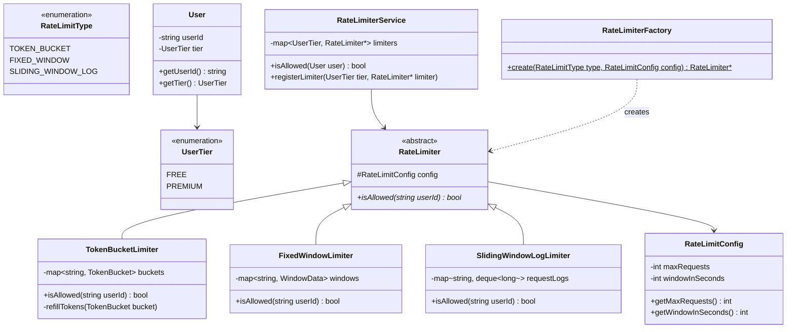
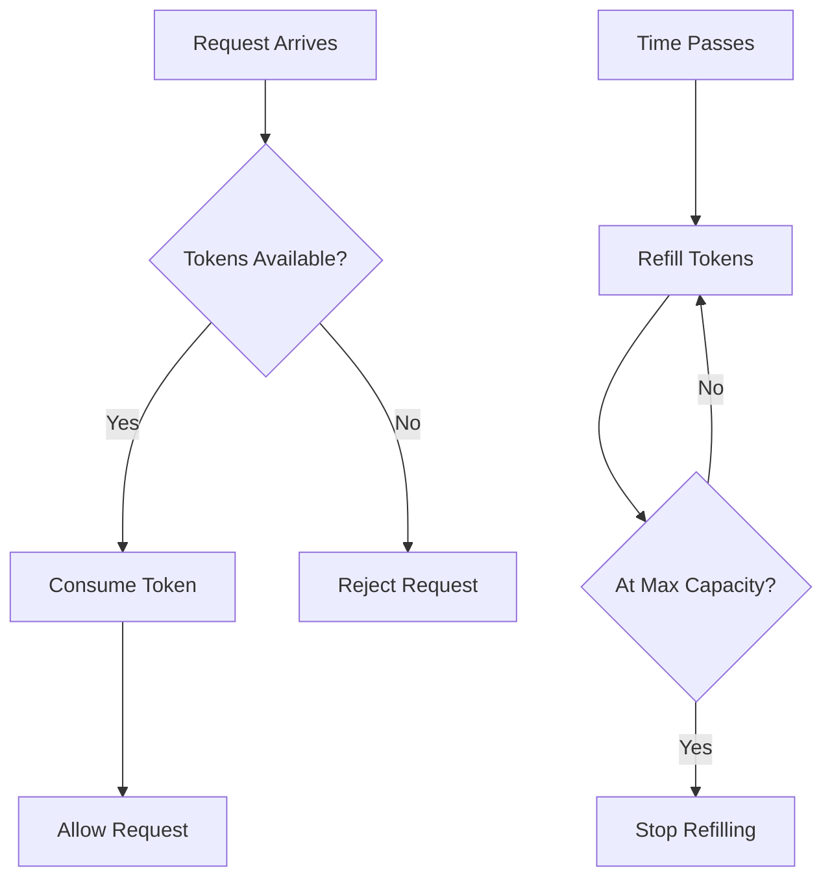
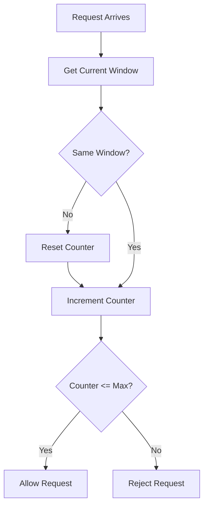
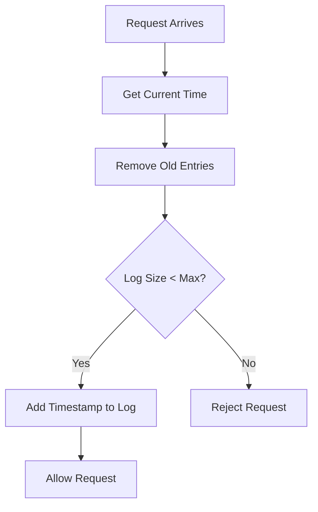
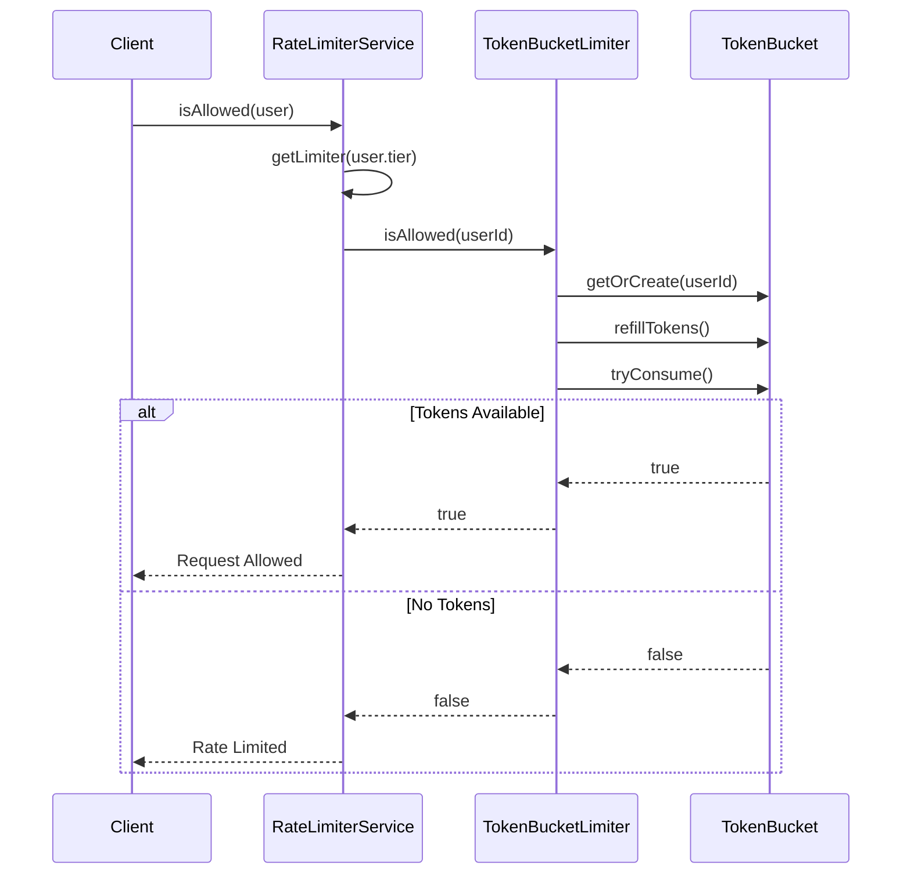

# Rate Limiter - Low Level Design (C++)

## Design Patterns Used
- **Factory Pattern**: RateLimiterFactory creates appropriate rate limiter based on type
- **Strategy Pattern**: Different rate limiting algorithms (Token Bucket, Fixed Window, Sliding Window Log)
- **Template Method**: RateLimiter abstract class with isAllowed() as abstract method

## Class Diagram



## Token Bucket Algorithm



## Fixed Window Algorithm



## Sliding Window Log Algorithm



## Sequence Diagram



## Files Structure
```
rate_limiter/
├── enums/
│   ├── UserTier.hpp
│   └── RateLimitType.hpp
├── model/
│   ├── User.hpp
│   └── RateLimitConfig.hpp
├── limiter/
│   ├── RateLimiter.hpp
│   ├── TokenBucketLimiter.hpp
│   ├── FixedWindowLimiter.hpp
│   └── SlidingWindowLogLimiter.hpp
├── factory/
│   └── RateLimiterFactory.hpp
├── service/
│   └── RateLimiterService.hpp
└── main.cpp
```
