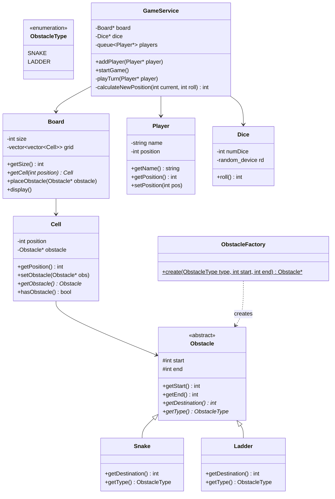
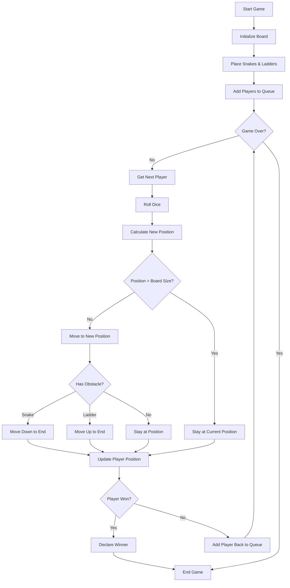
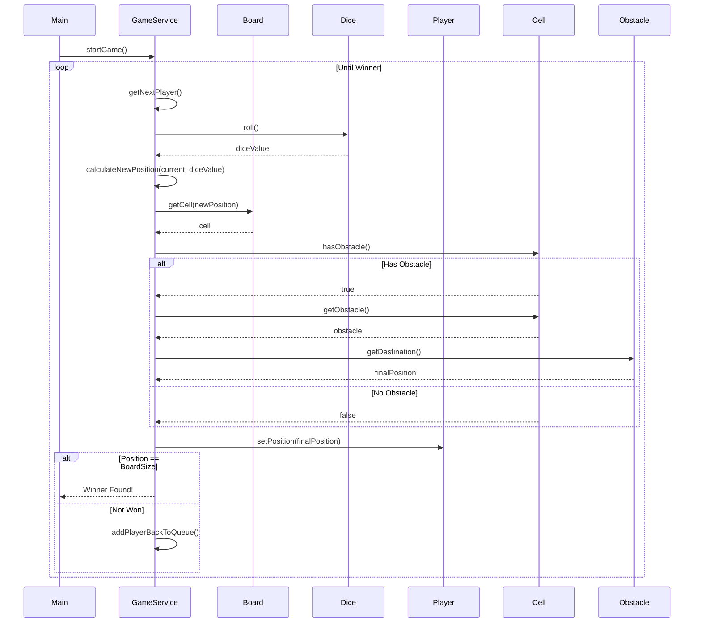

# Snakes and Ladder Game - Low Level Design (C++)

## Design Patterns Used
- **Factory Pattern**: ObstacleFactory creates Snake or Ladder objects
- **Template Method**: Obstacle abstract class with getDestination() as template
- **Composition**: Board contains Cells, Cells contain optional Obstacles

## Class Diagram



## Game Flow



## Sequence Diagram



## Board Layout

```mermaid
graph TD
    subgraph "Snakes & Ladder Board (10x10)"
        direction TB
        R1[100 99 98 97 96 95 94 93 92 91]
        R2[81 82 83 84 85 86 87 88 89 90]
        R3[80 79 78 77 76 75 74 73 72 71]
        R4[61 62 63 64 65 66 67 68 69 70]
        R5[60 59 58 57 56 55 54 53 52 51]
        R6[41 42 43 44 45 46 47 48 49 50]
        R7[40 39 38 37 36 35 34 33 32 31]
        R8[21 22 23 24 25 26 27 28 29 30]
        R9[20 19 18 17 16 15 14 13 12 11]
        R10[1  2  3  4  5  6  7  8  9  10]
    end
    
    style R1 fill:#90EE90
    style R10 fill:#FFB6C1
```



## Files Structure
```
snakes_and_ladder/
├── enums/
│   └── ObstacleType.hpp
├── model/
│   ├── Obstacle.hpp
│   ├── Snake.hpp
│   ├── Ladder.hpp
│   ├── Cell.hpp
│   ├── Board.hpp
│   ├── Player.hpp
│   └── Dice.hpp
├── factory/
│   └── ObstacleFactory.hpp
├── service/
│   └── GameService.hpp
└── main.cpp
```
