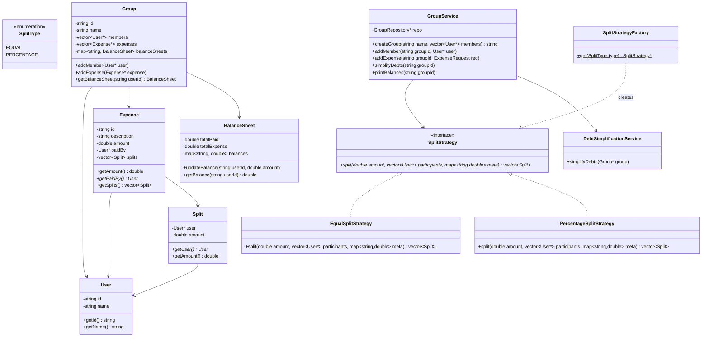
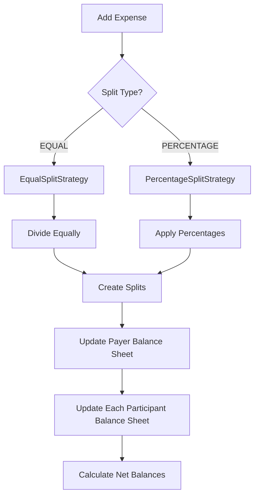
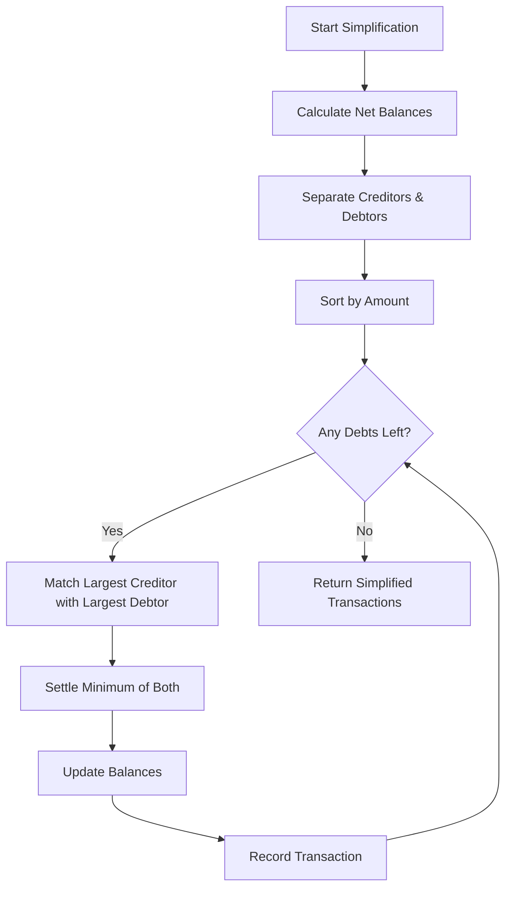
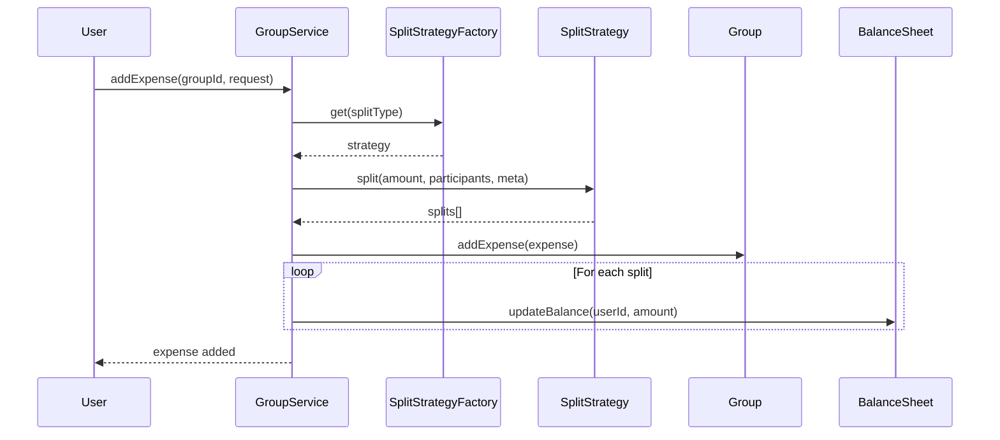

# Splitwise - Low Level Design (C++)

## Design Patterns Used
- **Strategy Pattern**: SplitStrategy interface with EqualSplitStrategy, PercentageSplitStrategy
- **Factory Pattern**: SplitStrategyFactory creates appropriate split strategy
- **Repository Pattern**: GroupRepository for data persistence abstraction

## Class Diagram



## Expense Split Flow



## Debt Simplification Algorithm



## Sequence Diagram



## Files Structure
```
splitwise/
├── enums/
│   └── SplitType.hpp
├── model/
│   ├── User.hpp
│   ├── Split.hpp
│   ├── Expense.hpp
│   ├── BalanceSheet.hpp
│   └── Group.hpp
├── strategy/
│   ├── SplitStrategy.hpp
│   ├── EqualSplitStrategy.hpp
│   └── PercentageSplitStrategy.hpp
├── factory/
│   └── SplitStrategyFactory.hpp
├── repository/
│   └── GroupRepository.hpp
├── service/
│   ├── GroupService.hpp
│   └── DebtSimplificationService.hpp
└── main.cpp
```
