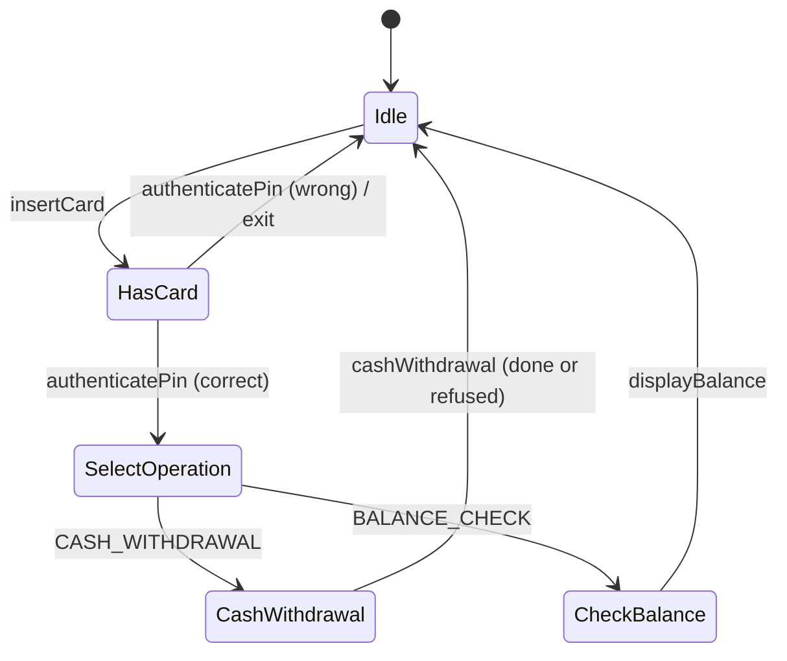

# ATM (Concept && Coding version) - C++

A second implementation of the same question. **To learn how to deliver the question in an interview, read [`../atm/README.md`](../atm/README.md)**: requirements, the state diagram, the note-dispensing chain and the follow-ups are the same.

This README covers only what's different here: how this design compares, what it does better, where it breaks, and how to run it. Everything matches the C++ code in this folder.

---

## 1. How this version differs

| Topic | Main version (`atm`) | This version |
|---|---|---|
| Context | `ATMMachine`, one per ATM id (from a repository) | `ATM` is a **singleton**: one machine per program |
| States | Idle, CardInserted, Authenticated, DispenseCash | Idle, HasCard, SelectOperation, **CashWithdrawal, CheckBalance** |
| Operations | Withdrawal only (the option string is ignored) | Withdrawal **and balance check**, chosen by a `TransactionType` enum |
| Invalid actions | Every state implements every action and prints a refusal | **Base class defaults** ("OOPS!! Something went wrong"); states override only what they allow |
| How states reach the machine | Each state stores `ATMMachine*` | `ATM*` and the card are **passed into every call** |
| State lifetime | `unique_ptr`, destroyed while its own method runs | `shared_ptr`; `getCurrentATMState()` returns a copy that keeps it alive |
| The card | Stored in the machine for the session | Passed in at every step, **not bound to the session** |
| PIN | Per card | **One `static const` PIN (112211) for every card** |
| Wrong PIN | Stay and retry | Card ejected, back to Idle |
| Money | `double` balances | `int` everywhere |
| ATM cash | Computed from the note counts | A separate `atmBalance` field set alongside the counts |
| Note chain | Built with `new` per withdrawal, never freed | Built from `shared_ptr`s per withdrawal, freed automatically |
| Exact-amount check | `canDispense` dry run inside each link | A separate dry-run helper, `canDispenseExactly`, before any debit |

**Which to present in an interview?** Combine them. Take this version's state set (with balance check as its own state), its base-class defaults, integer money and `shared_ptr` lifetime; take the main version's per-session card, per-card PIN, retry on a wrong PIN, and the dry run built into each chain link.

---

## 2. Design at a glance

| Class | Responsibility |
|---|---|
| `ATM` | Singleton context: current state, `atmBalance`, counts of 2000 / 500 / 100 notes. |
| `ATMState` | Base class: every action defaults to "OOPS!! Something went wrong". |
| `IdleState` | `insertCard` -> HasCard. |
| `HasCardState` | `authenticatePin`: correct -> SelectOperation, wrong -> eject (Idle). |
| `SelectOperationState` | `selectOperation`: CASH_WITHDRAWAL -> CashWithdrawal, BALANCE_CHECK -> CheckBalance. |
| `CashWithdrawalState` | Validate, dry-run the notes, debit, dispense through the chain, eject. |
| `CheckBalanceState` | Print the bank balance, eject. |
| `CashWithdrawProcessor` + 2000 / 500 / 100 processors | Chain of Responsibility: take what fits, pass the rest on. |
| `Card`, `UserBankAccount`, `User` | Card -> account balance; the PIN check. |



---

## 3. Key code

### Invalid actions default in the base class

```cpp
// States/ATMState.hpp
virtual void insertCard(ATM* atm, std::shared_ptr<Card> card) {
    std::cout << "OOPS!! Something went wrong" << std::endl;
}
```

Every action looks like this in the base class; `IdleState` overrides only `insertCard`. That's the "default rejection" design the other READMEs recommend, and why each state here is a few lines.

### The withdrawal

**Core logic:** refuse non-positive amounts, then not enough cash in the ATM, then not enough in the account, then amounts the notes can't make exactly. Only after all four checks pass, debit and dispense.

```cpp
// ATM.cpp
// Dry run of the 2000 -> 500 -> 100 chain: can the ATM's notes make exactly this amount?
static bool canDispenseExactly(const ATM* atm, int amount) {
    const int values[] = {2000, 500, 100};
    const int notes[] = {atm->getNoOfTwoThousandNotes(), atm->getNoOfFiveHundredNotes(),
                         atm->getNoOfOneHundredNotes()};
    for (int i = 0; i < 3; ++i) {
        int use = std::min(amount / values[i], notes[i]);
        amount -= use * values[i];
    }
    return amount == 0;
}

// CashWithdrawalState implementation
void CashWithdrawalState::cashWithdrawal(ATM* atm, std::shared_ptr<Card> card, int withdrawAmount) {
    if (withdrawAmount <= 0) {
        std::cout << "Invalid amount: " << withdrawAmount << std::endl;
        exit(atm);
    } else if (atm->getAtmBalance() < withdrawAmount) {
        std::cout << "Insufficient fund in the ATM Machine" << std::endl;
        exit(atm);
    } else if (card->getBankBalance() < withdrawAmount) {
        std::cout << "Insufficient fund in your Bank Account" << std::endl;
        exit(atm);
    } else if (!canDispenseExactly(atm, withdrawAmount)) {
        // Check before debiting anything, so nobody is charged for cash that can't come out
        std::cout << "Cannot dispense this exact amount with the available notes" << std::endl;
        exit(atm);
    } else {
        card->deductBankBalance(withdrawAmount);
        atm->deductATMBalance(withdrawAmount);

        // Chain of Responsibility for denomination selection
        auto withdrawProcessor = std::make_shared<TwoThousandWithdrawProcessor>(
            std::make_shared<FiveHundredWithdrawProcessor>(
                std::make_shared<OneHundredWithdrawProcessor>(nullptr)
            )
        );

        withdrawProcessor->withdraw(atm, withdrawAmount);
        exit(atm);
    }
}
```

### One link of the chain

```cpp
// ATM.cpp
void TwoThousandWithdrawProcessor::withdraw(ATM* atm, int remainingAmount) {
    int required = remainingAmount / 2000;
    int balance = remainingAmount % 2000;

    if (required <= atm->getNoOfTwoThousandNotes()) {
        atm->deductTwoThousandNotes(required);
        std::cout << "Dispensing " << required << " notes of 2000" << std::endl;
    } else if (required > atm->getNoOfTwoThousandNotes()) {
        int available = atm->getNoOfTwoThousandNotes();
        atm->deductTwoThousandNotes(available);
        std::cout << "Dispensing " << available << " notes of 2000" << std::endl;
        balance = balance + (required - available) * 2000;
    }

    if (balance != 0) {
        CashWithdrawProcessor::withdraw(atm, balance);
    }
}
```

The base class's `withdraw` forwards to the next processor. The 100-note processor is last: anything it can't cover it reports as "Cannot dispense remaining". With the dry run in place, that line can no longer be reached by a withdrawal.

### The bugs this code used to have

> [!WARNING]
> **1. Customers were charged for cash that never came out.** The account and the ATM's balance were debited **before** the notes were worked out. With one 100-note left, withdrawing 2300 charged 2300, handed out 2100 and printed "Cannot dispense remaining: 200"; the ATM's balance then said 800 while its notes were worth 1000. Withdrawing 2750 charged 2750 and handed out 2700.
>
> **2. A negative withdrawal added money, and a note.** `-500` passed both balance checks, `deductBankBalance(-500)` raised the account to 5500, and the 500 link computed `-500 / 500 = -1` note and called `deductFiveHundredNotes(-1)`, which **added** a note to the machine ("Dispensing -1 notes of 500").

The fixes: refuse amounts `<= 0`, and run `canDispenseExactly` (the same greedy split, without touching anything) before any debit. Lesson, same as the main version: **validate the amount's sign, and check the whole operation can succeed before changing any balance.**

---

## 4. Verification

The outputs below are from actually running the code.

```text
Demo: ATM 1 x 2000, 2 x 500, 5 x 100 (3500); account 5000; withdraw 2700
    "Dispensing 1 notes of 2000", "Dispensing 1 notes of 500", "Dispensing 2 notes of 100"
    ATM after: balance 800, notes 0 x 2000, 1 x 500, 3 x 100;  account 2300
```

Edge cases (separate test program):

```text
ATM 1 x 2000, 2 x 500, 1 x 100; withdraw 2300
    before the fix: charged 2300, 2100 handed out, ATM balance 800 vs notes worth 1000
    after:          refused ("Cannot dispense this exact amount ..."), charged 0, ATM consistent
withdraw 2750      before: charged 2750, 2700 out      after: refused, charged 0
withdraw -500      before: account 5500, a 500 note added      after: "Invalid amount: -500"
card A inserted + PIN, card B passed to cashWithdrawal 1000 -> card B charged (A untouched)
any card accepts PIN 112211
wrong PIN          -> "Invalid PIN Number", card ejected, back to Idle
an action in the wrong state -> "OOPS!! Something went wrong"
balance check      -> "Your Balance is: 5000"
```

---

## 5. Gaps in this code

| Gap | What happens | Fix to say |
|---|---|---|
| **The card isn't bound to the session** | Card A was inserted and authenticated, then `cashWithdrawal` was called with card B: **card B was charged** without ever being inserted. | Store the card in the `ATM` when it's inserted and use that one for every later step. |
| **Every card has the same PIN** | `Card::PIN_NUMBER` is a `static const int` (112211), so any card accepts it. | A per-card PIN (or better, a PIN check against the bank). |
| **A wrong PIN ejects the card, with no lockout** | One wrong digit ends the session; reinserting allows unlimited tries. | Allow a few retries in `HasCardState`, then block the card. |
| **`atmBalance` is a separate number** (by reading) | `setAtmBalance(balance, notes...)` takes the total and the counts separately, so they can disagree from the start. | Compute the total from the note counts, as the main version does. |
| **The dry run duplicates the chain** (by reading) | `canDispenseExactly` and the processors both encode "2000, then 500, then 100". Add a denomination and both must change. | Put a `canDispense` in each processor (as the main version does) so the chain answers both questions. |
| **One ATM per program** (by reading) | `ATM` is a singleton created with `new` and never deleted. | A normal object per physical ATM, owned by whoever runs it. |

---

## 6. Test yourself

<details><summary>1. What does putting the defaults in the <code>ATMState</code> base class buy?</summary>

Each state overrides only the actions it allows; everything else falls through to one "not allowed" implementation. No state has to list the actions it rejects.
</details>

<details><summary>2. Why did this version charge 2300 and hand out 2100?</summary>

It debited the account and the ATM first, then let the chain dispense what it could. With one 100-note, 200 couldn't be made. Now `canDispenseExactly` runs before any debit.
</details>

<details><summary>3. How did a negative withdrawal add a note to the machine?</summary>

The 500 link computed `-500 / 500 = -1` and called `deductFiveHundredNotes(-1)`, which adds one. The account was "debited" by -500, i.e. credited. Amounts `<= 0` are now refused.
</details>

<details><summary>4. Card A is authenticated, but the withdrawal call passes card B. What should happen?</summary>

The machine should use the card it holds for this session and ignore anything else. Here it charges card B, because the card is a parameter of every call instead of being stored at insertion.
</details>

<details><summary>5. Why is <code>getCurrentATMState()</code> returning a <code>shared_ptr</code> copy important?</summary>

States replace themselves (`setCurrentATMState(...)`) inside their own methods. The caller's copy keeps the running state alive until the call returns.
</details>

<details><summary>6. How do the two versions check that an amount can be made exactly?</summary>

The main version gives each chain link a `canDispense` dry run; this version has one separate helper that repeats the greedy split. Both run before anything is debited.
</details>

---

## 7. Run it

```bash
cd lld/ConceptCoding_atm
g++ -std=c++17 main.cpp ATM.cpp -o atm_cc
./atm_cc
```

Both `.cpp` files are needed. Expected output (shortened):

```text
--- User withdraws 2700 ---
Dispensing 1 notes of 2000
Dispensing 1 notes of 500
Dispensing 2 notes of 100
Please collect your card
Exit happens

--- Final ATM Status ---
ATM Balance: 800
2000 Notes: 0
500 Notes: 1
100 Notes: 3

--- User Bank Balance: 2300 ---
```

### Files

```text
ConceptCoding_atm/
├── main.cpp                 demo: withdraw 2700
├── ATM.hpp / ATM.cpp        singleton context; all state transitions and processors are in ATM.cpp
├── States/
│   ├── ATMState.hpp         base class with "OOPS" defaults
│   ├── IdleState.hpp, HasCardState.hpp, SelectOperationState.hpp
│   └── CashWithdrawalState.hpp, CheckBalanceState.hpp
├── Withdrawal/
│   ├── CashWithdrawProcessor.hpp    chain base: forwards to next
│   └── TwoThousand..., FiveHundred..., OneHundredWithdrawProcessor.hpp
├── Card.hpp, UserBankAccount.hpp, User.hpp
└── TransactionType.hpp      CASH_WITHDRAWAL, BALANCE_CHECK
```
