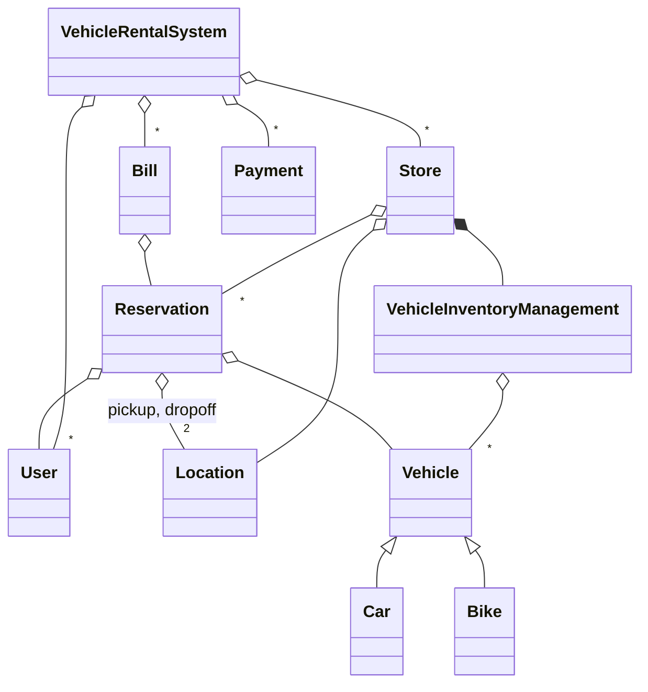
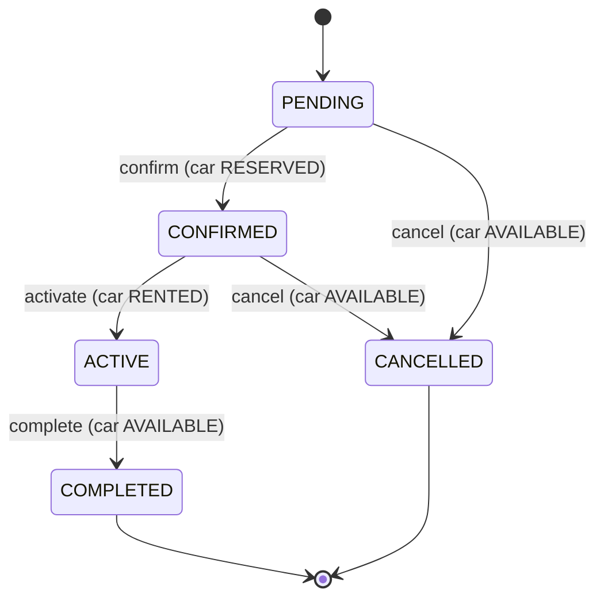

# Car Rental (Concept && Coding version) - C++

A second implementation of the same question. **To learn how to deliver the question in an interview, read [`../car_rental/README.md`](../car_rental/README.md)**: requirements, availability over time, double booking and the follow-ups are the same.

This README covers only what's different here: how this design compares, what it does better, where it breaks, and how to run it. Everything matches the C++ code in this folder.

---

## 1. How this version differs

| Topic | Main version (`car_rental`) | This version |
|---|---|---|
| What the customer picks | A branch, a type and dates; a **strategy picks the car** | **A specific vehicle by id**, after searching across all stores |
| Pricing | Pluggable `PricingStrategy` (standard, weekend, discount) | **Fixed multipliers** per rental type, applied in `Reservation` and `Bill` |
| Rental units | Days | **HOURLY, DAILY, WEEKLY, MONTHLY** |
| Dates | Stored on the booking, not used to check availability | Same: a vehicle has one status, whatever the dates |
| Lifecycle | CONFIRMED -> COMPLETED or CANCELLED | **PENDING -> CONFIRMED -> ACTIVE -> COMPLETED**, or CANCELLED before pickup |
| Vehicle state | Atomic available flag (`tryReserve` / `release`) | `VehicleStatus` enum: AVAILABLE, RESERVED, RENTED, UNDER_MAINTENANCE |
| Money | A total on the booking | **`Bill`** (10% tax, 5% insurance, $10/hour late fee, damage, discount) and **`Payment`** (5 modes, simulated) |
| Locations | Branches | **`Location`** with address and coordinates; a reservation has a pickup and a dropoff |
| Entry point | A `BookingService` object you create | **`VehicleRentalSystem` singleton** (also a facade) |
| Ownership | Raw pointers; the service owns its bookings | **`std::shared_ptr` everywhere** |
| Double-booking guard | Lock + atomic flag across the whole booking service | One mutex around `makeReservation` only |

**Which to present in an interview?** The main version's structure (the system picks the car, pluggable strategies) with this version's pickup state, hourly-to-monthly rental types, and `Bill` and `Payment` classes. Billing is the usual follow-up, and this folder shows what it looks like, including the trap in section 5.

---

## 2. Design at a glance

| Class | Responsibility |
|---|---|
| `VehicleRentalSystem` | Singleton facade: stores, users, bills, payments; search, reserve, bill, pay, complete. |
| `Store` | One location: an inventory and its reservations. |
| `VehicleInventoryManagement` | Vehicles by id and by type; lists the available ones. |
| `Vehicle` (`Car`, `Bike`) | Details, daily rate, status, km driven. |
| `Reservation` | User, vehicle, pickup and dropoff, duration and type; owns the status transitions. |
| `Bill` | Base amount, tax, insurance, late fee, damage, discount, total, paid flag. |
| `Payment` | Amount and mode; simulates the gateway, can refund. |
| `User`, `Location` | Customer details and an active flag; address and coordinates. |



A reservation drives its vehicle's status, so the two always move together:



**Patterns:** Singleton and Facade (`VehicleRentalSystem`), inheritance for vehicles. The comment at the top of `main.cpp` also lists Factory and Strategy, but there are no such classes: rental types are a `switch` on an enum.

---

## 3. Key code

### Check and reserve as one step

```cpp
// VehicleRentalSystem.hpp
std::lock_guard<std::mutex> lock(reservationMutex);
auto store = getStore(storeId);
auto user = getUser(userId);

if (!store || !user) {
    std::cout << "Store or User not found!" << std::endl;
    return nullptr;
}

auto vehicle = store->getInventory()->getVehicle(vehicleId);
if (!vehicle || vehicle->getStatus() != VehicleStatus::AVAILABLE) {
    std::cout << "Vehicle not available!" << std::endl;
    return nullptr;
}

std::string reservationId = "RES" + std::to_string(++reservationCounter);
auto reservation = store->createReservation(
    reservationId, user, vehicle, dropoffLocation, pickupTime, duration, type
);

reservation->confirm();
```

Without the lock, two threads can both see AVAILABLE and both reserve. The lock has to cover everything from the check to `confirm()`, which is the line that marks the car RESERVED.

### Transitions that refuse

```cpp
// Reservation.hpp
void requireStatus(bool allowed, const char* action) const {
    if (!allowed) {
        throw std::runtime_error(std::string("Cannot ") + action + " a reservation that is " +
                                 reservationStatusToString(status));
    }
}
// ...
void complete() {
    requireStatus(status == ReservationStatus::ACTIVE, "complete");
    status = ReservationStatus::COMPLETED;
    vehicle->setStatus(VehicleStatus::AVAILABLE);
}

void cancel() {
    requireStatus(status == ReservationStatus::PENDING || status == ReservationStatus::CONFIRMED, "cancel");
    status = ReservationStatus::CANCELLED;
    vehicle->setStatus(VehicleStatus::AVAILABLE);
}
```

Each transition also writes to the shared vehicle, so a stale call on an old reservation would change a car that now belongs to someone else. Keeping the check next to the change means no caller can skip it.

### Refuse before recording anything

```cpp
// VehicleRentalSystem.hpp
// Complete reservation first: it throws unless ACTIVE, before km or a bill are recorded
reservation->complete();

// Update vehicle
auto vehicle = reservation->getVehicle();
vehicle->addKmDriven(kmDriven);

// Generate bill with any penalties
auto bill = generateBill(reservation);
if (hoursLate > 0) {
    bill->addLateFee(hoursLate);
}
if (damageCost > 0) {
    bill->addDamagePenalty(damageCost);
}
```

### How the price is built

```cpp
// ReservationType.hpp
case ReservationType::HOURLY: return 1.0 / 24.0;  // Per hour rate
case ReservationType::DAILY: return 1.0;
case ReservationType::WEEKLY: return 6.5;  // Discount for weekly
case ReservationType::MONTHLY: return 25.0;  // Discount for monthly

// Reservation.hpp
double dailyRate = vehicle->getDailyRate();
double multiplier = getTypeMultiplier(reservationType);
return dailyRate * multiplier * duration;

// Bill.hpp
totalAmount = baseAmount + taxes + insuranceAmount + lateFeePenalty + damagePenalty - discount;
```

A week costs 6.5 days and a month costs 25 days. An hour is exactly a day's rate divided by 24.

### The bugs this code used to have

> [!WARNING]
> **1. Two customers could reserve the same car.** `makeReservation` had no lock. With 8 threads released together at the only car, 30 runs created 8 reservations in 26 runs, 7 in 3 runs and 6 in 1 run. Now every run creates exactly 1.
>
> **2. An old reservation could free a car someone else had reserved.** Transitions didn't check the current status. R1 was completed, R2 reserved the car, then `R1.cancel()` set the car back to AVAILABLE and R3 reserved it too, while R2 was still CONFIRMED.

The fixes: a mutex around the check and the reservation, and a status check on every transition. `completeRental` now completes the reservation first, so a refused call adds no km and creates no bill. Lesson: **if an operation writes to something shared, it must prove it still has the right to.**

---

## 4. Verification

The outputs below are from actually running the code.

**Demo** (transaction ids change on every run; bills and totals don't)
```text
RES1 Toyota Camry, 3 DAILY at $50      BILL1 150 + 15 + 7.5 = $172.5, then PAID
completeRental(RES1, 250 km)           BILL2 $172.5 UNPAID     <- second bill for the same rental
Status: Total Reservations 1, Total Bills 2, Total Payments 1
RES2 Ford Explorer, 2 DAILY at $80,    BILL3 160 + 16 + 8 + 50 late + 50 damage = $284
     5 hours late, $50 damage
RES3 Honda bike, 4 HOURLY at $30/day   BILL4 5 + 0.5 + 0.25 - 0.5 discount = $5.25
```

**Eight threads, one car** (barrier start, 30 runs)
```text
before the fix: 8 reservations x 26 runs, 7 x 3 runs, 6 x 1 run
after the fix:  1 reservation  x 30 runs
```

**Transitions** (separate test program)
```text
R1 completed, R2 reserves C1, R1.cancel() -> refused: "Cannot cancel a reservation that is COMPLETED"
    R1 COMPLETED, R2 CONFIRMED, car RESERVED, R3 refused
CONFIRMED: complete()                     -> refused: "Cannot complete a reservation that is CONFIRMED"
CONFIRMED: confirm() again                -> refused: "Cannot confirm a reservation that is CONFIRMED"
ACTIVE: cancel()                          -> refused: "Cannot cancel a reservation that is ACTIVE"
ACTIVE: activate() again                  -> refused: "Cannot activate a reservation that is ACTIVE"
COMPLETED: complete() again               -> refused: "Cannot complete a reservation that is COMPLETED"
CANCELLED: cancel() again, activate()     -> both refused; car stays AVAILABLE
completeRental on a CONFIRMED reservation -> refused; km added 0
completeRental on an ACTIVE reservation   -> km added 100, COMPLETED
completeRental again                      -> refused; km still 100
```

**Other edge cases**
```text
duration -2 days at $50                     -> base -100, total -115
1 day, applyDiscount(1000)                  -> total -942.5
inactive user reserves                      -> allowed
car reserved 30 days ahead, ask for tomorrow -> refused
same car added twice                        -> search lists it 2 times
pay the bill, completeRental(5 hours late)  -> first bill PAID with late fee 0; a second bill holds the fee
```

---

## 5. Gaps in this code

| Gap | What happens | Fix to say |
|---|---|---|
| **Double billing** | `completeRental` always makes a new bill. In the demo RES1 ends with BILL1 PAID and BILL2 UNPAID for the same $172.5. A late fee goes only on the new bill, which also repeats the charges already paid. | One bill per reservation: create it at pickup, add penalties to it at return, and charge only the unpaid difference. |
| **Dates are ignored** | A car reserved for 30 days from now can't be rented tomorrow, because availability is one status. | Keep reservations per vehicle and check overlap: `s1 <= e2 && s2 <= e1`. |
| **Negative amounts** | Duration -2 gave a bill of -115; `applyDiscount(1000)` on a $57.50 bill gave -942.5. | Reject `duration <= 0`; cap the discount at the amount due. |
| **Inactive users can reserve** | `isActive` is stored and `getIsActive` exists, but nothing calls it. | Check it in `makeReservation`. |
| **Duplicate vehicles** | Adding a vehicle twice lists it twice in search, because `vehiclesByType` is a plain vector. | Skip the type list if the id is already in `vehicles`. |
| **Only `makeReservation` is locked** (by reading) | `activate`, `cancel`, `complete`, `generateBill`, `processPayment`, `addStore` and `registerUser` have no lock. Two threads can both pass a transition check, and a status write can race with the read in `makeReservation`. | Route every transition through the system under one lock, or give each store its own mutex. |
| **Callers change reservations directly** (by reading) | The demo calls `reservation->activate()` itself; the system has no pickup or cancel method. | Add `pickup` and `cancelReservation` to the facade, so the locking has one home. |
| **Late hours are typed in** (by reading) | `completeRental` takes `hoursLate` from the caller, even though `Reservation` computes `dropoffTime`, which nothing reads. | Pass the actual return time and compute the hours from `dropoffTime`. |
| **Dropoff store doesn't get the car** (by reading) | RES1 ends at the Airport location, but the Camry stays in the Downtown store's inventory and shows as available there. | On completion, move the vehicle to the store at the dropoff location. |
| **Maintenance can bypass reservations** (by reading) | `updateVehicleStatus` sets any status, so it can free a car that's RESERVED or RENTED. | Refuse it while the car has a live reservation. |
| **Cancelling doesn't refund** (by reading) | `Payment::refund` exists, but nothing calls it. A paid reservation can be cancelled with no refund. | Look up the reservation's payment on cancel and refund it. |
| **Unused code** (by reading) | `Location::distanceTo` is never called, so "nearest store" isn't implemented. `createdAt` is set and never read. | Use `distanceTo` to sort search results by distance, or remove it. |

---

## 6. Test yourself

<details><summary>1. Why isn't a status check enough to stop double booking?</summary>

Two threads can both read AVAILABLE before either writes RESERVED. The check and the write have to be one step, so `makeReservation` holds a mutex from the check through `confirm()`. Before the fix, 8 threads usually all succeeded on one car.
</details>

<details><summary>2. Why should <code>cancel()</code> check the status when it only sets the car to AVAILABLE?</summary>

That write hits a shared vehicle. If this reservation is already finished, the car may belong to a newer reservation, and cancelling would free it. A third customer could then reserve it while the second still holds a confirmed reservation.
</details>

<details><summary>3. Why does <code>completeRental</code> call <code>complete()</code> before adding km and creating the bill?</summary>

`complete()` is the step that can refuse. If it ran last, a refused call would already have added km and created a bill. Do the step that can fail first, then record the results.
</details>

<details><summary>4. A customer pays at pickup and returns the car 5 hours late. What goes wrong here, and how would you fix it?</summary>

The first bill stays PAID with no late fee. `completeRental` creates a second, UNPAID bill with the full rental charges again plus the $50 fee, so the customer appears to owe the rental twice. Keep one bill per reservation, add the penalty to it, and collect only the unpaid difference.
</details>

<details><summary>5. Why can't a car reserved for next month be rented out tomorrow?</summary>

Availability is one status on the vehicle, set to RESERVED at booking time, whatever the dates. To fix it, store each vehicle's reservations and call a request available only if it overlaps none of them: two ranges overlap when `s1 <= e2 && s2 <= e1`. Status then describes only where the car is right now.
</details>

<details><summary>6. What would you take from each version for an interview answer?</summary>

From the main version: the system picks the car, with pluggable selection and pricing strategies. From this one: the separate pickup state (ACTIVE), hourly to monthly rental types, and `Bill` and `Payment` as their own classes. Add what neither has: availability by date range and one bill per reservation.
</details>

---

## 7. Run it

```bash
cd lld/ConceptCoding_car_rental
g++ -std=c++17 main.cpp -o car_rental_cc
./car_rental_cc
```

It runs three demos: a full rental (search, reserve, pick up, bill, pay, complete), a late return with damage, and an hourly bike rental. Expected key lines:

```text
--- Making a Reservation ---
Reservation created: RES1
...
TOTAL:           $172.5
...
Rental completed for reservation: RES1
...
Late Fee:        $50
Damage Penalty:  $50
...
TOTAL:           $284
...
TOTAL:           $5.25
...
   ALL DEMONSTRATIONS COMPLETED!
```

The order of stores and of inventory lines can vary, because they come from an `unordered_map`.

### Files

```text
ConceptCoding_car_rental/
├── main.cpp                         setup + three demos
├── VehicleRentalSystem.hpp          singleton facade: search, reserve (locked), bill, pay, complete
├── Store.hpp                        location, inventory, reservations
├── VehicleInventoryManagement.hpp   vehicles by id and by type
├── Reservation.hpp                  rental details + guarded status transitions
├── ReservationStatus.hpp            PENDING, CONFIRMED, ACTIVE, COMPLETED, CANCELLED
├── ReservationType.hpp              HOURLY, DAILY, WEEKLY, MONTHLY + price multipliers
├── Bill.hpp                         tax, insurance, late fee, damage, discount, total
├── Payment.hpp, PaymentMode.hpp     simulated payment, refund, 5 modes
├── User.hpp, Location.hpp           customer; address and coordinates
└── Product/
    ├── Vehicle.hpp                  base class
    ├── Car.hpp, Bike.hpp            subclasses
    └── Status.hpp, VehicleType.hpp  VehicleStatus; CAR, BIKE, SUV, VAN, TRUCK
```
