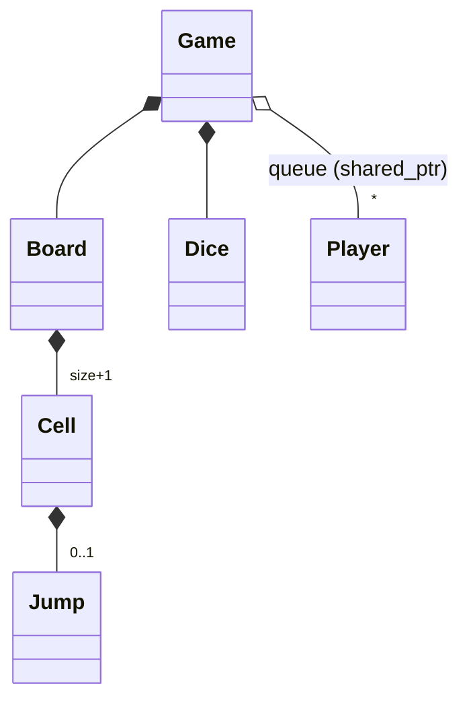

# Snakes and Ladders (Concept && Coding version) - C++

A second implementation of the same question. **To learn how to deliver the question in an interview, read [`../snakes_and_ladder/README.md`](../snakes_and_ladder/README.md)**: requirements, entities, the turn logic and the follow-ups are the same.

This README covers only what's different here: how this design compares, what it does better, where it breaks, and how to run it. Everything matches the C++ code in this folder.

---

## 1. How this version differs

| Topic | Main version (`snakes_and_ladder`) | This version |
|---|---|---|
| Snakes vs ladders | `Obstacle` base with `Snake` and `Ladder` subclasses | One `Jump` class; the type is worked out from the direction (`end > start` = ladder) |
| Board | N x N grid (cells 1..N²), drawn zig-zag | A plain line of `size` cells (1..size); the display lists the jumps |
| Placing jumps | `addSnake` / `addLadder`, no validation | Either **random** (avoids cell 1, the last cell and used cells) or **predefined lists**, each jump checked for range and direction |
| Ownership | Raw `new` / `delete` | `std::unique_ptr` everywhere (`Cell` owns its `Jump`, `Board` owns cells, `Game` owns board and dice); players are `std::shared_ptr` |
| Copying a game | Compiles, then corrupts the heap | Doesn't compile: `unique_ptr` members make `Game` move-only |
| Playing | `startGame()` runs the whole game | `playTurn()` plays **one turn** and returns the player; `play()` loops to the end; `playWithLimit(n)` stops after n turns |
| Dice | One or more 1..6 dice, seeded from `std::random_device` | Count and range configurable, seeded from the system clock |
| End of game | Return from `startGame()` | `gameOver` flag + stored `winner` |

**Which to present in an interview?** This version already picks several of the stronger options from the main README's decision boxes: one `Jump` class instead of two identical subclasses, `unique_ptr` ownership, a one-turn-at-a-time API, and validation of each jump. Present that, plus the fixes from the gaps table below.

---

## 2. Design at a glance

| Class | Responsibility |
|---|---|
| `Game` | Owns board and dice; queue of players; `playTurn()`, `play()`, `playWithLimit(maxTurns)`, `addPlayer`, `getWinner`. |
| `Board` | `size` cells; builds jumps randomly or from lists; `getFinalPosition(pos)`, `isWinningPosition(pos)`, `displayBoard()`. |
| `Cell` | Position + optional owned `Jump`; `getFinalPosition()`. |
| `Jump` | start, end, `JumpType` (SNAKE / LADDER) from the direction. |
| `Dice` | `numberOfDice` dice in `[minValue, maxValue]`; `rollDice()`. |
| `Player` | id, name, current position (0 = off the board). |



---

## 3. Key code

### One `Jump` class

```cpp
// Jump.hpp
Jump(int start, int end)
    : startPosition(start), endPosition(end) {
    // Automatically determine type based on positions
    type = (end > start) ? JumpType::LADDER : JumpType::SNAKE;
}
```

Snakes and ladders behave the same ("go from start to end"), so one class with the type derived from the direction is all the game needs.

### One turn

**Core logic:** take the front player, roll, stay put on an overshoot, apply at most one jump, check for the win, otherwise send the player to the back of the queue.

```cpp
// Game.hpp
// Get current player
auto currentPlayer = players.front();
players.pop();

turnCount++;
int currentPos = currentPlayer->getCurrentPosition();
int diceValue = dice->rollDice();
// ... prints the roll

int newPos = currentPos + diceValue;

// Check if move is valid
if (newPos > board->getSize()) {
    std::cout << "Cannot move! Need exact roll to reach " << board->getSize() << std::endl;
    players.push(currentPlayer);
    return currentPlayer;
}

// Check for snake or ladder
int finalPos = board->getFinalPosition(newPos);
// ... prints "Snake bite" or "Ladder"

currentPlayer->moveTo(finalPos);

// Check for win
if (board->isWinningPosition(finalPos)) {
    winner = currentPlayer;
    gameOver = true;
    // ... prints the winner
    return currentPlayer;
}

// Add player back to queue for next turn
players.push(currentPlayer);
return currentPlayer;
```

Because one turn is its own public method, a UI or a test can drive the game step by step, and `playWithLimit` can stop a game that would otherwise never end.

### Random board generation (ladders)

```cpp
// Board.hpp
std::set<int> usedPositions;
usedPositions.insert(0);  // Don't use position 0
usedPositions.insert(1);  // Don't start with jump at 1
usedPositions.insert(size);  // Don't put anything at final position

// Add Ladders (start < end)
int laddersAdded = 0;
while (laddersAdded < numLadders) {
    std::uniform_int_distribution<int> startDist(2, size - 2);
    int start = startDist(rng);

    if (usedPositions.count(start)) continue;

    std::uniform_int_distribution<int> endDist(start + 1, size - 1);
    int end = endDist(rng);

    if (usedPositions.count(end)) continue;

    usedPositions.insert(start);
    usedPositions.insert(end);
    cells[start]->setJump(std::make_unique<Jump>(start, end));
    laddersAdded++;
    // ... prints the ladder
}
```

Snakes are added the same way afterwards, except that **only the snake's start** goes into `usedPositions`, not its end. That's why random boards can still chain (see gaps). The loop retries until it has placed enough jumps, with no limit.

### Predefined boards are checked

```cpp
// Board.hpp
// Add snakes
for (const auto& [start, end] : snakes) {
    if (start > 1 && start < size && end >= 1 && end < start) {
        cells[start]->setJump(std::make_unique<Jump>(start, end));
        std::cout << "Added SNAKE: " << start << " -> " << end << std::endl;
    }
}
```

Each jump must be inside the board, off cell 1 and the last cell, and point the right way. A jump that fails is skipped **without a message**, and a second jump on the same start cell replaces the first.

---

## 4. Verification

The outputs below are from actually running the code; dice and random boards change every run.

```text
Small board (30 cells; snakes 27->5, 21->9, 17->4; ladders 3->22, 8->26, 11->28)
    play() ran to the end: "GAME OVER! Total turns: 8", "Winner: Slow"

Predefined 100-cell board (the same 5 snakes and 5 ladders as the main version)
    "YAY! Ladder at 6! Climbing up to 25", "Player 2 moved to position 25"
    -> 25 is a snake's head, but only one jump is applied (no chaining)
    Player 2 won within the 150-turn limit

Two dice, random board, 50-turn limit
    "Game ended due to turn limit (50)"; DiceRoller1 on 98, DiceRoller2 on 61
```

Edge cases, each run in its own process:

```text
Game(10, 5 snakes, 5 ladders)                 -> never finishes building the board (killed after 5 s)
Game(3, 1, 1)                                 -> segmentation fault
play() with no players                        -> never returns (killed after 5 s)
predefined: snake 5->14, snake 25->2 on 20 cells, ladder 7->4
                                              -> all three skipped, nothing printed
predefined: snake 10->3, then ladder 10->15   -> both print "Added", cell 10 ends up a LADDER
two dice, player on 99 of 100                 -> still on 99 after 2000 turns, game never over
2000 random 100-cell boards, 8 snakes + 8 ladders
                                              -> 550 have a jump ending on another jump's start
```

---

## 5. Gaps in this code

| Gap | What happens | Fix to say |
|---|---|---|
| **Jumps don't chain, and boards allow it** | Only one jump is applied per move. The predefined demo board has ladder 6 -> 25 onto snake 25 -> 2 (the player stayed on 25). Random boards don't reserve **snake ends**, so 550 of 2000 random boards (27.5%) had a jump ending on another jump's start. | Reserve every jump's end as well as its start, and reject predefined boards where an end is another jump's start; or apply jumps in a loop with a cycle guard. |
| **Random generation can loop forever** | Asking for more jumps than the board can hold (5 snakes + 5 ladders on 10 cells) retries forever. | Check up front that `2 * (snakes + ladders)` fits in the free cells, and cap the number of attempts. |
| **Tiny boards crash** | `Game(3, 1, 1)` builds `uniform_int_distribution(2, 1)` (min above max, undefined behaviour) and crashed with a segmentation fault. | Validate the size and counts in the `Board` constructor and throw `std::invalid_argument`. |
| **`play()` with no players never returns** | `playTurn()` returns `nullptr` immediately, `gameOver` stays false, and the loop spins forever. | Refuse to start with fewer than two players (or one, for testing). |
| **With two dice, the cell before the last is a trap** | The smallest roll is 2, so from 99 you can never land exactly on 100: the player stayed on 99 for 2000 turns. With k dice, any position less than k from the end is stuck. | Bounce back on overshoot, or let a player finish with any roll that reaches or passes the end; at least tell the interviewer this rule interaction exists. |
| **Invalid or duplicate predefined jumps are silent** | Bad jumps are skipped with no message; a second jump on a cell silently replaces the first (both print "Added"). | Throw on an invalid jump and on a start cell that's already taken, so mistakes in the configuration are visible. |
| **Not reproducible** (by reading) | Dice and random boards are seeded from the system clock, and neither can be replaced. Tests can't force a roll or a board. | Accept a seed (or a dice interface) through the constructor. |

---

## 6. Test yourself

<details><summary>1. How does one <code>Jump</code> class replace separate Snake and Ladder classes?</summary>

Both mean "move from start to end". The constructor sets the type from the direction: `end > start` is a ladder, otherwise a snake. The game logic never needs to know which it is except for the message.
</details>

<details><summary>2. Why is a public <code>playTurn()</code> better than one method that plays the whole game?</summary>

A UI or network game can play one turn per user action, a test can play exactly N turns, and `playWithLimit` can stop a game that would never end.
</details>

<details><summary>3. Why can random boards still produce chained jumps?</summary>

Ladder ends are reserved, but snake ends aren't. A later snake can start on an earlier snake's tail, and a player sliding down then stops on another snake's head (550 of 2000 random boards in our test).
</details>

<details><summary>4. Why can a two-dice game get stuck forever?</summary>

The smallest total of two dice is 2. Exact landing is required, so from one cell before the end there's no legal roll that finishes. Fix the rule (bounce back or allow overshoot) or account for it in the board design.
</details>

<details><summary>5. What does making every member a <code>unique_ptr</code> buy over the main version's raw pointers?</summary>

Automatic cleanup in the right order, no leaks, and copying the game no longer compiles, which turns the main version's heap-corruption bug into a compile error.
</details>

<details><summary>6. What should the <code>Board</code> constructor validate?</summary>

A sensible size; that the requested number of jumps fits; for predefined jumps, that each is in range, points the right way, doesn't share a start cell with another, and doesn't end on another jump's start.
</details>

---

## 7. Run it

```bash
cd lld/ConceptCoding_snakes_and_ladder
g++ -std=c++17 main.cpp -o snakes_and_ladder_cc
./snakes_and_ladder_cc
```

It plays three games: a 30-cell board to the end, the predefined 100-cell board (150-turn limit), and a random board with two dice (50-turn limit). Rolls and random boards differ on every run. The banner uses emoji, which may show as odd characters on a Windows console.

### Files

```text
ConceptCoding_snakes_and_ladder/
├── main.cpp       three games: small board, predefined board, two dice
├── Game.hpp       owns board + dice, player queue, playTurn / play / playWithLimit
├── Board.hpp      cells 1..size, random or predefined jumps, getFinalPosition
├── Cell.hpp       position + owned Jump
├── Jump.hpp       start, end, SNAKE/LADDER from the direction
├── Dice.hpp       count + range, clock-seeded
└── Player.hpp     id, name, position
```
