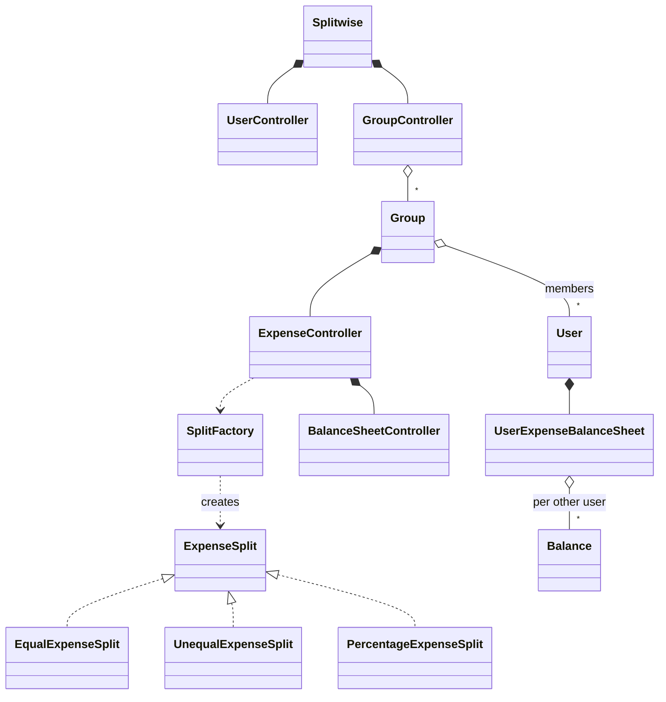

# Splitwise (Concept && Coding version) - C++

A second implementation of the same question. **To learn how to deliver the question in an interview, read [`../splitwise/README.md`](../splitwise/README.md)**: requirements, the balance model, split strategies, debt simplification and the follow-ups are the same.

This README covers only what's different here: how this design compares, what it does better, where it breaks, and how to run it. Everything matches the C++ code in this folder.

---

## 1. How this version differs

| Topic | Main version (`splitwise`) | This version |
|---|---|---|
| Who computes the shares | The **strategy computes** them from the amount and participants | The **caller computes** them; the strategy only **validates** |
| Validation | None (percentages adding to 80% are accepted) | **Throws `std::invalid_argument`** before any balance changes |
| Split types | EQUAL, PERCENTAGE | EQUAL, **UNEQUAL** (exact amounts), PERCENTAGE |
| Where balances live | One `BalanceSheet` per member **per group** | One `UserExpenseBalanceSheet` per **user, across all groups** |
| Pairwise balance | One signed number per pair (+ = they owe me) | A `Balance` with separate **`amountOwe` and `amountGetBack`, never netted** |
| Debt simplification | Greedy max-heap matching | **None** |
| Structure | `GroupService` + repository | **`Splitwise` facade + controllers** (User, Group, Expense, BalanceSheet) |
| Ownership | Raw `User*`, `Expense` created with `new` and never freed | **`std::shared_ptr` everywhere**, nothing leaks |
| Money | `double` | `double`, compared with a 0.01 tolerance |

**Which to present in an interview?** The main version's balance model (per group, one signed number per pair, nets that sum to zero, greedy simplification) with this version's validation-before-update, its UNEQUAL split, and its ownership.

---

## 2. Design at a glance

| Class | Responsibility |
|---|---|
| `Splitwise` | Facade: owns the user, group and balance-sheet controllers; `demo()`. |
| `UserController`, `GroupController` | Lists of users and groups; look up by id. |
| `Group` | Members, expenses, and an `ExpenseController` to create expenses. |
| `ExpenseController` | Validate the split with the right strategy, create the `Expense`, update balance sheets. |
| `SplitFactory` + `ExpenseSplit` (Equal, Unequal, Percentage) | Strategy: `validateSplitRequest(splits, total)`. |
| `BalanceSheetController` | Apply an expense to every involved user's sheet; print a sheet. |
| `User` | id, name, and its own `UserExpenseBalanceSheet`. |
| `UserExpenseBalanceSheet` | totals (expense, payment, you owe, you get back) + map userId -> `Balance`. |
| `Balance` | `amountOwe` and `amountGetBack` with one other user. |
| `Expense`, `Split` | The bill; one user's share. |



---

## 3. Key code

### Validate first, then update

```cpp
// Expense/ExpenseController.hpp
// Use Strategy Pattern: Get appropriate split validator
auto expenseSplit = SplitFactory::getSplitObject(splitType);

// Validate the split request
expenseSplit->validateSplitRequest(splitDetails, expenseAmount);

// Create the expense
auto expense = std::make_shared<Expense>(
    expenseId, expenseAmount, description,
    paidByUser, splitType, splitDetails);

// Update balance sheets for all involved users
balanceSheetController.updateUserExpenseBalanceSheet(
    paidByUser, splitDetails, expenseAmount);
```

If validation throws, nothing has been changed and no expense is stored. That's the property the main version lacks.

### The validators

```cpp
// Expense/Split/UnequalExpenseSplit.hpp
double sum = 0.0;
for (const auto& split : splitList) {
    if (split->getAmountOwe() < 0) {
        throw std::invalid_argument("Split amount cannot be negative");
    }
    sum += split->getAmountOwe();
}

const double epsilon = 0.01; // Tolerance for floating point comparison
if (std::abs(sum - totalAmount) > epsilon) {
    throw std::invalid_argument(
        "Invalid unequal split: Sum of splits (" + std::to_string(sum) +
        ") doesn't match total amount (" + std::to_string(totalAmount) + ")");
}

// Expense/Split/PercentageExpenseSplit.hpp
double totalPercentage = 0.0;
for (const auto& split : splitList) {
    double percentage = (split->getAmountOwe() / totalAmount) * 100.0;
    if (percentage < 0 || percentage > 100) {
        throw std::invalid_argument("Percentage must be between 0 and 100");
    }
    totalPercentage += percentage;
}
```

EQUAL checks every share is within 0.01 of `total / n`, so 100 as 33.33 + 33.33 + 33.34 passes. PERCENTAGE divides each share by the total: it expects **amounts**, even though its comment says the share "represents the percentage" (see gaps).

### Two numbers per pair

```cpp
// BalanceSheetController.hpp
userOweBalance->setAmountGetBack(
    userOweBalance->getAmountGetBack() + oweAmount);
// ...
userPaidBalance->setAmountOwe(
    userPaidBalance->getAmountOwe() + oweAmount);
```

Each pair accumulates "get back" and "owe" separately. If you owe someone 400 and they owe you 300, both numbers stay on the sheet; nothing computes that you owe 100.

---

## 4. Verification

The outputs below are from actually running the code.

**Demo**: User1 pays breakfast 900, EQUAL 300 each; User2 pays lunch 500, UNEQUAL User1 400 / User2 100.
```text
User1: TotalYourExpense 700  TotalGetBack 600  TotalYouOwe 400  TotalPaymentMade 900
       U3001 YouGetBack 300 YouOwe 0
       U2001 YouGetBack 300 YouOwe 400          <- net: User1 owes User2 100, not shown
User2: TotalYourExpense 400  TotalGetBack 400  TotalYouOwe 300  TotalPaymentMade 500
User3: TotalYourExpense 300  TotalGetBack 0    TotalYouOwe 300  TotalPaymentMade 0
nets (payment - expense): +200, +100, -300 -> sum 0
```

**Edge cases** (separate test program)
```text
PERCENTAGE of 1000 as 25 / 25 / 50     -> rejected: "Total percentage must equal 100%, got 10.000000%"
PERCENTAGE of 1000 as 250 / 250 / 500  -> accepted (it wants amounts)
EQUAL with total -300, shares -150 / -150 -> accepted; payer's TotalPayment becomes -300
UNEQUAL with a negative share          -> rejected: "Split amount cannot be negative"
PERCENTAGE with total 0, shares 0 / 0  -> accepted (0/0 is NaN; every comparison is false)
EQUAL 100 as 33.33 / 33.33 / 33.34     -> accepted (0.01 tolerance)
UNEQUAL 300 with a non-member owing 100 -> accepted; the non-member owes 100
empty split list                       -> rejected: "Split list cannot be empty"
M and N share a trip (M pays 200) and a flat (N pays 600)
    -> M's entry for N: getBack 100, owe 300 (net M owes 200); one sheet mixes both groups
```

---

## 5. Gaps in this code

| Gap | What happens | Fix to say |
|---|---|---|
| **PERCENTAGE expects amounts** | Passing 25 / 25 / 50 was rejected ("got 10%"); passing the amounts 250 / 250 / 500 was accepted. It's UNEQUAL with a 0-100% range check, and the balance sheet always treats the share as an amount. | Accept real percentages and convert them to amounts before updating balances (or drop the type and use UNEQUAL). |
| **Pairwise balances are never netted** | User1's line for User2 shows "get back 300, owe 400" instead of "owes 100"; totals `TotalYouOwe` and `TotalGetBack` aren't netted either. | One signed number per pair, as in the main version. |
| **Balances are per user, not per group** | A sheet adds up every group the user is in; you can't see what's owed within the trip vs the flat. | A balance sheet per (group, user). |
| **Negative and zero totals get through** | EQUAL with total -300 was accepted (payment -300). PERCENTAGE with total 0 was accepted because `0/0` is NaN. | Reject `total <= 0` before choosing a validator. |
| **Members aren't checked** | A user outside the group was made to owe 100 for a group expense. | Check the payer and every split user are group members. |
| **No debt simplification or settle-up** (by reading) | There's no "who pays whom" list and no way to record a repayment. | Greedy creditor/debtor matching and `recordPayment`, as in the main version. |
| **Duplicate ids** (by reading) | Expense ids and group ids are caller-supplied and never checked; `getGroup` returns the first match. | Generate ids, or reject duplicates. |

---

## 6. Test yourself

<details><summary>1. What's the difference between "compute shares" and "validate shares"?</summary>

The main version's strategy takes the total and participants and produces the shares. Here the caller supplies the shares and the strategy only checks them (all equal, adding up to the total, ...). Validating is safer to combine with user input; computing is more convenient for EQUAL and PERCENTAGE.
</details>

<details><summary>2. Why does validation before updating balances matter?</summary>

If validation fails after some balances were already changed, the books are half-updated. Here validation throws before anything is touched and before the expense is stored.
</details>

<details><summary>3. Why is "get back 300, owe 400" a worse model than one signed number?</summary>

The user has to do the subtraction, and the totals overstate how much money changes hands. A single signed value per pair (+ they owe me, - I owe them) gives the net directly.
</details>

<details><summary>4. Why did a PERCENTAGE split with total 0 pass validation?</summary>

`0 / 0` is NaN, and every comparison with NaN (`< 0`, `> 100`, `> epsilon`) is false, so no check fires. Reject `total <= 0` up front.
</details>

<details><summary>5. What changes if balances live on the user instead of per group?</summary>

One sheet sums every group, so per-group views and settling up one group (say, the trip) aren't possible. Per (group, user) sheets keep them apart.
</details>

<details><summary>6. What would you take from each version for an interview answer?</summary>

From the main version: per-group sheets, one signed number per pair, nets summing to zero, greedy simplification. From this one: validate before updating, UNEQUAL split, `shared_ptr` ownership.
</details>

---

## 7. Run it

```bash
cd lld/ConceptCoding_splitwise
g++ -std=c++17 main.cpp -o splitwise_cc
./splitwise_cc
```

It runs the built-in demo (3 users, 2 expenses) and an extended demo (4 users, 3 expenses), printing every user's balance sheet. Expected start:

```text
Running Splitwise Demo...

---------------------------------------
Balance sheet of user: U1001 (User1)
TotalYourExpense: 700
TotalGetBack: 600
TotalYouOwe: 400
TotalPaymentMade: 900
...
```

The order of the per-user lines (`UserID: ...`) can vary, because they come from an `unordered_map`.

### Files

```text
ConceptCoding_splitwise/
├── main.cpp                      built-in demo + extended 4-person demo
├── Splitwise.hpp                 facade: controllers + demo()
├── BalanceSheetController.hpp    apply an expense to balance sheets; print a sheet
├── UserExpenseBalanceSheet.hpp   per-user totals + userId -> Balance
├── Balance.hpp                   amountOwe, amountGetBack
├── User/                         User, UserController
├── Group/                        Group, GroupController
└── Expense/
    ├── Expense.hpp, ExpenseController.hpp, ExpenseSplitType.hpp, SplitFactory.hpp
    └── Split/                    Split, ExpenseSplit (interface), Equal / Unequal / Percentage validators
```
