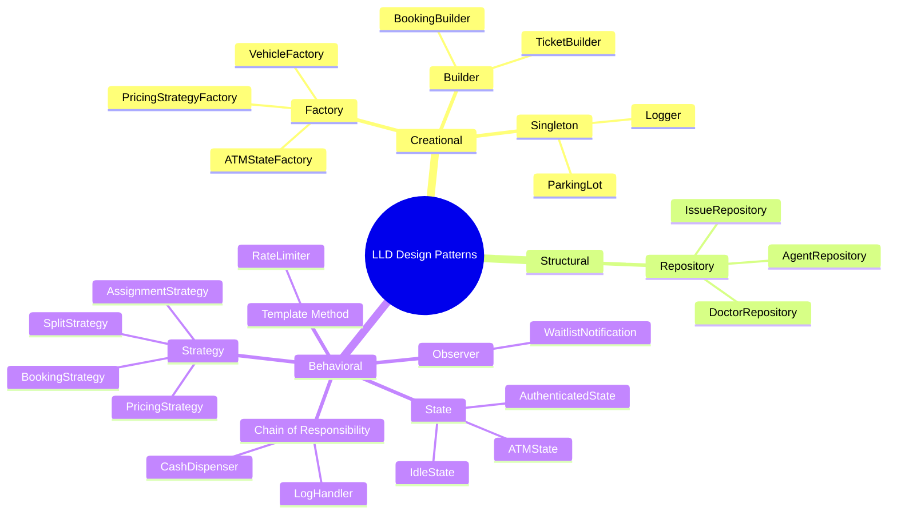
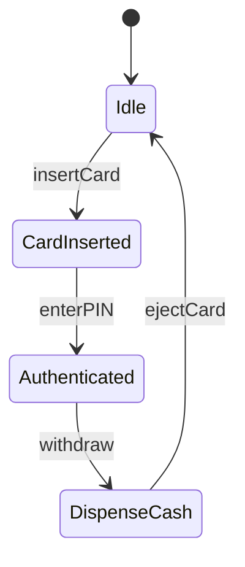
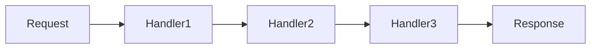
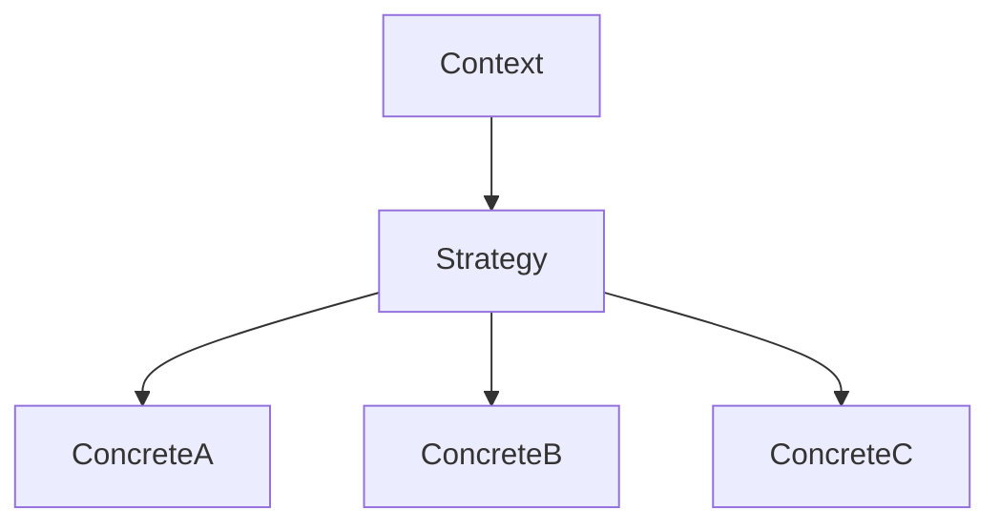
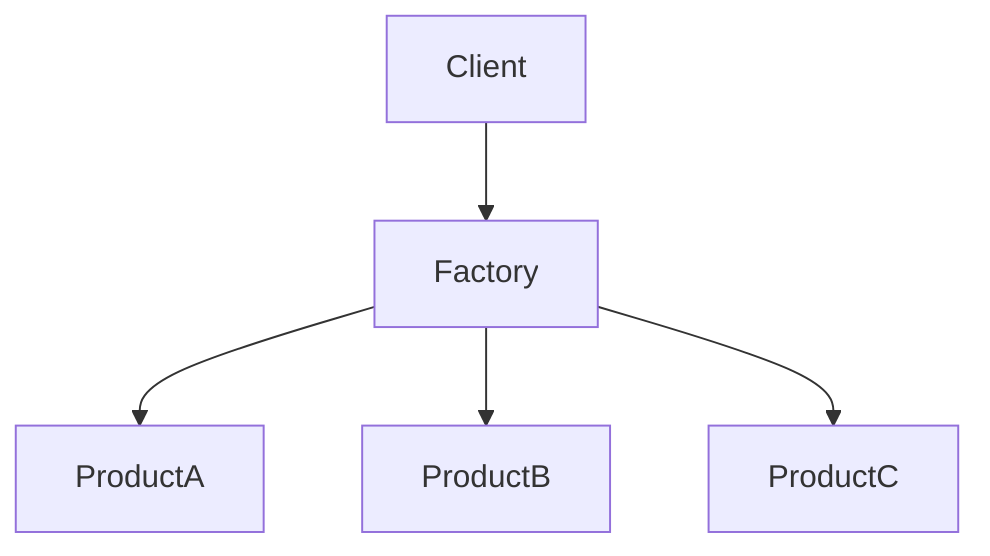
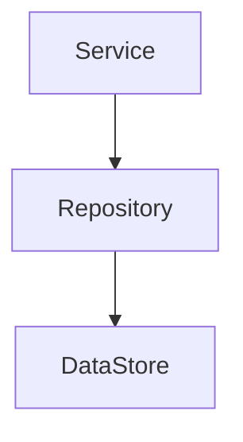

# C++ Low Level Design

Folders prefixed with `ConceptCoding_` are the Concept && Coding version of a question that also has its own folder here.

---

# Low Level Design (LLD) - C++ Implementations

This repository contains C++ implementations of common Low Level Design problems, converted from Java. Each implementation includes comprehensive Mermaid diagrams for visual understanding.

## Projects Overview

| # | Project | Design Patterns | Key Concepts |
|---|---------|-----------------|--------------|
| 1 | [ATM](./atm/) | State, Chain of Responsibility, Factory | State machine, Cash dispensing chain |
| 2 | [Parking Lot](./parking_lot/) | Singleton, Factory, Strategy | Multi-floor parking, Payment strategies |
| 3 | [Logger](./logger/) | Chain of Responsibility, Observer | Log levels, Multiple appenders |
| 4 | [Rate Limiter](./rate_limiter/) | Strategy, Factory | Token bucket, Sliding window |
| 5 | [Snakes & Ladder](./snakes_and_ladder/) | Factory, Template Method | Board game, Obstacle handling |
| 6 | [Splitwise](./splitwise/) | Strategy, Repository | Expense splitting, Debt simplification |
| 7 | [HashMap](./hashmap/) | Data Structure | Separate chaining, Rehashing |
| 8 | [Car Rental](./car_rental/) | Strategy, Factory, Repository | Vehicle booking, Pricing strategies |
| 9 | [Customer Support](./customer_support/) | Strategy, Repository | Agent assignment, Waitlist management |
| 10 | [Doctor Appointment](./doctors_appointment/) | Strategy, Repository | Slot booking, Waitlist notification |

## Design Patterns Summary



## Common C++ Features Used

- **C++17 Features**: `std::optional`, `inline static`, structured bindings
- **Smart Pointers**: `std::unique_ptr`, `std::shared_ptr` for memory management
- **Threading**: `std::mutex`, `std::atomic` for thread safety
- **STL Containers**: `std::unordered_map`, `std::vector`, `std::queue`, `std::priority_queue`
- **Templates**: Generic implementations (HashMap, etc.)

## Project Structure

Each project follows this structure:
```
project_name/
├── enums/           # Enumeration types
├── model/           # Domain models
├── strategy/        # Strategy pattern implementations
├── factory/         # Factory pattern implementations
├── repository/      # Data access layer
├── service/         # Business logic
├── README.md        # Design documentation with Mermaid diagrams
└── main.cpp         # Demo/entry point
```

## How to Compile

Each project can be compiled using a C++17 compatible compiler:

```bash
# Navigate to project directory
cd atm

# Compile with g++
g++ -std=c++17 -o main main.cpp

# Run
./main
```

## Mermaid Diagrams

Each project's README.md contains:
- **Class Diagram**: Shows relationships between classes
- **Sequence Diagram**: Illustrates flow of operations
- **State Diagram**: For state machine implementations
- **Flowchart**: Process flow visualizations

To view Mermaid diagrams:
1. Open README.md in VS Code with Mermaid extension
2. View in GitHub (native support)
3. Use Mermaid Live Editor: https://mermaid.live

## Design Pattern Details

### 1. State Pattern (ATM)


### 2. Chain of Responsibility (Logger, ATM Cash Dispenser)


### 3. Strategy Pattern (Pricing, Booking, Assignment)


### 4. Factory Pattern (Vehicle, State, Strategy creation)


### 5. Repository Pattern (Data Access)


## Learning Objectives

After studying these implementations, you will understand:

1. **SOLID Principles** applied in real scenarios
2. **Design Pattern** selection and implementation
3. **Thread Safety** considerations in concurrent systems
4. **Clean Architecture** with separation of concerns
5. **Modern C++** idioms and best practices

## Contributing

Feel free to:
- Add new LLD problems
- Improve existing implementations
- Enhance Mermaid diagrams
- Add unit tests

## License

MIT License - Feel free to use for learning and interviews!

---

# Low Level Design (LLD) - C++ Implementation

## 📚 Complete LLD Interview Preparation Guide

This repository contains C++ implementations of common Low Level Design problems with:
- ✅ Complete C++ source code (C++17)
- ✅ UML Class Diagrams (ASCII art)
- ✅ Interview Preparation Guides (Bottom-up approach)
- ✅ Design Pattern explanations

---

## 📁 Directory Structure

```
cpp/
├── DesignPatterns/
│   ├── AdapterPattern/          # Convert interface to another
│   ├── BuilderPattern/          # Step-by-step construction
│   ├── ChainOfResponsibility/   # Pass request along chain
│   ├── CompositePattern/        # Tree structures (files/folders)
│   └── FlyweightPattern/        # Share objects to save memory
│
├── DesignVendingMachine/        # State Pattern
├── DesignATM/                   # State + Singleton + Chain of Responsibility
├── DesignBookMyShow/            # Movie ticket booking
├── DesignSplitwise/             # Expense sharing (Strategy Pattern)
├── DesignOrderManagementSystem/ # E-commerce order flow
│
├── LLDElevatorDesign/           # Elevator scheduling
├── LLDCarRentalSystem/          # Vehicle rental
├── LLDCricbuzz/                 # Cricket score (Observer Pattern)
├── LLDSnakeLadder/              # Board game
├── LLDTicTacToe/                # Board game
│
├── DesignDataStructures/        # Custom HashMap
└── HandleNullObject/            # Null Object Pattern
```

---

## 🎯 Design Patterns Used

| Pattern | Systems | Key Concept |
|---------|---------|-------------|
| **State** | VendingMachine, ATM | Object behavior changes with state |
| **Singleton** | ATM, Controllers | Single instance |
| **Chain of Responsibility** | ATM (cash dispense), Logging | Pass request along chain |
| **Strategy** | Splitwise, Order Management | Interchangeable algorithms |
| **Observer** | Cricbuzz | Event notification |
| **Factory** | VehicleFactory, SplitFactory | Object creation |
| **Composite** | FileSystem | Tree structure |
| **Flyweight** | Robots, Characters | Share heavy objects |
| **Adapter** | WeightMachine | Interface conversion |
| **Builder** | Student | Step-by-step construction |
| **Null Object** | NullVehicle | Avoid null checks |
| **Facade** | BookMyShow, OrderSystem | Simplified interface |

---

## 📖 How to Use for Interview Preparation

### Bottom-Up Approach (Recommended)

1. **Start with Entities** (5 min)
   - Identify core entities (User, Item, Order)
   - Define their attributes and relationships

2. **Add Behaviors** (5 min)
   - What operations does each entity support?
   - Who owns what behavior?

3. **Identify Patterns** (5 min)
   - Does behavior change with state? → **State Pattern**
   - Multiple ways to do same thing? → **Strategy Pattern**
   - Notify multiple objects? → **Observer Pattern**

4. **Connect Components** (5 min)
   - Controllers, Services, Facades
   - Define APIs and interactions

### For Each System, Study:

```
📁 SystemName/
├── *.hpp, *.cpp      # Source code
├── UML_DIAGRAM.md    # Class relationships
└── INTERVIEW_GUIDE.md # How to explain in interview
```

---

## 🚀 Quick Start

### Compile and Run (Windows with g++)

```powershell
cd "cpp\DesignVendingMachine"
g++ -std=c++17 -o vending.exe main.cpp VendingMachine.cpp
.\vending.exe
```

### Compile (Linux/Mac)

```bash
cd vending_machine
g++ -std=c++17 -o vending main.cpp VendingMachine.cpp
./vending
```

---

## 🎤 Interview Cheat Sheet

### 1. Vending Machine
**Patterns:** State Pattern
**Key Classes:** VendingMachine, State, IdleState, HasMoneyState, SelectionState, DispenseState
**Flow:** Insert Coin → Select Product → Validate Payment → Dispense

### 2. ATM Machine
**Patterns:** State + Singleton + Chain of Responsibility
**Key Classes:** ATM, ATMState, CashWithdrawProcessor
**Flow:** Insert Card → Enter PIN → Select Operation → Execute → Return Card

### 3. BookMyShow
**Patterns:** Facade, Singleton Controllers
**Key Classes:** Movie, Theatre, Show, Seat, Booking
**Flow:** Select City → Select Movie → Select Show → Select Seats → Pay → Confirm

### 4. Splitwise
**Patterns:** Strategy (for split types)
**Key Classes:** User, Group, Expense, Split, ExpenseSplit
**Flow:** Create Group → Add Members → Add Expense → Calculate Splits → Update Balances

### 5. Elevator System
**Patterns:** State, Observer, Strategy
**Key Classes:** Building, Floor, ElevatorCar, ElevatorController, Dispatcher
**Algorithm:** LOOK algorithm for scheduling

### 6. Car Rental
**Patterns:** Factory, Strategy
**Key Classes:** Vehicle, Store, Reservation, Bill
**Flow:** Search Store → Select Vehicle → Reserve → Pay → Return

---

## 📊 Complexity Summary

| System | # Classes | Patterns | Difficulty |
|--------|-----------|----------|------------|
| Vending Machine | 10 | State | ⭐⭐ |
| ATM | 15 | State, CoR, Singleton | ⭐⭐⭐ |
| BookMyShow | 12 | Facade | ⭐⭐⭐ |
| Splitwise | 16 | Strategy, Factory | ⭐⭐⭐ |
| Elevator | 15 | State, Observer | ⭐⭐⭐⭐ |
| Car Rental | 18 | Factory, Strategy | ⭐⭐⭐ |
| Cricbuzz | 20 | Observer, Template | ⭐⭐⭐⭐ |
| Order Management | 20 | Strategy, Facade | ⭐⭐⭐⭐ |
| Snake &amp; Ladder | 6 | - | ⭐⭐ |
| TicTacToe | 8 | - | ⭐⭐ |

---

## 💡 Tips for LLD Interviews

1. **Always clarify requirements** before coding
2. **Start with core entities** - identify nouns in problem
3. **Think about relationships** - has-a, is-a
4. **Identify patterns** - don't force them
5. **Consider extensibility** - what might change?
6. **Discuss trade-offs** - why this design?
7. **Draw diagrams** - boxes and arrows help
8. **Write clean code** - names matter!

---

## 📝 License

Educational purposes only. Use for interview preparation.

---

**Happy Coding! 🎉**
