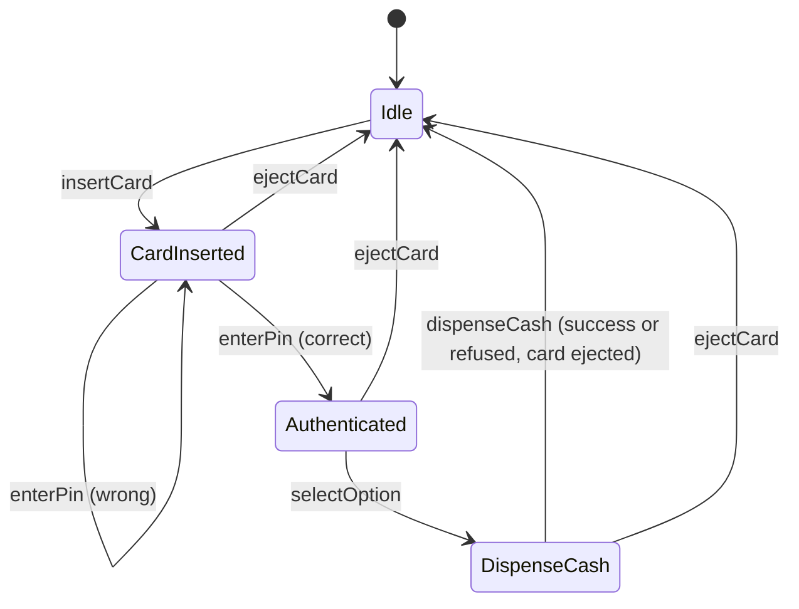
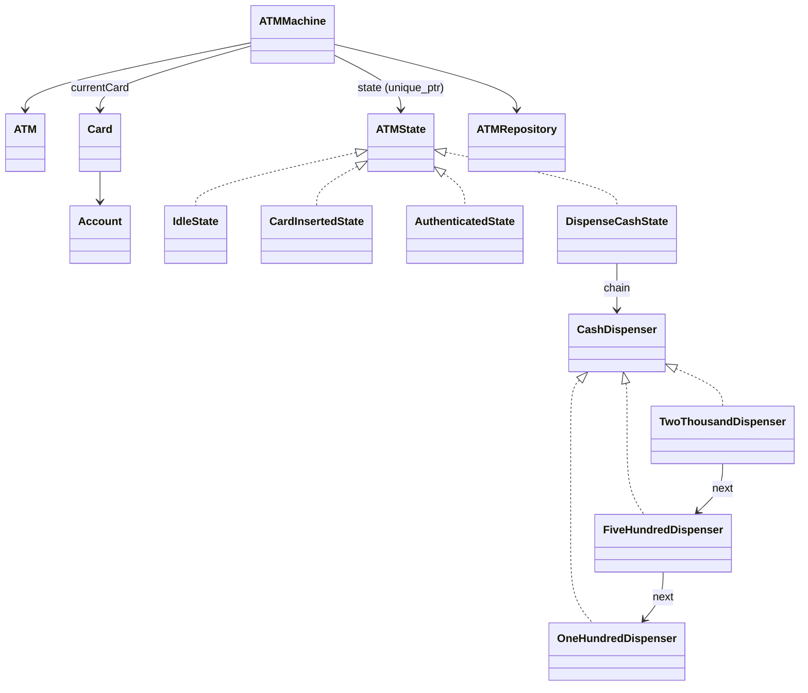

# ATM - Low Level Design (C++)

An ATM that lets a card holder withdraw cash: insert card, enter PIN, choose withdrawal, enter an amount, receive notes (Rs 2000, 500, 100), card ejected. The machine's behaviour depends on the step it's in (State pattern), and the notes are worked out by a chain of dispensers, one per denomination (Chain of Responsibility).

This README walks the question the way you should deliver it in an interview: **Requirements -> Entities -> Class Design -> Implementation -> Extensibility**. Everything here matches the C++ code in this folder.

| Step | Time (45 min interview) | Section |
|---|---|---|
| Understand + clarify | 5 min | [1. Requirements](#1-requirements) |
| Pick the objects, draw the states | 3-5 min | [2. Entities](#2-entities-and-relationships) |
| States + the note-dispensing chain | 10 min | [3. Class design](#3-class-design) |
| Write the transitions and `dispenseCash` | 15-20 min | [4. Implementation](#4-implementation), [5. Verification](#5-verification) |
| "What if..." | 5+ min | [6. Extensibility](#6-extensibility) |

---

## 0. Understanding the problem

An ATM is two small problems glued together:
1. **A flow with strict order**: you can't enter a PIN without a card, or withdraw before the PIN is right. That's a state machine.
2. **Making an amount out of notes**: Rs 3700 from a cassette of 2000s, 500s and 100s, using what the machine actually holds, and refusing if it can't be done exactly.

The interviewer usually opens with:

> "Design an ATM. Users insert a card, enter a PIN, and withdraw cash. The ATM holds notes of different denominations."

Expect to name two patterns: **State** for the flow, **Chain of Responsibility** for the notes. Then expect questions about what can go wrong: wrong PINs, not enough money, an amount the notes can't make.

---

## 1. Requirements

### Clarifying questions

Group your questions around: **what the system does**, **what can go wrong**, **what's in scope**, and **what might change later**.

**You:** "What does a user do, step by step?"
**Interviewer:** "Insert card, enter PIN, choose withdrawal, enter an amount, take the cash. The card comes out at the end."
> That's the state diagram: Idle -> card inserted -> authenticated -> dispensing -> idle.

**You:** "Which notes does the ATM hold?"
**Interviewer:** "Rs 2000, 500 and 100, a limited number of each."

**You:** "How should an amount be split into notes?"
**Interviewer:** "Use the largest notes first, as far as the machine has them."
> Greedy by denomination. With these notes (each a multiple of the next smaller one) that always finds a split if one exists.

**You:** "What if the amount can't be made exactly, or the ATM or the account doesn't have enough?"
**Interviewer:** "Refuse the withdrawal and eject the card. Never dispense part of it."
> "Never part of it" means: check that the whole amount can be made **before** giving out any notes.

**You:** "What about a wrong PIN?"
**Interviewer:** "Say so and let them try again."
> Ask about lockouts after N attempts; here it's out of scope, and our code has none (see gaps).

**You:** "Can the user cancel?"
**Interviewer:** "Yes, eject the card any time before cash comes out."

**You:** "Balance inquiry, deposits, transfers?"
**Interviewer:** "Only withdrawal for now."

**You:** "Talking to a real bank, several ATMs, receipts?"
**Interviewer:** "Out of scope. The account balance is in memory."

### Final requirements

Write this on the board before moving on:

```text
REQUIREMENTS
1. Flow: insert card -> enter PIN -> select withdrawal -> enter amount -> dispense -> eject card
2. ATM holds a limited number of Rs 2000, 500 and 100 notes
3. Split the amount greedily, largest notes first, using only notes the ATM has
4. Refuse (and eject) if: amount is not positive, ATM cash too low, account balance too low,
   or the notes can't make the exact amount; never dispense part of an amount
5. Wrong PIN: tell the user, let them retry
6. Eject the card at any point before dispensing
7. On success: dispense the notes, reduce the account balance and the ATM's note counts

OUT OF SCOPE
- Balance inquiry, deposits, transfers, PIN lockout, receipts
- Real bank connection, several ATMs sharing accounts
```

---

## 2. Entities and relationships

Look for nouns in the requirements, but don't make every noun a class. Ask of each one: **does it have state that changes, or behavior we own?**

- **ATM** - the physical machine's data: id, note counts per denomination, current status. `ATM`.
- **The machine's controller** - holds the current state, the inserted card, and forwards every user action to the state. `ATMMachine` (the State pattern's context).
- **States** - `IdleState`, `CardInsertedState`, `AuthenticatedState`, `DispenseCashState`, all implementing `ATMState`. An enum `ATMStatus` names them too, so the ATM's status can be stored.
- **Card and account** - a card has a number, a PIN and an account; an account has a balance. `Card`, `Account`.
- **Note dispensing** - one handler per denomination, linked largest to smallest: `CashDispenser` with `TwoThousandDispenser`, `FiveHundredDispenser`, `OneHundredDispenser`, built by `CashDispenserChainBuilder`.
- **Where ATMs are kept** - `ATMRepository` (find an ATM by id).
- **Making a state from a status** - `ATMStateFactory`.



| Entity | Responsibility |
|---|---|
| `ATMMachine` | Context: ATM, current state, current card, repository. Forwards `insertCard`, `enterPin`, `selectOption`, `dispenseCash`, `ejectCard` to the state; `setState` also records the status on the ATM. |
| `ATMState` (interface) + 4 states | What each action means in that step, and the next state. |
| `ATM` | id, counts of 2000 / 500 / 100 notes, `getCashAvailable()`, status. |
| `Card`, `Account` | Card number, PIN, account; balance. |
| `CashDispenser` (interface) + 3 dispensers | `canDispense(atm, amount)` (dry run), `dispense(atm, amount)`; pass the remainder to the next. |
| `CashDispenserChainBuilder` | Links 2000 -> 500 -> 100 and returns the head. |
| `ATMRepository` | ATMs by id. |
| `ATMStateFactory` | `ATMStatus` -> state object. |



> [!NOTE]
> **Decision: State pattern, or an enum and switch statements?**
> - **Good: an `ATMStatus` enum and a `switch` in every action.** Fine for a couple of states; each new state edits every method.
> - **Great (our choice): the State pattern.** One class per step decides what each action means there and which step comes next. "Wrong PIN, try again" lives in `CardInsertedState` only. Our code also keeps the `ATMStatus` enum, so the ATM can record which state it's in.

> [!TIP]
> **Say in the interview:** "The ATM's behaviour depends on the step, so each step is a State class; the machine forwards every action to the current state and the state decides the next one."

---

## 3. Class design

Work top-down, starting from the context. For each class ask two questions:
1. **State:** what must it remember to enforce the requirements?
2. **Methods:** what operations does the outside world need?

### ATMMachine (the context)

| Requirement | What ATMMachine must track |
|---|---|
| "Behaviour depends on the step" | The current state |
| "PIN check, balance check" | The card currently inserted |
| "Notes the ATM has" | The ATM it controls |

```cpp
class ATMMachine {
    std::shared_ptr<ATM> atm;
    std::unique_ptr<ATMState> state;
    std::shared_ptr<ATMRepository> atmRepository;
    std::shared_ptr<Card> currentCard;
public:
    ATMMachine(const std::string& atmId, std::shared_ptr<ATMRepository> atmRepository);   // starts in Idle
    void insertCard(std::shared_ptr<Card> card);     // each forwards to state->...
    void enterPin(const std::string& pin);
    void selectOption(const std::string& option);
    void dispenseCash(int amount);
    void ejectCard();
    void setState(std::unique_ptr<ATMState> newState);   // also atm->setStatus(...)
};
```

### ATMState and the four states

```cpp
class ATMState {
public:
    virtual void insertCard(std::shared_ptr<Card> card) = 0;
    virtual void enterPin(const std::string& pin) = 0;
    virtual void selectOption(const std::string& option) = 0;
    virtual void dispenseCash(int amount) = 0;
    virtual void ejectCard() = 0;
    virtual ATMStatus getStatus() const = 0;
};
// Each state stores ATMMachine* atmMachine (passed to its constructor)
```

| Action | Idle | CardInserted | Authenticated | DispenseCash |
|---|---|---|---|---|
| insertCard | store card -> CardInserted | "Card already inserted." | "Card already inserted." | "Transaction in progress..." |
| enterPin | "No card inserted." | correct -> Authenticated; wrong -> stay | "Already authenticated." | "Already authenticated." |
| selectOption | "No card inserted." | "Enter PIN first." | -> DispenseCash | "Option already selected." |
| dispenseCash | "No card inserted." | "Enter PIN before dispensing." | "Select an option first." | check, dispense, eject -> Idle |
| ejectCard | "No card to eject." | -> Idle | -> Idle | -> Idle |

Rejected actions print a message and change nothing (no exceptions, unlike the vending machine).

> [!NOTE]
> **Decision: does a state store the machine, or get it on every call?**
> - **Our choice (Good): each state stores an `ATMMachine*`.** Method signatures stay short (`enterPin(pin)`). The cost: every state is tied to one machine, and if the `ATMMachine` object were moved, the states would point at the old address.
> - **Great: pass the machine into every call** (as `vending_machine` does). States then hold no data at all and can't dangle.

### ATM, Card, Account

```cpp
class ATM {
    std::string id;
    int twoThousandNotes, fiveHundredNotes, oneHundredNotes;
    ATMStatus status;
public:
    double getCashAvailable() const;    // 2000*n2000 + 500*n500 + 100*n100
    // getters / setters for each note count and the status
};
class Card    { std::string cardNumber, pin; std::shared_ptr<Account> account; };
class Account { std::string id; double balance; };
```

### The dispensing chain

```cpp
class CashDispenser {
public:
    virtual void setNext(CashDispenser* next) = 0;
    virtual bool canDispense(ATM* atm, int amount) = 0;   // dry run: could the chain make this amount?
    virtual void dispense(ATM* atm, int& amount) = 0;     // take notes, pass the rest on
};
// TwoThousandDispenser -> FiveHundredDispenser -> OneHundredDispenser (built by CashDispenserChainBuilder)
```

Each handler takes as many of its notes as fit and the ATM has, then hands the remainder to the next one.

> [!NOTE]
> **Decision: Chain of Responsibility, or a loop?**
> - **Good: one loop over a sorted list of denominations** (`for (int d : {2000, 500, 100})`). Shorter, and the "chain" is just the list order.
> - **Our choice: one handler class per denomination, linked in a chain.** It's the classic way to show Chain of Responsibility, and a new denomination (say Rs 200) is a new handler inserted in the chain without touching the others. Know that a loop does the same job.

> [!TIP]
> **Say in the interview:** "Each denomination is a link in a chain: it takes as many notes as it can and passes the rest down. A plain loop over denominations would also work; the chain makes adding or reordering denominations a local change."

> [!NOTE]
> **Decision: check first, or dispense and hope?**
> - **Good: dispense greedily and, if money is left over at the end, undo.** Undoing means putting notes back and is easy to get wrong.
> - **Great (our choice): two phases.** `canDispense` runs the whole chain as a dry run (no counts change); only if it says yes does `dispense` run and take the notes. That's what guarantees "never part of an amount".

### Final class design

```text
ATMMachine (context)
    - atm: shared_ptr<ATM>,  state: unique_ptr<ATMState>,  atmRepository,  currentCard: shared_ptr<Card>
    + insertCard, enterPin, selectOption, dispenseCash, ejectCard     -> forwarded to state
    + setState(newState)                                              also records status on the ATM

ATMState (interface)  <- IdleState, CardInsertedState, AuthenticatedState, DispenseCashState
    each holds ATMMachine*;  DispenseCashState also holds the dispenser chain

CashDispenser (interface)  <- TwoThousandDispenser -> FiveHundredDispenser -> OneHundredDispenser
    + setNext(next),  canDispense(atm, amount) -> bool,  dispense(atm, amount&)
CashDispenserChainBuilder  + buildChain() -> head                   static

ATM      - id, twoThousandNotes, fiveHundredNotes, oneHundredNotes, status   + getCashAvailable()
Card     - cardNumber, pin, account          Account - id, balance
ATMRepository  - atms: unordered_map<id, ATM>     + save, getById
ATMStateFactory  + getState(status, machine) -> unique_ptr<ATMState>        static
enum ATMStatus { IDLE, CARD_INSERTED, AUTHENTICATED, DISPENSE_CASH }
```

### Design patterns used

| Pattern | Where | Why | One line to say |
|---|---|---|---|
| State | `ATMState` + 4 states, `ATMMachine` as context | Strict step order; each step owns its rules | "The machine forwards each action to its current state." |
| Chain of Responsibility | 2000 -> 500 -> 100 dispensers | Each denomination handles what it can and passes the rest | "Adding a denomination is adding a link." |
| Factory | `ATMStateFactory`, `CashDispenserChainBuilder` | Build a state from a status; build the chain in one place | "One place knows how to assemble the chain." |
| Repository | `ATMRepository` | Find ATMs by id without knowing the storage | "The machine asks the repository for its ATM." |

---

## 4. Implementation

Before writing code, ask the interviewer: real code, pseudocode, or talk it through? Draw the state diagram, write the transitions, then `dispenseCash` and the chain.

### Transitions

```cpp
// ATMImplementation.cpp
void IdleState::insertCard(std::shared_ptr<Card> card) {
    atmMachine->setCurrentCard(card);
    std::cout << "Card inserted." << std::endl;
    atmMachine->setState(std::make_unique<CardInsertedState>(atmMachine));
}

void CardInsertedState::enterPin(const std::string& pin) {
    if (atmMachine->getCurrentCard()->getPin() == pin) {
        std::cout << "PIN correct. Authenticated." << std::endl;
        atmMachine->setState(std::make_unique<AuthenticatedState>(atmMachine));
    } else {
        std::cout << "Invalid PIN." << std::endl;
    }
}

void AuthenticatedState::selectOption(const std::string& option) {
    std::cout << "Option selected: Withdrawal." << std::endl;
    atmMachine->setState(std::make_unique<DispenseCashState>(atmMachine));
}
```

`selectOption` ignores its argument: every option means withdrawal (see gaps).

### dispenseCash

**Core logic**
1. Refuse amounts of zero or less.
2. Refuse if the ATM's total cash or the account's balance is less than the amount.
3. Dry-run the chain: can the notes make the exact amount?
4. If yes: dispense (note counts go down), reduce the account balance.
5. In every case, eject the card (back to Idle).

```cpp
// ATMImplementation.cpp
void DispenseCashState::dispenseCash(int amount) {
    if (amount <= 0) {
        std::cout << "Invalid amount: " << amount << std::endl;
        ejectCard();
        return;
    }

    double atmBalance = atmMachine->getAtm()->getCashAvailable();
    double accountBalance = atmMachine->getCurrentCard()->getAccount()->getBalance();

    if (amount > atmBalance) {
        std::cout << "ATM has insufficient cash. Cannot dispense " << amount << std::endl;
        ejectCard();
        return;
    }

    if (amount > accountBalance) {
        std::cout << "Insufficient account balance." << std::endl;
        ejectCard();
        return;
    }

    // Check if note combination is possible
    if (chain->canDispense(atmMachine->getAtm().get(), amount)) {
        int amountToDispense = amount;
        chain->dispense(atmMachine->getAtm().get(), amountToDispense);

        // Deduct from account balance
        atmMachine->getCurrentCard()->getAccount()->setBalance(accountBalance - amount);
        // ... prints the new balance
        ejectCard();
    } else {
        std::cout << "Cannot dispense exact amount with available notes." << std::endl;
        ejectCard();
    }
}
```

### The chain

```cpp
// cor/TwoThousandDispenser.hpp
bool canDispense(ATM* atm, int amount) override {
    int notesNeeded = amount / DENOMINATION;
    int notesAvailable = atm->getTwoThousandNotes();
    int notesToUse = std::min(notesNeeded, notesAvailable);
    int remaining = amount - (notesToUse * DENOMINATION);

    if (remaining == 0) return true;
    if (nextDispenser) return nextDispenser->canDispense(atm, remaining);
    return false;
}

void dispense(ATM* atm, int& amount) override {
    int notesNeeded = amount / DENOMINATION;
    int notesAvailable = atm->getTwoThousandNotes();
    int notesToUse = std::min(notesNeeded, notesAvailable);

    if (notesToUse > 0) {
        atm->setTwoThousandNotes(notesAvailable - notesToUse);
        amount -= notesToUse * DENOMINATION;
        std::cout << "Dispensing " << notesToUse << " x Rs.2000 notes" << std::endl;
    }

    if (amount > 0 && nextDispenser) {
        nextDispenser->dispense(atm, amount);
    }
}

// cor/CashDispenserChainBuilder.hpp
static CashDispenser* buildChain() {
    CashDispenser* twoThousand = new TwoThousandDispenser();
    CashDispenser* fiveHundred = new FiveHundredDispenser();
    CashDispenser* oneHundred = new OneHundredDispenser();

    twoThousand->setNext(fiveHundred);
    fiveHundred->setNext(oneHundred);

    return twoThousand;
}
```

The 500 dispenser is identical with its own denomination; the 100 dispenser is the end of the chain (`canDispense` returns `remaining == 0`, `dispense` passes nothing on). `dispense` takes `amount` by reference so each link can subtract what it handed out.

**Why greedy is enough here:** each denomination is a multiple of the next smaller one (2000 = 4 x 500, 500 = 5 x 100). For such a "divisible" set, taking as many big notes as possible never blocks a split that would otherwise exist. With notes like 500 and 200, it can: 600 from one 500 and three 200s fails greedily (500 leaves 100), but 3 x 200 works.

### The bugs this code used to have

> [!WARNING]
> **1. A negative withdrawal added money.** `dispenseCash(-500)` passed both balance checks (-500 is not more than anything). In the chain, the 2000 link computed `-500 / 2000 = 0` notes and passed -500 on; the 500 link computed `-500 / 500 = -1` note, and `-500 - (-1 x 500) = 0` "exactly" covered it, so `canDispense` said yes. No notes moved, and then `setBalance(5000 - (-500))` made the balance **5500**, with "Cash dispensed successfully".
>
> **2. A second `ATMMachine` for the same ATM crashed.** The constructor resumed the state stored on the ATM. If another machine had left the ATM in CARD_INSERTED, the new machine started there **with no card**, and `enterPin` dereferenced the null card: segmentation fault.

The fixes: `dispenseCash` now refuses amounts `<= 0` before anything else, and the constructor always starts in Idle (`setState(ATMStateFactory::getState(ATMStatus::IDLE, this))`). Lessons: **validate the sign of every amount at the boundary**, because integer division of a negative number produces nonsense that looks valid; and **don't restore a state without the context it needs** (here, the card).

### C++ talking points

- **A state replaces itself mid-call.** `ATMMachine` owns the state through `std::unique_ptr`; `setState(...)` destroys the state object whose method is still running. That's only safe because every method returns immediately after `setState` (or after `ejectCard()`), never touching a member afterwards: the same rule as `delete this`. The vending machine avoids the trap differently: `getState()` returns a `shared_ptr` copy that keeps the state alive.
- **Breaking the include cycle:** states need `ATMMachine` and vice versa, so headers forward-declare and the transitions live in `ATMImplementation.cpp`. Build with both `.cpp` files.
- **`int& amount` in `dispense`** lets each link subtract what it handed out, so the caller sees what's left.
- **Integer division of negatives truncates towards zero** (`-500 / 500 == -1`): the root of the negative-amount bug.
- **Raw `new` in `buildChain`**, never deleted: each `DispenseCashState` leaks three small objects (see gaps).
- **`static constexpr int DENOMINATION`** per dispenser class: a compile-time constant.

### Gaps in our code (know these before the interviewer finds them)

I tested each of these by running the code, except where marked "by reading". Raising them yourself, with the fix, is a strong signal.

| Gap | What happens | Fix to say |
|---|---|---|
| **No PIN lockout** | 1000 wrong PINs (0 to 999), then the correct one: authenticated. Anyone can try every PIN. | Count failures on the card; after 3, keep (block) the card and go to Idle. |
| **The option is ignored** | `selectOption("CHECK_BALANCE")` still went to withdrawal, and 500 was taken from the account. | An option enum (WITHDRAW, BALANCE, ...) and a state per operation, or reject unknown options. |
| **Two machines on one ATM conflict** | A second `ATMMachine` for ATM1 now starts safely in Idle, but it **resets ATM1's status to IDLE while the first machine is mid-transaction**, and both draw from the same note counts. | One controller per physical ATM (the repository hands out the machine, not just the data), or a lock per ATM. |
| **Balance and dispensing aren't atomic** (by reading) | Notes are taken, then the balance is updated, with no lock. Two ATMs withdrawing from the same account at once could both pass the balance check. | Lock the account (or a database transaction) around check + debit; debit before dispensing and roll back on failure. |
| **The dispenser chain leaks** (by reading) | Every `DispenseCashState` builds a new chain with `new` and its destructor deletes nothing. | `std::unique_ptr<CashDispenser>` links, or build the chain once per ATM. |
| **Moving an `ATMMachine` would dangle** (by reading) | States hold `ATMMachine*`; the class is movable (its members are), so a moved-to object's states would still point at the old one. | Delete the move constructor/assignment, or pass the machine into each call. |
| **Money is `double`** (by reading) | Balances and `getCashAvailable()` are `double` while notes are whole rupees. | Integer rupees (or paise). |
| **Every state implements every action** | Most methods only print a refusal; compiling with warnings reports 15 unused parameters. | Default "not allowed here" implementations in a base class; override only what's allowed. |

---

## 5. Verification

Trace the code on concrete scenarios and say the state out loud after each step. The outputs below are from actually running the code.

**1. The demo: withdraw 1100 from ATM2 (0 x 2000, 2 x 500, 5 x 100 = 1500), account 5000**
```text
Idle           insertCard        -> CardInserted      "Card inserted."
CardInserted   enterPin("1234")  -> Authenticated     "PIN correct. Authenticated."
Authenticated  selectOption      -> DispenseCash      "Option selected: Withdrawal."
DispenseCash   dispenseCash(1100):
    1100 > 0; 1100 <= ATM cash 1500; 1100 <= balance 5000
    canDispense: 2000s: 0 notes -> 1100 left; 500s: min(2, 2) -> 100 left; 100s: 1 -> 0 left: yes
    dispense: "Dispensing 2 x Rs.500 notes", "Dispensing 1 x Rs.100 notes"
    balance 5000 - 1100 = 3900: "Cash dispensed successfully. New balance: 3900"
    "Card ejected."  -> Idle
```

**2. Withdraw 3700 from ATM1 (5 x 2000, 5 x 500, 20 x 100)**
```text
2000s: 3700/2000 = 1 -> 1700 left;  500s: 1700/500 = 3 -> 200 left;  100s: 2 -> 0
notes after: 4 x 2000, 2 x 500, 18 x 100;  balance 5000 -> 1300
```

**3. Edge cases** (separate test program)
```text
withdraw -500             -> "Invalid amount: -500", balance stays 5000   (was: balance 5500, "success")
withdraw 0                -> "Invalid amount: 0"
withdraw 150              -> "Cannot dispense exact amount with available notes.", nothing changes
withdraw 6000 (balance 5000) -> "Insufficient account balance."
withdraw 20000 (ATM holds 10800) -> refused, balance unchanged
1000 wrong PINs, then 1234 -> CARD_INSERTED ... then AUTHENTICATED       (no lockout)
selectOption("CHECK_BALANCE") + 500 -> treated as a withdrawal, balance 4500
second ATMMachine for ATM1 while the first has a card in
                          -> starts in IDLE, enterPin says "No card inserted."   (was: crash)
every path ends in Idle with the card ejected
```

---

## 6. Extensibility

If there's time left, expect "what if" questions. You usually explain where the change goes rather than code it. Junior candidates may skip this; senior candidates can get several in a row.

### 1. "Block the card after three wrong PINs"

> "Keep a failed-attempt count for the card (on the card or in the bank's records). `CardInsertedState::enterPin` increments it on a wrong PIN; at 3 it marks the card blocked, keeps it, and returns to Idle. A blocked card is refused in `IdleState::insertCard`."

### 2. "Add balance inquiry, deposit, PIN change"

> "Make the option an enum and give each operation its own state after Authenticated: `BalanceInquiryState`, `DepositState`, `WithdrawState`. `AuthenticatedState::selectOption` picks the next state from the option. Each new operation is a new state class."

### 3. "Add Rs 200 notes"

> "A `TwoHundredDispenser` inserted between 500 and 100 in the chain builder, plus a count on the ATM. Note that 500 isn't a multiple of 200, so greedy can now fail where a split exists (600 = 3 x 200, but greedy takes a 500 first); `canDispense` would need to try alternatives, for example a small search over how many 500s to use."

### 4. "Several ATMs and one bank"

> "Accounts live in the bank, not in memory. Withdrawal becomes: authorize and debit at the bank in one transaction, then dispense; if the dispenser jams, reverse the debit. Each physical ATM has one controller, so its notes and status aren't shared between objects."

### 5. "Running low on cash"

> "When a dispense leaves a denomination below a threshold, notify the bank (Observer). An ATM with no cash at all goes to an OUT_OF_SERVICE state that refuses cards."

### 6. "Prefer fewer notes, or a mix"

> "Make the split rule a strategy: 'largest first' (fewest notes) or 'include some 500s' (a mix people like). The chain becomes the default strategy."

### 7. "Timeout if the user walks away"

> "Record when the current state was entered; if no action arrives within, say, 30 seconds after authentication, eject the card (or keep it, as many banks do) and return to Idle."

---

## 7. What is expected at each level

**Junior.** The state diagram, the four states, the happy path (insert, PIN, withdraw, eject), and the checks for enough cash and enough balance. Hints on using Chain of Responsibility for notes are fine.

**Mid-level.** A clean State pattern and the note chain, with a dry-run check before dispensing so an amount is never half paid. Handle wrong PINs, impossible amounts and cancel. Explain why greedy works for 2000/500/100. Discuss one extension: PIN lockout or more operations.

**Senior.** Raise the hard edges yourself: validating amounts (negative and zero), not resuming a state without its card, one controller per physical ATM, atomic debit-then-dispense with rollback, lockout, and the lifetime subtlety of a state replacing itself. Know when greedy fails (non-divisible denominations) and what to do instead.

---

## 8. Test yourself

<details><summary>1. Draw the state diagram.</summary>

Idle --insertCard--> CardInserted --correct PIN--> Authenticated --selectOption--> DispenseCash --dispenseCash--> Idle. Wrong PIN stays in CardInserted. ejectCard from CardInserted, Authenticated or DispenseCash goes to Idle.
</details>

<details><summary>2. How does the chain split 3700 when the ATM has 5 x 2000, 5 x 500, 20 x 100?</summary>

2000s: one note (1700 left); 500s: three notes (200 left); 100s: two notes (0 left). Result 1 x 2000 + 3 x 500 + 2 x 100.
</details>

<details><summary>3. Why is there a <code>canDispense</code> separate from <code>dispense</code>?</summary>

So the whole amount is checked before any note leaves the machine. A dry run that changes nothing, then the real dispense: the ATM never pays out part of an amount.
</details>

<details><summary>4. Why is greedy safe for 2000 / 500 / 100, and when isn't it?</summary>

Each denomination is a multiple of the next smaller one, so using the largest possible notes never blocks a split. With 500 and 200 it can: 600 needs 3 x 200, but greedy takes a 500 and is stuck with 100.
</details>

<details><summary>5. How did <code>dispenseCash(-500)</code> increase the balance?</summary>

It passed the "amount > balance" checks; in the chain, integer division gave -1 five-hundred note, which "exactly" made -500, so it looked dispensable. No notes moved, and `balance - (-500)` added 500. Now amounts `<= 0` are refused first.
</details>

<details><summary>6. Why did a second <code>ATMMachine</code> crash, and what's the remaining problem?</summary>

It resumed the stored CARD_INSERTED status without a card, and `enterPin` dereferenced the null card. It now starts in Idle, but two machine objects for one ATM still share its notes and overwrite its status: there should be one controller per physical ATM.
</details>

<details><summary>7. A state's method calls <code>setState</code>, which destroys that state. Why doesn't it crash?</summary>

Every such method returns straight away without touching a member, like the `delete this` idiom. Accessing a member after `setState` would be use-after-free. The vending machine keeps the state alive with a `shared_ptr` copy instead.
</details>

<details><summary>8. How would you add a PIN lockout?</summary>

Count failed attempts per card in `CardInsertedState::enterPin`; at 3, block the card and return to Idle; refuse blocked cards in `IdleState::insertCard`.
</details>

<details><summary>9. Here a state stores <code>ATMMachine*</code>; in the vending machine the machine is passed in. Trade-off?</summary>

Stored pointer: shorter signatures, but states are tied to one machine and dangle if it moves. Passed in: states hold no data and can't dangle.
</details>

<details><summary>10. How would a withdrawal work with a real bank?</summary>

Authorize and debit at the bank atomically, then dispense; if dispensing fails, reverse the debit. Never dispense before the debit is confirmed.
</details>

<details><summary>11. How would you add Rs 200 notes?</summary>

A new dispenser link between 500 and 100 and a note count on the ATM. Because 500 isn't a multiple of 200, `canDispense` must also try using fewer 500s.
</details>

<details><summary>12. What does Chain of Responsibility buy here over a loop?</summary>

Each denomination is its own handler, so adding, removing or reordering one is a local change in the chain builder. A loop over a sorted list does the same job in fewer lines; both are fine to present.
</details>

---

## 9. Run it

```bash
cd lld/atm
g++ -std=c++17 main.cpp ATMImplementation.cpp -o atm
./atm
```

Both `.cpp` files are needed: the state transitions are in `ATMImplementation.cpp`. Expected output:

```text
=== ATM Machine Demo ===

ATM2 Cash Available: 1500
Account Balance: 5000

--- Inserting Card ---
Card inserted.

--- Entering PIN ---
PIN correct. Authenticated.

--- Selecting Withdrawal ---
Option selected: Withdrawal.

--- Dispensing Cash (1100) ---
Dispensing 2 x Rs.500 notes
Dispensing 1 x Rs.100 notes
Cash dispensed successfully. New balance: 3900
Card ejected.

=== Demo Complete ===
```

### Files

```text
atm/
├── main.cpp                        demo: withdraw 1100 from ATM2
├── ATMImplementation.cpp           ATMMachine constructor + all state transitions + dispenseCash
├── service/ATMMachine.hpp          context: ATM, state, current card, repository
├── state/
│   ├── ATMState.hpp                interface: the 5 actions + getStatus
│   ├── IdleState.hpp, CardInsertedState.hpp, AuthenticatedState.hpp, DispenseCashState.hpp
├── cor/
│   ├── CashDispenser.hpp           interface: setNext, canDispense, dispense
│   ├── TwoThousandDispenser.hpp, FiveHundredDispenser.hpp, OneHundredDispenser.hpp
│   └── CashDispenserChainBuilder.hpp   2000 -> 500 -> 100
├── factory/ATMStateFactory.hpp     ATMStatus -> state
├── model/ATM.hpp, Card.hpp, Account.hpp
├── repository/ATMRepository.hpp    ATMs by id
└── enums/ATMStatus.hpp             IDLE, CARD_INSERTED, AUTHENTICATED, DISPENSE_CASH
```
