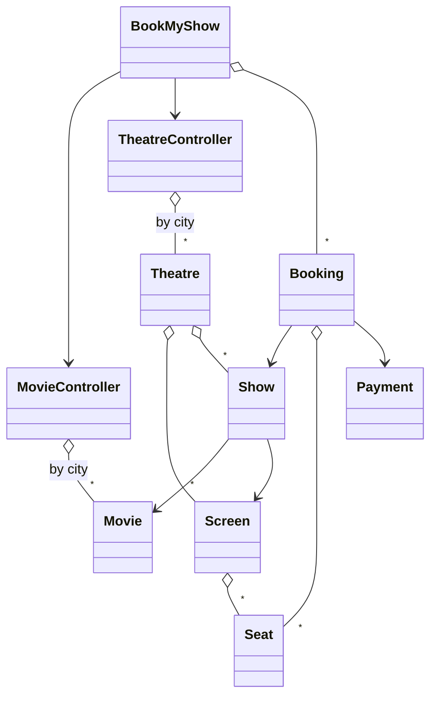

# BookMyShow (Movie Ticket Booking) - Low Level Design (C++)

A movie ticket booking system: pick a city, see which movies are on, pick a show at a theatre, choose seats (Silver, Gold, Platinum), pay, and get a ticket. Two people must never get the same seat for the same show, and a cancelled booking releases its seats and refunds the payment.

This README walks the question the way you should deliver it in an interview: **Requirements -> Entities -> Class Design -> Implementation -> Extensibility**. Everything here matches the C++ code in this folder.

| Step | Time (45 min interview) | Section |
|---|---|---|
| Understand + clarify | 5 min | [1. Requirements](#1-requirements) |
| Pick the objects | 3-5 min | [2. Entities](#2-entities-and-relationships) |
| State + methods, seat availability, concurrency | 10 min | [3. Class design](#3-class-design) |
| Write the booking path | 15-20 min | [4. Implementation](#4-implementation), [5. Verification](#5-verification) |
| "What if..." | 5+ min | [6. Extensibility](#6-extensibility) |

---

## 0. Understanding the problem

There are many nouns (city, movie, theatre, screen, show, seat, booking, payment), and candidates often spend half the interview drawing all of them. The interviewer cares about two things:

1. **Where seat availability lives.** A seat in Screen 1 is a physical chair; whether it's taken depends on *which show*. Availability belongs to the show, not the seat.
2. **Double booking.** Two users choose seat D5 for the same show at the same moment. Exactly one must get it.

The interviewer usually opens with:

> "Design BookMyShow. Users browse movies in their city, pick a show, select seats and book them."

---

## 1. Requirements

### Clarifying questions

Group your questions around: **what the system does**, **what can go wrong**, **what's in scope**, and **what might change later**.

**You:** "What does a user do, step by step?"
**Interviewer:** "Pick a city, see the movies there, pick a movie, see its shows grouped by theatre, pick a show, choose seats, pay."

**You:** "How are theatres organized?"
**Interviewer:** "A theatre is in one city and has several screens. A show is one movie on one screen at one start time."
> A show is the thing that gets booked. The same screen hosts many shows, so seat state can't live on the seat.

**You:** "Are seats priced differently?"
**Interviewer:** "Three categories: Silver 150, Gold 250, Platinum 400 rupees. Same prices everywhere for now."

**You:** "Can a user book several seats at once?"
**Interviewer:** "Yes, any number in one booking, all paid together. Either all of them are booked or none."
> "All or none" means the booking has to check and take every seat in one step.

**You:** "What happens if two people choose the same seat at the same time?"
**Interviewer:** "Only one can get it. Never double-book."
> This is the concurrency requirement; design for it from the start.

**You:** "How does payment work?"
**Interviewer:** "UPI, cards, net banking, wallet. Simulate it: assume it succeeds."

**You:** "Can a booking be cancelled?"
**Interviewer:** "Yes: release the seats and refund."

**You:** "Do we hold seats while the user is paying, like a 10-minute timer?"
**Interviewer:** "Not for now. It's a likely follow-up."
> Note it. It's the most common BookMyShow extension, and our code's booking order (pay first, then take the seats) is exactly what it improves.

**You:** "User accounts, offers, dynamic pricing, notifications?"
**Interviewer:** "Out of scope."

### Final requirements

Write this on the board before moving on:

```text
REQUIREMENTS
1. Cities -> movies running there; theatres in a city -> screens -> seats
2. A show = movie + screen + start time
3. Browse: movies in a city; shows for a movie in a city, grouped by theatre;
   available seats for a show, by category
4. Seat categories: SILVER 150, GOLD 250, PLATINUM 400 (fixed prices)
5. Book one or more seats of one show in one booking: all or nothing
6. Pay (UPI, cards, net banking, wallet; simulated, always succeeds)
7. Never double-book a seat for a show, even with concurrent users
8. Cancel a confirmed booking: release seats, refund

OUT OF SCOPE
- Holding seats during payment (timer), dynamic pricing, offers
- User accounts, notifications, real payment gateway
```

---

## 2. Entities and relationships

Look for nouns in the requirements, but don't make every noun a class. Ask of each one: **does it have state that changes, or behavior we own?**

- **City** - a fixed list: enum `City`.
- **Movie** - id, name, duration, genre, language, rating. Data, shared by many shows.
- **Theatre -> Screen -> Seat** - the physical layout. A seat has an id, row, number and category; it never changes per show.
- **Show** - a movie on a screen at a time. **It holds which seats are booked**, and the lock that protects them. The most important entity.
- **Booking** - one user's purchase: show, seats, payment, status, customer details.
- **Payment** - amount, method, status, transaction id.
- **Catalog and lookup** - "movies in a city", "theatres in a city": `MovieController` and `TheatreController` keep city indexes.
- **Entry point** - `BookMyShow` ties it together: browse, book, cancel.

| Entity | Responsibility |
|---|---|
| `BookMyShow` | Singleton facade: browse movies/theatres/shows, `createBooking`, `cancelBooking`, keeps all bookings. |
| `MovieController` | Singleton: all movies and a City -> movies index; search by name/genre. |
| `TheatreController` | Singleton: all theatres and a City -> theatres index; shows for a movie in a city, grouped by theatre. |
| `Theatre` | Name, address, city, screens, shows. |
| `Screen` | Seats, created by category rows (Silver front, Gold middle, Platinum back). |
| `Seat` | id, row, number, category; price from the category; label like "D5". |
| `Show` | Movie + screen + start time; **set of booked seat ids + mutex**; check, book, cancel seats. |
| `Booking` | Show, seats, payment, `BookingStatus`, customer; `makePayment`, `cancelBooking`, `generateTicket`. |
| `Payment` | Amount, `PaymentMethod`, `PaymentStatus`, transaction id; `processPayment`, `refund`. |
| `City`, `SeatCategory`, `BookingStatus`, `PaymentStatus`, `PaymentMethod` | Enums. |



> [!NOTE]
> **Decision: where does "this seat is taken" live?**
> - Not on `Seat`: the same chair is used by every show on that screen, so a `booked` flag on the seat would mean "booked for every show".
> - **Our choice (Good): the show keeps a `std::set<int>` of booked seat ids.** Small, O(log n) to check, and naturally per show. One mutex per show protects it, so bookings for different shows never wait on each other.
> - **Great: a per-show seat status** (AVAILABLE, HELD, BOOKED, plus who holds it and until when). Same idea, but with room for a third state, which is what you need to hold seats while a user pays.

> [!TIP]
> **Say in the interview:** "A seat is a physical chair; availability depends on the show. So each show tracks which of its screen's seats are booked, protected by a lock per show."

---

## 3. Class design

Work top-down, starting from the entry point. For each class ask two questions:
1. **State:** what must it remember to enforce the requirements?
2. **Methods:** what operations does the outside world need?

### BookMyShow (facade)

| Requirement | What BookMyShow must track |
|---|---|
| "Movies in a city", "theatres in a city" | The two controllers |
| "Cancel a booking", "show bookings" | All bookings |
| Show ids | A running show id counter |

| Need | Method |
|---|---|
| Browse | `getMoviesInCity(city)`, `getShowsForMovie(movieName, city)`, `getAvailableSeatsByCategory(show, category)` |
| Book | `createBooking(show, seats, customerName, customerPhone, paymentMethod) -> Booking` (nullptr on failure) |
| Cancel | `cancelBooking(bookingId) -> bool` |
| Set up | `addMovie`, `addTheatre`, `addShowToTheatre`, `createScreen`, `initialize()` (sample data) |

```cpp
class BookMyShow {                                         // singleton
    std::shared_ptr<MovieController> movieController;
    std::shared_ptr<TheatreController> theatreController;
    std::vector<std::shared_ptr<Booking>> allBookings;
    mutable std::mutex bookingsMutex;                    // guards allBookings
    static int nextShowId;
public:
    static std::shared_ptr<BookMyShow> getInstance();
    void initialize();
    std::vector<std::shared_ptr<Movie>> getMoviesInCity(City city) const;
    std::map<std::shared_ptr<Theatre>, std::vector<std::shared_ptr<Show>>>
        getShowsForMovie(const std::string& movieName, City city) const;
    std::vector<std::shared_ptr<Seat>> getAvailableSeatsByCategory(std::shared_ptr<Show> show, SeatCategory category) const;
    std::shared_ptr<Booking> createBooking(std::shared_ptr<Show> show, const std::vector<std::shared_ptr<Seat>>& seats,
                                           const std::string& customerName, const std::string& customerPhone,
                                           PaymentMethod paymentMethod);
    bool cancelBooking(int bookingId);
    std::vector<std::shared_ptr<Booking>> getAllBookings() const;   // a copy, taken under the lock
};
```

### MovieController and TheatreController

```cpp
class MovieController {                                    // singleton
    std::map<City, std::vector<std::shared_ptr<Movie>>> cityMoviesMap;
    std::vector<std::shared_ptr<Movie>> allMovies;
public:
    void addMovie(std::shared_ptr<Movie> movie);
    void addMovieToCity(std::shared_ptr<Movie> movie, City city);   // skips duplicates
    std::vector<std::shared_ptr<Movie>> getMoviesByCity(City city) const;
    std::vector<std::shared_ptr<Movie>> searchMovies(const std::string& pattern) const;
};

class TheatreController {                                  // singleton
    std::map<City, std::vector<std::shared_ptr<Theatre>>> cityTheatresMap;
    std::vector<std::shared_ptr<Theatre>> allTheatres;
public:
    void addTheatre(std::shared_ptr<Theatre> theatre);              // indexes it by its city
    std::map<std::shared_ptr<Theatre>, std::vector<std::shared_ptr<Show>>>
        getShowsForMovie(const std::string& movieName, City city) const;
    void addShowToTheatre(std::shared_ptr<Show> show, int theatreId);
};
```

The City -> list maps are indexes: "movies in Bangalore" is one lookup instead of a scan over every theatre and show.

### Theatre, Screen, Seat

```cpp
class Theatre { int theatreId; std::string theatreName, address; City city;
                std::vector<std::shared_ptr<Screen>> screens; std::vector<std::shared_ptr<Show>> shows; };
class Screen  { int screenId; std::string screenName; std::vector<std::shared_ptr<Seat>> seats;
                void createSeats(int silverRows, int goldRows, int platinumRows, int seatsPerRow); };
class Seat    { int seatId; int rowNumber; int seatNumber; SeatCategory seatCategory;
                double getPrice() const;  std::string getSeatLabel() const; };       // "D5"
```

### Show (the important one)

| Requirement | What Show must track |
|---|---|
| "A show = movie + screen + time" | Movie, screen, start time |
| "Never double-book" | Which seats of the screen are booked |
| "Even with concurrent users" | A lock around that set |

```cpp
class Show {
    int showId;
    std::shared_ptr<Movie> movie;
    std::shared_ptr<Screen> screen;
    std::time_t startTime;
    std::set<int> bookedSeatIds;          // per show, not per seat
    mutable std::mutex bookingMutex;      // lockable from const methods too
public:
    bool areSeatsAvailable(const std::vector<std::shared_ptr<Seat>>& requestedSeats) const;
    bool bookSeats(const std::vector<std::shared_ptr<Seat>>& seatsToBook);      // all or nothing
    void cancelSeats(const std::vector<std::shared_ptr<Seat>>& seatsToCancel);
    std::vector<std::shared_ptr<Seat>> getAvailableSeatsByCategory(SeatCategory category) const;
};
```

> [!NOTE]
> **Decision: when are the seats taken, before or after payment?**
> - **Our choice (Good): pay first, then book the seats atomically.** `bookSeats` checks and takes every seat under the show's lock, so double booking is impossible; whoever loses the race is refunded. Correct, but losers are charged first: with 8 users racing for one seat, 1 was confirmed and **7 were charged and refunded**.
> - **Great: hold the seats, then pay, then confirm.** Atomically mark the seats HELD for this booking with an expiry (say 10 minutes); take payment; on success mark them BOOKED, on failure or timeout release them. Losers find the seats held and are never charged.

> [!TIP]
> **Say in the interview:** "The show's lock makes check-and-book a single step, so a seat can't be sold twice. To avoid charging people who then lose the race, I'd hold seats with a timeout before payment and confirm after."

### Booking and Payment

```cpp
enum class BookingStatus { PENDING, CONFIRMED, CANCELLED, EXPIRED };

class Booking {
    int bookingId;                         // from static std::atomic<int> nextBookingId, starting at 1000
    std::shared_ptr<Show> show;
    std::vector<std::shared_ptr<Seat>> bookedSeats;
    std::shared_ptr<Payment> payment;
    BookingStatus status;
    std::string customerName, customerPhone, customerEmail;
public:
    double calculateTotalAmount() const;   // sum of seat prices
    bool makePayment(PaymentMethod method);
    bool cancelBooking();
    std::string generateTicket() const;
};

class Payment {
    int paymentId; double amount; PaymentStatus status; PaymentMethod method; std::string transactionId;
public:
    bool processPayment();                 // simulated: always COMPLETED
    bool refund();                         // COMPLETED -> REFUNDED
};
```

### Final class design

```text
BookMyShow (singleton facade)
    - movieController, theatreController, allBookings + bookingsMutex, nextShowId
    + getMoviesInCity, getShowsForMovie, getAvailableSeats(ByCategory)
    + createBooking(show, seats, name, phone, method) -> Booking,  cancelBooking(id)
    + addMovie, addTheatre, addShowToTheatre, createScreen, initialize

MovieController (singleton)    - cityMoviesMap: map<City, vector<Movie>>, allMovies
TheatreController (singleton)  - cityTheatresMap: map<City, vector<Theatre>>, allTheatres
                               + getShowsForMovie(name|id, city) -> map<Theatre, vector<Show>>

Theatre   - id, name, address, city, screens, shows
Screen    - id, name, seats                       + createSeats(silver, gold, platinum rows, perRow)
Seat      - id, row, number, category             + getPrice(), getSeatLabel()
Show      - id, movie, screen, startTime, bookedSeatIds: set<int>, bookingMutex
          + areSeatsAvailable, bookSeats (atomic, all or nothing), cancelSeats, getAvailableSeats...
Booking   - id, show, seats, payment, status, customer      + makePayment, cancelBooking, generateTicket
Payment   - id, amount, method, status, transactionId       + processPayment, refund

enum City { BANGALORE, DELHI, MUMBAI, ... }      enum SeatCategory { SILVER, GOLD, PLATINUM }
enum BookingStatus { PENDING, CONFIRMED, CANCELLED, EXPIRED }
enum PaymentStatus { PENDING, COMPLETED, FAILED, REFUNDED }
enum PaymentMethod { CREDIT_CARD, DEBIT_CARD, UPI, NET_BANKING, WALLET }
```

### Design patterns used

| Pattern | Where | Why | One line to say |
|---|---|---|---|
| Facade | `BookMyShow` | One entry point for browsing, booking and cancelling | "Clients only talk to `BookMyShow`." |
| Singleton | `BookMyShow`, `MovieController`, `TheatreController` | One catalog and one booking system per process | "Convenient; I'd inject them in production for testing." |
| Controller / index | City -> movies, City -> theatres maps | Browsing by city is one lookup | "Keep the lookups users do most as indexes." |
| Monitor (lock per object) | `Show`'s mutex around `bookedSeatIds` | Atomic check-and-book per show | "Each show is its own lock, so different shows never contend." |

---

## 4. Implementation

Before writing code, ask the interviewer: real code, pseudocode, or talk it through? The path that matters is **booking**: `createBooking` -> `makePayment` -> `Show::bookSeats`. Write that well; browsing is plain lookups.

### Show::bookSeats (atomic, all or nothing)

**Core logic:** under the show's lock, check that **every** requested seat is free; only then mark them all booked. If any is taken, book none.

```cpp
// Show.hpp
bool bookSeats(const std::vector<std::shared_ptr<Seat>>& seatsToBook) {
    std::lock_guard<std::mutex> lock(bookingMutex);

    // First verify all seats are available
    for (const auto& seat : seatsToBook) {
        if (bookedSeatIds.find(seat->getSeatId()) != bookedSeatIds.end()) {
            return false;  // Seat already booked
        }
    }

    // Book all seats
    for (const auto& seat : seatsToBook) {
        bookedSeatIds.insert(seat->getSeatId());
    }
    return true;
}
```

The check and the insert happen while holding the same lock, so no other thread can book a seat between them. Checking everything before inserting anything is what makes it all-or-nothing.

### createBooking -> makePayment

**Core logic**
1. Quick check that the seats look free (fails fast for the common case).
2. Create the booking (PENDING).
3. Take payment.
4. Book the seats atomically. If someone got there first, refund and mark the booking CANCELLED.
5. Keep the confirmed booking (under `bookingsMutex`, since many threads book at once).

**Edge cases**
- Seats already taken at step 1: return `nullptr` immediately, nothing charged.
- Seats taken between steps 1 and 4 (a concurrent user won): payment refunded, booking CANCELLED, `nullptr` returned.

```cpp
// BookMyShow.cpp
std::shared_ptr<Booking> BookMyShow::createBooking(
    std::shared_ptr<Show> show,
    const std::vector<std::shared_ptr<Seat>>& seats,
    const std::string& customerName,
    const std::string& customerPhone,
    PaymentMethod paymentMethod) {

    // Check if seats are available
    if (!show->areSeatsAvailable(seats)) {
        std::cout << "Error: One or more selected seats are not available.\n";
        return nullptr;
    }

    // Create booking
    auto booking = std::make_shared<Booking>(show, seats, customerName, customerPhone);

    // Process payment
    if (booking->makePayment(paymentMethod)) {
        std::lock_guard<std::mutex> lock(bookingsMutex);
        allBookings.push_back(booking);
        return booking;
    }

    std::cout << "Error: Payment failed or seats were booked by another user.\n";
    return nullptr;
}

// Booking.hpp
bool makePayment(PaymentMethod method) {
    double amount = calculateTotalAmount();
    payment = std::make_shared<Payment>(bookingId, amount, method);

    if (payment->processPayment()) {
        // Book seats in the show
        if (show->bookSeats(bookedSeats)) {
            status = BookingStatus::CONFIRMED;
            return true;
        } else {
            payment->refund();
            status = BookingStatus::CANCELLED;
            return false;
        }
    }
    return false;
}
```

`areSeatsAvailable` is only an early check; it takes the lock, answers, and releases it, so its answer can be out of date a moment later. The real guarantee is `bookSeats`.

### Cancel

```cpp
// Booking.hpp
bool cancelBooking() {
    if (status == BookingStatus::CONFIRMED) {
        show->cancelSeats(bookedSeats);
        if (payment) {
            payment->refund();
        }
        status = BookingStatus::CANCELLED;
        return true;
    }
    return false;
}
```

Only a CONFIRMED booking can be cancelled, so cancelling twice returns `false` the second time.

### Browsing: shows for a movie in a city

```cpp
// TheatreController.hpp
std::map<std::shared_ptr<Theatre>, std::vector<std::shared_ptr<Show>>>
getShowsForMovie(const std::string& movieName, City city) const {
    std::map<std::shared_ptr<Theatre>, std::vector<std::shared_ptr<Show>>> result;

    auto theatres = getTheatresByCity(city);
    for (const auto& theatre : theatres) {
        auto shows = theatre->getShowsForMovie(movieName);
        if (!shows.empty()) {
            result[theatre] = shows;
        }
    }
    return result;
}
```

The map is keyed by `shared_ptr<Theatre>`, and `shared_ptr`'s `operator<` compares **addresses**: theatres come out in memory order, not by name or distance (see gaps).

### The bug this code used to have

> [!WARNING]
> Each `Show` locked its own seat set, but the code **around** it wasn't safe for concurrent bookings: `createBooking` appended to the shared `allBookings` vector with no lock, and `Booking`'s id counter was a plain `static int` incremented with `nextBookingId++`. Two threads appending to one `std::vector` at once is a data race. With 8 threads making 64 bookings of different seats, **2 of 100 runs crashed**.

The fix: a `mutable std::mutex bookingsMutex` in `BookMyShow` taken wherever `allBookings` is read or written, `getAllBookings()` returning a **copy** made under that lock (a reference could be read while another thread appends), and `std::atomic<int>` for the booking id counter. After the fix: **0 crashes in 100 runs**, every run storing 64 bookings with 64 unique ids. The lesson: **locking the obvious shared object isn't enough; every piece of shared state a request touches needs protecting** (here, the list of bookings and the id counter).

### C++ talking points

- **`mutable std::mutex`** lets `const` methods like `areSeatsAvailable` and `getAvailableSeats` lock it (and `BookMyShow::getBookingById` lock `bookingsMutex`): locking doesn't change the object's logical state.
- **`std::lock_guard`** releases the lock on every return path, including the early `return false` in `bookSeats`.
- **Singletons via `std::shared_ptr<T>(new T())`**: the constructors are private, and `std::make_shared` can't call a private constructor, so `getInstance` uses `new` directly. The lazy `if (!instance)` check isn't thread-safe; a function-local static would be.
- **Static data members two ways:** `inline std::atomic<int> Booking::nextBookingId{1000};` (C++17 `inline`, defined in the header; atomic so `nextBookingId++` is safe from many threads) and `int BookMyShow::nextShowId = 1;` (defined in `BookMyShow.cpp`).
- **`shared_ptr` everywhere:** movies are shared by cities and shows, seats by screens and bookings, shows by theatres and bookings. It's safe (no reference cycles here) but hides who really owns what.
- **Erase-remove idiom** in `Theatre::removeShow` and `TheatreController::removeTheatre`.
- **Two `.cpp` files:** `BookMyShow`'s methods are defined in `BookMyShow.cpp`, so it must be compiled with `main.cpp`.

### Gaps in our code (know these before the interviewer finds them)

I tested each of these by running the code, except where marked "by reading". Raising them yourself, with the fix, is a strong signal.

| Gap | What happens | Fix to say |
|---|---|---|
| **Payment happens before seats are taken** | 8 users racing for seat A1 of one show: exactly 1 confirmed (good), but **all 8 were charged** and 7 refunded. `PENDING` and `EXPIRED` statuses exist but are never used. | Hold seats first (HELD with an expiry), then pay, then confirm; release on failure or timeout. |
| **Setup and cancel aren't thread-safe** (by reading) | Booking is now safe from many threads (see the fixed bug above), but adding shows (`nextShowId++`, `Theatre::shows.push_back`) and cancelling the same booking from two threads at once are not protected. | Do setup before serving traffic, or lock it; give `Booking` its own mutex so its status changes once. |
| **Seats aren't checked against the show's screen** | Seat ids restart at 1 on every screen. Booking seat id 5 from another screen on show 1 was **confirmed and took show 1's own seat A5**. | Check every requested seat belongs to `show->getScreen()` (by object, not just id). |
| **Empty and duplicate seat lists** | An empty booking was CONFIRMED for Rs 0. Seat A1 listed twice was **charged 300** for one seat. | Reject empty lists; de-duplicate (or reject) repeated seats before pricing. |
| **Show scheduling isn't validated** | Two shows on the **same screen at the same time** were both accepted, and a Mumbai theatre's screen was accepted for a Bangalore theatre's show. | Check the screen belongs to the theatre and the time slot (start to start + duration) doesn't overlap another show on that screen. |
| **`initialize()` twice duplicates everything** | After a second call: 4 theatres in Bangalore instead of 2, 4 Avengers shows at PVR Forum Mall, two movies with id 1. | Guard with an "initialized" flag, or keep sample data out of the singleton. |
| **Theatre order is by memory address** (by reading) | Shows are grouped in a `map` keyed by `shared_ptr<Theatre>`, so the order depends on where theatres happen to be allocated. `main.cpp` picks "the first theatre" from it. | Key by theatre id or name, or return a sorted `vector`. |
| **Seat labels break after 26 rows** | Rows 26, 27, 28 are labelled `Z1`, `[1`, `\1`. | Use two letters (AA, AB, ...) or the row number. |
| **Money is `double`** (by reading) | Prices are whole rupees stored as `double`. Harmless today, wrong as soon as discounts or taxes create fractions. | Store paise as integers. |

---

## 5. Verification

Trace the code on concrete scenarios and say the state out loud after each step. The outputs below are from actually running the code.

**Setup (`initialize()`)**: 4 movies; Bangalore has PVR Forum Mall (Screen 1: 80 seats, Screen 2) and INOX Garuda Mall; Mumbai has PVR Phoenix. Screen 1 = 3 Silver rows (A-C), 3 Gold rows (D-F), 2 Platinum rows (G-H), 10 seats each.

**1. Browse and select**
```text
Movies in Bangalore: Avengers: Endgame, The Dark Knight, Inception
Shows for 'Avengers: Endgame': PVR Forum Mall, two shows on Screen 1, 80 seats each
Selected show 1: Silver 30, Gold 30, Platinum 20 available
```

**2. Book 3 Gold seats (D1, D2, D3) with UPI**
```text
areSeatsAvailable({D1,D2,D3}) -> true
Booking 1000 PENDING; amount = 3 x 250 = 750; payment COMPLETED
show.bookSeats -> lock; none taken; insert ids -> CONFIRMED
Ticket: "Booking ID: BMS001000", "Seats: D1, D2, D3", "Total Amount: Rs.750"
```

**3. Book 2 Platinum seats (G1, G2)** -> booking 1001, Rs 800, CONFIRMED. Availability: Gold 27, Platinum 18, total 75.

**4. Cancel booking 1000**
```text
status CONFIRMED -> show.cancelSeats({D1,D2,D3}); payment REFUNDED; status CANCELLED
Gold available 30 again; total available 78
Summary: 1000 Cancelled, 1001 Confirmed
```

**5. Edge cases** (separate test program, each run in its own process)
```text
8 users pay for seat A1 at once            -> confirmed 1, paid then refunded 7
8 threads x 8 bookings of different seats  -> before the fix 2 of 100 runs crashed; after it 0 of 100,
                                              always 64 stored with 64 unique ids
seat id 5 from another screen on show 1    -> CONFIRMED; show 1's seat A5 now taken
empty seat list                            -> Confirmed, amount 0
seat A1 listed twice                       -> Confirmed, charged 300, 1 seat booked
show on the same screen at the same time   -> accepted
another city's screen for theatre 1        -> accepted
initialize() twice                         -> 4 Bangalore theatres, 4 Avengers shows at PVR Forum Mall
28 seat rows                               -> labels Z1, [1, \1
cancel the same booking twice              -> true, then false; unknown id -> false
```

---

## 6. Extensibility

If there's time left, expect "what if" questions. You usually explain where the change goes rather than code it. Junior candidates may skip this; senior candidates can get several in a row.

### 1. "Hold seats while the user pays"

> "Turn the show's booked set into a per-seat status: AVAILABLE, HELD (by booking X until time T), BOOKED. Selecting seats atomically moves them from AVAILABLE to HELD under the show's lock; payment success moves them to BOOKED; failure, cancel or timeout moves them back to AVAILABLE. A held seat counts as unavailable for everyone else, and expired holds are released lazily on the next lookup or by a periodic sweep."

```cpp
struct SeatHold { int bookingId; std::time_t expiresAt; };
std::map<int, SeatHold> heldSeats;       // seatId -> hold, inside Show, same mutex
std::set<int> bookedSeatIds;

bool holdSeats(const std::vector<int>& ids, int bookingId, std::time_t now, int holdSeconds);
bool confirmSeats(int bookingId);        // HELD by this booking -> BOOKED
void releaseSeats(int bookingId);        // HELD -> AVAILABLE
```

### 2. "Different prices per show (weekends, premieres, demand)"

> "Move pricing out of `getSeatPrice(category)` into a `PricingStrategy` the show holds: `price(seat, show)`. A weekend strategy multiplies the base price, a demand strategy looks at how full the show is. `Booking::calculateTotalAmount` asks the show's strategy instead of the seat."

### 3. "Coupons and offers"

> "Apply discounts to the booking total through a list of `Offer` objects (percentage, flat, buy-2-get-1), each checking its own eligibility. Compute in paise to keep rounding exact."

### 4. "Real payments that can fail"

> "Put each payment method behind a `PaymentGateway` interface. With seat holds in place, a failed payment simply releases the hold; with today's order (pay then book), a failed payment just leaves the seats untouched."

### 5. "Several servers"

> "A per-show mutex only works in one process. With several servers, the database row (or a seat-status table) is the lock: `UPDATE show_seats SET status='HELD', booking=? WHERE show=? AND seat IN (...) AND status='AVAILABLE'` and check the number of rows changed, inside a transaction. Or a distributed lock (Redis) per show."

### 6. "Notify users"

> "Booking confirmed, cancelled, or the show rescheduled: publish an event and let notification services subscribe (Observer), so booking code doesn't know about email or SMS."

### 7. "Search and filters"

> "Add indexes for what users filter on: language, genre, date. Keep shows per theatre sorted by start time so 'shows after 6 pm' is a range query."

---

## 7. What is expected at each level

**Junior.** Model city, movie, theatre, screen, seat, show and booking with clear relationships; book seats and refuse already-booked ones; cancel. Hints about putting availability on the show instead of the seat are fine.

**Mid-level.** Availability per show without prompting, an atomic all-or-nothing `bookSeats` under a lock, and a clear booking flow with payment and refund. Handle concurrent users for the same seat and explain why the early availability check isn't enough. Discuss seat holds or pricing per show.

**Senior.** Drive the concurrency design: lock granularity (per show), check-and-book atomically, hold-then-pay-then-confirm with expiry, and what changes with several servers (database row locks or conditional updates). Raise validation (seats from the right screen, empty and duplicate lists, overlapping shows), thread safety of shared lists and counters, and singleton trade-offs.

---

## 8. Test yourself

<details><summary>1. Why isn't "booked" a field on <code>Seat</code>?</summary>

A seat is a physical chair shared by every show on its screen. Whether it's taken depends on the show, so availability lives in `Show` (`bookedSeatIds`).
</details>

<details><summary>2. How does <code>bookSeats</code> prevent double booking?</summary>

It holds the show's mutex while it checks that every requested seat is free and then inserts them all. Nothing can change the set between the check and the insert.
</details>

<details><summary>3. Why is it all-or-nothing?</summary>

It checks every seat first and returns `false` before inserting anything if one is taken. Only when all are free does it insert them.
</details>

<details><summary>4. <code>createBooking</code> calls <code>areSeatsAvailable</code> first. Why isn't that enough?</summary>

It releases the lock after answering, so another user can take the seats a moment later. It's only a fast early rejection; `bookSeats` is the real guarantee.
</details>

<details><summary>5. Eight users pay for the same seat at the same moment. What happens in our code, and what's better?</summary>

All eight are charged; one `bookSeats` succeeds and the other seven are refunded (tested). Better: hold seats atomically before payment, so losers are rejected without being charged.
</details>

<details><summary>6. How would you implement a 10-minute seat hold?</summary>

A per-show seat status with HELD + booking id + expiry, all under the show's lock. Hold on selection, BOOKED on successful payment, released on failure, cancel or expiry (lazily on lookup or by a sweep).
</details>

<details><summary>7. Why one mutex per show instead of one for the whole system?</summary>

Bookings for different shows never touch the same seats, so they shouldn't wait for each other. A global lock would serialize every booking in the country.
</details>

<details><summary>8. The show's seats were locked, yet concurrent bookings still crashed. Why, and what fixed it?</summary>

`BookMyShow::allBookings.push_back` ran from several threads with no lock, and the booking id counter was a plain `int`: concurrent writes to a `std::vector` are a data race (2 of 100 runs crashed). A mutex around `allBookings` (with `getAllBookings` returning a copy) and an atomic counter fixed it: 0 of 100.
</details>

<details><summary>9. A seat from another screen is passed to <code>createBooking</code>. What happens?</summary>

It's accepted. Seat ids restart at 1 per screen and `Show` only stores ids, so it books the show's own seat with the same id. Validate that each seat belongs to the show's screen.
</details>

<details><summary>10. How does double-booking protection change with several servers?</summary>

An in-process mutex no longer covers everyone. Use the database: a conditional update that only changes seats still AVAILABLE, checking the affected row count, inside a transaction; or a distributed lock per show.
</details>

<details><summary>11. Why is the theatre order in <code>getShowsForMovie</code> unpredictable?</summary>

The result is a `std::map` keyed by `shared_ptr<Theatre>`, whose ordering compares addresses. Key by id or name, or return a sorted list.
</details>

<details><summary>12. Why does <code>getInstance</code> use <code>new</code> instead of <code>std::make_shared</code>?</summary>

The constructor is private, and `std::make_shared` constructs the object from inside the standard library, which can't access it. `std::shared_ptr<T>(new T())` is called from inside the class, which can.
</details>

---

## 9. Run it

```bash
cd lld/book_my_show
g++ -std=c++17 main.cpp BookMyShow.cpp -o book_my_show
./book_my_show
```

Both `.cpp` files are needed. Expected key lines (show times depend on when you run it):

```text
=== Movies in Bangalore ===
  - Avengers: Endgame (English, 180 mins)
...
Silver Seats (Rs.150): 30 available
Gold Seats (Rs.250): 30 available
Platinum Seats (Rs.400): 20 available
...
Booking ID: BMS001000
Seats: D1, D2, D3
Total Amount: Rs.750
Booking Status: Confirmed
...
Total Available: 75 seats
✓ Booking 1000 cancelled successfully!
Refund Status: Refunded
...
Total Bookings in System: 2
```

The banner uses box-drawing characters and ✓, which may show as odd characters on a Windows console.

### Files

```text
book_my_show/
├── main.cpp                 browse, book 3 Gold + 2 Platinum, cancel, browse Mumbai
├── BookMyShow.hpp / .cpp    singleton facade: browse, createBooking, cancelBooking, sample data
├── MovieController.hpp      singleton: movies + City -> movies index, search
├── TheatreController.hpp    singleton: theatres + City -> theatres index, shows for a movie
├── Theatre.hpp              screens + shows of one theatre
├── Screen.hpp               seats by category rows
├── Seat.hpp                 id, row, number, category, price, label
├── Show.hpp                 movie + screen + time; booked seat ids + mutex (atomic booking)
├── Booking.hpp              booking + status, payment, cancel, ticket
├── Payment.hpp              payment + status/method enums, refund
└── Enums/
    ├── City.hpp
    └── SeatCategory.hpp     SILVER 150, GOLD 250, PLATINUM 400
```
