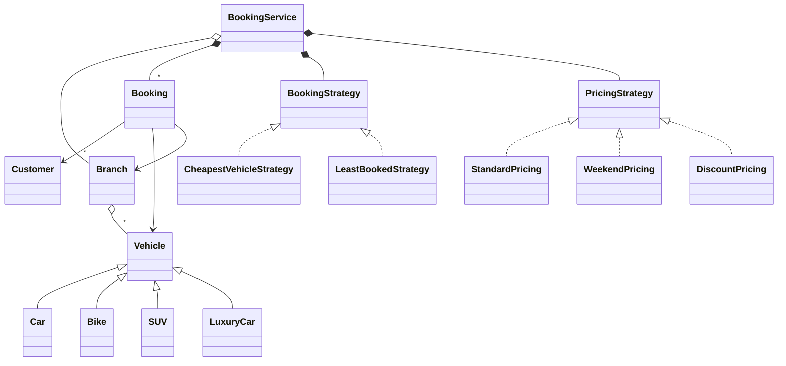
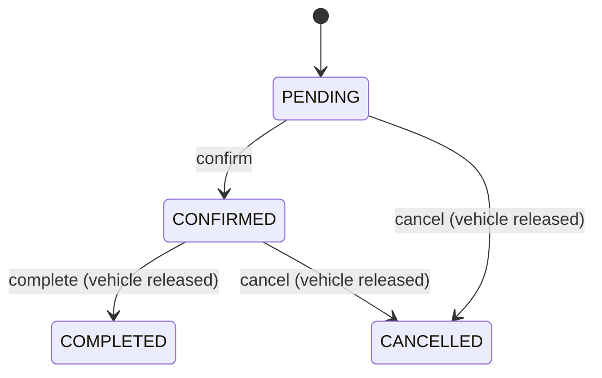

# Car Rental - Low Level Design (C++)

A car rental system with branches, each holding vehicles (cars, bikes, SUVs, luxury cars). A customer asks a branch for a vehicle type and a date range; the system picks a vehicle with a selection strategy, prices it with a pricing strategy, reserves it, and creates a booking that can later be completed or cancelled.

This README walks the question the way you should deliver it in an interview: **Requirements -> Entities -> Class Design -> Implementation -> Extensibility**. Everything here matches the C++ code in this folder.

| Step | Time (45 min interview) | Section |
|---|---|---|
| Understand + clarify | 5 min | [1. Requirements](#1-requirements) |
| Pick the objects | 3-5 min | [2. Entities](#2-entities-and-relationships) |
| Availability, strategies, booking lifecycle | 10 min | [3. Class design](#3-class-design) |
| Write `createBooking` | 15-20 min | [4. Implementation](#4-implementation), [5. Verification](#5-verification) |
| "What if..." | 5+ min | [6. Extensibility](#6-extensibility) |

---

## 0. Understanding the problem

Car rental looks like parking lot with dates, and the dates are the point. A vehicle isn't "free" or "taken"; it's free for **some** date ranges and booked for others. The questions interviewers push on:
1. **Availability over time:** can this car be rented for the 5th to the 7th if it's booked for the 1st to the 3rd?
2. **Double booking:** two customers ask for the last SUV at the same moment.
3. **Pluggable rules:** which car to give out, and how to price it.

The interviewer usually opens with:

> "Design a car rental system. Customers book vehicles from branches for a period of time."

Our code handles 2 and 3 well and simplifies 1 (see the availability decision and the first follow-up).

---

## 1. Requirements

### Clarifying questions

Group your questions around: **what the system does**, **what can go wrong**, **what's in scope**, and **what might change later**.

**You:** "What does a customer choose: a specific car, or a type?"
**Interviewer:** "A branch, a vehicle type and dates. The system picks the car."
> So there's a "pick one of the available cars" rule: a strategy.

**You:** "Which vehicle types?"
**Interviewer:** "Car, bike, SUV and luxury. Each vehicle has a daily price."

**You:** "How is the price worked out?"
**Interviewer:** "Daily price times days, but we run promotions: weekend rates, discounts."
> Pricing varies: a second strategy.

**You:** "How are days counted?"
**Interviewer:** "Inclusive: the 1st to the 3rd is 3 days."

**You:** "Can a car be booked for dates in the future while it's rented now?"
**Interviewer:** "Ideally yes. For a first version, it's fine if a car is either available or rented."
> This is the big simplification in our code. Say it out loud and offer the date-range version as a follow-up.

**You:** "What happens to a booking afterwards?"
**Interviewer:** "It's confirmed when made; it's either completed when the car comes back, or cancelled. Either way the car becomes available again."

**You:** "Two customers asking for the last car at the same time?"
**Interviewer:** "Only one gets it."

**You:** "Payments, licence checks, picking up at one branch and returning at another?"
**Interviewer:** "Out of scope."

### Final requirements

Write this on the board before moving on:

```text
REQUIREMENTS
1. Branches hold vehicles: CAR, BIKE, SUV, LUXURY, each with a daily price
2. Book: customer + branch + vehicle type + start and end date
3. A selection strategy picks one available vehicle of that type (cheapest, least booked)
4. A pricing strategy computes the total (standard, weekend x1.5, discount %); days are inclusive
5. Booking lifecycle: CONFIRMED on creation -> COMPLETED or CANCELLED; the vehicle is released
6. Never give the same vehicle to two customers at once
7. Reject: unknown branch, no vehicle of that type available, end date before start date

OUT OF SCOPE (first version)
- Availability per date range (a vehicle is simply available or rented)
- Payments, licence checks, one-way rentals, late fees
```

---

## 2. Entities and relationships

Look for nouns in the requirements, but don't make every noun a class. Ask of each one: **does it have state that changes, or behavior we own?**

- **Branch** - holds its vehicles, answers "which vehicles of type X are available?". `Branch`.
- **Vehicle** - id, brand, model, registration, daily price, type and an **availability flag**. Subclasses `Car`, `Bike`, `SUV`, `LuxuryCar` only set the type and a description prefix.
- **Customer** - id, name, contact details, licence number. Data.
- **Booking** - customer, vehicle, branch, dates, total, status; it owns the status transitions. `Booking` with `BookingStatus`.
- **Booking service** - the orchestrator: finds the branch, picks a vehicle, prices it, reserves it, stores bookings. `BookingService`.
- **Selection rule** - `BookingStrategy` with `CheapestVehicleStrategy` and `LeastBookedStrategy`.
- **Pricing rule** - `PricingStrategy` with `StandardPricing`, `WeekendPricing`, `DiscountPricing`.

| Entity | Responsibility |
|---|---|
| `BookingService` | Branches, bookings, per-vehicle booking counts, current strategies; `createBooking`, `cancelBooking`, `completeBooking`. One mutex around everything. |
| `Branch` | Vehicles by id (mutex-guarded); `getAvailableVehicles(type)`. |
| `Vehicle` (+ 4 subclasses) | Details, daily price, type; `std::atomic<bool> available` with `tryReserve()` / `release()`. |
| `Booking` | Customer, vehicle, branch, dates, total, status; `confirm()`, `cancel()`, `complete()`, `getDurationDays()`. |
| `Customer` | Customer details. |
| `BookingStrategy` (Cheapest, LeastBooked) | Pick one vehicle from the available list. |
| `PricingStrategy` (Standard, Weekend, Discount) | `calculatePrice(vehicle, days)`. |



> [!NOTE]
> **Decision: how is availability modelled?**
> - **Our choice (Good): one `available` flag per vehicle.** Reserving sets it to false, completing or cancelling sets it back. Simple, and with an atomic compare-and-swap it's safe under concurrency. But **the dates don't matter**: a car booked for days 1-3 can't be booked for days 5-7 (tested: "No vehicles available").
> - **Great: booked date ranges per vehicle.** A vehicle is available for `[start, end]` if that range overlaps none of its confirmed bookings. Any number of future bookings per car; completing or cancelling removes one range.

> [!TIP]
> **Say in the interview:** "My first version treats a vehicle as available or rented. The real model is a list of booked ranges per vehicle, and a request fits if it doesn't overlap any of them. Two ranges overlap when `start1 <= end2 && start2 <= end1`."

---

## 3. Class design

Work top-down, starting from the orchestrator. For each class ask two questions:
1. **State:** what must it remember to enforce the requirements?
2. **Methods:** what operations does the outside world need?

### BookingService

| Requirement | What BookingService must track |
|---|---|
| "Branches hold vehicles" | Branches by id |
| "Complete or cancel a booking later" | Bookings by id |
| "Least booked" strategy | How many times each vehicle was booked |
| "Pluggable selection and pricing" | The current strategies |
| "Never give one vehicle to two customers" | A lock (plus the vehicle's atomic flag) |

| Need | Method |
|---|---|
| Book | `createBooking(customer, branchId, vehicleType, startDate, endDate) -> Booking*` (throws on failure) |
| Finish | `completeBooking(bookingId)`, `cancelBooking(bookingId)` |
| Configure | `addBranch`, `setBookingStrategy`, `setPricingStrategy` |
| Look up | `getBooking(bookingId)`, `getAllBookings()` |

```cpp
class BookingService {
    std::unordered_map<std::string, Branch*> branches;
    std::unordered_map<std::string, Booking*> bookings;          // owned: deleted in ~BookingService
    std::unordered_map<std::string, int> vehicleBookingCounts;
    std::unique_ptr<BookingStrategy> bookingStrategy;            // default: CheapestVehicleStrategy
    std::unique_ptr<PricingStrategy> pricingStrategy;            // default: StandardPricing
    mutable std::mutex mutex_;
    int bookingCounter = 0;                                      // ids BK000001, BK000002, ...
public:
    Booking* createBooking(Customer* customer, const std::string& branchId,
                           VehicleType vehicleType, time_t startDate, time_t endDate);
    void cancelBooking(const std::string& bookingId);
    void completeBooking(const std::string& bookingId);
    void setBookingStrategy(std::unique_ptr<BookingStrategy> strategy);
    void setPricingStrategy(std::unique_ptr<PricingStrategy> strategy);
};
```

### Vehicle

```cpp
class Vehicle {
protected:
    std::string vehicleId, brand, model, registrationNumber;
    double pricePerDay;
    std::atomic<bool> available;          // true = can be rented
    VehicleType type;
public:
    bool tryReserve();                    // atomically true -> false; false if someone got it first
    void release();                       // available = true
    virtual std::string getDescription() const;
};
// Car, Bike, SUV, LuxuryCar: pass their VehicleType and prefix the description ("[SUV] ...")
```

> [!NOTE]
> **Decision: how is "never two customers for one car" enforced?**
> - **Good: one mutex around the whole booking.** `createBooking` holds `mutex_` from finding the branch to storing the booking, so two bookings can't interleave.
> - **Great (our choice, and then some): the lock plus an atomic claim on the vehicle.** `tryReserve()` is a compare-and-swap from `true` to `false`, so exactly one caller can take a vehicle even if some other code path didn't hold the service lock. In our tests, 8 threads racing for the only car: 1 succeeded, 7 were rejected.

> [!TIP]
> **Say in the interview:** "The service lock serializes bookings, and the vehicle's atomic compare-and-swap makes the claim itself indivisible. With the per-lock design I could later shrink the lock to one per branch, because the CAS still prevents double booking."

### Booking and its lifecycle

```cpp
enum class BookingStatus { PENDING, CONFIRMED, CANCELLED, COMPLETED };

class Booking {
    std::string bookingId;
    Customer* customer;  Vehicle* vehicle;  Branch* branch;
    time_t startDate, endDate;
    double totalAmount;
    BookingStatus status;                 // starts PENDING
public:
    int getDurationDays() const;          // whole days between the dates + 1 (inclusive)
    void confirm();                       // PENDING -> CONFIRMED, else throws
    void complete();                      // CONFIRMED -> COMPLETED, releases the vehicle, else throws
    void cancel();                        // -> CANCELLED, releases the vehicle; throws if COMPLETED or CANCELLED
};
```



> [!NOTE]
> **Decision: who guards the status transitions?**
> - **Good: the service checks the status before calling a setter.** Every caller must remember the rules.
> - **Great (our choice): `Booking` enforces them itself.** `confirm`, `complete` and `cancel` throw `std::runtime_error` if the current status doesn't allow the move, so no caller can complete a cancelled booking or cancel one twice. (Cancelling twice used to be allowed; see the fixed bug.)

### Strategies

```cpp
class BookingStrategy {
public:
    virtual Vehicle* selectVehicle(const std::vector<Vehicle*>& vehicles) = 0;
};
// CheapestVehicleStrategy: lowest pricePerDay
// LeastBookedStrategy:    lowest count in the service's vehicleBookingCounts (holds a reference to it)

class PricingStrategy {
public:
    virtual double calculatePrice(Vehicle* vehicle, int days) = 0;
};
// StandardPricing: pricePerDay * days
// WeekendPricing:  pricePerDay * days * multiplier (default 1.5), applied to every day
// DiscountPricing: pricePerDay * days * (1 - discountPercentage)
```

### Final class design

```text
BookingService
    - branches: map<id, Branch*>,  bookings: map<id, Booking*> (owned),  vehicleBookingCounts: map<vehicleId, int>
    - bookingStrategy, pricingStrategy: unique_ptr,  mutex_,  bookingCounter
    + createBooking(customer, branchId, type, start, end) -> Booking*
    + cancelBooking(id), completeBooking(id), getBooking(id), getAllBookings()
    + addBranch, setBookingStrategy, setPricingStrategy

Branch        - branchId, name, address, vehicles: map<id, Vehicle*>, mutex_
              + addVehicle, removeVehicle, getVehicle, getAvailableVehicles(type?)
Vehicle       - id, brand, model, registration, pricePerDay, available: atomic<bool>, type
              + tryReserve(), release(), getDescription()        <- Car, Bike, SUV, LuxuryCar
Booking       - id, customer, vehicle, branch, startDate, endDate, totalAmount, status
              + confirm(), complete(), cancel(), getDurationDays()
Customer      - id, name, email, phone, licenseNumber

BookingStrategy  <- CheapestVehicleStrategy, LeastBookedStrategy
PricingStrategy  <- StandardPricing, WeekendPricing, DiscountPricing
enum VehicleType { CAR, BIKE, SUV, LUXURY }    enum BookingStatus { PENDING, CONFIRMED, CANCELLED, COMPLETED }
enum PaymentMode { CASH, CARD, UPI }           (defined but not used yet)
```

### Design patterns used

| Pattern | Where | Why | One line to say |
|---|---|---|---|
| Strategy (twice) | `BookingStrategy`, `PricingStrategy` | Which car to hand out, and how to price it, change independently | "Swap the rule at runtime with `setPricingStrategy`." |
| State-like guards | `Booking::confirm/complete/cancel` | The booking refuses transitions its status doesn't allow | "The booking owns its lifecycle." |
| Inheritance | `Vehicle` subclasses | Type and description per kind of vehicle | "An enum would do; subclasses leave room for per-type rules." |
| Service layer | `BookingService` | One entry point that coordinates branch, strategies and bookings | "Models hold data; the service runs the use case." |

---

## 4. Implementation

Before writing code, ask the interviewer: real code, pseudocode, or talk it through? The method that matters is `createBooking`.

### createBooking

**Core logic**
1. Lock the service.
2. Reject an end date before the start date.
3. Find the branch; get its available vehicles of the requested type.
4. Let the selection strategy pick one.
5. Claim it atomically with `tryReserve()`.
6. Count the days (inclusive) and price them with the pricing strategy.
7. Create the booking, confirm it, store it, bump the vehicle's booking count.

**Edge cases**
- Unknown branch, or no vehicle of that type available: throw, nothing changes.
- `tryReserve()` fails (someone else claimed it): throw "Vehicle already booked".

```cpp
// service/BookingService.hpp
Booking* createBooking(Customer* customer, const std::string& branchId,
                       VehicleType vehicleType, time_t startDate, time_t endDate) {
    std::lock_guard<std::mutex> lock(mutex_);

    if (endDate < startDate) {
        throw std::runtime_error("End date is before start date");
    }

    Branch* branch = nullptr;
    auto it = branches.find(branchId);
    if (it == branches.end()) {
        throw std::runtime_error("Branch not found: " + branchId);
    }
    branch = it->second;

    // Get available vehicles
    std::vector<Vehicle*> available = branch->getAvailableVehicles(vehicleType);
    if (available.empty()) {
        throw std::runtime_error("No vehicles available of type: " +
                                 vehicleTypeToString(vehicleType));
    }

    // Select vehicle using strategy
    Vehicle* selectedVehicle = bookingStrategy->selectVehicle(available);
    if (!selectedVehicle) {
        throw std::runtime_error("Failed to select vehicle");
    }

    // Try to reserve atomically
    if (!selectedVehicle->tryReserve()) {
        throw std::runtime_error("Vehicle already booked");
    }

    // Calculate price
    int days = static_cast<int>(difftime(endDate, startDate) / (60 * 60 * 24)) + 1;
    double totalAmount = pricingStrategy->calculatePrice(selectedVehicle, days);

    // Create booking
    std::string bookingId = generateBookingId();
    Booking* booking = new Booking(bookingId, customer, selectedVehicle,
                                    branch, startDate, endDate, totalAmount);
    booking->confirm();

    bookings[bookingId] = booking;
    vehicleBookingCounts[selectedVehicle->getVehicleId()]++;

    return booking;
}
```

Note that `startDate` and `endDate` are only used for the price: availability is the vehicle's flag, regardless of dates.

### The atomic claim

```cpp
// model/Vehicle.hpp
bool tryReserve() {
    bool expected = true;
    return available.compare_exchange_strong(expected, false);
}

void release() { available.store(true); }
```

### Cancel and complete

```cpp
// model/Booking.hpp
void cancel() {
    if (status == BookingStatus::COMPLETED) {
        throw std::runtime_error("Cannot cancel a completed booking");
    }
    if (status == BookingStatus::CANCELLED) {
        // Releasing again could free a vehicle that has since been rented to someone else
        throw std::runtime_error("Booking is already cancelled");
    }
    status = BookingStatus::CANCELLED;
    if (vehicle) {
        vehicle->release();
    }
}

void complete() {
    if (status != BookingStatus::CONFIRMED) {
        throw std::runtime_error("Cannot complete booking in " +
                                 bookingStatusToString(status) + " state");
    }
    status = BookingStatus::COMPLETED;
    if (vehicle) {
        vehicle->release();
    }
}
```

### Selecting and pricing

```cpp
// strategy/booking/CheapestVehicleStrategy.hpp
Vehicle* cheapest = vehicles[0];
for (Vehicle* vehicle : vehicles) {
    if (vehicle->getPricePerDay() < cheapest->getPricePerDay()) {
        cheapest = vehicle;
    }
}
return cheapest;

// strategy/pricing/WeekendPricing.hpp
double calculatePrice(Vehicle* vehicle, int days) override {
    return vehicle->getPricePerDay() * days * multiplier;
}
```

`WeekendPricing` multiplies **every** day, not just Saturdays and Sundays: it's really a "surge" multiplier (see gaps).

### The bugs this code used to have

> [!WARNING]
> **1. Cancelling twice double-booked a car.** `cancel()` only refused completed bookings, so a cancelled booking could be cancelled again, and each call released the vehicle. Sequence: A books V1 and cancels; B books V1; A cancels **again**, releasing V1 while B still has it; C books V1. The same car was rented to B and C.
>
> **2. A reversed date range was accepted.** Start day 5, end day 2 gave "-2 days" and a total of **$-100**, confirmed.

The fixes: `cancel()` throws "Booking is already cancelled", and `createBooking` rejects `endDate < startDate` before touching any vehicle. The lesson: **a "release" must happen exactly once**: guard it with the status, so a repeated call can't undo someone else's reservation.

### C++ talking points

- **`std::atomic<bool>` with `compare_exchange_strong`** makes check-and-claim one indivisible step; `available` makes `Vehicle` non-copyable, which is why vehicles are handled through pointers.
- **`mutable std::mutex`** in `Branch` and `BookingService` lets `const` methods like `getAvailableVehicles` lock.
- **Strategies as `std::unique_ptr`**, swapped with `std::move` under the lock.
- **`LeastBookedStrategy` stores a reference** (`std::unordered_map<std::string, int>&`) to the service's counts. It must not outlive the service, and a reference member makes the class non-assignable.
- **Ownership:** the service `new`s bookings and deletes them in its destructor; branches, vehicles and customers are owned by the caller (`main` creates them). Returned `Booking*`s are valid until the service is destroyed.
- **`time_t` and `difftime`:** days = whole seconds difference / 86400, truncated, plus one.
- **Booking ids** come from a counter formatted with `std::setw(6)` and `std::setfill('0')`: BK000001.

### Gaps in our code (know these before the interviewer finds them)

I tested each of these by running the code, except where marked "by reading". Raising them yourself, with the fix, is a strong signal.

| Gap | What happens | Fix to say |
|---|---|---|
| **Dates don't affect availability** | A car booked for days 1-3 couldn't be booked for days 5-7: "No vehicles available of type: CAR". In the demo Jane gets the Honda for days 5-7 because the Toyota is "taken", though it's free then. | Per-vehicle booked ranges with an overlap check (see [follow-up 1](#1-book-any-free-dates)). |
| **Past dates are accepted** | A booking for 10 to 8 days ago was confirmed at full price. | Reject `startDate` before today. |
| **Negative prices** | `DiscountPricing(1.5)` (150% off) produced a **$-75** confirmed booking. Nothing checks the discount or the result. | Validate `0 <= discount < 1`, and reject a total `<= 0`. |
| **"Weekend" pricing applies to every day** (by reading) | `WeekendPricing` multiplies the whole rental by 1.5, whatever the dates. | Walk the days and apply the multiplier only to Saturdays and Sundays (`std::localtime(...)->tm_wday`). |
| **Bookings come back in no particular order** | `getAllBookings()` iterates an `unordered_map`: the demo listed BK000003, BK000002, BK000001. | Keep bookings in insertion order (a `vector`) or sort by id or date. |
| **`PaymentMode` is never used** (by reading) | The enum exists but no booking takes or records a payment. | A payment step before confirming, through a `PaymentStrategy` per mode. |
| **Counts escape the lock** (by reading) | `getVehicleBookingCounts()` hands out a reference to the map with no lock, and `getActiveStrategies()` reads the strategies without locking. | Return a copy under the lock; lock in `getActiveStrategies`. |
| **Money is `double`** (by reading) | Prices and totals are `double` (247.50 is fine; repeated discounts drift). | Integer cents. |

---

## 5. Verification

Trace the code on concrete scenarios and say the state out loud after each step. The outputs below are from actually running the code.

**Setup (`main.cpp`)**: Downtown has Toyota Camry $50, Honda Accord $55, Ford Explorer SUV $80, Harley bike $30. Airport has Mercedes S-Class (LUXURY) $200, BMW 3 Series $100, Audi Q7 SUV $150.

**1. John: CAR at Downtown, days 1 to 3, cheapest + standard pricing**
```text
available CARs: Camry 50, Accord 55 -> cheapest: Camry; tryReserve true -> false
days = 2 + 1 = 3; price 50 x 3 = 150
"BK000001 | John Doe | Toyota Camry | $150.00 | CONFIRMED"
```

**2. Switch to WeekendPricing x1.5. Jane: CAR at Downtown, days 5 to 7**
```text
available CARs: Accord only (Camry's flag is false, although it's free on days 5-7)
3 days x 55 x 1.5 = 247.50  -> BK000002
```

**3. Switch to DiscountPricing 20%. Bob: LUXURY at Airport, days 10 to 12**
```text
Mercedes, 3 x 200 x 0.8 = 480.00  -> BK000003
```

**4. Complete BK000001** -> status COMPLETED, Camry available again: Yes.

**5. Edge cases** (separate test program)
```text
one car, days 1-3, then days 5-7         -> second rejected: "No vehicles available of type: CAR"
end before start (day 5 -> day 2)        -> rejected: "End date is before start date"   (was: -2 days, $-100)
dates in the past                        -> accepted, $150
A books V1, cancels; B books V1; A cancels again
                                         -> "Booking is already cancelled"; C is refused   (was: C also got V1)
DiscountPricing(1.5), 3 days at $50      -> $-75, CONFIRMED
8 threads book the only car              -> 1 succeeded, 7 rejected
complete twice                           -> "Cannot complete booking in COMPLETED state"
cancel after complete                    -> "Cannot cancel a completed booking"
```

---

## 6. Extensibility

If there's time left, expect "what if" questions. You usually explain where the change goes rather than code it. Junior candidates may skip this; senior candidates can get several in a row.

### 1. "Book any free dates"

> "Give each vehicle a list of booked ranges. A vehicle is available for `[s, e]` if no booked range overlaps it, i.e. there's no `[bs, be]` with `bs <= e && s <= be`. Reserving adds the range under the vehicle's lock; completing or cancelling removes it. With many bookings per vehicle, keep the ranges sorted by start and check only the neighbours of where the new one would go."

```cpp
struct Range { time_t start, end; std::string bookingId; };
class Vehicle {
    std::vector<Range> booked;           // sorted by start
    std::mutex m;
public:
    bool tryReserve(time_t s, time_t e, const std::string& id) {
        std::lock_guard<std::mutex> lock(m);
        for (const auto& r : booked)
            if (r.start <= e && s <= r.end) return false;          // overlap
        booked.push_back({s, e, id});
        std::sort(booked.begin(), booked.end(), [](auto& a, auto& b) { return a.start < b.start; });
        return true;
    }
    void release(const std::string& id);   // erase the range with this booking id
};
```

### 2. "Pick up at one branch, return at another"

> "The booking gets a pickup branch and a return branch. Completing moves the vehicle from one branch's map to the other. Availability at a branch then depends on where each car will be on the requested start date, which the date-range model makes possible."

### 3. "Late returns, damage, fuel"

> "At completion compare the actual return time with `endDate`; charge extra days through the pricing strategy plus a late fee. Damage and fuel become line items on the final invoice."

### 4. "Add-ons: insurance, GPS, child seat"

> "Decorate the price: each add-on wraps the pricing strategy and adds its own daily cost, so any combination of add-ons composes without new classes per combination."

### 5. "Take payment"

> "Use the unused `PaymentMode`: a `PaymentStrategy` per mode, called before `confirm()`. If payment fails, release the vehicle and leave the booking PENDING or CANCELLED. With seat-hold style, reserve the car for a few minutes while the customer pays."

### 6. "Find a car across nearby branches"

> "Branches get a location; when the requested branch has nothing, search the nearest branches in order of distance and offer alternatives."

---

## 7. What is expected at each level

**Junior.** Branch, vehicle, customer and booking classes; booking picks an available vehicle of the type, marks it unavailable, and computes days x price; complete and cancel release it. Hints on strategies are fine.

**Mid-level.** Selection and pricing as strategies, a booking that guards its own status transitions, and safe concurrent booking (lock or atomic claim). Handle no availability, invalid dates and repeated cancels. Discuss date-range availability as the next step.

**Senior.** Lead with the availability model: date ranges per vehicle and the overlap check. Discuss lock granularity (service vs branch vs vehicle), the atomic claim, exactly-once release, one-way rentals, and payment ordering (hold, pay, confirm). Spot pricing pitfalls: negative totals, "weekend" applied to all days, floating-point money.

---

## 8. Test yourself

<details><summary>1. Why can't a car booked for days 1-3 be booked for days 5-7 in our code?</summary>

Availability is a single `available` flag per vehicle, cleared when it's reserved and set again only on complete or cancel. The dates are only used for the price.
</details>

<details><summary>2. When do two date ranges overlap?</summary>

`[s1, e1]` and `[s2, e2]` overlap exactly when `s1 <= e2 && s2 <= e1`. A request fits a vehicle if it overlaps none of the vehicle's booked ranges.
</details>

<details><summary>3. How does the code stop two customers getting the same car?</summary>

`createBooking` holds the service mutex, and the claim itself is `tryReserve()`, an atomic compare-and-swap from true to false: only one caller can win it (8 threads, 1 success in our test).
</details>

<details><summary>4. How did cancelling a booking twice cause a double booking?</summary>

The second `cancel()` released the vehicle again, after someone else had booked it, so it looked free and a third customer got it too. Now a cancelled booking can't be cancelled again.
</details>

<details><summary>5. Where do the booking's status rules live, and why there?</summary>

In `Booking::confirm/complete/cancel`, which throw if the transition isn't allowed. Keeping them in the object means no caller can bypass them.
</details>

<details><summary>6. What are the two strategies, and what does each decide?</summary>

`BookingStrategy` picks which available vehicle to hand out (cheapest, least booked). `PricingStrategy` computes the total (standard, weekend multiplier, discount). Both can be swapped at runtime.
</details>

<details><summary>7. How are rental days counted?</summary>

Whole days between start and end (seconds / 86400, truncated) plus one, so the 1st to the 3rd is 3 days.
</details>

<details><summary>8. What's wrong with <code>DiscountPricing(1.5)</code>?</summary>

150% off makes the total negative ($-75 in our test), and nothing rejects it. Validate the discount and refuse non-positive totals.
</details>

<details><summary>9. Why does <code>LeastBookedStrategy</code> hold a reference to the service's map, and what's the risk?</summary>

It needs the live booking counts. The risk: if the strategy outlived the service it would read a destroyed map, and a reference member makes the strategy non-assignable.
</details>

<details><summary>10. How would you add pickup at one branch and return at another?</summary>

Store a pickup and a return branch on the booking; on completion move the vehicle between the branches' maps. Availability on a date must then consider where the car will be.
</details>

---

## 9. Run it

```bash
cd lld/car_rental
g++ -std=c++17 main.cpp -o car_rental
./car_rental
```

Expected key lines:

```text
--- Booking with Cheapest Vehicle Strategy ---
Booking 1 Created:
  ID: BK000001
  Vehicle: [CAR] Toyota Camry (ABC-1234)
  Duration: 3 days
  Total: $150.00
  Status: CONFIRMED
...
  Total (with weekend pricing): $247.50
...
  Total (with 20% discount): $480.00
...
--- Completing Booking BK000001 ---
Status: COMPLETED
Vehicle V001 available again: Yes
```

The "All Bookings" list can come out in any order (it's an `unordered_map`).

### Files

```text
car_rental/
├── main.cpp                         two branches, three bookings with three pricing strategies, complete one
├── service/BookingService.hpp       createBooking / cancelBooking / completeBooking, strategies, lock
├── model/
│   ├── Branch.hpp                   vehicles by id, available vehicles by type
│   ├── Vehicle.hpp                  details, price, atomic availability (tryReserve / release)
│   ├── Car.hpp, Bike.hpp, SUV.hpp, LuxuryCar.hpp
│   ├── Booking.hpp                  dates, total, status transitions
│   └── Customer.hpp
├── strategy/
│   ├── booking/   BookingStrategy, CheapestVehicleStrategy, LeastBookedStrategy
│   └── pricing/   PricingStrategy, StandardPricing, WeekendPricing, DiscountPricing
└── enums/         VehicleType, BookingStatus, PaymentMode (unused)
```
