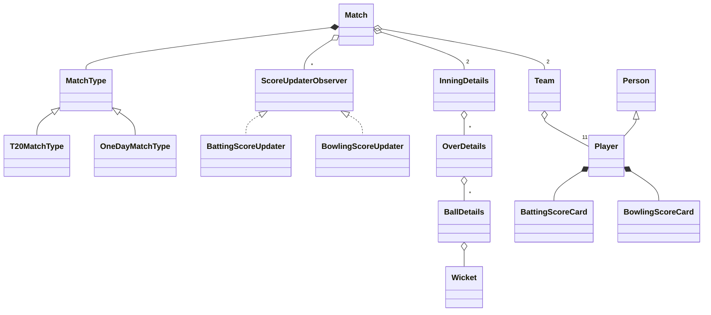

# Cricbuzz (Cricket Scoring) - Low Level Design (C++)

A ball-by-ball cricket scoring system. A match has two innings; each innings is a sequence of overs, and each over a sequence of deliveries. Every delivery updates the team score, the batter's card and the bowler's card, and works out who faces next.

This README walks the question the way you should deliver it in an interview: **Requirements -> Entities -> Class Design -> Implementation -> Extensibility**. Everything here matches the C++ code in this folder.

| Step | Time (45 min interview) | Section |
|---|---|---|
| Understand + clarify | 5 min | [1. Requirements](#1-requirements) |
| Pick the objects | 3-5 min | [2. Entities](#2-entities-and-relationships) |
| Hierarchy, observers, match formats | 10 min | [3. Class design](#3-class-design) |
| Write `playBall` | 15-20 min | [4. Implementation](#4-implementation), [5. Verification](#5-verification) |
| "What if..." | 5+ min | [6. Extensibility](#6-extensibility) |

---

## 0. Understanding the problem

No payments and no scarce resources here, so the interesting part is different: **one event, a delivery, has to update several things correctly, and cricket's rules decide how**. The questions interviewers push on:
1. **What does one ball change?** Team total, batter's card, bowler's card, the over, and who is on strike.
2. **How do you keep adding features** (live commentary, push notifications) without rewriting `playBall`? That's the Observer pattern.
3. **What varies by format?** T20 and ODI have different overs and limits but the same flow.

If you don't follow cricket, ask. These rules matter here:

| Term | Meaning |
|---|---|
| Over | 6 legal deliveries by one bowler; the next over must be a different bowler, from the other end |
| Striker / non-striker | The batter facing, and their partner. An odd number of runs swaps them, and so does the end of an over |
| Wide, no-ball | Illegal deliveries: 1 penalty run, and the ball must be bowled again |
| Free hit | The delivery after a no-ball; the batter can only be out in a few ways, such as a run out |
| Bye, leg bye | Runs taken without hitting the ball: added to the team, not to the batter or the bowler |
| Maiden | An over in which no runs are charged to the bowler |

The interviewer usually opens with:

> "Design a cricket scoring system like Cricbuzz. Show live scores and scorecards for a match."

---

## 1. Requirements

### Clarifying questions

Group your questions around: **what the system does**, **what can go wrong**, **what's in scope**, and **what might change later**.

**You:** "Which formats?"
**Interviewer:** "T20 and ODI to begin with; other formats may come later."
> Formats differ in numbers and rules, not flow: a class per format.

**You:** "Who enters the data? Do we simulate the game?"
**Interviewer:** "A scorer enters what happened on each ball. No simulation."
> So the input is one event per delivery, and we must refuse events that can't happen.

**You:** "What do users see?"
**Interviewer:** "Live score, run rate, the target when chasing, and batting and bowling scorecards."

**You:** "Do extras count differently?"
**Interviewer:** "Yes. Wides, no-balls, byes and leg byes are shown separately, and byes don't count against the bowler."

**You:** "When does an innings end?"
**Interviewer:** "When the overs run out, when the team is all out, or when the chasing team passes the target."

**You:** "What might be added next?"
**Interviewer:** "Commentary and push notifications."
> So delivery events should be easy to subscribe to.

**You:** "Do we need rain rules, a super over, or career statistics?"
**Interviewer:** "Not now, but be ready to discuss them."

### Final requirements

Write this on the board before moving on:

```text
REQUIREMENTS
1. A match: two teams of 11, a format (T20 or ODI), a toss, two innings
2. An over is 6 legal deliveries; wides and no-balls don't count toward them
3. Each delivery updates: team total, extras, batter's card, bowler's card, the over
4. Strike changes on an odd number of runs run, and at the end of each over
5. Bowlers: from the fielding team, never two overs in a row, up to the format's limit
6. Free hit after a no-ball; only some dismissals are possible on a no-ball, free hit or wide
7. An innings ends on overs up, all out, or target reached
8. Second innings target = first innings total + 1; show required run rate
9. Result: won by runs, won by wickets, or tied

OUT OF SCOPE (first version)
- Test matches, rain rules (DLS), super over
- Enforcing power plays and DRS, career statistics, persistence, real-time delivery
```

---

## 2. Entities and relationships

Scan the requirements for nouns, then ask of each: does it hold state or rules of its own?

| Candidate | Keep? | Why |
|---|---|---|
| `Match` | Yes | The orchestrator: teams, format, innings, result. |
| `MatchType` (`T20MatchType`, `OneDayMatchType`) | Yes | Numbers and rules per format. |
| `Team` | Yes | Players, captain, batting order. |
| `Player` (extends `Person`) | Yes | Identity plus current scorecards. |
| `InningDetails` | Yes | Totals, extras, who's batting, the overs, whether it's complete. |
| `OverDetails` | Yes | One bowler's deliveries, legal count, maiden. |
| `BallDetails` | Yes | The event itself: type, runs, wicket. |
| `Wicket` | Yes | How and whom; a ball may or may not have one. |
| `BattingScoreCard`, `BowlingScoreCard` | Yes | Per-player statistics; the two change on different rules. |
| `ScoreUpdaterObserver` | Yes (interface) | Lets scorecards react to a ball without `Match` knowing how. |
| Runs, ball kinds, dismissal kinds | Enums | `RunType`, `BallType`, `WicketType`: no behavior of their own. |



---

## 3. Class design

Work top-down, starting from the orchestrator. For each class ask two questions:
1. **State:** what must it remember to enforce the requirements?
2. **Methods:** what operations does the outside world need?

### Match

| Requirement | What Match must track |
|---|---|
| "Two teams and a format" | `team1_`, `team2_`, `matchType_` |
| "Two innings, target from the first" | `innings_`, `currentInning_` |
| "Won by runs or wickets" | `result_`, `winner_` |
| "Others react to each ball" | `scoreObservers_` |

```text
class Match {
    std::shared_ptr<Team> team1_, team2_;
    std::unique_ptr<MatchType> matchType_;
    std::vector<std::shared_ptr<InningDetails>> innings_;
    std::shared_ptr<InningDetails> currentInning_;
    MatchResult result_;
    std::shared_ptr<Team> winner_;
    std::vector<std::shared_ptr<ScoreUpdaterObserver>> scoreObservers_;
public:
    void conductToss(winner, decision);
    void startInning(battingTeam, bowlingTeam);  // refuses a third, or while one is running
    void startOver(bowler);                      // refuses illegal bowlers
    void playBall(ballType, runs, runType, wicket = nullptr);
    void endInning();
    void determineResult();
    void registerObserver(observer);
};
```

### The hierarchy: match, innings, over, ball

```text
class InningDetails {
    std::vector<std::shared_ptr<OverDetails>> overs_;     // completed overs
    std::shared_ptr<OverDetails> currentOver_;            // null between overs
    int totalRuns_, totalWickets_, totalExtras_;
    int wides_, noBalls_, byes_, legByes_;
    std::shared_ptr<Player> striker_, nonStriker_, currentBowler_;
    int maxOvers_, targetScore_;
    bool isComplete_, freeHitNext_;
};
```

> [!NOTE]
> **Decision: how do you store the score?**
> - **Good: only running totals.** Simple and fast, but you can't show the last over or correct a mistake.
> - **Great (our choice): the history plus running totals.** `OverDetails` keeps every `BallDetails`, which gives the over summary (`. 4 Wd 1 6 2 .`), and `InningDetails` keeps totals, so showing the live score doesn't need a walk through the history.

> [!TIP]
> **Say in the interview:** "A ball is an immutable event, and the totals are derived from those events. That gives me history for commentary and makes it possible to rebuild the score if a correction is needed."

### Observers

```cpp
class ScoreUpdaterObserver {
public:
    virtual void update(std::shared_ptr<BallDetails> ballDetails) = 0;
    virtual std::string getName() const = 0;
};
```

`Match` registers `BattingScoreUpdater` and `BowlingScoreUpdater` in its constructor, and calls every observer for each delivery.

> [!NOTE]
> **Decision: how do scorecards learn about a ball?**
> - **Good: `playBall` updates each card directly.** It's easy to follow, but every new feature means changing `playBall`.
> - **Great (our choice): Observer.** `playBall` publishes the ball; each updater applies its own rules. Adding commentary or notifications means registering one more observer, and `Match` doesn't change.

> [!TIP]
> **Say in the interview:** "Batting and bowling react to the same ball by different rules: a bye counts for neither, a wide counts against the bowler only. Separate observers keep those rules apart."

### Match formats

```cpp
class MatchType {
public:
    void setupMatch() {
        initializeRules();
        setupFieldRestrictions();
        setupReviewSystem();
    }

    // Abstract methods to be implemented by concrete types
    virtual void initializeRules() = 0;
    virtual void setupFieldRestrictions() = 0;
    virtual void setupReviewSystem() = 0;
    virtual int getMaxOversPerBowler() const = 0;
    virtual std::string getDescription() const = 0;
};
```

> [!NOTE]
> **Decision: how do you represent the format?**
> - **Good: an enum with `if`s.** Fine for one or two numbers, but rules spread through the code.
> - **Great (our choice): a class per format, using Template Method.** `setupMatch` fixes the sequence and each format fills in the steps. `T20MatchType` is 20 overs and 4 per bowler; `OneDayMatchType` is 50 and 10. A new format is a new class.

### Where the rules live

| Rule | Lives in | Why there |
|---|---|---|
| Legal delivery | `BallDetails` | A fact about the ball |
| Over of 6, maiden | `OverDetails` | Facts about the over |
| Strike rotation, extras, target, all out | `InningDetails` | It owns the batting pair and the totals |
| Allowed bowler, innings order, result | `Match` | Needs the format and both innings |
| Dismissal possible on this ball | `canBeOutOn` | Depends only on the ball type and dismissal type |
| Bowler gets the credit | `creditsBowler` | Depends only on the dismissal type |

### Final class design

```text
Match
  team1_, team2_, matchType_, innings_, currentInning_, result_, scoreObservers_
  conductToss, startInning, startOver, playBall, endInning, determineResult

MatchType (T20MatchType, OneDayMatchType)
  oversPerInning_, powerPlayOvers_
  setupMatch, getMaxOversPerBowler, getDescription

InningDetails
  overs_, currentOver_, totals, striker_, nonStriker_, currentBowler_, targetScore_
  recordBall, addRuns, recordWicket, completeOver, rotateStrike
  getRunRate, getRequiredRunRate, getScoreSummary, getFullScoreBoard

OverDetails: bowler_, balls_, runsInOver_, runsOffBowler_, isMaiden_
BallDetails: ballType_, runsScored_, runType_, bowler_, striker_, nonStriker_, wicket_
Wicket: wicketType_, batsmanOut_, bowler_, fielder_

Team: players_, captain_, wicketKeeper_
Player: playerType_, details_, battingScoreCard_, bowlingScoreCard_

ScoreUpdaterObserver (BattingScoreUpdater, BowlingScoreUpdater): update
```

### Design patterns used

| Pattern | Where | Why | One line to say |
|---|---|---|---|
| Observer | `ScoreUpdaterObserver`, `Match::notifyObservers` | Several things react to each ball | "New feature, new observer; `playBall` doesn't change." |
| Template Method | `MatchType::setupMatch` | Same setup order, different steps per format | "The base class fixes the sequence; each format fills it in." |
| Composition | Match -> innings -> over -> ball | The domain really is nested | "Each level answers its own questions." |

---

## 4. Implementation

Before writing code, ask the interviewer: real code, pseudocode, or talk it through? The method that matters is `playBall`.

### playBall

```cpp
// Match.hpp
void playBall(BallType ballType, int runs, RunType runType,
              std::shared_ptr<Wicket> wicket = nullptr) {
    if (!currentInning_ || currentInning_->isComplete()) {
        std::cout << "No active innings!\n";
        return;
    }
    if (!currentInning_->hasOverInProgress()) {
        std::cout << "No over in progress!\n";
        return;
    }
    
    auto striker = currentInning_->getStriker();
    auto nonStriker = currentInning_->getNonStriker();
    auto bowler = currentInning_->getCurrentBowler();

    if (ballType == BallType::NORMAL && currentInning_->isFreeHitNext()) {
        ballType = BallType::FREE_HIT;
    }

    // Refuse an impossible dismissal before anything is recorded
    if (wicket) {
        if (wicket->getBatsmanOut() != striker && wicket->getBatsmanOut() != nonStriker) {
            std::cout << "That batsman is not at the crease!\n";
            return;
        }
        if (!canBeOutOn(ballType, wicket->getWicketType())) {
            std::cout << "Cannot be out " << wicketTypeToString(wicket->getWicketType())
                      << " on a " << ballTypeToString(ballType) << "!\n";
            return;
        }
    }
    
    int ballNumber = currentInning_->getBallsInCurrentOver() + 1;
    
    auto ballDetails = std::make_shared<BallDetails>(
        ballNumber, ballType, runs, runType, bowler, striker, nonStriker);
    
    if (wicket) {
        ballDetails->setWicket(wicket);
    }
    
    // Notify all observers to update scores
    notifyObservers(ballDetails);
    
    // Update innings
    currentInning_->recordBall(ballDetails);
    bool isExtra = (runType == RunType::WIDE || runType == RunType::NO_BALL ||
                    runType == RunType::BYE || runType == RunType::LEG_BYE);
    currentInning_->addRuns(runs, runType, isExtra);
    
    if (wicket) {
        currentInning_->recordWicket(wicket);
    }
    
    // Check if over is complete
    if (ballDetails->isLegalDelivery() && 
        currentInning_->getBallsInCurrentOver() >= 6) {
        currentInning_->completeOver();
    }
    // ...
}
```

The order matters. Validate first, so a refused ball changes nothing. Observers run before `addRuns` because the ball's striker has to be the one who faced it, before any rotation.

### Runs, extras and strike

```cpp
// Inning/InningDetails.hpp
void addRuns(int runs, RunType runType, bool isExtra = false) {
    totalRuns_ += runs;
    
    if (isExtra) {
        // On a no-ball only the penalty is an extra: the rest came off the bat
        int extras = (runType == RunType::NO_BALL) ? std::min(runs, 1) : runs;
        totalExtras_ += extras;
        switch (runType) {
            case RunType::WIDE: wides_ += extras; break;
            case RunType::NO_BALL: noBalls_ += extras; break;
            case RunType::BYE: byes_ += extras; break;
            case RunType::LEG_BYE: legByes_ += extras; break;
            default: break;
        }
    }
    
    // Rotate strike for odd runs actually run: the penalty on a wide or no-ball isn't run
    int runsRun = runs;
    if (runType == RunType::WIDE || runType == RunType::NO_BALL) {
        runsRun = std::max(0, runs - 1);
    }
    if (runsRun % 2 == 1) {
        rotateStrike();
    }
    
    // Check if target achieved (second innings)
    if (targetScore_ > 0 && totalRuns_ >= targetScore_) {
        isComplete_ = true;
    }
}
```

A check you can always make: **batter runs + extras = team total.**

### Wickets

```cpp
// Inning/InningDetails.hpp
void recordWicket(std::shared_ptr<Wicket> wicket) {
    wickets_.push_back(wicket);
    totalWickets_++;
    
    // Bring in next batsman, in place of whichever batsman is out
    if (nextBatsmanIndex_ < static_cast<int>(battingTeam_->getTeamSize())) {
        auto nextBatsman = battingTeam_->getPlayer(nextBatsmanIndex_);
        if (wicket->getBatsmanOut() == nonStriker_) {
            nonStriker_ = nextBatsman;
        } else {
            striker_ = nextBatsman;
        }
        nextBatsmanIndex_++;
    } else {
        isComplete_ = true;  // All out
    }
}

// Inning/BallDetails.hpp
inline bool canBeOutOn(BallType ballType, WicketType wicketType) {
    bool alwaysPossible = wicketType == WicketType::RUN_OUT ||
                          wicketType == WicketType::HANDLED_BALL ||
                          wicketType == WicketType::OBSTRUCTING_FIELD;
    switch (ballType) {
        case BallType::NO_BALL:
        case BallType::FREE_HIT:
            return alwaysPossible;
        case BallType::WIDE:
            return alwaysPossible || wicketType == WicketType::STUMPED ||
                   wicketType == WicketType::HIT_WICKET;
        case BallType::DEAD_BALL:
            return false;
        default:
            return true;
    }
}
```

All out needs no count: with 11 players, the tenth wicket finds nobody left to come in.

### Choosing the bowler

```cpp
// Match.hpp
if (currentInning_->hasOverInProgress()) {
    std::cout << "The current over is not finished!\n";
    return;
}
if (!bowler || !currentInning_->getBowlingTeam()->getPlayerById(bowler->getPlayerId())) {
    std::cout << "The bowler must be in the fielding team!\n";
    return;
}
const auto& overs = currentInning_->getOvers();
if (!overs.empty() && overs.back()->getBowler() == bowler) {
    std::cout << bowler->getName() << " cannot bowl two overs in a row!\n";
    return;
}
if (bowler->getBowlingScoreCard()->getOversBowled() >= matchType_->getMaxOversPerBowler()) {
    std::cout << bowler->getName() << " has bowled the maximum overs!\n";
    return;
}
```

### What one observer does

```cpp
// ScoreUpdater/BowlingScoreUpdater.hpp
if (ballType == BallType::WIDE) {
    bowlingCard->addWide();
    // Additional runs on wide
    if (runs > 1) {
        bowlingCard->addRuns(runs - 1);
    }
} else if (ballType == BallType::NO_BALL) {
    bowlingCard->addNoBall();
    // Runs scored off no-ball
    if (runs > 1) {
        bowlingCard->addRuns(runs - 1);
    }
} else {
    // Regular runs conceded (excluding byes and leg byes)
    if (runType != RunType::BYE && runType != RunType::LEG_BYE) {
        bowlingCard->addRuns(runs);
    }
}

// Increment balls for legal deliveries
if (ballDetails->isLegalDelivery()) {
    bowlingCard->incrementBalls();
}
```

### Deciding the result

```cpp
// Match.hpp
if (team2Score > team1Score) {
    result_ = (battingSecond == team1_) ? MatchResult::TEAM1_WON : MatchResult::TEAM2_WON;
    winner_ = battingSecond;
    int wicketsRemaining = 10 - team2Wickets;
    std::cout << "\n=== MATCH RESULT ===\n";
    std::cout << winner_->getName() << " won by " << wicketsRemaining << " wickets!\n";
} else if (team1Score > team2Score) {
    result_ = (battingFirst == team1_) ? MatchResult::TEAM1_WON : MatchResult::TEAM2_WON;
    winner_ = battingFirst;
    int runDifference = team1Score - team2Score;
    std::cout << "\n=== MATCH RESULT ===\n";
    std::cout << winner_->getName() << " won by " << runDifference << " runs!\n";
} else {
```

The team batting second wins by wickets remaining, and the team batting first wins by runs. That's why `team1Score` here means the first innings, not `team1_`.

### The bugs this code used to have

> [!WARNING]
> **1. Overs never counted.** `playBall` created each ball and never added it to the over. The demo printed `28/1 (0.0 overs)` and `RR: 0.00`, every ball was "ball 1", no over ever finished, strike never changed at the end of an over, and 20 overs didn't end the innings.
>
> **2. Strike rotated on penalty runs.** A single wide swapped the batters. A no-ball with one run taken didn't.
>
> **3. Runs off a no-ball were counted twice.** They went to the batter and to extras, so the demo's scoreboard read batters 26 + extras 3 against a total of 28.
>
> **4. A run-out of the non-striker removed the striker.** The non-striker stayed in and wasn't marked out, and the striker was replaced.
>
> **5. The second innings erased the first.** `startInning` reset the batting team's cards, and that team had just bowled, so its bowling figures went to zero (4 runs became 0).
>
> **6. The game didn't stop.** Runs were still added after all out, after the target was passed, and with no over started. A third innings could begin, and `determineResult` declared a winner in the middle of a chase, with "Need -3 runs" shown after a win.
>
> **7. Illegal dismissals and bowlers were accepted.** Bowled on a no-ball or free hit counted; a bowler got credit for obstructing the field. The same bowler could bowl consecutive overs or beyond the limit (5 overs in a T20), a player from the batting team could bowl, and starting a new over discarded the one in progress.
>
> **8. Maidens were wrong.** The bowler's card counted an over of 1 wide and 6 dots as a maiden. The over's own check treated a wicket as breaking a maiden, and byes as runs off the bowler.

The fixes: record every ball, separate runs run from penalty runs, reset cards only at the start of the match, and check innings, over, bowler and dismissal rules before recording anything. `Wicket::toString`, declared but never defined, was removed as well, since calling it would fail at link time. Lesson: **add invariants you can check (batter runs + extras = total). Bug 3 was sitting in the demo's own output, waiting for someone to add the numbers up.**

### C++ talking points

- **Forward declaration:** `Wicket.hpp` declares `class Player;` because it only stores `std::shared_ptr<Player>`, which avoids a circular include. Anything that dereferences the pointer needs the full class.
- **`std::shared_ptr<Player>`** is shared by the team, balls and wickets, and identity is compared with `==`: `wicket->getBatsmanOut() == nonStriker_`.
- **`std::unique_ptr` for scorecards and format:** a `Player` owns its cards and a `Match` owns its `MatchType`. `resetScoreCards` replaces them, so any saved raw pointer would dangle: `getBattingScoreCard()` is called fresh each time.
- **`std::unique_ptr<MatchType>` keeps the base type:** `matchType_->getMaxOversPerBowler()` dispatches virtually, which is why it had to be added to the base class as a pure virtual function.
- **`virtual ~Person() = default`:** needed because `Player` derives from it and may be deleted through a base pointer. `MatchType` and `ScoreUpdaterObserver` do the same.
- **`inline` free functions** in headers, like `canBeOutOn`, avoid multiple-definition link errors.
- **`switch` on `enum class`:** the `default` branch means the compiler can't warn when a new enum value is missed.

### Gaps in our code (know these before the interviewer finds them)

I tested each of these by running the code, except where marked "by reading". Raising them yourself, with the fix, is a strong signal.

| Gap | What happens | Fix to say |
|---|---|---|
| **Scorecards live on `Player`** (by reading) | A player's figures are one set of cards, reset at the start of a match. They can't hold two matches at once or keep past matches. | Key cards by innings: `InningDetails` owns a map of player id to cards. |
| **Runs and run type can disagree** | `playBall(NORMAL, 3, RunType::SIX)` was accepted as 3 runs labelled SIX. `getRunValue` exists but nothing calls it. | Pass the count only for extras; derive the rest from `RunType`. |
| **Retirement is treated as a wicket** | `RETIRED_HURT` raised team wickets to 1, and has to be attached to a delivery; `TIMED_OUT` has the same problem (by reading). The retired batter can't return. | A separate `retireBatter` between deliveries, with no wicket counted. |
| **No correcting a mistake** (by reading) | A wrong entry can't be undone; totals and cards only go up. | Treat balls as events: replay them without the bad one, or apply a reversing event. |
| **Toss decision isn't used** (by reading) | `conductToss` prints it, and the caller chooses who bats. `startInning` doesn't check that the teams are in this match. | Have `Match` derive the batting team from the toss. |
| **Power play and DRS are only printed** (by reading) | `setupMatch` prints the rules; `getFieldersOutsideCirclePowerPlay`, `getDRSReviewsPerInnings` and `isFollowOnApplicable` are never called. | Track fielding and reviews as state when they're needed. |
| **Team size isn't enforced** | A 12th `addPlayer` is silently ignored. Nothing stops a match with fewer than 11 (by reading). | Throw on a 12th; check for 11 at the start of the match. |
| **"Won by N wickets" assumes 10** (by reading) | The margin is `10 - wickets`, which is wrong for a team that has lost players or retired batters. | Use the number of batters available. |
| **A tie just ends** | Level scores print "Match Tied!" with no super over. | [Follow-up 3](#3-resolve-a-tie-with-a-super-over). |
| **Injured bowler can't be replaced** (by reading) | `startOver` refuses while an over is in progress, so nobody can finish another bowler's over. | A `replaceBowler` that keeps the over and credits each ball to its bowler. |
| **Not thread-safe** (by reading) | No locks, so one scorer thread and many readers would race on the totals. | [Follow-up 1](#1-push-live-scores-to-millions-of-users). |
| **Career figures never update** (by reading) | `PlayerDetails::addRuns`, `addWickets` and `addMatch` are never called. | A `determineResult` observer that adds a match's totals. |

---

## 5. Verification

The outputs below are from actually running the code.

**Demo**: India bat, Australia chase.
```text
Over 1 (Mitchell Starc):  . 4 Wd 1 6 2 .     | 14 runs
Over 2 (Josh Hazlewood):  1 . W 4 Nb 6 1     | 14 runs, 1 wicket(s)
Rohit Sharma:  13* (6b)   Shubman Gill: 8 (5b) - Bowled   Virat Kohli: 5* (2b)
Extras: 2 (Wd: 1, Nb: 1)
TOTAL: 28/1 (2.0 overs)                      13 + 8 + 5 + 2 = 28

Over 1 (Jasprit Bumrah):  6 4 . 6 1 4        | 21 runs
Over 2 (Mohammed Siraj):  4 2 2              | 8 runs
Score: Australia: 6/0 (0.1 ov) | RR: 36.0 | Need 23 runs | RRR: 1.15
TOTAL: 29/0 (1.3 overs)
Australia won by 10 wickets!
Status: Team 2 Won
```

**Overs and strike** (separate test program)
```text
six singles: overs 1.0, completed overs 1, RR 6, on strike A2/A1
one wide: strike stays A1/A2
no-ball + 1 run taken: A2/A1
1 bye: A1/A2
mixed over: batter runs 11 + extras 6 = total 17; bowler charged 15 (2 leg byes excluded)
```

**Wickets**
```text
non-striker A2 run out: pair A1/A3; A2 marked out; bowler wickets 0
bowled on a no-ball: refused, wickets 0
no-ball, then bowled on the free hit: refused, wickets 0
wide, then bowled (still a free hit): refused, wickets 0
run out on the free hit: wickets 1; bowled on the next ball: wickets 2
stumped on a wide: wickets 1; bowled on a wide: refused
batter not at the crease: refused
obstructing the field: bowler wickets 0
10 wickets: innings complete; ball after all out: refused, total unchanged
```

**Bowlers**
```text
new bowler mid-over: refused, B7 still bowling, balls this over 2
same bowler twice in a row: refused
player from the batting team: refused
two bowlers alternating 10 overs: B7 stops at 4.0 (T20 limit)
20 overs by 5 bowlers: overs 20.0, innings complete; another ball refused
```

**Maidens**
```text
wide + 6 dots: 0 maidens, 1 run
wicket + 5 dots: maiden
6 byes: maiden
```

**Result**
```text
second innings starts: first-innings bowler still shows 4 runs, batter still shows 4 runs
target 7, score 10: B: 10/0 (0.2 ov) | RR: 30.0; innings complete; another ball refused
result mid-chase: status In Progress
chase ended short at 4 of 7: A won by 2 runs!
scores level: Match Tied!
third innings: refused
```

---

## 6. Extensibility

If there's time left, expect "what if" questions. You usually explain where the change goes rather than code it. Junior candidates may skip this; senior candidates can get several in a row.

### 1. "Push live scores to millions of users"

> "Add a `LiveScorePublisher` observer that publishes each ball to a message queue. Serving processes consume the queue and push over WebSockets, and a cache holds the current score for new viewers. One scorer writes per match, so ordering by a per-match sequence number is straightforward, and readers never touch the `Match` objects."

```text
class LiveScorePublisher : public ScoreUpdaterObserver {
    void update(std::shared_ptr<BallDetails> ball) override {
        queue.publish("match-" + matchId, toJson(ball));
    }
};
```

### 2. "Add ball-by-ball commentary"

> "A `CommentaryObserver` registered on the match. `BallDetails` already has a `commentary_` field. This is the case the Observer pattern exists for: `Match` doesn't change."

### 3. "Resolve a tie with a super over"

> "After a tie, `determineResult` starts two more `InningDetails` with `maxOvers = 1`, and the team list limited to three batters, which also ends the innings at two wickets. Reuse everything else. Scorecards must be kept apart from the main innings, which is another reason to key them by innings."

### 4. "Rain: DLS"

> "A `TargetCalculator` strategy that takes the overs and wickets available at each stoppage and returns a revised target. `InningDetails` already has `setTargetScore` and `maxOvers_`, so it needs a way to change them, plus an event recording the interruption."

### 5. "Add Test matches"

> "A new `MatchType` for the rules, but the flow changes too: four innings, no over limit, declarations, follow-on, and draws. `Match` hardcodes two innings and target logic, so that moves behind the format: `MatchType` decides whether another innings is due and how the result is computed."

### 6. "Correct a wrong entry"

> "Store balls as an append-only event log with a sequence number. To correct one, mark it void and rebuild the innings by replaying the rest. Since cards and totals are derived from balls, replay gives the right answer. Observers need a matching correction event, so subscribers stay in step."

---

## 7. What is expected at each level

**Junior.** Match, team, player, innings, over and ball classes; each ball adds runs and updates cards; extras don't count as legal balls. Hints on Observer are fine.

**Mid-level.** Observer for scorecards, a class per format, correct strike rotation and extras, innings-ending conditions, and refusing illegal input. Handle free hits and non-striker run-outs. Point out invariants like batter runs + extras = total.

**Senior.** Treat balls as events and totals as derived data. Discuss corrections, scaling reads with a queue and cache, where scorecards should live, and how Test cricket would break the two-innings assumption. Explain what the design gives up, such as observers running synchronously.

---

## 8. Test yourself

<details><summary>1. Why Observer for scorecards, rather than direct calls in <code>playBall</code>?</summary>

Batting and bowling react to a ball by different rules, and more reactions are coming (commentary, notifications). With Observer, each adds a class and registers, and `playBall` doesn't change.
</details>

<details><summary>2. Why do observers run before <code>addRuns</code>?</summary>

The ball's striker must be whoever faced it. `addRuns` may rotate the strike and `recordWicket` may replace a batter. `BallDetails` captures striker and non-striker up front, so the ball stays accurate either way.
</details>

<details><summary>3. A batter takes one run off a no-ball. How much goes where, and who is on strike?</summary>

Two runs are added to the team total: one penalty (an extra) and one to the batter. The bowler is charged both. Batters crossed once, so the strike changes. The next delivery is a free hit, and the no-ball doesn't count toward the 6.
</details>

<details><summary>4. Why does a single wide not change the strike?</summary>

Strike follows runs actually run, and the penalty isn't run. So a wide worth 1 means 0 run; a wide worth 2 means 1 run, and they swap. The code computes `runsRun` for that reason.
</details>

<details><summary>5. What's an invariant you can use to test the scoring?</summary>

Batter runs + extras = team total. It caught the double-counted no-ball run: 26 + 3 against 28. Also: bowler runs + byes + leg byes = team total.
</details>

<details><summary>6. Why can't <code>startInning</code> reset every player's card each time?</summary>

The team batting second has just bowled, so resetting erases its bowling figures, and the first innings scorecard can no longer be shown. Cards are now reset only at the start of the match. Better still would be to key them by innings.
</details>

<details><summary>7. How does the code know the team is all out?</summary>

`recordWicket` looks for the next batter. With 11 players, the openers plus nine more cover nine wickets, so the tenth finds `nextBatsmanIndex_` at the end, which sets `isComplete_`.
</details>

<details><summary>8. Why does the team batting second win by wickets, not runs?</summary>

The chase stops as soon as the target is passed, so a chasing win is measured by wickets in hand. The side batting first wins by the run difference. Which team "first" means comes from `innings_[0]`, not from `team1_`.
</details>

<details><summary>9. A wicket falls on an over's sixth ball, and the batter ran one first. What's the order of changes?</summary>

Observers record the ball; `recordBall` adds it to the over; `addRuns` adds the run and rotates; `recordWicket` replaces the batter who's out, at whichever end they're now at; and `completeOver` stores the over and rotates again.
</details>

<details><summary>10. Where does a maiden come from, and what doesn't break one?</summary>

An over with no runs charged to the bowler. Wides and no-balls count against the bowler; byes, leg byes and wickets don't break it. So "wicket + 5 dots" and "6 byes" are both maidens, and "wide + 6 dots" isn't.
</details>

<details><summary>11. What would you change first in this design for production?</summary>

Move scorecards from `Player` to the innings, make balls an append-only log so that errors can be corrected by replay, and publish balls to a queue so readers never touch the scoring objects.
</details>

---

## 9. Run it

```bash
cd lld/cricbuzz
g++ -std=c++17 main.cpp -o cricbuzz
./cricbuzz
```

Expected key lines:

```text
=== TOSS ===
India won the toss and elected to bat first.
...
[0.2] 2. FOUR!
Score: India: 4/0 (0.2 ov) | RR: 12.0
...
Extras: 2 (Wd: 1, Nb: 1, B: 0, Lb: 0)

TOTAL: 28/1 (2.0 overs)
...
Over 1 (Mitchell Starc): . 4 Wd 1 6 2 . | 14 runs
Over 2 (Josh Hazlewood): 1 . W 4 Nb 6 1 | 14 runs, 1 wicket(s)
...
TOTAL: 29/0 (1.3 overs)
...
Australia won by 10 wickets!
```

### Files

```text
cricbuzz/
├── main.cpp                       India vs Australia: a two-over innings and a chase
├── Match.hpp                      toss, innings, overs, playBall, result
├── MatchType.hpp                  format base class (Template Method)
├── T20MatchType.hpp, OneDayMatchType.hpp
├── Inning/
│   ├── InningDetails.hpp          totals, extras, strike, target, scoreboard
│   ├── OverDetails.hpp            balls, legal count, maiden, summary
│   ├── BallDetails.hpp            one delivery; canBeOutOn
│   └── BallType.hpp, RunType.hpp
├── ScoreUpdater/
│   ├── ScoreUpdaterObserver.hpp   observer interface
│   └── BattingScoreUpdater.hpp, BowlingScoreUpdater.hpp
└── Team/
    ├── Team.hpp, Person.hpp, PlayerDetails.hpp (PlayerDetails and Player), PlayerType.hpp
    ├── Wicket.hpp, WicketType.hpp creditsBowler
    └── Score/                     BattingScoreCard.hpp, BowlingScoreCard.hpp
```
