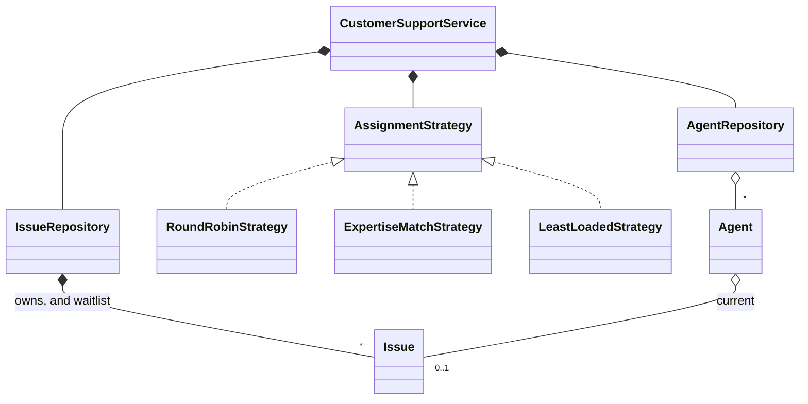
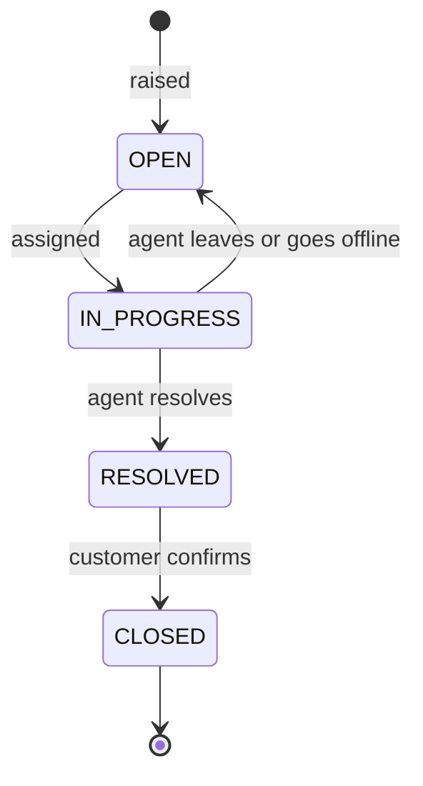
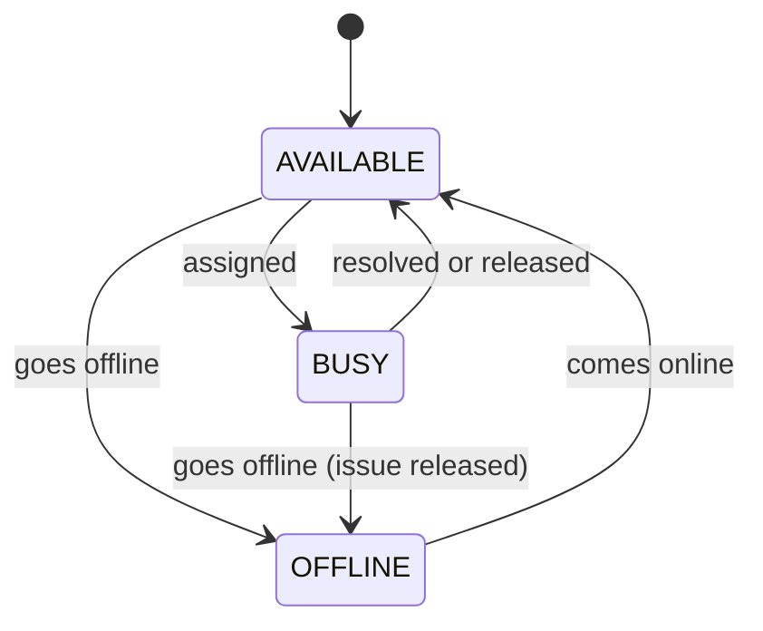

# Customer Support System - Low Level Design (C++)

A support desk that routes customer issues to agents. An issue goes to a free agent chosen by a pluggable strategy; if nobody is free, it waits in a queue. When an agent finishes, they pick up the next waiting issue.

This README walks the question the way you should deliver it in an interview: **Requirements -> Entities -> Class Design -> Implementation -> Extensibility**. Everything here matches the C++ code in this folder.

| Step | Time (45 min interview) | Section |
|---|---|---|
| Understand + clarify | 5 min | [1. Requirements](#1-requirements) |
| Pick the objects | 3-5 min | [2. Entities](#2-entities-and-relationships) |
| Strategies, waitlist, lifecycles | 10 min | [3. Class design](#3-class-design) |
| Write `raiseIssue` and `resolveIssue` | 15-20 min | [4. Implementation](#4-implementation), [5. Verification](#5-verification) |
| "What if..." | 5+ min | [6. Extensibility](#6-extensibility) |

---

## 0. Understanding the problem

This is a matching problem between issues and agents, with a queue for when demand beats supply. The questions interviewers push on:
1. **How is an agent chosen?** The rule changes between companies, so it should be pluggable.
2. **What happens when nobody is free,** and when somebody becomes free?
3. **What happens to work in flight** when an agent logs off or leaves? This is the part that's easy to miss: an issue must never be stranded.

The interviewer usually opens with:

> "Design a customer support system. Customers raise issues, and agents resolve them."

---

## 1. Requirements

### Clarifying questions

Group your questions around: **what the system does**, **what can go wrong**, **what's in scope**, and **what might change later**.

**You:** "How many issues can an agent handle at once?"
**Interviewer:** "One at a time."
> So an agent is either free or busy, which keeps availability simple.

**You:** "How do we choose among free agents?"
**Interviewer:** "It depends. Round robin, by expertise, or whoever has handled the least. It should be switchable."
> A strategy.

**You:** "Do agents specialise?"
**Interviewer:** "Yes: billing, technical, account, general. Some agents handle everything."

**You:** "If no agent is free?"
**Interviewer:** "The issue waits in a queue, and agents pick up from it when they finish."

**You:** "What if an agent logs off, or leaves, in the middle of an issue?"
**Interviewer:** "Good question. The customer shouldn't lose their place."
> So their issue goes back to another agent or to the front of the queue.

**You:** "What's the life of an issue?"
**Interviewer:** "Open, in progress, resolved, then closed once the customer confirms."

**You:** "Priorities, SLAs, chat?"
**Interviewer:** "Not for now."

### Final requirements

Write this on the board before moving on:

```text
REQUIREMENTS
1. Raise an issue: customer, description, type (BILLING, TECHNICAL, GENERAL, ACCOUNT)
2. An agent has expertise (a list of types, or all) and handles one issue at a time
3. A pluggable strategy picks a free agent: round robin, expertise match, least loaded
4. No free agent: the issue waits in first-come order
5. When an agent becomes free or joins, they take a waiting issue, preferring their expertise
6. An agent leaving or going offline gives the issue back; it keeps its place in line
7. Issue: OPEN -> IN_PROGRESS -> RESOLVED -> CLOSED; closing needs a resolved issue
8. Never give one agent two issues; never lose an issue

OUT OF SCOPE (first version)
- Priorities and SLAs, several issues per agent, escalation
- Customer accounts, notifications, conversation history
```

---

## 2. Entities and relationships

Scan the requirements for nouns, then ask of each: does it hold state or rules of its own?

| Candidate | Keep? | Why |
|---|---|---|
| `Issue` | Yes | Customer, type, status; owns its lifecycle. |
| `Agent` | Yes | Expertise, status, current issue, resolved count. |
| `AssignmentStrategy` | Yes (interface) | The rule for picking an agent. |
| `AgentRepository`, `IssueRepository` | Yes | Own the collections; the waitlist lives with the issues. |
| `CustomerSupportService` | Yes | The orchestrator: runs each use case. |
| Status and type values | Enums | `IssueStatus`, `AgentStatus`, `IssueType`. |
| Customer | No | Only an id is needed here. |



---

## 3. Class design

Work top-down, starting from the orchestrator. For each class ask two questions:
1. **State:** what must it remember to enforce the requirements?
2. **Methods:** what operations does the outside world need?

### CustomerSupportService

| Requirement | What the service must track |
|---|---|
| "Agents and issues" | The two repositories |
| "Switchable rule" | `assignmentStrategy` |
| "Never give one agent two issues" | A lock around choose + assign |

```cpp
class CustomerSupportService {
private:
    AgentRepository agentRepo;
    IssueRepository issueRepo;
    std::unique_ptr<AssignmentStrategy> assignmentStrategy;
    mutable std::mutex mutex_;  // Makes choosing an agent and assigning to it one step
public:
    void addAgent(Agent* agent);
    void removeAgent(const std::string& agentId);
    void setAgentOnline(const std::string& agentId);
    void setAgentOffline(const std::string& agentId);
    void setAssignmentStrategy(std::unique_ptr<AssignmentStrategy> strategy);
    Issue* raiseIssue(const std::string& customerId, const std::string& description, IssueType type);
    void resolveIssue(const std::string& agentId);
    void closeIssue(const std::string& issueId);
};
```

> [!NOTE]
> **Decision: who decides an agent is free right now?**
> - **Good: a lock in each repository.** Every single read and write is safe, but "pick a free agent, then assign" is two steps, and two threads can pick the same agent.
> - **Great (our choice): one lock across the whole use case.** The service's mutex covers choosing and assigning together. The repositories keep their own locks for direct reads.

> [!TIP]
> **Say in the interview:** "Thread-safe parts don't make a thread-safe operation. The invariant is one issue per agent, and it spans a check and a write, so the lock has to span them too."

### Issue and its lifecycle



> [!NOTE]
> **Decision: who guards the status?**
> - **Good: the service checks before changing it.** Each caller must remember, and a public `setStatus` makes the rules optional.
> - **Great (our choice): `Issue` enforces its own moves.** `assignToAgent`, `releaseFromAgent`, `resolve` and `close` throw if the current status doesn't allow them, and there is no status setter. A closed issue can't return to work.

### Agent



`isAvailable()` checks both fields: `status == AVAILABLE && currentIssue == nullptr`. An empty expertise list means the agent can handle everything.

### Strategies

```cpp
class AssignmentStrategy {
public:
    virtual ~AssignmentStrategy() = default;
    virtual Agent* assignIssue(std::vector<Agent*>& agents, Issue* issue) = 0;
    virtual std::string getStrategyName() const = 0;
};
```

| Strategy | Rule | Weakness |
|---|---|---|
| `RoundRobinStrategy` | Next free agent after the last one chosen | Ignores expertise |
| `ExpertiseMatchStrategy` | First free expert; otherwise any free agent | A non-expert may get the issue while an expert is about to finish |
| `LeastLoadedStrategy` | Free agent with the fewest issues resolved | "Load" here means past work, since nobody holds more than one |

> [!NOTE]
> **Decision: how is the choice of agent made pluggable?**
> - **Good: an enum and a `switch` in the service.** A new rule means editing the service.
> - **Great (our choice): Strategy.** The strategy only chooses; the service does the assigning. `setAssignmentStrategy` swaps rules at runtime. It returns `nullptr` when nobody is free, and that's the signal to queue.

### Waitlist

> [!NOTE]
> **Decision: what does a freed agent take from the queue?**
> - **Good: strictly the oldest issue.** It's simple and fair, but a technical agent can pick up a billing issue while a technical one waits behind it.
> - **Great (our choice): the oldest issue they have expertise in, otherwise the oldest of all.** Work stays with experts, and nobody sits idle while issues wait. The cost: a type with no free experts can be overtaken for a while (see gaps).

That's why the waitlist is a `std::deque`: it allows removing from the middle, and putting a released issue back at the front.

### Final class design

```text
CustomerSupportService
  agentRepo, issueRepo, assignmentStrategy, mutex_
  addAgent, removeAgent, setAgentOnline, setAgentOffline
  raiseIssue, resolveIssue, closeIssue, setAssignmentStrategy

AgentRepository: agents (id -> Agent*), agentList (insertion order)
IssueRepository: issues (id -> Issue*, owned), waitlist (deque), issueCounter

Agent: status, expertise, currentIssue, resolvedCount
  isAvailable, hasExpertise, assignIssue, resolveCurrentIssue, releaseCurrentIssue

Issue: customerId, description, type, status, assignedAgentId, createdAt, resolvedAt
  assignToAgent, releaseFromAgent, resolve, close
```

### Design patterns used

| Pattern | Where | Why | One line to say |
|---|---|---|---|
| Strategy | `AssignmentStrategy` and its three classes | The routing rule changes independently | "A new rule is a new class; the service doesn't change." |
| Repository | `AgentRepository`, `IssueRepository` | Storage is apart from the rules | "Swapping in a database touches only these." |
| Service layer | `CustomerSupportService` | One place runs each use case | "Models hold state, the service coordinates." |

---

## 4. Implementation

Before writing code, ask the interviewer: real code, pseudocode, or talk it through? The methods that matter are `raiseIssue` and `resolveIssue`.

### Raising an issue

```cpp
// service/CustomerSupportService.hpp
bool tryAssign(Issue* issue) {
    std::vector<Agent*> agents = agentRepo.getAllAgents();
    Agent* agent = assignmentStrategy->assignIssue(agents, issue);
    if (agent == nullptr) {
        return false;
    }
    agent->assignIssue(issue);
    std::cout << "  [Assigned] Issue " << issue->getIssueId() 
              << " to Agent " << agent->getName() << std::endl;
    return true;
}
// ...
Issue* raiseIssue(const std::string& customerId, 
                  const std::string& description,
                  IssueType type) {
    std::lock_guard<std::mutex> lock(mutex_);

    // Create the issue
    Issue* issue = issueRepo.createIssue(customerId, description, type);

    // Try to assign to an agent
    if (!tryAssign(issue)) {
        issueRepo.addToWaitlist(issue);
        std::cout << "  [Waitlist] Issue " << issue->getIssueId() 
                  << " added to queue (no agents available)" << std::endl;
    }

    return issue;
}
```

### Resolving, and picking up the next issue

```cpp
// service/CustomerSupportService.hpp
void resolveIssue(const std::string& agentId) {
    std::lock_guard<std::mutex> lock(mutex_);
    Agent* agent = requireAgent(agentId);

    Issue* resolved = agent->resolveCurrentIssue();
    if (resolved) {
        std::cout << "  [Resolved] Issue " << resolved->getIssueId() 
                  << " by Agent " << agent->getName() << std::endl;
        
        // Try to assign next issue from waitlist
        tryAssignFromWaitlist(agent);
    }
}
// ...
void tryAssignFromWaitlist(Agent* agent) {
    if (issueRepo.hasWaitingIssues() && agent->isAvailable()) {
        // Prefer the oldest issue this agent has expertise in
        Issue* waitingIssue = issueRepo.getNextFromWaitlist([agent](const Issue* issue) {
            return agent->hasExpertise(issue->getType());
        });
        if (waitingIssue) {
            agent->assignIssue(waitingIssue);
            std::cout << "  [Auto-assigned] Issue " << waitingIssue->getIssueId() 
                      << " from waitlist to Agent " << agent->getName() << std::endl;
        }
    }
}

// repository/IssueRepository.hpp
Issue* getNextFromWaitlist(const std::function<bool(const Issue*)>& preferred) {
    std::lock_guard<std::mutex> lock(mutex_);
    if (waitlist.empty()) return nullptr;
    auto it = std::find_if(waitlist.begin(), waitlist.end(), preferred);
    if (it == waitlist.end()) {
        it = waitlist.begin();
    }
    Issue* next = *it;
    waitlist.erase(it);
    return next;
}
```

The repository doesn't need to know about agents: the service passes in what "preferred" means. The same `tryAssignFromWaitlist` runs whenever capacity appears: an issue resolved, an agent joining, or an agent coming online.

### Work in flight

```cpp
// service/CustomerSupportService.hpp
void setAgentOffline(const std::string& agentId) {
    std::lock_guard<std::mutex> lock(mutex_);
    Agent* agent = requireAgent(agentId);
    Issue* issue = agent->releaseCurrentIssue();
    agent->goOffline();
    reassign(issue);
}
// ...
void reassign(Issue* issue) {
    if (issue && !tryAssign(issue)) {
        issueRepo.addToFrontOfWaitlist(issue);
        std::cout << "  [Waitlist] Issue " << issue->getIssueId() 
                  << " back at the front of the queue" << std::endl;
    }
}
```

`goOffline` comes before `reassign` so the strategy can't give the issue straight back to the same agent. `removeAgent` does the same, removing the agent from the repository before reassigning.

### Round robin

```cpp
// strategy/RoundRobinStrategy.hpp
size_t startIndex = lastAssignedIndex;
size_t count = 0;

while (count < agents.size()) {
    size_t currentIndex = (startIndex + count) % agents.size();
    Agent* agent = agents[currentIndex];

    if (agent->isAvailable()) {
        lastAssignedIndex = (currentIndex + 1) % agents.size();
        return agent;
    }
    count++;
}

return nullptr;  // No available agent found
```

### The bugs this code used to have

> [!WARNING]
> **1. Issues could be lost.** Choosing and assigning weren't one step. With a strategy that paused for 2 ms after choosing, 8 threads raising issues gave one agent 8 issues on all 30 runs: all 8 showed IN_PROGRESS, the agent held one, and the other 7 were lost. Calling `assignIssue` on a busy agent also silently replaced its issue.
>
> **2. Issues were stranded.** Removing a busy agent left the issue IN_PROGRESS forever, assigned to nobody, even with another agent free. An offline agent that finished an issue became AVAILABLE again.
>
> **3. New capacity ignored the queue.** An agent joining or coming online left waiting issues waiting, until someone else happened to resolve one.
>
> **4. Closed issues came back.** Closing a waiting issue left it in the queue, and the next free agent reopened it as IN_PROGRESS. Closing one in progress let the agent resolve it, turning CLOSED back into RESOLVED.
>
> **5. Agents took the wrong work.** A freed TECHNICAL agent took the older BILLING issue while a TECHNICAL one waited behind it.

The fixes: one lock across each use case, `releaseCurrentIssue` with reassignment, a waitlist check whenever capacity appears, guarded transitions, and expertise-first pickup. Lesson: **list every event that changes capacity or ownership (raise, resolve, join, leave, offline, online), and check each one leaves no issue stranded.**

### C++ talking points

- **`std::unique_ptr<AssignmentStrategy>`:** the service owns its strategy, and swapping it destroys the old one. `virtual ~AssignmentStrategy() = default` makes that safe.
- **`mutable std::mutex`** lets `const` methods like `getActiveStrategy` lock.
- **`std::function<bool(const Issue*)>` and a lambda:** the lambda captures `agent` by value (it's a pointer), and the call happens before the function returns, so nothing dangles.
- **`std::deque`** instead of `std::queue`: `queue` only exposes the two ends, and we need to search and erase in the middle.
- **Returning a `std::vector<Agent*>` by value** from `getAllAgents`: it used to return a reference to the member, which let callers read it without the lock.
- **Ownership:** `IssueRepository` `new`s and `delete`s issues. Agents belong to the caller (`main` creates them), so an agent must outlive any call that uses it.
- **Comment out unused parameters:** `Issue* /*issue*/` keeps the override's signature and silences `-Wunused-parameter`.

### Gaps in our code (know these before the interviewer finds them)

I tested each of these by running the code, except where marked "by reading". Raising them yourself, with the fix, is a strong signal.

| Gap | What happens | Fix to say |
|---|---|---|
| **Round robin ignores expertise** | A technical issue went to an agent whose only expertise is billing. | Filter by expertise first, then rotate among experts. |
| **Expertise falls back to anyone** | With no free expert, a technical issue went to a billing-only agent rather than wait. | Make fallback optional, or fall back only after a wait limit. |
| **"Least loaded" is really "least experienced"** | It compares issues resolved in the past. An agent who resolved 1 lost out to one who resolved 0, whatever they're doing now. | Track time spent, or open issues if agents take more than one. |
| **Preferring expertise can starve an issue** (by reading) | A BILLING issue can be overtaken by newer TECHNICAL ones while only technical agents are finishing work. Fallback helps only when no preferred issue waits. | Raise an issue's priority with age. |
| **No priorities** (by reading) | First come, first served, so an outage waits behind a question. | A priority queue keyed by (priority, time). |
| **`Agent` can be changed directly** | `agent->goOffline()` on a busy agent keeps the issue with them; the service's `setAgentOffline` is what releases it. | Keep agents inside the service and hand out read-only views. |
| **Agents are raw pointers owned by the caller** (by reading) | Deleting an agent while the service still holds it would dangle. `main` deletes them before the service is destroyed, which is safe only because nothing uses them after that. | The repository owns agents with `std::unique_ptr`. |
| **The lock is held while printing** (by reading) | `std::cout` and the strategy run inside the lock, which limits throughput. | Log outside the lock. |
| **Waitlist search is linear** (by reading) | `find_if` walks the queue each time. | One queue per issue type. |
| **Listing order isn't stable** | The demo's summary came out as ISS000006, 5, 4, 3, 7, 2, 1, since `getAllIssues` walks an `unordered_map`. | Keep creation order, or sort by id. |
| **No validation of input** (by reading) | An empty customer id or description is accepted. | Check in `raiseIssue`. |

---

## 5. Verification

The outputs below are from actually running the code.

**Demo** (3 agents: Alice for billing and account, Bob for technical, Charlie for everything)
```text
Round robin: ISS000001 -> Alice, ISS000002 -> Bob, ISS000003 -> Charlie
All busy:    ISS000004 and ISS000005 -> waitlist (size 2)
Alice resolves: ISS000004 auto-assigned to Alice
Bob resolves:   ISS000005 auto-assigned to Bob
Expertise strategy: ISS000006 (TECHNICAL) -> Bob, ISS000007 (BILLING) -> Alice
Final: Alice 2 resolved, Bob 2 resolved, Charlie 1 resolved and available; waitlist 0
```

**Eight threads, one agent** (a strategy that pauses 2 ms after choosing, 30 runs)
```text
before the fix: 8 in progress, 0 waiting  x 30 runs (7 issues lost)
after the fix:  1 in progress, 7 waiting  x 30 runs
```

**Capacity and work in flight** (separate test program)
```text
only agent offline, issue raised: waitlist 1; agent comes online: waitlist 0, issue IN_PROGRESS
issue waits, then an agent joins: waitlist 0, agent BUSY, issue IN_PROGRESS
busy agent removed, another free: issue IN_PROGRESS with agent B
busy agent goes offline, nobody free: ISS000001 OPEN, waitlist 2; back online: takes ISS000001 (oldest)
busy agent goes offline directly, then resolves: agent OFFLINE, issue RESOLVED
```

**Issue lifecycle**
```text
close a waiting issue: threw "Cannot close issue ISS000002: it is OPEN"
close an issue in progress: threw "Cannot close issue ISS000001: it is IN_PROGRESS"
close after resolved: ok; close again: threw "Cannot close issue ISS000001: it is CLOSED"
assign to a busy agent: threw "Agent A is not available"; still handling I1, I2 OPEN
```

**Strategies**
```text
round robin: technical issue goes to billing agent A; next B; after A frees, next C
expertise: technical goes to C (ALL); next technical, no expert free: falls back to A
least loaded: A resolved 1, B resolved 0: next goes to B
TECHNICAL agent frees, waiting [BILLING, TECHNICAL]: takes TECHNICAL
frees again, only BILLING waits: takes BILLING
idle agent resolves: nothing happens, resolved 0
unknown agent: threw "Agent not found: NOPE"
```

---

## 6. Extensibility

If there's time left, expect "what if" questions. You usually explain where the change goes rather than code it. Junior candidates may skip this; senior candidates can get several in a row.

### 1. "Add priorities"

> "Add a `priority` to `Issue`, and make the waitlist ordered by priority and then time. A `std::multimap` keyed by (priority, createdAt) replaces the deque. To stop low priorities starving, raise priority with age."

### 2. "Let agents handle several issues"

> "Replace `currentIssue` with a list and add `maxConcurrent`. `isAvailable` becomes `status != OFFLINE && issues.size() < maxConcurrent`. `resolveIssue` then needs an issue id as well, and `LeastLoadedStrategy` finally has real load to compare. `BUSY` means at capacity."

### 3. "Escalate issues"

> "Add a tier to `Agent` and `escalate(issueId)` to the service: release the issue, keep it IN_PROGRESS or add an ESCALATED status, and route with a strategy that only considers higher tiers. Keep a history on the issue, so that the next agent sees what was tried."

### 4. "Notify customers"

> "Observer: `Issue` status changes publish an event, and a notification service subscribes. The core flow doesn't change. Send after the lock is released, so a slow email provider can't block routing."

### 5. "Enforce an SLA"

> "Store a due time based on type and priority. A periodic sweep finds waiting or in-progress issues near their deadline and escalates them. Use `createdAt`, which already exists, and record first-response time on assignment."

### 6. "Scale across many servers"

> "The in-memory lock stops working. Keep issues in a database and agent state in a shared store. Assignment becomes a conditional update: set the agent's issue only if it's free, and retry with another agent if it isn't. The waitlist becomes a durable queue, ideally one per expertise."

---

## 7. What is expected at each level

**Junior.** Issue and agent classes, one assignment rule, a queue when nobody is free, and picking from it after resolving. Hints on Strategy are fine.

**Mid-level.** Strategy for routing, guarded transitions, and correct handling of agents going offline or leaving. Explain why repository locks alone don't make assignment safe.

**Senior.** Enumerate the capacity events and the invariants (one issue per agent, no issue lost). Discuss priorities and starvation, the tradeoff between waiting for an expert and answering sooner, and moving to a shared store with conditional updates.

---

## 8. Test yourself

<details><summary>1. Both repositories have mutexes. Why isn't that enough?</summary>

Each mutex protects one call. "Is this agent free?" and "assign this agent" are separate steps, and two threads can both pass the first. The service's lock has to cover both. With a pause added after choosing, 8 threads gave one agent 8 issues, and 7 were lost.
</details>

<details><summary>2. Which events can make a waiting issue assignable?</summary>

An agent resolving an issue, joining, or coming online. Each one calls `tryAssignFromWaitlist`. Missing the last two was a bug: waiting issues sat there with a free agent available.
</details>

<details><summary>3. An agent goes offline in the middle of an issue. What happens?</summary>

`releaseCurrentIssue` moves the issue back to OPEN and clears the agent. `goOffline` runs next, so the strategy can't choose that agent. `reassign` then tries another agent, and if nobody is free, puts the issue at the front of the queue.
</details>

<details><summary>4. Why the front of the queue for a released issue?</summary>

It has already waited, and possibly been partly worked on. Sending it to the back would punish the customer for something the agent did. That's why the waitlist is a `std::deque`.
</details>

<details><summary>5. Why does <code>Issue</code> throw on an illegal move, rather than ignore it?</summary>

Ignoring hides bugs in the caller. A throw says exactly what went wrong: "Cannot close issue ISS000002: it is OPEN". The old behavior closed it and then reopened it when an agent became free.
</details>

<details><summary>6. What does <code>nullptr</code> from a strategy mean?</summary>

No agent is free. The service then queues the issue. The strategy only chooses; it doesn't queue or assign, so every strategy gets that behavior without repeating it.
</details>

<details><summary>7. A freed TECHNICAL agent sees waiting [BILLING, TECHNICAL]. What do they take, and why not simply the oldest?</summary>

The TECHNICAL issue, since it's the oldest they have expertise in. Taking BILLING would give it to a non-expert and leave the technical one waiting. If only BILLING waits, they take it anyway, rather than sit idle.
</details>

<details><summary>8. What's the downside of that preference?</summary>

Starvation: a BILLING issue can keep being overtaken if only technical agents are finishing work. Raising priority with age bounds the wait.
</details>

<details><summary>9. Why doesn't <code>IssueRepository</code> know about <code>Agent</code>?</summary>

The waitlist search takes a predicate, and the service builds it from the agent. This keeps storage independent of the matching rule, and the rule can change without touching the repository.
</details>

<details><summary>10. How does round robin stay correct as agents join and leave?</summary>

It stores the next index and applies `% agents.size()` on every step, so an index past the end wraps safely, and it tries each agent at most once. The fairness shifts slightly when the list changes, but it can't crash or loop forever.
</details>

<details><summary>11. What breaks when this moves to several servers?</summary>

The in-process mutex. Use a conditional update in a shared store ("set current issue only if empty"), retry on failure, and move the waitlist into a durable queue.
</details>

---

## 9. Run it

```bash
cd lld/customer_support
g++ -std=c++17 main.cpp -o customer_support
./customer_support
```

Expected key lines:

```text
--- Raising Issues (Round Robin Strategy) ---
  [Assigned] Issue ISS000001 to Agent Alice
  [Assigned] Issue ISS000002 to Agent Bob
  [Assigned] Issue ISS000003 to Agent Charlie
...
  [Waitlist] Issue ISS000004 added to queue (no agents available)
...
  [Resolved] Issue ISS000001 by Agent Alice
  [Auto-assigned] Issue ISS000004 from waitlist to Agent Alice
...
--- Raising Issues (Expertise Match Strategy) ---
  [Assigned] Issue ISS000006 to Agent Bob
  [Assigned] Issue ISS000007 to Agent Alice
```

The "All Issues Summary" can come out in any order (it's an `unordered_map`).

### Files

```text
customer_support/
├── main.cpp                         3 agents, 7 issues, round robin then expertise match
├── service/CustomerSupportService.hpp   raise, resolve, close; agents joining, leaving, offline
├── model/
│   ├── Issue.hpp                    guarded status transitions
│   └── Agent.hpp                    availability, expertise, current issue
├── repository/
│   ├── AgentRepository.hpp          agents by id, in insertion order
│   └── IssueRepository.hpp          owns issues; the waitlist
├── strategy/
│   ├── AssignmentStrategy.hpp       interface
│   └── RoundRobinStrategy.hpp, ExpertiseMatchStrategy.hpp, LeastLoadedStrategy.hpp
└── enums/                           AgentStatus, IssueStatus, IssueType
```
