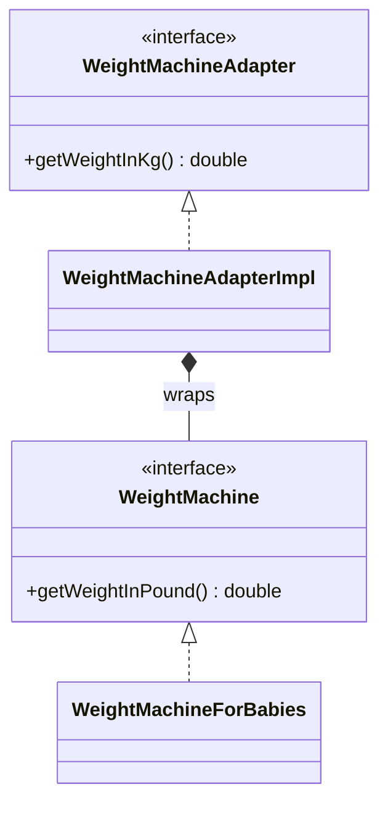

# Adapter Pattern (C++)

**Make an existing class usable through the interface your code expects, without changing either side.**

Our example: a baby weighing machine reports pounds, but the client wants kilograms. The adapter wraps the machine and converts.

---

## The problem

You have a working class with the wrong interface. Often you can't change it, because it's third-party or used elsewhere, and you don't want conversion logic spread across every caller.

```text
Client wants:   getWeightInKg()
Machine offers: getWeightInPound()
```

## The roles

| Role | Our class | Job |
|---|---|---|
| Target | `WeightMachineAdapter` | The interface the client wants |
| Adaptee | `WeightMachine`, `WeightMachineForBabies` | The existing interface and its implementation |
| Adapter | `WeightMachineAdapterImpl` | Implements the target by calling the adaptee |

Watch the naming: `WeightMachineAdapter` is really the target interface, and the class that does the adapting is `WeightMachineAdapterImpl`.



## Our code

```cpp
// WeightMachineAdapterImpl.hpp
class WeightMachineAdapterImpl : public WeightMachineAdapter {
private:
    static constexpr double KG_PER_POUND = 0.45359237;

    std::unique_ptr<WeightMachine> weightMachine;

public:
    explicit WeightMachineAdapterImpl(std::unique_ptr<WeightMachine> wm)
        : weightMachine(std::move(wm)) {
        if (!weightMachine) {
            throw std::invalid_argument("The adapter needs a weight machine");
        }
    }

    double getWeightInKg() override {
        double weightInPound = weightMachine->getWeightInPound();
        // Convert pounds to kilograms
        double weightInKg = weightInPound * KG_PER_POUND;
        return weightInKg;
    }
};
```

The client only sees `getWeightInKg()`, and any `WeightMachine` can be wrapped.

## When to use it

| Use it when | Don't, when |
|---|---|
| A class has the right behavior but the wrong interface | You own both sides and can just change one |
| You're integrating a third-party library or legacy code | The two do different things, rather than the same thing differently |
| You want to isolate your code from a vendor's API | A single conversion function would be enough |

| Pattern | Difference |
|---|---|
| **Decorator** | Same interface, added behavior. Adapter: different interface, same behavior. |
| **Facade** | Simplifies many classes behind a new interface. Adapter converts one interface to another. |
| **Proxy** | Same interface, controls access. |

**Say in the interview:** "Object adapter, using composition: it holds the adaptee rather than inheriting from it, so it works with any `WeightMachine`, and the machine can be swapped in tests."

> [!WARNING]
> **Bugs this code used to have.** The conversion used `0.45`, so 28 lb came out as 12.6 kg; the correct factor is 0.45359237, giving 12.7006 kg. The file comments had target and adaptee the wrong way round. A null machine crashed on first use; it's now refused in the constructor.

## Verification

From actually running the code:

```text
Weight in Kg: 12.7006
null machine: threw "The adapter needs a weight machine"
0 lb: 0 kg; -10 lb: -4.53592 kg
```

## Gaps

| Gap | What happens | Fix to say |
|---|---|---|
| **Impossible weights pass through** | -10 lb gives -4.53592 kg. | Validate in the adapter, or decide that the adaptee is trusted. |
| **Weights are bare doubles** (by reading) | Nothing stops mixing pounds with kilograms, the very mistake this example is about. | A `Weight` type that carries its unit. |
| **One-way only** (by reading) | There's no conversion back to pounds. | A second adapter, if something needs it. |
| **Confusing names** (by reading) | `WeightMachineAdapter` is the target, not the adapter. | Rename to `KgWeightSource` and `PoundToKgAdapter`. |

## Test yourself

<details><summary>1. Which class is the target, and which the adaptee?</summary>

Target: `WeightMachineAdapter`, the interface the client calls. Adaptee: `WeightMachine`, the existing one that returns pounds.
</details>

<details><summary>2. Object adapter or class adapter: what's the difference, and which is this?</summary>

An object adapter holds the adaptee (composition). A class adapter inherits from both, using multiple inheritance. This is an object adapter, and it can wrap any `WeightMachine` at runtime.
</details>

<details><summary>3. Why does the adapter take a <code>std::unique_ptr</code>?</summary>

The adapter becomes the sole owner of the machine and destroys it. `std::move` makes that transfer visible at the call site. If callers need to keep using the machine, it would take a `shared_ptr` or a reference.
</details>

<details><summary>4. How does Adapter differ from Decorator?</summary>

An adapter changes the interface and keeps the behavior; a decorator keeps the interface and adds behavior.
</details>

<details><summary>5. A vendor changes its API. What changes in your code?</summary>

Only the adapter. That's the main benefit of putting vendor code behind one: callers depend on your interface.
</details>

<details><summary>6. Why is a named constant better here than <code>0.45</code> in the method?</summary>

It documents what the number means and gives it one home. A rounded value buried in a method is how 28 lb came out 0.1 kg wrong without anyone noticing.
</details>

## Run it

```bash
cd lld/design_patterns/AdapterPattern
g++ -std=c++17 main.cpp -o adapter
./adapter
```

```text
AdapterPattern/
├── main.cpp                       client: asks for kilograms
├── WeightMachineAdapter.hpp       target interface
├── WeightMachine.hpp              adaptee interface
├── WeightMachineForBabies.hpp     adaptee implementation (28 lb)
└── WeightMachineAdapterImpl.hpp   the adapter
```
