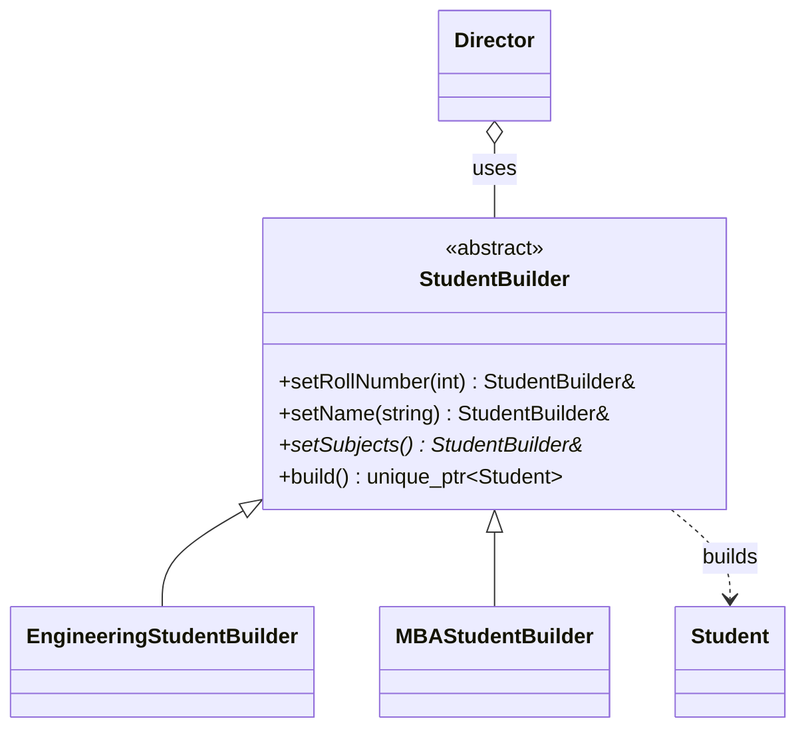

# Builder Pattern (C++)

**Construct a complex object step by step, so the same process can create different results, and the object is valid once built.**

Our example: a `Student` with several fields, where the subjects depend on the kind of student.

---

## The problem

Objects with many fields lead to constructors like this, where any argument can land in the wrong place:

```text
Student(1, 22, "John", "", "", {"DSA", "OS"})
```

A Builder names each step, and allows skipping optional ones. It can also check the whole object at the end, which a sequence of setters on the object can't.

## The roles

| Role | Our class | Job |
|---|---|---|
| Product | `Student` | What gets built; has a private constructor and no setters |
| Builder | `StudentBuilder` | Holds the values; `set...` steps and `build()` |
| Concrete builder | `EngineeringStudentBuilder`, `MBAStudentBuilder` | Decide what `setSubjects()` means |
| Director | `Director` | Knows recipes: which steps to run |



## Our code

Each step returns `*this`, which gives the fluent chain, and `build()` is the single place that checks the result:

```cpp
// StudentBuilder.hpp
StudentBuilder& setName(const std::string& n) {
    name = n;
    return *this;
}
// ...
std::unique_ptr<Student> build() const {
    if (name.empty()) {
        throw std::invalid_argument("A student needs a name");
    }
    if (subjects.empty()) {
        throw std::invalid_argument("A student needs subjects: call setSubjects");
    }

    // Not make_unique: it couldn't reach Student's private constructor
    std::unique_ptr<Student> student(new Student());
    student->rollNumber = rollNumber;
    // ...
    return student;
}
```

Only the builder can create a `Student`, because of the private constructor and the `friend` declaration. So every `Student` has passed those checks, and with no setters it can't change afterwards:

```cpp
// Student.hpp
Student() = default;
friend class StudentBuilder;
```

The director's recipes only use the `StudentBuilder` interface:

```cpp
// Director.hpp
std::unique_ptr<Student> createBasicStudent() {
    studentBuilder->setRollNumber(1)
                  .setAge(22)
                  .setName("John")
                  .setSubjects();
    return studentBuilder->build();
}
```

The recipe says "run these steps"; the builder decides what each step does. So the same recipe gives different subjects with different builders. The director is optional: `main.cpp` also drives a builder directly.

## When to use it

| Use it when | Don't, when |
|---|---|
| There are many fields, especially optional ones | There are two or three required fields: use a constructor |
| The object must be valid and immutable once created | The object is meant to change after creation |
| One process should produce different results | Every field is simple and independent: an aggregate with designated initializers (C++20) may do |

| Pattern | Difference |
|---|---|
| **Factory Method** | Chooses which class to create, in one call. Builder assembles one object in steps. |
| **Abstract Factory** | Creates families of related objects. |
| **Prototype** | Copies an existing object. |

**Say in the interview:** "The value of Builder over setters is that the object doesn't exist until it's complete. `build()` validates in one place, and the result is immutable."

> [!WARNING]
> **Bugs this code used to have.**
> - **The director inspected builder types.** `createStudent` used `dynamic_cast` to detect each concrete builder, so a new `LawStudentBuilder` got `nullptr`, and the director had to be edited for every builder. That's the coupling this pattern is meant to remove. Recipes are now public methods that use only the interface.
> - **Invalid students could be built.** `build()` with nothing set returned a student with no name and no subjects.
> - **Students could change after being built.** All `Student` fields were public, and so were the builder's.

## Verification

From actually running the code:

```text
Engineering Student: Roll: 1 Age: 22 Name: John Father:  Mother:  Subjects: [DSA, OS, Computer Architecture]
MBA Student: Roll: 2 Age: 24 Name: Jane Father: Father Name Mother: Mother Name Subjects: [Micro Economics, Business Studies, Operations Management]
Custom: Roll: 100 Age: 20 Name: Custom Student Father:  Mother:  Subjects: [DSA, OS, Computer Architecture]

new builder through Director: Roll: 1 Age: 22 Name: John Father:  Mother:  Subjects: [Contracts]
build with nothing set: threw "A student needs a name"
name but no subjects: threw "A student needs subjects: call setSubjects"
two builds from one builder: First, Second
creating a Student directly: compile error, constructor is private
```

## Gaps

| Gap | What happens | Fix to say |
|---|---|---|
| **A builder remembers earlier values** | Running the basic recipe after the parents recipe on one builder gave a student with "Father Name". | Reset in `build()`, or use one builder per object. |
| **Recipes hardcode data** (by reading) | Every basic student is called John. | Pass the values to the recipe. |
| **Roll number and age aren't checked** (by reading) | A roll number of 0 or a negative age is accepted. | Add them to `build()`. |
| **Fluent order** (by reading) | The chain returns `StudentBuilder&`, so a step added only to a concrete builder can't appear after a base step. | The curiously recurring template pattern, or call those steps first. |
| **The director shares a builder** (by reading) | It takes a `shared_ptr`, though it doesn't need to own the builder. | Pass a reference. |

## Test yourself

<details><summary>1. What does Builder give you that setters on the object don't?</summary>

With setters the object exists while incomplete, and it stays mutable. A builder hands over the object only when it's complete and checked, and it can then be immutable.
</details>

<details><summary>2. Why does every step return <code>*this</code>?</summary>

It allows chaining: `builder.setName("A").setAge(20)`. Each call returns the same builder.
</details>

<details><summary>3. What's the director for, and do you always need one?</summary>

It stores reusable recipes: which steps, in what order. It's optional; `main.cpp` builds a custom student without it. Use one when the same recipes recur.
</details>

<details><summary>4. Why was <code>dynamic_cast</code> in the director a problem?</summary>

The director had to know every concrete builder, so a new builder meant editing it, and an unknown one silently returned `nullptr`. It should depend only on the abstract builder.
</details>

<details><summary>5. Why not <code>std::make_unique&lt;Student&gt;()</code> in <code>build()</code>?</summary>

`make_unique` constructs the object from inside its own code, and it isn't a friend of `Student`, so it can't reach the private constructor. `new` inside the friend class can.
</details>

<details><summary>6. How does this differ from Factory Method?</summary>

A factory picks which class to create, in one call. A builder assembles one complex object over several steps.
</details>

## Run it

```bash
cd lld/design_patterns/BuilderPattern
g++ -std=c++17 main.cpp -o builder
./builder
```

```text
BuilderPattern/
├── main.cpp                        with a director, and with the builder directly
├── Student.hpp                     product: private constructor, getters only
├── StudentBuilder.hpp              abstract builder: steps and build()
├── EngineeringStudentBuilder.hpp   DSA, OS, Computer Architecture
├── MBAStudentBuilder.hpp           Micro Economics, Business Studies, Operations Management
└── Director.hpp                    recipes
```
