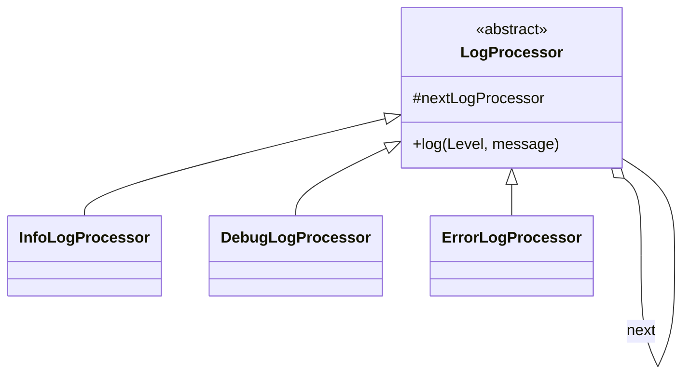

# Chain of Responsibility Pattern (C++)

**Pass a request along a chain of handlers until one of them deals with it. The sender doesn't know which one will.**

Our example: log messages. Each processor handles one level, and passes anything else to the next.

---

## The problem

Without this pattern the sender has a growing `if`/`else`, and has to know every handler:

```text
if (level == INFO) info.write(msg)
else if (level == DEBUG) debug.write(msg)
else if (level == ERROR) error.write(msg)
```

With a chain, the sender calls the head. Adding or reordering handlers only changes how the chain is built.

## The roles

| Role | Our class | Job |
|---|---|---|
| Handler | `LogProcessor` | The interface, plus the link to the next handler |
| Concrete handlers | `InfoLogProcessor`, `DebugLogProcessor`, `ErrorLogProcessor` | Handle one level, pass on the rest |
| Client | `main` | Builds the chain and calls the head |




## Our code

The base class knows how to pass a request along, and stops safely at the end of the chain:

```cpp
// LogProcessor.hpp
virtual void log(Level logLevel, const std::string& message) {
    if (nextLogProcessor != nullptr) {
        nextLogProcessor->log(logLevel, message);
    }
}
```

Each handler takes its own level and defers the rest to the base class:

```cpp
// ErrorLogProcessor.hpp
void log(Level logLevel, const std::string& message) override {
    if (logLevel == Level::ERROR) {
        std::cout << "ERROR: " << message << std::endl;
    } else {
        LogProcessor::log(logLevel, message);
    }
}
```

The chain is built backwards, since each handler needs its successor:

```cpp
// main.cpp
auto errorProcessor = std::make_shared<ErrorLogProcessor>(nullptr);
auto debugProcessor = std::make_shared<DebugLogProcessor>(errorProcessor);
auto infoProcessor = std::make_shared<InfoLogProcessor>(debugProcessor);
```

## When to use it

| Use it when | Don't, when |
|---|---|
| Several objects might handle a request, and it isn't known up front which | There's a fixed mapping: a `map` from key to handler is simpler and faster |
| Handlers should change at runtime, or be reordered | Every request must be handled: a chain can silently drop it |
| Requests pass through stages: auth, validate, log | The chain would be very long, since each step costs a call |

| Pattern | Difference |
|---|---|
| **Decorator** | Every wrapper runs and adds behavior. A chain usually stops at the first handler. |
| **Strategy** | One algorithm is selected up front. A chain finds its handler by asking. |
| **Command** | Wraps a request as an object; it can be combined with a chain. |

**Say in the interview:** "This is how middleware and ATM note dispensers work. The classic trap is a request that falls off the end, so decide what the last handler does."

The main folder's [`atm`](../../atm/README.md) uses this pattern to dispense notes, with each link taking what it can and passing on the remainder.

> [!WARNING]
> **Bug this code used to have.** Levels were plain `int` constants, so `log(99, ...)` compiled, travelled the whole chain and vanished. With `enum class Level`, that no longer compiles.

## Verification

From actually running the code:

```text
ERROR: exception happens
DEBUG: need to debug this
INFO: just for info

log(99, ...): compile error, cannot convert 'int' to 'LogProcessor::Level'
INFO starting from the debug handler prints: []
ERROR on a chain with no error handler prints: []
```

## Gaps

| Gap | What happens | Fix to say |
|---|---|---|
| **Requests can still fall off the end** | ERROR on a chain with no error handler printed nothing, and so did INFO sent to the debug handler, which is past the info handler. | End with a default handler that reports unhandled requests, or have `log` return whether it was handled. |
| **Handlers repeat themselves** (by reading) | All three have the same `if`/`else`; only the level and label differ. | Template Method: the base's `log` runs the check, and subclasses supply `handles` and `write`. |
| **Only one handler runs** (by reading) | A message can't go to both a file and the console. | Let handlers continue after handling, as real logging frameworks do with appenders. |
| **Exact match only** (by reading) | Real loggers treat levels as a threshold: "ERROR and above". | Compare with `>=`, and keep going down the chain. |
| **Not synchronized** (by reading) | Lines from several threads can interleave; each `<<` is a separate call. | Lock around the write. |

## Test yourself

<details><summary>1. How does a request travel through the chain?</summary>

The client calls the head. Each handler either handles it or calls `LogProcessor::log`, which forwards to `nextLogProcessor` if there is one.
</details>

<details><summary>2. Why is the chain built from the end?</summary>

Each handler takes its successor in the constructor, so the last one has to exist first.
</details>

<details><summary>3. What happens if no handler matches?</summary>

Nothing. The last handler's `nextLogProcessor` is null, so the request disappears silently. That's the pattern's main risk.
</details>

<details><summary>4. Why is <code>enum class</code> better than <code>int</code> constants here?</summary>

The compiler rejects an invalid level, rather than letting it travel the chain and vanish. It also keeps the names scoped, as `Level::ERROR`.
</details>

<details><summary>5. How does this differ from Decorator?</summary>

A decorator's wrappers all run, each adding behavior. A chain's handlers decide whether to pass on, and usually one handles the request and stops.
</details>

<details><summary>6. Why does the handler call <code>LogProcessor::log</code> explicitly?</summary>

`log` is virtual, and a plain `log(...)` inside the override would call itself forever. Qualifying with the class name calls the base version directly.
</details>

## Run it

```bash
cd lld/design_patterns/ChainOfResponsibility
g++ -std=c++17 main.cpp -o chain
./chain
```

```text
ChainOfResponsibility/
├── main.cpp                builds info -> debug -> error, logs one of each
├── LogProcessor.hpp        base handler: Level, next link, forwarding
├── InfoLogProcessor.hpp
├── DebugLogProcessor.hpp
└── ErrorLogProcessor.hpp
```
