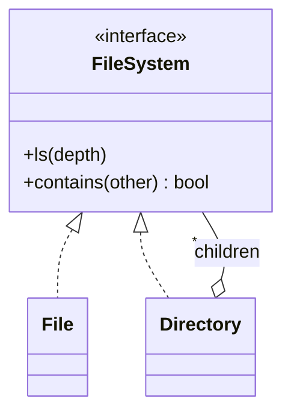

# Composite Pattern (C++)

**Build a tree where a single item and a group of items share one interface, so clients treat them the same way.**

Our example: a file system. A `Directory` contains files and other directories, and `ls` works on either.

---

## The problem

Without a shared interface, client code has to keep asking what it's holding:

```text
if (item is a file) print it
else for each child: if (child is a file) ... else ...
```

With Composite, the client calls `ls()`. A file prints itself, and a directory prints itself and then asks its children to do the same.

## The roles

| Role | Our class | Job |
|---|---|---|
| Component | `FileSystem` | The shared interface |
| Leaf | `File` | Has no children; does the work itself |
| Composite | `Directory` | Holds children; delegates to them |



The key is that `children` holds `FileSystem`, not `File`, so a directory can contain directories, to any depth.

## Our code

The leaf does its job. The composite does its own part, then delegates to its children:

```cpp
// File.hpp
void ls(int depth = 0) override {
    std::cout << std::string(depth * 2, ' ') << "File: " << fileName << std::endl;
}

// Directory.hpp
void ls(int depth = 0) override {
    std::cout << std::string(depth * 2, ' ') << "Directory: " << directoryName << std::endl;
    for (const auto& child : children) {
        child->ls(depth + 1);
    }
}
```

A tree must stay a tree. `add` refuses anything that would put a directory inside itself:

```cpp
// Directory.hpp
void add(std::shared_ptr<FileSystem> component) {
    if (!component) {
        throw std::invalid_argument("Cannot add nothing to " + directoryName);
    }
    // A directory inside itself would make ls recurse forever and leak the shared_ptrs
    if (component->contains(this)) {
        throw std::invalid_argument("Cannot put " + directoryName + " inside itself");
    }
    if (std::find(children.begin(), children.end(), component) != children.end()) {
        throw std::invalid_argument("Already in " + directoryName);
    }
    children.push_back(component);
}
```

`contains` is itself a composite operation: a file compares itself, and a directory also asks its children.

## When to use it

| Use it when | Don't, when |
|---|---|
| The data is a real part-whole tree: folders, menus, UI widgets, org charts | The structure is flat, or items and groups behave very differently |
| Clients shouldn't care whether they hold one item or many | You need different types to have very different operations |
| Operations combine naturally: total size, render all | The tree would need many cross-links: use a graph |

| Pattern | Difference |
|---|---|
| **Decorator** | Also recursive, but wraps one object to add behavior. A composite has many children and combines them. |
| **Iterator** | Walks a structure; often used on a composite. |
| **Visitor** | Adds new operations over a tree without changing its classes. |

**Say in the interview:** "The recursion is what makes it work: each node handles its own part and delegates the rest. The design decision is where `add` lives. I keep it on `Directory`, so a file can't be asked to add a child; the cost is that clients need the concrete type to build the tree."

> [!WARNING]
> **Bugs this code used to have.**
> - **A directory could contain itself.** Putting `root` inside its own child made `ls` recurse until the program crashed, after printing 21,599 lines. The `shared_ptr` cycle would also have leaked the tree.
> - **The tree wasn't visible.** `ls` printed everything flush left, so you couldn't tell what was inside what. It now indents by depth.
> - **The same file could be added twice** to one directory, and nothing refused a null child, which `ls` would then dereference.

## Verification

From actually running the code:

```text
Directory: Movies
  File: Border.mp4
  Directory: Comedy Movies
    File: Hulchul.mp4
    File: Hera_Pheri.mp4
  Directory: Action Movies
    File: Dhoom.mp4

same file twice: threw "Already in root"
directory into itself: threw "Cannot put root inside itself"
root into its child: threw "Cannot put sub inside itself"
root into its grandchild: threw "Cannot put deep inside itself"
null: threw "Cannot add nothing to root"
```

## Gaps

| Gap | What happens | Fix to say |
|---|---|---|
| **One file can have two parents** | The same file was accepted in both `root` and `deep`, and it stayed in `deep` after `root->remove(f)`. | Track a parent pointer, and refuse if the component already has one. |
| **Names aren't unique** (by reading) | Two different files named `a.txt` can share a directory. | Keep children in a map by name. |
| **Removal is only one level** (by reading) | `remove` searches direct children. | Fine for a file system; say so. A recursive version is simple. |
| **Only `ls` exists** (by reading) | There's no total size or search, the classic composite operations. | `virtual size_t size()`: a file returns its size, and a directory sums its children. |
| **Output is tied to `std::cout`** (by reading) | `ls` can't be reused or tested without capturing the stream. | Take a `std::ostream&`. |

## Test yourself

<details><summary>1. Why does <code>children</code> hold <code>FileSystem</code> rather than <code>File</code>?</summary>

So a directory can hold both files and directories. That's what allows nesting to any depth.
</details>

<details><summary>2. How does <code>ls</code> reach everything without any type checks?</summary>

Virtual dispatch and recursion. `child->ls()` runs the right version, and a directory's version calls its own children in turn.
</details>

<details><summary>3. Should <code>add</code> be on the interface or only on <code>Directory</code>?</summary>

A tradeoff. On the interface gives full uniformity, but a file must then do something odd, like throw. On `Directory` gives safety at compile time, but clients need the concrete type. Our code chooses safety.
</details>

<details><summary>4. How does <code>add</code> detect a cycle?</summary>

Before adding, it asks `component->contains(this)`. If the new child, or anything inside it, is this directory, adding it would form a loop.
</details>

<details><summary>5. What's wrong with a <code>shared_ptr</code> cycle?</summary>

Each object keeps the other's count above zero, so neither is ever destroyed: a leak. Children could also hold a `weak_ptr` to their parent, if parent links are added.
</details>

<details><summary>6. How would you add a total size?</summary>

Add a virtual `size()` to `FileSystem`. A file returns its size, and a directory sums `size()` over its children. No client code needs to know the difference.
</details>

## Run it

```bash
cd lld/design_patterns/CompositePattern
g++ -std=c++17 main.cpp -o composite
./composite
```

```text
CompositePattern/
├── main.cpp         builds a small movie tree and lists it
├── FileSystem.hpp   component interface
├── File.hpp         leaf
└── Directory.hpp    composite: add, remove, ls, contains
```
