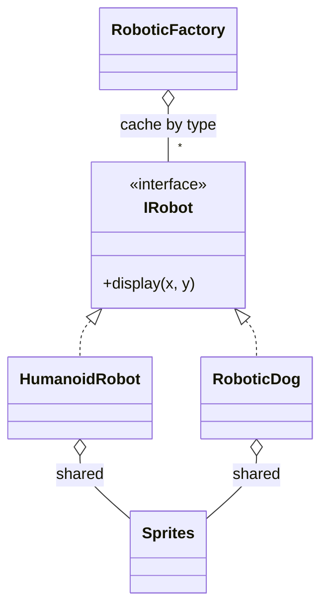

# Flyweight Pattern (C++)

**When you need huge numbers of similar objects, share what they have in common and pass in what differs.**

Our example: a game with many robots. Every humanoid looks the same, so they share one heavy sprite and differ only by position.

---

## The problem

The comment in `main.cpp` puts it in numbers: at about 10 MB of graphics per robot, 1000 robots need about 10 GB if each has its own copy. Nearly all of that data is identical.

The pattern splits an object's state in two:

| State | Meaning | Example | Where it lives |
|---|---|---|---|
| **Intrinsic** | The same for all, never changes | Type, sprite | Inside the shared object |
| **Extrinsic** | Differs per use | x, y position | Passed in on each call |

With two robot types, 1000 robots need 2 sprites.

## The roles

| Role | Our class | Job |
|---|---|---|
| Flyweight interface | `IRobot` | `display(x, y)`: takes the extrinsic state |
| Concrete flyweight | `HumanoidRobot`, `RoboticDog` | Holds the intrinsic state |
| Shared data | `Sprites` | The heavy graphics |
| Flyweight factory | `RoboticFactory` | Creates one per type, then reuses it |



## Our code

The position is a parameter rather than a field, which is what makes one object usable for every robot:

```cpp
// HumanoidRobot.hpp
void display(int x, int y) override {
    std::cout << "Humanoid Robot at (" << x << ", " << y << ")" << std::endl;
    // Use shared sprites to render at position
}
```

The factory returns the existing object for a type, or creates it once. The lock makes "look it up, or create it" one step:

```cpp
// RoboticFactory.hpp
static std::shared_ptr<IRobot> createRobot(const std::string& robotType) {
    std::lock_guard<std::mutex> lock(cacheMutex);

    // Check if robot already exists in cache
    auto it = robotCache.find(robotType);
    if (it != robotCache.end()) {
        std::cout << "Returning cached " << robotType << std::endl;
        return it->second;
    }

    // Create new robot if not in cache
    std::shared_ptr<IRobot> robot = nullptr;
    
    if (robotType == "HUMANOID") {
        auto sprite = std::make_shared<Sprites>();
        robot = std::make_shared<HumanoidRobot>(robotType, sprite);
    } else if (robotType == "ROBOTICDOG") {
        auto sprite = std::make_shared<Sprites>();
        robot = std::make_shared<RoboticDog>(robotType, sprite);
    } else {
        throw std::invalid_argument("Unknown robot type: " + robotType);
    }

    robotCache[robotType] = robot;
    return robot;
}
```

The robots hold `std::shared_ptr<const Sprites>`, because shared state must not change: one robot altering it would alter them all.

## When to use it

| Use it when | Don't, when |
|---|---|
| There are very many objects, and memory is the real problem | There are few objects: it only adds complexity |
| Most state is shared, and can be separated out | Most state is unique to each object |
| The shared part can be immutable | Objects need to change their shared part |

| Pattern | Difference |
|---|---|
| **Singleton** | One instance of a class. Flyweight: one instance **per kind**, and the factory manages many. |
| **Object pool** | Reuses objects one at a time, handing them out exclusively. Flyweights are used by everyone at once. |
| **Prototype** | Copies objects. Flyweight avoids copies. |

**Say in the interview:** "String interning and font glyph caches use the same idea. The whole design rests on immutability, since that's what makes sharing safe without further locking."

> [!WARNING]
> **Bugs this code used to have.**
> - **The cache had no lock.** With 8 threads creating robots at once, the program crashed on all 5 test runs.
> - **The header broke linking.** The static cache was defined in the header, so including it from two source files gave "multiple definition of `RoboticFactory::robotCache`". It's now `inline static`.
> - **An unknown type returned `nullptr`,** which crashes at the caller's next `->`. It now throws.
> - **The demo's numbers misled.** It printed "Total robot instances created: 5" when only 2 objects existed. That's the very thing this demo sets out to show.

## Verification

From actually running the code:

```text
Creating HumanoidRobot (expensive operation)
Humanoid Robot at (1, 2)
Returning cached HUMANOID
Humanoid Robot at (10, 30)
Returning cached HUMANOID
Humanoid Robot at (100, 200)

Creating RoboticDog (expensive operation)
Robotic Dog at (2, 9)
Returning cached ROBOTICDOG
Robotic Dog at (11, 19)

Robots requested: 5
Robot objects created: 2
Sprite objects created: 2

humanoid1 == humanoid2: true

8 threads ask for one type, 2000 rounds, 5 runs:
    before the fix: crashed, 5 of 5 runs
    after the fix:  more than one object in 0 of 2000 rounds, 5 of 5 runs
two source files include the factory: links
unknown type: threw "Unknown robot type: TANK"; cache stays empty
```

## Gaps

| Gap | What happens | Fix to say |
|---|---|---|
| **Each caller must keep the position** (by reading) | The robot doesn't store x and y, so game code has to hold a list of positions. That's inherent to the pattern, but it's the cost to mention. | A small `RobotInstance { IRobot* type; int x, y; }`. |
| **The cache never shrinks** (by reading) | Types live until the program ends, even if unused. | Hold `weak_ptr`s in the cache, so unused types can be freed. |
| **The factory lists every type** (by reading) | A new robot type means editing the `if` chain. | A registry from type name to creator function. |
| **Types are strings** (by reading) | A typo is found only at runtime. | An `enum class`. |
| **Sprites are stand-ins** (by reading) | `display` doesn't use `body`, and `Sprites` holds a short string. | Fine for a demo; the shape of the code is the point. |
| **The lock is held during creation and printing** (by reading) | Fast here; a real sprite load would block all lookups. | Load outside the lock, or lock per type. |

## Test yourself

<details><summary>1. What's the difference between intrinsic and extrinsic state?</summary>

Intrinsic is shared and doesn't change, and lives in the flyweight (type, sprite). Extrinsic varies per use, and is passed in (position).
</details>

<details><summary>2. Why must a flyweight be immutable?</summary>

Everyone holds the same object, so a change made for one affects all. It's enforced here with `std::shared_ptr<const Sprites>`, and immutability is also why reading it needs no lock.
</details>

<details><summary>3. In the demo, how many robots exist?</summary>

Two objects, used through five `shared_ptr` handles. `humanoid1 == humanoid2` is true because they're the same object.
</details>

<details><summary>4. Why did the static member defined in a header fail to link?</summary>

Every source file including it got its own definition, breaking the one-definition rule. C++17's `inline static` means all of them refer to one object.
</details>

<details><summary>5. Why does the factory need a lock, when robots themselves are immutable?</summary>

The cache isn't. Two threads can both miss and insert, and an `unordered_map` being changed from two threads at once is undefined behavior. It crashed in testing.
</details>

<details><summary>6. How does Flyweight differ from Singleton?</summary>

A singleton allows one instance of a class. Flyweight has one instance per intrinsic state, here per robot type.
</details>

## Run it

```bash
cd lld/design_patterns/FlyweightPattern
g++ -std=c++17 main.cpp -o flyweight
./flyweight
```

```text
FlyweightPattern/
├── main.cpp             requests 5 robots, gets 2 objects
├── IRobot.hpp           flyweight interface
├── HumanoidRobot.hpp    concrete flyweight
├── RoboticDog.hpp       concrete flyweight
├── Sprites.hpp          the heavy shared data
└── RoboticFactory.hpp   cache by type
```
