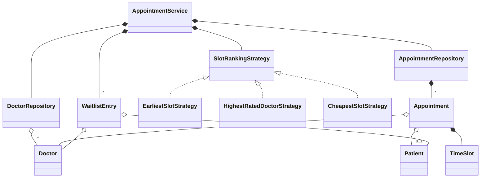
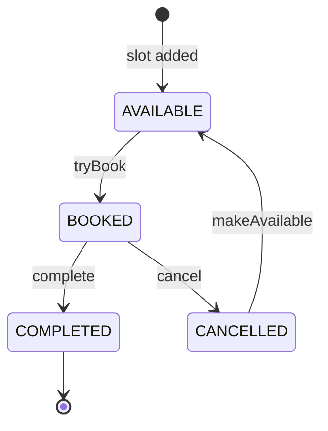

# Doctor Appointment System - Low Level Design (C++)

A booking system for doctors' time. Doctors publish time slots; patients search by specialty or doctor, with results ordered by a pluggable strategy, and book a slot. When a doctor has nothing free, patients join a waitlist, and a cancelled or newly added slot goes to the first one who can take it.

This README walks the question the way you should deliver it in an interview: **Requirements -> Entities -> Class Design -> Implementation -> Extensibility**. Everything here matches the C++ code in this folder.

| Step | Time (45 min interview) | Section |
|---|---|---|
| Understand + clarify | 5 min | [1. Requirements](#1-requirements) |
| Pick the objects | 3-5 min | [2. Entities](#2-entities-and-relationships) |
| Slots, ranking, waitlist | 10 min | [3. Class design](#3-class-design) |
| Write `bookAppointment` and `cancelAppointment` | 15-20 min | [4. Implementation](#4-implementation), [5. Verification](#5-verification) |
| "What if..." | 5+ min | [6. Extensibility](#6-extensibility) |

---

## 0. Understanding the problem

This is a time-slot booking problem, with a person on each side who can only be in one place at a time. The questions interviewers push on:
1. **Double booking, in both directions:** a slot can have one patient, and a patient can't be in two rooms at once.
2. **The waitlist handoff:** a cancelled slot must reach the first waiting patient, not whoever books fastest.
3. **Status rules:** only a booked appointment can be cancelled or completed.

The interviewer usually opens with:

> "Design a doctor appointment booking system. Patients find doctors by specialty and book a time."

---

## 1. Requirements

### Clarifying questions

Group your questions around: **what the system does**, **what can go wrong**, **what's in scope**, and **what might change later**.

**You:** "Who decides when a doctor is free?"
**Interviewer:** "Doctors publish slots with a start and duration."
> So slots exist up front, and booking claims one. An overlapping slot for the same doctor must be refused.

**You:** "How do patients search?"
**Interviewer:** "By specialty or by a specific doctor, and the results can be ordered different ways: earliest, best rated, cheapest."
> The ordering varies: a strategy.

**You:** "Can a patient have two appointments at the same time?"
**Interviewer:** "No."

**You:** "What happens if a doctor is fully booked?"
**Interviewer:** "The patient joins that doctor's waitlist, and gets the slot automatically if one opens up."

**You:** "Can past slots be booked?"
**Interviewer:** "No. They shouldn't even appear."

**You:** "What about payments and reminders?"
**Interviewer:** "Out of scope. Fees are only shown."

### Final requirements

Write this on the board before moving on:

```text
REQUIREMENTS
1. Doctors have a specialty, rating (1-5) and fee, and publish non-overlapping slots
2. Search upcoming free slots by specialty or doctor
3. A pluggable strategy orders results: earliest, highest rated, cheapest
4. Book a slot; one patient per slot, and a patient can't overlap with themselves
5. Slot status: AVAILABLE -> BOOKED -> COMPLETED; cancelling a booking reopens the slot
6. Fully booked doctor: join their waitlist, first come first served, once per patient
7. A cancelled or new slot goes to the first waiting patient who can take it
8. Reject: past slots, overlapping or empty slots, unknown doctors, illegal status moves

OUT OF SCOPE (first version)
- Generating slots from working hours, rescheduling, time preferences on the waitlist
- Payments, reminders, patient accounts
```

---

## 2. Entities and relationships

Scan the requirements for nouns, then ask of each: does it hold state or rules of its own?

| Candidate | Keep? | Why |
|---|---|---|
| `Doctor` | Yes | Specialty, rating, fee. |
| `Patient` | Yes | Identity and contact details. |
| `TimeSlot` | Yes (value) | Start and end; knows whether it overlaps another. |
| `Appointment` | Yes | A doctor's slot plus, once booked, a patient and a status. |
| `WaitlistEntry` | Yes | Who waits for which doctor, and since when. |
| `SlotRankingStrategy` | Yes (interface) | How search results are ordered. |
| `DoctorRepository`, `AppointmentRepository` | Yes | Own and index the collections. |
| `AppointmentService` | Yes | The orchestrator; also holds the waitlists. |



---

## 3. Class design

Work top-down, starting from the orchestrator. For each class ask two questions:
1. **State:** what must it remember to enforce the requirements?
2. **Methods:** what operations does the outside world need?

### AppointmentService

| Requirement | What the service must track |
|---|---|
| "Doctors and slots" | The two repositories |
| "Ordering can change" | `rankingStrategy` |
| "Waitlist per doctor" | `waitlists`: doctor id -> queue |
| "A cancelled slot reaches the first in line" | A lock across cancel + waitlist |

```cpp
class AppointmentService {
private:
    DoctorRepository doctorRepo;
    AppointmentRepository appointmentRepo;
    std::unique_ptr<SlotRankingStrategy> rankingStrategy;
    std::unordered_map<std::string, std::deque<WaitlistEntry*>> waitlists;
    mutable std::mutex mutex_;  // Makes each use case one step, such as cancel + waitlist
public:
    void addDoctor(Doctor* doctor);
    Appointment* addSlot(Doctor* doctor, const TimeSlot& slot);
    std::vector<Appointment*> searchAvailableSlots(Specialty specialty);
    std::vector<Appointment*> searchAvailableSlots(const std::string& doctorId);
    bool bookAppointment(Patient* patient, const std::string& appointmentId);
    bool cancelAppointment(const std::string& appointmentId);
    bool completeAppointment(const std::string& appointmentId);
    bool addToWaitlist(Patient* patient, Doctor* doctor);
    void setRankingStrategy(std::unique_ptr<SlotRankingStrategy> strategy);
};
```

### Appointment and its lifecycle



`cancelAppointment` runs `cancel` and `makeAvailable` together, so callers see the slot return to AVAILABLE (or go straight to the next patient).

> [!NOTE]
> **Decision: how do you stop two patients taking one slot?**
> - **Good: an atomic compare-and-swap on the status.** `tryBook` moves AVAILABLE to BOOKED in one step, so exactly one caller wins. It's fast, but protects only that one field.
> - **Great (our choice): the atomic claim, inside a lock over the whole use case.** Booking also checks the patient's other appointments, and cancelling hands the slot to the waitlist. Those span several objects, and an atomic on one field can't cover them.

> [!TIP]
> **Say in the interview:** "The atomic makes the claim safe. It doesn't make the operation safe: between 'slot is free' and 'give it to the first in line', someone else could claim it. The lock is there for that gap."

### TimeSlot

```cpp
class TimeSlot {
    time_t startTime;
    time_t endTime;
public:
    bool overlaps(const TimeSlot& other) const {
        return !(endTime <= other.startTime || startTime >= other.endTime);
    }
};
```

Two ranges overlap unless one ends before the other begins. Using `<=` lets a 10:00-10:30 slot sit right next to 10:30-11:00.

### Strategies

```cpp
class SlotRankingStrategy {
protected:
    // Earlier start first; the older slot wins a tie, so results don't vary between runs
    static bool startsFirst(const Appointment* a, const Appointment* b) {
        if (a->getSlot().getStartTime() != b->getSlot().getStartTime()) {
            return a->getSlot().getStartTime() < b->getSlot().getStartTime();
        }
        return a->getAppointmentId() < b->getAppointmentId();
    }

public:
    virtual ~SlotRankingStrategy() = default;
    virtual std::vector<Appointment*> rankSlots(std::vector<Appointment*>& slots) = 0;
    virtual std::string getStrategyName() const = 0;
};
```

| Strategy | Order |
|---|---|
| `EarliestSlotStrategy` | Start time |
| `HighestRatedDoctorStrategy` | Rating, highest first, then start time |
| `CheapestSlotStrategy` | Fee, lowest first, then start time |

> [!NOTE]
> **Decision: where does the ordering rule live?**
> - **Good: a `sortBy` enum and a `switch` in the search.** Easy to write, but every new order edits the service.
> - **Great (our choice): Strategy.** The service gathers the free slots and hands them over. Each strategy returns them sorted, and a shared tie-break keeps results repeatable. `doctorRepo` iterates an `unordered_map`, so without it, tied slots came out in an arbitrary order.

### Waitlist

> [!NOTE]
> **Decision: what does a freed slot do about the waitlist?**
> - **Good: give it to the first in line, always.** Simple, but it can double-book someone who already has another appointment at that time.
> - **Great (our choice): the first in line who can take it.** Patients with a clash are passed over and keep their place, which is why the queue is a `std::deque`, not a `std::queue`.

### Final class design

```text
AppointmentService
  doctorRepo, appointmentRepo, rankingStrategy, waitlists, mutex_
  addDoctor, addSlot, searchAvailableSlots, bookAppointment
  cancelAppointment, completeAppointment, addToWaitlist, setRankingStrategy

DoctorRepository: doctors (id -> Doctor*); getDoctorsBySpecialty
AppointmentRepository: appointments (id -> Appointment*, owned), doctorAppointments

Appointment: doctor, patient, slot, status (atomic)
  tryBook, cancel, complete, makeAvailable
TimeSlot: startTime, endTime; overlaps
Doctor: specialty, rating, consultationFee
Patient: name, email, phone, age
WaitlistEntry: patient, doctor, requestedTime
```

### Design patterns used

| Pattern | Where | Why | One line to say |
|---|---|---|---|
| Strategy | `SlotRankingStrategy` and its three classes | Search order changes independently | "A new order is a new class." |
| Repository | `DoctorRepository`, `AppointmentRepository` | Storage and lookups apart from rules | "A database would replace only these." |
| Service layer | `AppointmentService` | One place runs each use case, under one lock | "Models hold state, the service coordinates." |

---

## 4. Implementation

Before writing code, ask the interviewer: real code, pseudocode, or talk it through? The methods that matter are `bookAppointment` and `cancelAppointment`.

### Booking

```cpp
// service/AppointmentService.hpp
bool bookAppointment(Patient* patient, const std::string& appointmentId) {
    std::lock_guard<std::mutex> lock(mutex_);
    Appointment* appointment = appointmentRepo.getAppointment(appointmentId);
    if (appointment == nullptr) {
        std::cout << "  [Error] Appointment not found: " << appointmentId << std::endl;
        return false;
    }
    if (hasStarted(appointment->getSlot())) {
        std::cout << "  [Failed] Slot has already started" << std::endl;
        return false;
    }
    if (patientHasClash(patient, appointment->getSlot())) {
        std::cout << "  [Failed] " << patient->getName()
                  << " already has an appointment at that time" << std::endl;
        return false;
    }

    if (appointment->tryBook(patient)) {
        std::cout << "  [Booked] " << patient->getName() << " booked "
                  << appointment->getSlot().toString()
                  << " with Dr. " << appointment->getDoctor()->getName() << std::endl;
        return true;
    } else {
        std::cout << "  [Failed] Slot already taken" << std::endl;
        return false;
    }
}
// ...
bool patientHasClash(Patient* patient, const TimeSlot& slot) const {
    for (Appointment* apt : appointmentRepo.getAllAppointments()) {
        if (apt->getStatus() == AppointmentStatus::BOOKED && apt->getPatient() == patient &&
            apt->getSlot().overlaps(slot)) {
            return true;
        }
    }
    return false;
}
```

### The atomic claim

```cpp
// model/Appointment.hpp
bool tryBook(Patient* p) {
    AppointmentStatus expected = AppointmentStatus::AVAILABLE;
    if (status.compare_exchange_strong(expected, AppointmentStatus::BOOKED)) {
        patient = p;
        return true;
    }
    return false;
}

// Only a booked appointment can be cancelled or completed
bool cancel() {
    AppointmentStatus expected = AppointmentStatus::BOOKED;
    if (status.compare_exchange_strong(expected, AppointmentStatus::CANCELLED)) {
        patient = nullptr;
        return true;
    }
    return false;
}

bool complete() {
    AppointmentStatus expected = AppointmentStatus::BOOKED;
    return status.compare_exchange_strong(expected, AppointmentStatus::COMPLETED);
}
```

### Cancelling, and the waitlist handoff

```cpp
// service/AppointmentService.hpp
bool cancelAppointment(const std::string& appointmentId) {
    std::lock_guard<std::mutex> lock(mutex_);
    Appointment* appointment = appointmentRepo.getAppointment(appointmentId);
    if (appointment == nullptr) return false;

    Patient* patient = appointment->getPatient();
    Doctor* doctor = appointment->getDoctor();
    
    if (!appointment->cancel()) {
        std::cout << "  [Failed] Only a booked appointment can be cancelled: "
                  << appointmentId << std::endl;
        return false;
    }
    appointment->makeAvailable();  // Make available for rebooking
    
    std::cout << "  [Cancelled] Appointment " << appointmentId;
    if (patient) std::cout << " for " << patient->getName();
    std::cout << std::endl;

    // Process waitlist
    processWaitlist(doctor->getDoctorId(), appointment);
    return true;
}
// ...
void processWaitlist(const std::string& doctorId, Appointment* availableSlot) {
    auto it = waitlists.find(doctorId);
    if (it == waitlists.end() || hasStarted(availableSlot->getSlot())) return;

    std::deque<WaitlistEntry*>& waiting = it->second;
    for (auto entry = waiting.begin(); entry != waiting.end(); ++entry) {
        Patient* patient = (*entry)->getPatient();
        if (!patientHasClash(patient, availableSlot->getSlot()) && availableSlot->tryBook(patient)) {
            waiting.erase(entry);
            std::cout << "  [Waitlist] Auto-booked " << patient->getName()
                      << " for slot " << availableSlot->getSlot().toString()
                      << " with Dr. " << availableSlot->getDoctor()->getName() << std::endl;
            return;
        }
    }
}
```

The entry leaves the queue only **after** the booking succeeds, and the function returns straight away, so the erased iterator is never used again. `addSlot` calls `processWaitlist` too, because a new slot is capacity just like a cancelled one.

### Adding a slot

```cpp
// service/AppointmentService.hpp
if (slot.getEndTime() <= slot.getStartTime()) {
    std::cout << "  [Failed] A slot must end after it starts" << std::endl;
    return nullptr;
}
for (Appointment* existing : appointmentRepo.getAppointmentsForDoctor(doctor->getDoctorId())) {
    if (existing->getSlot().overlaps(slot)) {
        std::cout << "  [Failed] Slot overlaps " << existing->getAppointmentId()
                  << " for Dr. " << doctor->getName() << std::endl;
        return nullptr;
    }
}
```

### The bugs this code used to have

> [!WARNING]
> **1. A waiting patient could silently lose their place.** `cancelAppointment` reopened the slot, then called the waitlist as a separate step. A booking in that gap took the slot; the waitlist had already removed the patient from the queue, its `tryBook` failed, and nothing was printed. With one thread cancelling and one booking, the patient lost their place in 298 to 300 of 300 tries.
>
> **2. Status changes weren't checked.** A slot nobody had booked could be "completed", and the demo did exactly that. Cancelling a completed appointment reopened it, and cancelling an empty slot printed "[Cancelled]".
>
> **3. Double booking in both directions.** One patient could hold the same hour with two doctors. One doctor could publish overlapping slots (a 0-minute or negative one too): `TimeSlot::overlaps` existed, but nothing called it.
>
> **4. Past slots were bookable,** and appeared in search. A cancelled slot that had already started went to the next waiting patient.
>
> **5. The waitlist was careless.** A slot added for a fully booked doctor ignored the people waiting. Patients could join while slots were free, join twice, or join for an unregistered doctor. A first-in-line patient with a clash was booked anyway.
>
> **6. Results depended on hash order.** `EarliestSlotStrategy` had no tie-break, and the demo's slots tie, so which patient held APT000004 came down to hash order. The comment "Bob's appointment" was wrong: the output cancelled Alice's. The demo also printed "Dr. Dr. Jones".

The fixes: one lock across each use case, guarded transitions, overlap checks both ways, past-slot checks, a waitlist that removes a patient only once they're booked, and a deterministic tie-break. Lesson: **when ownership passes from one party to another, there must be no moment when a third party can step in.**

### C++ talking points

- **`std::atomic<AppointmentStatus>` with `compare_exchange_strong`:** on failure it writes the actual value into `expected`, which is why `expected` must be a fresh local each time.
- **An atomic field makes the class non-copyable:** `std::atomic` has deleted copy operations, so appointments are handled through pointers.
- **`patient` isn't atomic:** `tryBook` sets it after the status, so a reader outside the lock could see BOOKED with no patient. All writes here happen under the service lock.
- **`mutable std::mutex`:** lets `const` methods like `getWaitlistSize` lock.
- **`static` helpers:** `hasStarted` and `upcoming` use no member data, so they don't need an object; `startsFirst` is `protected static` so strategies' lambdas can call it without capturing `this`.
- **Overloading on `std::string` and `Specialty`:** `searchAvailableSlots("D002")` converts a string literal to `std::string`; an `enum class` can't convert implicitly, so there's no ambiguity.
- **Ownership:** `AppointmentRepository` and the service `new` and `delete` appointments and waitlist entries. Doctors and patients belong to the caller.

### Gaps in our code (know these before the interviewer finds them)

I tested each of these by running the code, except where marked "by reading". Raising them yourself, with the fix, is a strong signal.

| Gap | What happens | Fix to say |
|---|---|---|
| **Slot and booking are one object** (by reading) | A cancelled slot is reused, so the patient's name and the cancellation disappear; CANCELLED is never visible to callers. | Separate `Slot` from `Appointment`, and keep every booking as a record. |
| **Auto-booking doesn't ask** | A waiting patient is simply booked into whatever slot opens, at any time. | Offer the slot with a deadline, and move on if there's no reply. |
| **Nobody can leave the waitlist** (by reading) | There's no removal, and booking another slot doesn't take a patient off. | Add `removeFromWaitlist`, and optional time preferences. |
| **Appointments can be completed early** | The demo completes APT000001 about an hour before it starts. | Refuse before the start time. |
| **Slots are entered one by one** (by reading) | There are no working hours, and a slot can't be removed, so a doctor's day off can't be recorded. | A schedule that generates slots, plus `removeSlot` that reopens or notifies. |
| **The clash check scans everything** (by reading) | `patientHasClash` walks all appointments on every booking. | Index appointments by patient. |
| **One lock for the whole system** (by reading) | Bookings for unrelated doctors wait for each other. A per-doctor lock isn't enough, because the patient check spans doctors. | Per-doctor and per-patient locks, always taken in the same order. |
| **The `TimeSlot` constructors are a trap** (by reading) | `TimeSlot(start, 30)` means 30 minutes, while `TimeSlot(start, someTime)` is an end time; a `long` argument is ambiguous and won't compile. | Named factories: `TimeSlot::ofDuration`, `TimeSlot::between`. |
| **`localtime` isn't thread-safe** (by reading) | `TimeSlot::toString` uses its shared static buffer, and shows no date, so slots on different days look alike. | `localtime_r` or `localtime_s`, and print the date. |
| **Patients are compared by pointer** (by reading) | Two `Patient` objects with the same id count as different people. | Compare ids, and keep patients in a repository. |
| **Fees aren't validated** (by reading) | A negative consultation fee is accepted. | Check in the constructor. |

---

## 5. Verification

The outputs below are from actually running the code.

**Demo** (times change with the clock)
```text
Earliest: APT000001 Dr. Smith, APT000004 Dr. Jones (tie, older first), APT000002, APT000003
[Booked] Alice Johnson booked ... with Dr. Smith
Highest rated: APT000004 Dr. Jones (4.8), APT000002 Dr. Smith (4.5), APT000003
[Booked] Bob Williams booked ... with Dr. Jones
Cheapest, general: APT000007 Dr. Brown $75, APT000008 Dr. Brown $75
[Booked] Carol Davis booked ... with Dr. Brown
No slots available for Dr. Jones -> David Miller on the waitlist (size 1)
[Cancelled] Appointment APT000004 for Bob Williams
[Waitlist] Auto-booked David Miller for slot ... with Dr. Jones
[Completed] Appointment APT000001 -> COMPLETED | Alice Johnson
```

**Concurrency**
```text
8 threads book one slot:                     1 booked, in 30 of 30 runs
one thread cancels while another books, with a patient waiting (300 tries per run):
    before the fix: patient lost 298-300 of 300
    after the fix:  patient lost 0 of 300, in 30 of 30 runs
```

**Status** (separate test program)
```text
complete a slot nobody booked: stays AVAILABLE
cancel a completed appointment: stays COMPLETED, patient A
cancel a slot nobody booked: "[Failed] Only a booked appointment can be cancelled: APT000001"
second patient on a taken slot: still A
```

**Time**
```text
one doctor: 1h, 1h again, 1h10 (overlaps), 0-minute, negative, 2h: bookable slots 2
patient books same time with two doctors: first BOOKED, second AVAILABLE; a later time BOOKED
slot 2 hours ago and one in 2 hours: search lists 1; book the past one: stays AVAILABLE
```

**Waitlist**
```text
patient waiting, doctor adds a slot: new slot BOOKED for B, waitlist 0
waitlist while a slot is free: size 0
same patient twice: size 1
unregistered doctor: size 0
two waiting, slot frees: goes to A, waitlist 1; C tries it: still A
first in line A already busy at that time, B behind: slot goes to B; waitlist 1
slot already started, cancelled with someone waiting: AVAILABLE for nobody; waitlist 1
```

**Strategies and data**
```text
complete tie, listed newest first; each strategy picks: APT000001 APT000001 APT000001
specialty search: GENERAL 1, CARDIOLOGY 0
doctor created with rating 9.9: 5; setRating(9.9): 5
```

---

## 6. Extensibility

If there's time left, expect "what if" questions. You usually explain where the change goes rather than code it. Junior candidates may skip this; senior candidates can get several in a row.

### 1. "Generate slots from working hours"

> "Add a `Schedule` to `Doctor`: weekly hours, breaks and slot length. A job creates slots a few weeks ahead through `addSlot`, which already refuses overlaps and serves the waitlist. Days off become exceptions to the schedule."

### 2. "Allow rescheduling"

> "A single operation under the lock: check the new slot, book it, then cancel the old one, so the patient never ends up with neither. The cancel then serves the waitlist as usual. It has to ignore the patient's own old slot when checking for clashes."

### 3. "Ask before auto-booking"

> "Give the slot a HELD status and a deadline, instead of booking. Notify the patient. They confirm, moving it to BOOKED, or the hold lapses and the next patient gets it. A periodic sweep expires holds. Holding stops others booking in the meantime."

### 4. "Remind patients"

> "Observer: booking and cancelling publish events; a notification service schedules reminders from them. Send after the lock is released. A reminder checks the status when it fires, in case the appointment has since been cancelled."

### 5. "Take payment"

> "Book in a PENDING_PAYMENT state with a short hold, then charge outside the lock, then confirm or release. A payment strategy per method, with an idempotency key so that retries can't charge twice. A cancellation policy decides the refund."

### 6. "Scale out"

> "Keep slots in a database with a unique constraint on (doctor, start), and use a conditional update as the claim: `UPDATE ... SET status = BOOKED WHERE id = ? AND status = AVAILABLE`, checking the affected rows. The patient clash check becomes part of that transaction, and search can read from a replica or cache."

---

## 7. What is expected at each level

**Junior.** Doctor, patient, slot and appointment classes; search by specialty; book a free slot; cancel to free it. Hints on Strategy are fine.

**Mid-level.** Ranking as a strategy, guarded transitions, safe claims with a lock or atomic, overlap checks for doctors and patients, and a waitlist. Handle past slots and illegal moves.

**Senior.** Separate slots from bookings. Explain why an atomic claim isn't enough for the waitlist handoff, discuss holds and consent, lock granularity when a check spans doctor and patient, and database-level guarantees. Point out what the simple design gives up.

---

## 8. Test yourself

<details><summary>1. <code>tryBook</code> is atomic. Why does the service still need a lock?</summary>

The atomic protects one claim on one field. Booking also needs "this patient has no clash", and cancelling needs "the slot goes to the first in line". Those involve several objects, so a booking could slip in between the steps. Before the lock, that lost the waiting patient's place in nearly every test try.
</details>

<details><summary>2. When do two time ranges overlap?</summary>

Unless one ends before the other starts: `!(endTime <= other.startTime || startTime >= other.endTime)`. This is the same as `start1 < end2 && start2 < end1`. Strict comparison means back-to-back slots don't overlap.
</details>

<details><summary>3. Why did the waiting patient vanish, rather than just lose the race?</summary>

The old code popped the entry first and then tried to book. When the booking failed, the entry was gone and nothing was reported. Now the entry is erased only after a successful booking, and the lock prevents the race anyway.
</details>

<details><summary>4. Which events can serve the waitlist?</summary>

A cancellation and a new slot. `addSlot` used to skip it, so a patient could wait while a new slot sat empty.
</details>

<details><summary>5. Why a <code>std::deque</code> for the waitlist?</summary>

A patient with a clash is passed over and keeps their place, so the code has to walk the queue and erase from the middle. `std::queue` exposes only the two ends.
</details>

<details><summary>6. Why is <code>expected</code> a local variable inside <code>tryBook</code>?</summary>

`compare_exchange_strong` overwrites it with the current value when it fails, so it can't be shared or reused without resetting.
</details>

<details><summary>7. Why could tied slots come out in any order, and why does it matter?</summary>

`std::sort` isn't stable, and doctors come from an `unordered_map`. With no tie-break, `cardioSlots[0]` could be either doctor's slot, so the demo's hardcoded "Bob's appointment" was really Alice's. `startsFirst` compares ids last, so the order is always the same.
</details>

<details><summary>8. Why check <code>hasStarted</code> when the slot is cancelled, not just when booked?</summary>

Because the waitlist books automatically. Without the check, cancelling a slot that had already started moved the next patient into the past.
</details>

<details><summary>9. Appointment is both the slot and the booking. What does that cost?</summary>

History. Cancelling clears the patient and reuses the object, so you can't report on cancellations or see who held the slot. Separate `Slot` and `Appointment` classes fix that, with a slot having many appointments over time, at most one of them active.
</details>

<details><summary>10. Why can't you simply use one lock per doctor?</summary>

The patient clash check reads appointments across all doctors, so two bookings with different doctors could both pass. You'd add per-patient locks and always acquire them in a fixed order, to avoid deadlock.
</details>

<details><summary>11. What replaces the atomic and the lock with a database?</summary>

A conditional update (`SET status = BOOKED WHERE id = ? AND status = AVAILABLE`, then check the row count), a unique constraint on (doctor, start), and a transaction around the patient check.
</details>

---

## 9. Run it

```bash
cd lld/doctors_appointment
g++ -std=c++17 main.cpp -o doctors_appointment
./doctors_appointment
```

Expected key lines (times change with the clock):

```text
--- Booking Appointments ---
  [Booked] Alice Johnson booked 13:34 - 14:04 with Dr. Smith
...
  [Booked] Bob Williams booked 13:34 - 14:04 with Dr. Jones
...
No slots available for Dr. Jones
  [Waitlist] David Miller added to waitlist for Dr. Jones
...
  [Cancelled] Appointment APT000004 for Bob Williams
  [Waitlist] Auto-booked David Miller for slot 13:34 - 14:04 with Dr. Jones
...
  [Completed] Appointment APT000001
```

### Files

```text
doctors_appointment/
├── main.cpp                         4 doctors, 4 patients, three strategies, waitlist, cancel, complete
├── service/AppointmentService.hpp   search, book, cancel, complete, waitlists, the lock
├── model/
│   ├── Appointment.hpp              slot + patient; atomic status
│   ├── TimeSlot.hpp                 start, end, overlaps
│   ├── Doctor.hpp, Patient.hpp
│   └── WaitlistEntry.hpp
├── repository/
│   ├── DoctorRepository.hpp         doctors by id and specialty
│   └── AppointmentRepository.hpp    owns appointments; by id and by doctor
├── strategy/
│   ├── SlotRankingStrategy.hpp      interface + shared tie-break
│   └── EarliestSlotStrategy.hpp, HighestRatedDoctorStrategy.hpp, CheapestSlotStrategy.hpp
└── enums/                           AppointmentStatus, Specialty
```
