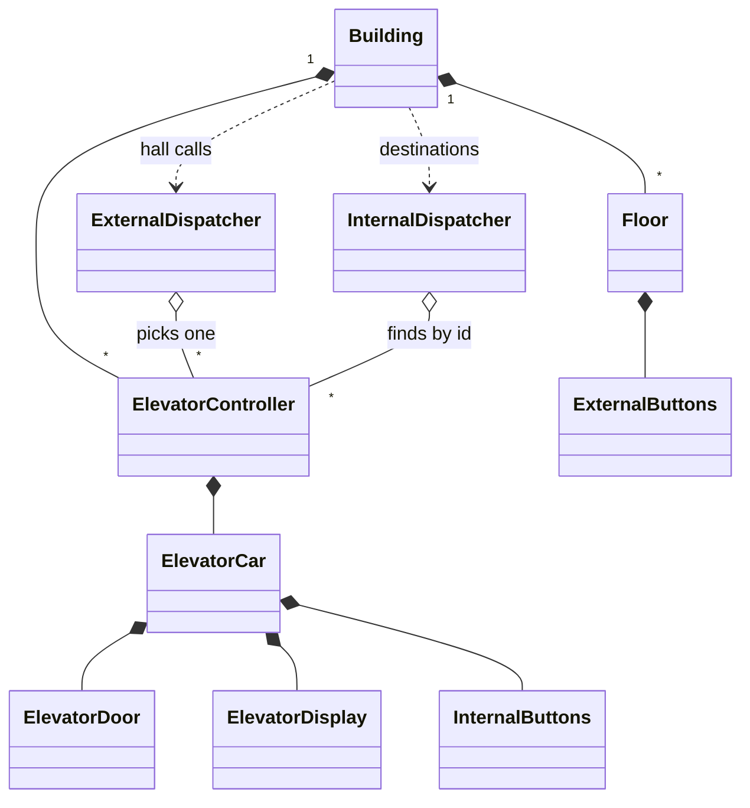

# Elevator System - Low Level Design (C++)

A building with N floors and M elevators. People on a floor press UP or DOWN (a **hall call**), and the system picks an elevator to send. People inside press the floor they want (a **destination**). Each elevator then visits its stops in sweep order: up through the requests above it, then down through the ones below.

This README walks the question the way you should deliver it in an interview: **Requirements -> Entities -> Class Design -> Implementation -> Extensibility**. Everything here matches the C++ code in this folder.

| Step | Time (45 min interview) | Section |
|---|---|---|
| Understand + clarify | 5 min | [1. Requirements](#1-requirements) |
| Pick the objects | 3-5 min | [2. Entities](#2-entities-and-relationships) |
| State, dispatch + movement algorithms | 10 min | [3. Class design](#3-class-design) |
| Write the core methods | 15-20 min | [4. Implementation](#4-implementation), [5. Verification](#5-verification) |
| "What if..." | 5+ min | [6. Extensibility](#6-extensibility) |

---

## 0. Understanding the problem

An elevator system answers two questions over and over:
1. **Dispatch:** a hall call arrives from floor 6 going UP. Which elevator should take it?
2. **Movement:** an elevator has stops at 2, 5 and 8. In what order does it visit them?

The interviewer usually opens with:

> "Design an elevator system for a building with several elevators. Handle requests from floors and from inside the elevators."

The most important clarifying question is one candidates rarely ask: **are we building a simulation, or real control software?** Real elevators react to hardware events (a sensor fires when the car reaches a floor). In an interview you almost always build a simulation, and then you have to decide **how time moves forward**. That choice shapes the whole design, and it's where our code takes a shortcut (see the decision on the time model).

---

## 1. Requirements

### Clarifying questions

Group your questions around: **what the system does**, **what can go wrong**, **what's in scope**, and **what might change later**.

**You:** "How many floors and elevators? Fixed, or configurable?"
**Interviewer:** "Configurable. Floors are numbered from 0."

**You:** "On a floor, is it the classic UP and DOWN buttons, or a panel where you type your destination?"
**Interviewer:** "Classic UP/DOWN buttons."
> So a hall call has a **floor and a direction**, but not a destination.

**You:** "Inside, can people press several floors?"
**Interviewer:** "Yes, any number of floor buttons."
> A destination request has a **floor but no direction**. Two different kinds of request.

**You:** "How should the system choose which elevator answers a hall call?"
**Interviewer:** "Something sensible. Prefer an elevator that's free, or already heading that way."

**You:** "In what order should an elevator serve its stops?"
**Interviewer:** "Like a real elevator: keep going in one direction while there are stops ahead, then turn around."
> That's the **LOOK** algorithm. Serving stops first-come-first-served makes the car zig-zag.

**You:** "Is this a simulation, or software driving real motors? If it's a simulation, how does time advance?"
**Interviewer:** "A simulation is fine. Collect some requests, then let the elevators run and show what they do."
> Our code takes the simplest reading: requests are queued first, then each elevator serves its whole queue. The stronger answer, a clock that ticks, is in the class design.

**You:** "What about a floor that doesn't exist, or the floor you're already on?"
**Interviewer:** "Ignore floors that don't exist. Pressing the floor you're on does nothing."

**You:** "Doors, displays?"
**Interviewer:** "Open and close the door at each stop; show the current floor and direction. No timing details."

**You:** "Weight limits, emergencies, express elevators, maintenance?"
**Interviewer:** "Out of scope. Possible follow-ups."

### Final requirements

Write this on the board before moving on:

```text
REQUIREMENTS
1. A building has N floors (0..N-1) and M elevators
2. Hall call: floor + direction (UP/DOWN); the system picks an elevator
3. Destination: inside an elevator, press any number of floors
4. Dispatch: prefer an idle elevator or one already moving towards the caller; nearest wins
5. Movement: serve stops in sweep order (LOOK), stop and open the door at each
6. Each elevator shows its current floor and direction
7. Requests for floors that don't exist are ignored; your own floor does nothing
8. Simulation: queue requests, then run the elevators

OUT OF SCOPE
- Weight/capacity, emergencies, maintenance, express or VIP cars
- Real hardware, real-time concurrency, door timing
```

---

## 2. Entities and relationships

Look for nouns in the requirements, but don't make every noun a class. Ask of each one: **does it have state that changes, or behavior we own?**

- **Building** - owns the floors and elevators, and is the entry point for requests. A facade over everything else.
- **Floor** - has the UP/DOWN buttons. `Floor` owns `ExternalButtons`.
- **Elevator** - split in two on purpose:
  - **`ElevatorCar`**: the physical car. Current floor, direction, state, and its door, display and internal buttons.
  - **`ElevatorController`**: the car's brain. Holds the pending stops and decides the order to visit them.
- **Door, display, buttons** - small parts of the car with their own little state: `ElevatorDoor`, `ElevatorDisplay`, `InternalButtons`.
- **Dispatch** - something must pick an elevator for a hall call: `ExternalDispatcher`. Something must route a destination press to the right car: `InternalDispatcher`.
- **Direction, elevator state** - fixed sets of values: enums `Direction` (UP, DOWN, NONE), `ElevatorState` (MOVING, IDLE, STOPPED), `DoorState` (OPEN, CLOSED).
- **Request** - not a class here. A hall call becomes a floor number in the controller's UP or DOWN set (see the decision on request storage).

| Entity | Responsibility |
|---|---|
| `Building` | Owns floors and controllers; `requestElevator(floor, dir)`, `requestFloor(elevatorId, floor)`, `processAllRequests()`. |
| `Floor` + `ExternalButtons` | Floor number, UP/DOWN button state. |
| `ElevatorController` | One per car. UP and DOWN request sets, `addRequest`, `addInternalRequest`, `processRequests` (LOOK). |
| `ElevatorCar` | id, current floor, direction, state; `moveUp`, `moveDown`, `stop`, door, display, internal buttons. |
| `ElevatorDoor`, `ElevatorDisplay`, `InternalButtons` | Door open/closed; floor + direction shown; which floor buttons are lit. |
| `ExternalDispatcher` (singleton) | Picks the best controller for a hall call: `findOptimalElevator`, `dispatchRequest`. |
| `InternalDispatcher` (singleton) | Finds the controller with a given elevator id and hands it the destination. |
| `Direction`, `ElevatorState`, `DoorState` | Enums. |



> [!NOTE]
> **Decision: one Elevator class, or a car and a controller?**
> - **Good: one `Elevator` class** holding position, direction, door and the pending stops, with the movement logic in it. Fewer classes, fine for a small design.
> - **Great (our choice): `ElevatorCar` + `ElevatorController`.** The car only knows its physical state and how to move one floor. The controller owns the stops and the scheduling. You can change the scheduling algorithm without touching the car, and the car looks like the hardware it would drive.

> [!TIP]
> **Say in the interview:** "I split the elevator into the car, which is the physical state, and a controller, which decides where it goes next. Scheduling changes never touch the car."

---

## 3. Class design

Work top-down, starting from the entry point. For each class ask two questions:
1. **State:** what must it remember to enforce the requirements?
2. **Methods:** what operations does the outside world need?

### Building

| Requirement | What Building must track |
|---|---|
| "N floors" | The floors, owned |
| "M elevators" | One controller per elevator, owned |
| "Ignore floors that don't exist" | The valid range, `minFloor`..`maxFloor` |

| Need | Method |
|---|---|
| Hall call | `requestElevator(floorNumber, dir)` |
| Destination press | `requestFloor(elevatorId, floorNumber)` |
| Run the simulation | `processAllRequests()` |
| Show status | `showAllElevatorStatus()` |

```cpp
class Building {
    std::string name;
    std::vector<std::unique_ptr<Floor>> floors;
    std::vector<std::unique_ptr<ElevatorController>> elevatorControllers;
    int minFloor, maxFloor;
public:
    Building(const std::string& name, int numFloors, int numElevators);   // registers controllers with both dispatchers
    ~Building();                                                           // clears both dispatchers
    void requestElevator(int floorNumber, Direction dir);
    void requestFloor(int elevatorId, int floorNumber);
    void processAllRequests();
    void showAllElevatorStatus() const;
};
```

### ElevatorController

| Requirement | What the controller must track |
|---|---|
| "Serve stops in sweep order" | Pending stops for the UP sweep, sorted |
| | Pending stops for the DOWN sweep, sorted |
| "Show floor and direction, move" | Its car, owned |

```cpp
class ElevatorController {
    std::unique_ptr<ElevatorCar> elevatorCar;
    std::set<int> upRequests;
    std::set<int> downRequests;
public:
    void addRequest(int floor, Direction dir);   // hall call: goes into the set for its direction
    void addInternalRequest(int floor);          // destination: UP set if above the car, DOWN set if below
    bool hasRequests() const;
    void processRequests();                      // LOOK until both sets are empty
};
```

> [!NOTE]
> **Decision: how are pending stops stored?**
> - **Good: one queue of floors, served first come first served.** Simple, but a car at floor 0 with requests 9, 1, 8, 2 travels 9 + 8 + 7 + 6 = 30 floors instead of 9.
> - **Great (our choice): two sorted `std::set<int>`s, one per direction.** Sorted order gives the next stop in either direction instantly (`lower_bound` / `upper_bound`), and pressing the same floor twice merges into one stop. A hall call keeps its direction by going into the matching set; a destination is put in UP or DOWN depending on whether it's above or below the car.
> - A further step: a `Request { floor, type }` object with HALL_UP / HALL_DOWN / DESTINATION, so a car can treat "someone waiting to go up" differently from "someone getting out". Our sets encode that only partly.

> [!TIP]
> **Say in the interview:** "Each controller keeps two ordered sets, one per direction. Ordered sets give me the next stop above or below the car in O(log n) and remove duplicate presses for free."

### ElevatorCar

```cpp
class ElevatorCar {
    int id;
    int currentFloor;
    Direction direction;                          // UP, DOWN, NONE
    ElevatorState state;                          // MOVING, IDLE, STOPPED
    std::unique_ptr<ElevatorDisplay> display;
    std::unique_ptr<ElevatorDoor> door;
    std::unique_ptr<InternalButtons> internalButtons;
public:
    void moveUp();                                // one floor up, updates display
    void moveDown();
    void stop();                                  // state STOPPED, direction NONE
    void openDoor();  void closeDoor();
    void pressInternalButton(int floor);
};
```

### ExternalDispatcher and InternalDispatcher

```cpp
class ExternalDispatcher {                        // singleton
    std::vector<ElevatorController*> controllers; // not owned
    ElevatorController* findOptimalElevator(int floor, Direction dir);
public:
    static ExternalDispatcher& getInstance();
    void addController(ElevatorController*);  void removeController(ElevatorController*);
    void dispatchRequest(int floor, Direction dir);
    void clearControllers();
};

class InternalDispatcher {                        // singleton
    std::vector<ElevatorController*> controllers;
public:
    static InternalDispatcher& getInstance();
    void dispatchRequest(int elevatorId, int floor);   // finds the controller by car id
};
```

> [!NOTE]
> **Decision: how does the dispatcher choose an elevator?**
> - **Good: the nearest elevator.** Easy, but it may send a car that's heading the other way, so the caller waits for it to finish its trip first.
> - **Our choice: direction-aware nearest.** Consider only idle cars, and cars moving the same direction as the call that haven't passed the caller yet; take the nearest of those. If none qualify, fall back to the nearest car of all.
> - **Great: estimate each car's arrival time** from its position, direction and the stops it already has, and pick the smallest. That also spreads load, which our version doesn't: with all cars idle at the same floor, every request goes to elevator 0.

> [!TIP]
> **Say in the interview:** "I prefer an idle car or one already coming my way, nearest first, and fall back to the nearest car. To balance load I'd score cars by estimated time to arrive, counting the stops they already have."

> [!NOTE]
> **Decision: how does time move forward in the simulation?**
> - **Our choice (Good): queue requests, then run each elevator until its queue is empty.** `processAllRequests()` takes elevator 0 through all its stops, then elevator 1, and so on. Easy to follow and to print. But elevators never move *at the same time*, and since requests are only dispatched while every car is idle, the dispatcher's "moving towards the caller" branch never actually runs.
> - **Great: a clock.** `step()` advances every elevator by one floor (or one door action). Requests can arrive between steps, so cars really are moving when the dispatcher looks at them, several cars move "together", and tests can step the simulation deterministically.

> [!TIP]
> **Say in the interview:** "For a simulation I'd drive time with a `step()` that moves every car one floor. My current version runs each car's queue to the end, which is simpler but means cars don't overlap in time, so I'd call that out."

> [!NOTE]
> **Decision: should the dispatchers be singletons?**
> - **Our choice: singletons** (`getInstance()` with a function-local static). Any code can reach them, and there's exactly one per program.
> - **Great: one dispatcher per building, owned by `Building`.** "One per program" is wrong as soon as there are two buildings: both register their cars with the same dispatcher. In our tests a hall call in building A was sent to building B's car, and destroying one building emptied the dispatcher for the other.

> [!TIP]
> **Say in the interview:** "A dispatcher belongs to a building, not to the program, so I'd make it a member of `Building` and pass it to whoever needs it. A singleton is only right when there's truly one of something."

### Final class design

```text
Building                                                 owns floors + controllers
    - name, floors: vector<unique_ptr<Floor>>, elevatorControllers: vector<unique_ptr<ElevatorController>>
    - minFloor, maxFloor
    + requestElevator(floor, dir),  requestFloor(elevatorId, floor)
    + processAllRequests(),  showAllElevatorStatus()

ElevatorController                                       one per car
    - elevatorCar: unique_ptr<ElevatorCar>,  upRequests: set<int>,  downRequests: set<int>
    + addRequest(floor, dir),  addInternalRequest(floor),  hasRequests(),  processRequests()
    - processUpRequests(),  processDownRequests(),  moveToFloor(target)
    - hasUpRequestAtOrAbove(floor),  hasDownRequestAtOrBelow(floor)

ElevatorCar
    - id, currentFloor, direction: Direction, state: ElevatorState
    - display, door, internalButtons                     (unique_ptr each)
    + moveUp(), moveDown(), stop(), openDoor(), closeDoor(), pressInternalButton(floor), showStatus()

ExternalDispatcher (singleton)  - controllers: vector<ElevatorController*>
    + dispatchRequest(floor, dir)          - findOptimalElevator(floor, dir)
InternalDispatcher (singleton)  - controllers: vector<ElevatorController*>
    + dispatchRequest(elevatorId, floor)

Floor { floorNumber, externalButtons }   ExternalButtons { upButtonPressed, downButtonPressed }
InternalButtons { pressedFloors: set<int>, minFloor, maxFloor }
ElevatorDoor { state: DoorState }        ElevatorDisplay { currentFloor, direction }
enum Direction { UP, DOWN, NONE }   enum ElevatorState { MOVING, IDLE, STOPPED }   enum DoorState { OPEN, CLOSED }
```

### Design patterns used

| Pattern | Where | Why | One line to say |
|---|---|---|---|
| Singleton | `ExternalDispatcher`, `InternalDispatcher` | One shared dispatcher reachable from anywhere | "Convenient, but wrong with two buildings; I'd make it per building." |
| Facade | `Building` | Callers press buttons through one object and never touch controllers or dispatchers | "`Building` is the only class the outside world uses." |
| Composition | Building -> controllers -> car -> door, display, buttons | Clear ownership with `unique_ptr` at every level | "Each object owns its parts; dispatchers only point at controllers." |
| (Not quite) Strategy and State | `findOptimalElevator`, `ElevatorState` enum | `main.cpp`'s comments name these patterns, but the algorithm is a hard-coded method and the state is an enum | "To make dispatch a real Strategy, I'd put it behind a `DispatchStrategy` interface; to make it State, each state would be a class handling `step()`." |

---

## 4. Implementation

Before writing code, ask the interviewer: real code, pseudocode, or talk it through? The two methods that matter are **dispatch** (`findOptimalElevator`) and **movement** (`processRequests`). Write those two well.

### Hall call: Building -> ExternalDispatcher

**Core logic:** check the floor exists, light the button, let the dispatcher pick a car and add the stop to that car's controller.

```cpp
// Building.hpp
void requestElevator(int floorNumber, Direction dir) {
    if (floorNumber >= minFloor && floorNumber <= maxFloor) {
        Floor* floor = floors[floorNumber].get();

        if (dir == Direction::UP) {
            floor->pressUpButton();
        } else {
            floor->pressDownButton();
        }

        ExternalDispatcher::getInstance().dispatchRequest(floorNumber, dir);
    }
}

// ElevatorController.hpp
void addRequest(int floor, Direction dir) {
    if (dir == Direction::UP) {
        upRequests.insert(floor);
    } else if (dir == Direction::DOWN) {
        downRequests.insert(floor);
    }
    // ... prints the request
}
```

### findOptimalElevator (dispatch)

**Core logic**
1. For each car: if it's idle, it's a candidate; if it's moving in the call's direction and hasn't passed the caller (below the floor for UP, above it for DOWN), it's a candidate.
2. Take the candidate nearest to the calling floor.
3. If nobody qualified, take the nearest car of all.

**Edge cases**
- No elevators at all: returns `nullptr`, and `dispatchRequest` prints "No elevator available!".
- Ties: the first car in the list wins (`<`, not `<=`).

```cpp
// ExternalDispatcher.hpp
ElevatorController* findOptimalElevator(int floor, Direction dir) {
    ElevatorController* bestController = nullptr;
    int minDistance = std::numeric_limits<int>::max();

    for (auto* controller : controllers) {
        auto* car = controller->getElevatorCar();
        int currentFloor = car->getCurrentFloor();
        int distance = std::abs(currentFloor - floor);

        // Prefer idle elevators
        if (car->getState() == ElevatorState::IDLE) {
            if (distance < minDistance) {
                minDistance = distance;
                bestController = controller;
            }
        }
        // Or elevators moving towards the request
        else if (car->getDirection() == dir) {
            if (dir == Direction::UP && currentFloor <= floor) {
                if (distance < minDistance) {
                    minDistance = distance;
                    bestController = controller;
                }
            } else if (dir == Direction::DOWN && currentFloor >= floor) {
                if (distance < minDistance) {
                    minDistance = distance;
                    bestController = controller;
                }
            }
        }
    }

    // If no optimal found, just pick the closest
    if (!bestController && !controllers.empty()) {
        for (auto* controller : controllers) {
            int distance = std::abs(controller->getElevatorCar()->getCurrentFloor() - floor);
            if (distance < minDistance) {
                minDistance = distance;
                bestController = controller;
            }
        }
    }

    return bestController;
}
```

The source comment calls this "LOOK". It isn't: LOOK is the *movement* order inside one car. This is direction-aware nearest-car dispatch.

### Destination press: InternalDispatcher -> controller

```cpp
// InternalDispatcher.hpp
void dispatchRequest(int elevatorId, int floor) {
    for (auto* controller : controllers) {
        if (controller->getElevatorCar()->getId() == elevatorId) {
            controller->addInternalRequest(floor);
            // ... prints
            return;
        }
    }
    std::cout << "Elevator " << elevatorId << " not found!" << std::endl;
}

// ElevatorController.hpp
void addInternalRequest(int floor) {
    int currentFloor = elevatorCar->getCurrentFloor();
    if (floor > currentFloor) {
        upRequests.insert(floor);
    } else if (floor < currentFloor) {
        downRequests.insert(floor);
    }
    elevatorCar->pressInternalButton(floor);
}
```

A destination has no direction of its own, so it joins whichever sweep will pass it: above the car means UP, below means DOWN. Pressing the current floor adds no stop.

### processRequests (movement, LOOK)

**Core logic**, repeated until both sets are empty:
1. Any UP stop **at or above** the car? Sweep up, lowest first.
2. Otherwise any DOWN stop **at or below** the car? Sweep down, highest first.
3. Otherwise everything left is "behind" the sweep (UP stops below the car, or DOWN stops above it): travel to the far end of them, then the next round sweeps back through them in the right direction.

**Edge cases**
- A stop on the car's current floor: `lower_bound` finds it, the car "moves" zero floors, stops and opens the door.
- At each stop the car stops, opens and closes the door, and the internal button for that floor is cleared.

```cpp
// ElevatorController.hpp
void processRequests() {
    while (hasRequests()) {
        int currentFloor = elevatorCar->getCurrentFloor();

        // LOOK: sweep up serving UP requests ahead, then down serving DOWN requests ahead
        if (hasUpRequestAtOrAbove(currentFloor)) {
            processUpRequests();
        } else if (hasDownRequestAtOrBelow(currentFloor)) {
            processDownRequests();
        } else if (!upRequests.empty()) {
            // Only UP requests below us: go down to the lowest one, then sweep up
            moveToFloor(*upRequests.begin());
        } else {
            // Only DOWN requests above us: go up to the highest one, then sweep down
            moveToFloor(*downRequests.rbegin());
        }
    }
    elevatorCar->stop();
    elevatorCar->setState(ElevatorState::IDLE);
}

bool hasUpRequestAtOrAbove(int floor) const {
    return upRequests.lower_bound(floor) != upRequests.end();
}

bool hasDownRequestAtOrBelow(int floor) const {
    return downRequests.upper_bound(floor) != downRequests.begin();
}

void processUpRequests() {
    // Serve UP requests at or above the current floor, lowest first
    while (hasUpRequestAtOrAbove(elevatorCar->getCurrentFloor())) {
        int targetFloor = *upRequests.lower_bound(elevatorCar->getCurrentFloor());
        moveToFloor(targetFloor);
        upRequests.erase(targetFloor);
        elevatorCar->getInternalButtons()->clearButton(targetFloor);

        // Simulate stop at floor
        elevatorCar->stop();
        elevatorCar->openDoor();
        std::this_thread::sleep_for(std::chrono::milliseconds(100));
        elevatorCar->closeDoor();
    }
}

void processDownRequests() {
    // Serve DOWN requests at or below the current floor, highest first
    while (hasDownRequestAtOrBelow(elevatorCar->getCurrentFloor())) {
        int targetFloor = *std::prev(downRequests.upper_bound(elevatorCar->getCurrentFloor()));
        moveToFloor(targetFloor);
        downRequests.erase(targetFloor);
        // ... same stop, door, clear button
    }
}

void moveToFloor(int targetFloor) {
    // Step towards the target from wherever the car is
    while (elevatorCar->getCurrentFloor() < targetFloor) {
        elevatorCar->moveUp();
        std::this_thread::sleep_for(std::chrono::milliseconds(50));
    }
    while (elevatorCar->getCurrentFloor() > targetFloor) {
        elevatorCar->moveDown();
        std::this_thread::sleep_for(std::chrono::milliseconds(50));
    }
}
```

`std::set` is sorted, so "the next stop above me" is `lower_bound(current)` (first element `>= current`) and "the next stop below me" is the element just before `upper_bound(current)` (last element `<= current`). Both are O(log n).

### The bug this code used to have

> [!WARNING]
> Until this version, the demo **never finished**. `moveToFloor(target, dir)` always stepped in the direction it was given and only stopped when it hit the target exactly; `processUpRequests` took the *lowest* UP stop and `processDownRequests` the *highest* DOWN stop, without looking at where the car was. In `main.cpp`'s first scenario elevator 0 served floor 5, then went "down" towards a DOWN stop at floor 8, which is above it: it passed floor 0 and kept going (floor -226 when the run was killed after 15 seconds).

The fix has three parts: `moveToFloor` steps towards the target from wherever the car is; each sweep serves only the stops *ahead* of the car; and stops "behind" are reached by travelling to the far end first. It's a good interview lesson: **any loop that waits for a value to become equal to a target should be written so it can't step past it.**

### C++ talking points

- **Meyers singleton:** `static ExternalDispatcher& getInstance() { static ExternalDispatcher instance; return instance; }`. A function-local static is created on first use, and C++11 guarantees that's thread-safe. Copying is deleted, so nobody can make a second one by accident.
- **Ownership tree with `unique_ptr`:** `Building` owns floors and controllers, a controller owns its car, a car owns its door, display and buttons. The dispatchers hold **non-owning** `ElevatorController*`, so `~Building()` must clear them, or they'd point at destroyed controllers.
- **Ordered `std::set`:** `begin()` / `rbegin()` give the lowest and highest stop; `lower_bound` / `upper_bound` with `std::prev` give the nearest stop above or below a floor.
- **Erase-remove idiom** in `removeController`: `controllers.erase(std::remove(...), controllers.end())`.
- **`enum class` + to-string helpers** (`directionToString`, `stateToString`) keep enums type-safe and printable.
- **`namespace ElevatorSystem`** and `#pragma once` keep the names and headers tidy.
- **`std::this_thread::sleep_for`** stands in for travel and door time. It makes the demo readable but slow, and is another reason a `step()` clock is better for tests.

### Gaps in our code (know these before the interviewer finds them)

I tested each of these by running the code, except where marked "by reading". Raising them yourself, with the fix, is a strong signal.

| Gap | What happens | Fix to say |
|---|---|---|
| **Two buildings share the dispatchers** | Building A (car at floor 9) and building B (car at 0): a hall call on A's floor 1 was **sent to B's car**. Pressing 7 inside B's elevator 0 **lit the button in A's elevator 0** (both are "elevator 0"; A's registered first). Destroying B **emptied the dispatcher for A**: A's next call printed "No elevator available!". | Give each `Building` its own dispatchers instead of singletons. |
| **No load balancing** | Five hall calls while 3 cars sat idle at floor 0: **all five went to elevator 0**. Ties go to the first car, and stops already queued aren't counted. | Score cars by estimated arrival time including their pending stops; break ties by fewest stops. |
| **Elevators don't move at the same time** | `processAllRequests` runs elevator 0's whole queue, then elevator 1's. Since requests are only dispatched while cars are idle, the "moving towards the caller" branch of dispatch never runs. | A `step()` clock that moves every car one floor per tick (see [follow-up 1](#1-run-the-elevators-at-the-same-time)). |
| **Destination floors aren't validated** | In a 15-floor building, a destination of floor **50** was rejected by the button but still queued: the car **went to floor 50**. | Check the range in `addInternalRequest` (or `InternalDispatcher`) before queueing; `pressButton` already returns `false`. |
| **Buttons stay lit** | Pressing the car's current floor queues nothing but leaves the internal button lit forever. Hall-call buttons are never reset after a car arrives (floor 5 UP still pressed after service). | Don't light a button for the current floor; call `Floor::resetButtons()` (or reset the one direction) when a car stops there. |
| **No momentum in the sweep** | `stop()` resets the direction to NONE, so after each stop the car prefers going up again. Car at 8 with DOWN@4, UP@2, DOWN@9: it served **4, 2, 9 (13 floors)** where 9, 4, 2 (8 floors) was possible. | Keep the sweep direction in the controller and keep going that way while stops remain ahead. |
| **"stopped at floor X" printed twice** | The last stop is followed by the final `stop()` in `processRequests`. Cosmetic. | Only call the final `stop()` if the car isn't already stopped. |

---

## 5. Verification

Trace the code on concrete scenarios and say the state out loud after each step. The outputs below are from actually running the code (door lines left out).

**1. Tech Tower: 10 floors, 3 elevators, all idle at 0**
```text
requestElevator(5, UP)    all idle, distance 5 each, tie -> Elevator 0     up = {5}
requestElevator(2, DOWN)  still all idle at 0, tie -> Elevator 0          down = {2}
requestElevator(8, DOWN)  tie -> Elevator 0                                down = {2, 8}

processAllRequests, Elevator 0 at 0:
  UP stop >= 0? 5         -> moving UP 1..5, stopped at floor 5            up = {}
  UP stop >= 5? none; DOWN stop <= 5? 2  -> moving DOWN 4, 3, 2, stopped at floor 2   down = {8}
  nothing ahead; DOWN stop above -> move up to 8 (3..8)
  DOWN stop <= 8? 8       -> stopped at floor 8                            down = {}
Final: Elevator 0 at 8, Elevators 1 and 2 never moved
```
(Before the fix, this scenario went DOWN from 5 looking for floor 8 and never stopped.)

**2. Office Complex: 15 floors, 2 elevators**
```text
requestFloor(0, 7)        Elevator 0 at 0: 7 > 0 -> up = {7}
requestFloor(1, 10)       Elevator 1 at 0: up = {10}
requestElevator(3, UP)    both idle at 0, distance 3, tie -> Elevator 0    up = {3, 7}
Elevator 0: stops at 3, then 7          Elevator 1 (after Elevator 0 is done): stops at 10
```

**3. Smart Building: 20 floors, cars placed at 0, 5, 10, 15**
```text
requestElevator(6, UP)    nearest idle: Elevator 1 (at 5, distance 1)      -> moves UP to 6
requestElevator(12, DOWN) nearest idle: Elevator 2 (at 10, distance 2; Elevator 3 at 15 is 3 away)
                          -> Elevator 2 goes UP to 12 to collect someone going down
```

**4. Edge cases** (separate test programs)
```text
car at 8; UP@2, DOWN@9, DOWN@4            -> stops 4, 2, 9      (13 floors; 8 possible)
5 hall calls, 3 cars idle at 0            -> all to Elevator 0
15 floors, destination 50                 -> car ends at floor 50
hall call from floor 20 in a 15-floor building -> ignored, nothing printed
destination = current floor               -> nothing queued, button stays lit
after serving floor 5 UP                  -> floor 5 UP button still pressed
buildings A + B: A's hall call            -> served by B's car
B's car 0 button 7                        -> lights A's car 0
B destroyed, A's hall call                -> "No elevator available!"
```

---

## 6. Extensibility

If there's time left, expect "what if" questions. You usually explain where the change goes rather than code it. Junior candidates may skip this; senior candidates can get several in a row.

### 1. "Run the elevators at the same time"

> "Replace 'run each queue to the end' with a clock. `Building::step()` calls `controller->step()` on every car; a car's step moves it one floor towards its next stop, or opens the door if it's arrived. Requests can arrive between steps, so the dispatcher now sees cars that are really moving, and direction-aware dispatch finally matters. Tests become deterministic: 'call `step()` 5 times, the car is at floor 5'."

```cpp
void ElevatorController::step() {
    int next = nextStop();                    // LOOK choice, as in processRequests
    if (next == NO_STOP) { elevatorCar->setState(ElevatorState::IDLE); return; }
    int floor = elevatorCar->getCurrentFloor();
    if (floor < next) elevatorCar->moveUp();
    else if (floor > next) elevatorCar->moveDown();
    else arriveAt(floor);                     // stop, open the door, erase the stop, clear buttons
}
```

### 2. "Smarter dispatch"

> "Put dispatch behind a `DispatchStrategy` interface so it can be swapped (nearest car, direction-aware, estimated time to arrive). The ETA version simulates how many floors and stops each car needs before it reaches the caller, given its current stops, and picks the smallest. That also balances load."

### 3. "Several buildings"

> "Make the dispatchers members of `Building` instead of singletons. Each building's dispatcher only knows its own cars, so calls can't cross buildings and destroying one building can't affect another."

### 4. "Capacity / weight limit"

> "Give the car a current load and a maximum. A full car keeps its destinations but stops accepting hall calls, so dispatch skips it, and it doesn't stop for hall calls on the way."

### 5. "Emergency or maintenance mode"

> "Add states such as EMERGENCY and MAINTENANCE. In an emergency every car stops at the nearest floor, opens its doors and refuses new requests; a car in maintenance is skipped by dispatch. This is where a real State pattern pays off: each state is a class that decides what `step()` and `addRequest()` do."

### 6. "Express or VIP elevators"

> "Give each car the set of floors it may stop at. Dispatch only considers cars that serve the calling floor, and `addInternalRequest` rejects floors the car doesn't serve."

### 7. "A request waits too long"

> "Record when each stop was added. If one waits longer than a threshold, the dispatcher or controller serves it next even if it's not in sweep order (aging), so a busy building can't starve a quiet floor."

---

## 7. What is expected at each level

**Junior.** Building, floors, elevators, and requests from both floors and inside cars. An elevator moves to its stops and stops there; a hall call goes to some reasonable elevator. Getting a working, terminating movement loop is the main thing; hints on the sweep order are fine.

**Mid-level.** Separate the car from its scheduling, store stops so the sweep order (LOOK) is easy, and explain direction-aware dispatch. Handle invalid floors and a request for the current floor. Discuss one extension, such as a `step()` clock or capacity.

**Senior.** Ask "simulation or real control?" and how time advances, without prompting. Raise the weaknesses yourself: sequential processing hiding concurrency, singletons breaking with several buildings, no load balancing, lost sweep direction, buttons never reset. Discuss ETA-based dispatch, a State pattern for modes, and how you'd test the scheduler deterministically.

---

## 8. Test yourself

<details><summary>1. What's the difference between a hall call and a destination request?</summary>

A hall call comes from a floor and has a direction (UP or DOWN) but no destination. A destination comes from inside a car and has a floor but no direction. Our controller files a hall call under its own direction and a destination under UP or DOWN depending on whether it's above or below the car.
</details>

<details><summary>2. Why two sorted sets per controller instead of one queue?</summary>

A FIFO queue makes the car zig-zag. Sorted sets give the next stop above or below the car with `lower_bound` / `upper_bound` in O(log n), and pressing a floor twice merges into one stop.
</details>

<details><summary>3. What is LOOK, and where is it in our code?</summary>

Keep moving in one direction while there are stops ahead, then reverse. It's the movement order inside `processRequests`: UP stops at or above the car lowest first, then DOWN stops at or below highest first, then travel to whatever is left behind. (`findOptimalElevator` is dispatch, not LOOK, despite its comment.)
</details>

<details><summary>4. How does <code>findOptimalElevator</code> pick a car?</summary>

Among idle cars and cars moving in the call's direction that haven't passed the caller, it takes the nearest. If none qualify, it takes the nearest car overall. Ties go to the first car in the list.
</details>

<details><summary>5. Why did the old demo walk the elevator to floor -226?</summary>

`moveToFloor(target, DOWN)` only moved down and stopped only on reaching the target exactly; the down pass picked the highest DOWN stop (8) without checking it was below the car (at 5). It moved away from 8 forever. The fix steps towards the target from wherever the car is and only serves stops ahead in each sweep.
</details>

<details><summary>6. Why does the "moving towards the caller" branch of dispatch never run in our demo?</summary>

All requests are dispatched before `processAllRequests()`, and cars are only MOVING inside it. So at dispatch time every car is IDLE. A `step()` clock with requests arriving between steps would exercise it.
</details>

<details><summary>7. What goes wrong with two <code>Building</code>s in one program?</summary>

Both register their cars with the same singleton dispatchers: a hall call can go to the other building's car, a destination press can reach the other building's "elevator 0", and destroying one building clears the dispatcher for both. Make dispatchers per building.
</details>

<details><summary>8. How would you balance load across elevators?</summary>

Score each car by estimated time to reach the caller, counting the stops it already has, and pick the lowest; break ties by fewest pending stops. Today five calls with three idle cars all went to elevator 0.
</details>

<details><summary>9. In <code>std::set</code>, how do you find the nearest stop at or below floor <code>f</code>?</summary>

`upper_bound(f)` returns the first element greater than `f`; if it isn't `begin()`, `std::prev` of it is the largest element `<= f`.
</details>

<details><summary>10. Why does <code>~Building()</code> clear the dispatchers?</summary>

The dispatchers hold raw, non-owning pointers to controllers that the building owns. Without clearing, they'd point at destroyed controllers after the building is gone. (The side effect, with singletons, is that it clears other buildings' cars too.)
</details>

<details><summary>11. How would you add an emergency mode?</summary>

A state such as EMERGENCY: every car stops at the nearest floor, opens its doors and rejects new requests until the mode is cleared. With several modes, model each as a State class that decides what `step()` and `addRequest()` do.
</details>

<details><summary>12. What's the first question to ask in an elevator interview, and why?</summary>

"Simulation or real control software, and how does time advance?" It decides whether you write a `step()`-driven simulation or event-driven code, and it shapes every class.
</details>

---

## 9. Run it

```bash
cd lld/elevator
g++ -std=c++17 main.cpp -o elevator
./elevator
```

It runs three scenarios and takes a few seconds, because travel and doors are simulated with short sleeps. Expected output (door lines left out):

```text
--- Scenario 1: Person on floor 5 wants to go UP ---
External request from floor 5 (UP) dispatched to Elevator 0
...
--- Processing all elevator requests ---
Elevator 0 moving UP to floor 1
...
Elevator 0 stopped at floor 5
Elevator 0 moving DOWN to floor 4
Elevator 0 moving DOWN to floor 3
Elevator 0 moving DOWN to floor 2
Elevator 0 stopped at floor 2
Elevator 0 moving UP to floor 3
...
Elevator 0 stopped at floor 8
...
Request from floor 6 (UP) - Should pick Elevator 1 (at floor 5)
External request from floor 6 (UP) dispatched to Elevator 1
...
  ALL SIMULATIONS COMPLETED!
```

### Files

```text
elevator/
├── main.cpp                   three scenarios: basic hall calls, destinations, dispatch choice
├── Building.hpp               owns floors + controllers, entry point, registers with dispatchers
├── ElevatorController.hpp     UP/DOWN request sets, LOOK movement (processRequests)
├── ElevatorCar.hpp            floor, direction, state; owns door, display, internal buttons
├── ExternalDispatcher.hpp     singleton: picks a car for a hall call (findOptimalElevator)
├── InternalDispatcher.hpp     singleton: routes a destination to the car with that id
├── Floor.hpp, ExternalButtons.hpp       floor number + UP/DOWN buttons
├── InternalButtons.hpp        lit floor buttons inside a car
├── ElevatorDoor.hpp           OPEN / CLOSED
├── ElevatorDisplay.hpp        floor + direction shown
├── Direction.hpp              UP, DOWN, NONE
└── ElevatorState.hpp          MOVING, IDLE, STOPPED
```
