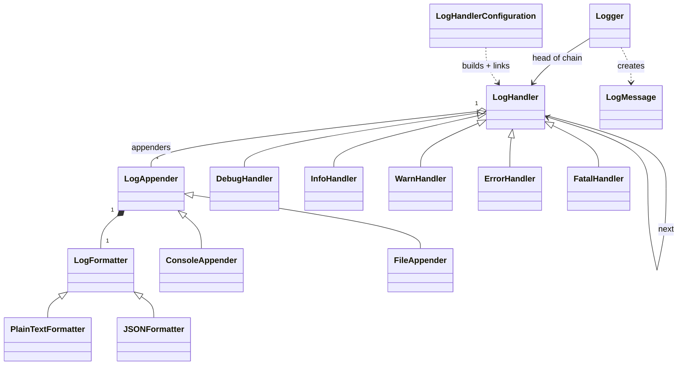

# Logger - Low Level Design (C++)

A logging library: application code calls `logger->error("...")`, and the message is stamped with the time and level, then written to whichever outputs are configured for that level (console, file), each in its own format (plain text, JSON).

This README walks the question the way you should deliver it in an interview: **Requirements -> Entities -> Class Design -> Implementation -> Extensibility**. Everything here matches the C++ code in this folder.

| Step | Time (45 min interview) | Section |
|---|---|---|
| Understand + clarify | 5 min | [1. Requirements](#1-requirements) |
| Pick the objects | 3-5 min | [2. Entities](#2-entities-and-relationships) |
| State + methods, patterns | 10 min | [3. Class design](#3-class-design) |
| Write the core methods | 15-20 min | [4. Implementation](#4-implementation), [5. Verification](#5-verification) |
| "What if..." | 5+ min | [6. Extensibility](#6-extensibility) |

---

## 0. Understanding the problem

A logger records what an application is doing. Each entry has a **level** (how serious it is), a **message** and a **time**. The interesting part is routing: errors might go to the console *and* a file, debug output only to the console, and each destination may want a different format.

The interviewer usually opens with:

> "Design a logging framework like log4j. Support log levels, multiple output destinations, and different formats."

This question is mostly about **separating three things that change independently**: *which* messages go somewhere (levels), *where* they go (destinations), and *how* they look (formats). Get those three apart and the rest follows. It's also a favorite for naming design patterns, so be ready to say which pattern sits where and why.

---

## 1. Requirements

### Clarifying questions

Group your questions around: **what the system does**, **what can go wrong**, **what's in scope**, and **what might change later**.

**You:** "Which log levels do we need?"
**Interviewer:** "TRACE, DEBUG, INFO, WARN, ERROR and FATAL."
> Six ordered levels. Write them down in order of severity.

**You:** "Where do logs go?"
**Interviewer:** "Console and files for now. More destinations later, maybe a database."
> "More later" tells you destinations must be pluggable: an interface with one class per destination.

**You:** "Can different levels go to different places? For example errors to a file, debug only to the console?"
**Interviewer:** "Yes. Each level can have its own set of destinations, and one level can go to several."
> This is the routing requirement. Errors may need two outputs at once.

**You:** "What formats?"
**Interviewer:** "Human-readable text, and JSON for files that other tools read."
> Format is independent of destination: console could use JSON too. So format must be a separate pluggable piece, not baked into the destination.

**You:** "What does each log entry contain?"
**Interviewer:** "Level, message, and the time it was logged."

**You:** "If a level has no destination configured, what happens to its messages?"
**Interviewer:** "They're dropped. That's how you turn off noisy levels."

**You:** "One logger for the whole application, or many?"
**Interviewer:** "One shared logger."

**You:** "Will many threads log at the same time? Should logging block the caller?"
**Interviewer:** "Write synchronously for now, and start single-threaded. We'll talk about threads if there's time."
> Interviewers often defer concurrency so you build a clean core first. Expect them to come back to it, and note that our code is not thread-safe yet (see the gaps table).

**You:** "Out of scope: log rotation, sending logs over the network, config files?"
**Interviewer:** "All out of scope."

### Final requirements

Write this on the board before moving on:

```text
REQUIREMENTS
1. Levels: TRACE < DEBUG < INFO < WARN < ERROR < FATAL
2. Each entry has level, message, timestamp (taken when log() is called)
3. Destinations: console and file; new destinations must be easy to add
4. Formats: plain text and JSON; any format with any destination
5. Each level is routed to its own set of destinations (zero, one or several)
6. A level with no destinations is dropped
7. One shared logger with debug(), info(), warn(), error(), fatal()
8. Logging is synchronous

OUT OF SCOPE
- Thread safety (discussed as a follow-up)
- Asynchronous logging, log rotation, network/remote destinations
- Configuration files, per-module loggers
```

---

## 2. Entities and relationships

Look for nouns in the requirements, but don't make every noun a class. Ask of each one: **does it have state that changes, or behavior we own?**

- **Logger** - the object application code talks to. It stamps the time, builds the entry and hands it on. One shared instance.
- **Log entry** - level + message + timestamp, created once and only read afterwards. A value object, `LogMessage`.
- **Level** - a fixed, ordered set of values: an enum, `LogLevel`.
- **Destination** - console, file, later database. Each one writes differently, so they share an interface, `LogAppender`, with one class per destination.
- **Format** - plain text, JSON. Each turns an entry into a string differently: interface `LogFormatter`, one class per format. Each destination *holds* a formatter.
- **Routing by level** - something must decide, for each entry, which destinations get it. We use a chain of per-level handlers (`LogHandler` subclasses), each holding the destinations for its level.
- **Setup of that routing** - something builds the handlers, links them, and lets callers attach destinations to a level: `LogHandlerConfiguration`.

| Entity | Responsibility |
|---|---|
| `Logger` | Singleton entry point. `log(level, msg)` plus `debug/info/warn/error/fatal`. Stamps time, builds `LogMessage`, sends it down the handler chain. |
| `LogMessage` | Value object: level, message, timestamp (ms since epoch). |
| `LogLevel` | Enum TRACE..FATAL, plus `logLevelToString`. |
| `LogHandler` (abstract) | One link in the chain. If the level is its own, sends the message to all its appenders; then always passes it to the next handler. |
| `DebugHandler`, `InfoHandler`, `WarnHandler`, `ErrorHandler`, `FatalHandler` | Each decides which level(s) it handles. `DebugHandler` handles both DEBUG and TRACE. |
| `LogHandlerConfiguration` | Builds the chain once, keeps a level -> handler map, `addAppenderForLevel(level, appender)`. |
| `LogAppender` (abstract) | A destination. Holds a formatter, `append(msg)` writes it. |
| `ConsoleAppender`, `FileAppender` | Write to `std::cout` / append to a file. |
| `LogFormatter` (abstract) | `format(msg) -> string`. |
| `PlainTextFormatter`, `JSONFormatter` | `[2026-10-30 21:12:23] [ERROR] text` / `{"timestamp":...,"level":"ERROR","message":"..."}`. |



> [!NOTE]
> **Decision: where does the format live?**
> - **Good: each destination hard-codes its format.** `ConsoleAppender` prints text, `FileAppender` writes JSON. Simple, but "JSON to the console" needs a new class, and every new format multiplies classes (ConsoleJson, FileJson, DbJson...).
> - **Great (our choice): each appender holds a `LogFormatter`.** Destination and format vary independently: 2 destinations × 2 formats = 4 combinations from 4 small classes, not 4 combined ones. Adding a format never touches an appender.

> [!TIP]
> **Say in the interview:** "Where a log goes and what it looks like change independently, so the appender owns a formatter. Any destination can use any format."

---

## 3. Class design

Work top-down, starting from what application code calls. For each class ask two questions:
1. **State:** what must it remember to enforce the requirements?
2. **Methods:** what operations does the outside world need?

### Logger

| Requirement | What Logger must track |
|---|---|
| "One shared logger" | The single instance |
| "Route each entry by level" | The head of the handler chain |

| Need | Method |
|---|---|
| Log at any level | `log(level, message)` |
| Convenience per level | `debug(msg)`, `info(msg)`, `warn(msg)`, `error(msg)`, `fatal(msg)` |
| Get the logger | `static getInstance()` |

```cpp
class Logger {                                   // Singleton
    static inline Logger* instance = nullptr;
    LogHandler* handlerChain;                    // built by LogHandlerConfiguration::build()
    Logger();                                    // private
public:
    static Logger* getInstance();
    void log(LogLevel level, const std::string& message);
    void debug(const std::string& msg);          // ... info, warn, error, fatal
};
```

There's no `trace()` shortcut; TRACE is logged with `log(LogLevel::TRACE, ...)`.

> [!NOTE]
> **Decision: should Logger be a Singleton?**
> - **Good: a normal object created at startup and passed to the code that logs.** Easy to test and to have several (one per module).
> - **Great for this requirement (our choice): Singleton.** "One shared logger" for the whole app, reachable from anywhere without passing it through every function. Logging is the textbook case where global access is accepted.

> [!TIP]
> **Say in the interview:** "A logger is the classic place where a singleton is acceptable: everything logs, and threading a logger through every call is noise. I'd still make `getInstance` thread-safe with a function-local static."

### LogMessage and LogLevel

```cpp
enum class LogLevel { TRACE, DEBUG, INFO, WARN, ERROR, FATAL };   // ordered by severity
std::string logLevelToString(LogLevel level);

class LogMessage {
    LogLevel level;
    std::string message;
    long long timestamp;                         // ms since epoch, taken in Logger::log
public:
    LogLevel getLevel() const;
    std::string getMessage() const;
    long long getTimestamp() const;
};
```

The timestamp is taken **when `log()` is called**, not when the line is written, so it records when the event happened even if writing is slow.

### LogHandler (the chain)

| Requirement | What a handler must track |
|---|---|
| "Each level has its own destinations" | Its list of appenders |
| "Entry must reach the right handler" | The next handler in the chain |
| "Which level is mine?" | `shouldHandle(level)` in each subclass |

```cpp
class LogHandler {
protected:
    LogHandler* nextHandler = nullptr;
    std::vector<LogAppender*> appenders;
    virtual bool shouldHandle(LogLevel level) const = 0;
    void notifyAppenders(const LogMessage& msg);
public:
    void setNext(LogHandler* handler);
    void addAppender(LogAppender* appender);
    void handle(const LogMessage& msg);          // notify if mine, then always pass on
};
// DebugHandler: DEBUG or TRACE.  InfoHandler: INFO.  WarnHandler: WARN.
// ErrorHandler: ERROR.  FatalHandler: FATAL.
// Chain: Debug -> Info -> Warn -> Error -> Fatal
```

> [!NOTE]
> **Decision: how is an entry routed to its destinations?**
> - **Good: a map from level to a list of appenders.** `appenders[level]` and write to each. One lookup, nothing to link.
> - **Our choice: Chain of Responsibility with one handler per level.** Each handler checks "is this my level?", writes to its appenders, and passes the entry on. It shows the pattern clearly and each level's routing lives in its own object. Since every handler matches exactly one level and the entry always travels the whole chain, it behaves like the map version.
> - **Great: threshold handlers.** Each handler accepts "my level **and above**" (e.g. a file handler for WARN+). Then one setting sends WARN, ERROR and FATAL to a file, which is what most real loggers do. That's where a chain earns its keep: one entry is picked up by several handlers.

> [!TIP]
> **Say in the interview:** "I used Chain of Responsibility: each handler owns one level's destinations. Right now each handler matches exactly one level, which is basically a lookup. The natural evolution is threshold handlers, so 'WARN and above to a file' is one rule."

### LogAppender and LogFormatter

```cpp
class LogAppender {
protected:
    std::unique_ptr<LogFormatter> formatter;     // owned
public:
    explicit LogAppender(std::unique_ptr<LogFormatter> formatter);
    virtual void append(const LogMessage& msg) = 0;
};
class ConsoleAppender : public LogAppender { /* std::cout */ };
class FileAppender    : public LogAppender { std::string filePath; /* opens in append mode */ };

class LogFormatter {
public:
    virtual std::string format(const LogMessage& msg) const = 0;
};
class PlainTextFormatter : public LogFormatter { /* [YYYY-MM-DD HH:MM:SS] [LEVEL] message */ };
class JSONFormatter      : public LogFormatter { /* {"timestamp":..,"level":"..","message":".."} */ };
```

A handler keeps a *list* of appenders and calls each one in turn. The appenders act as **observers**: the handler doesn't know or care what they do with the entry.

### LogHandlerConfiguration

```cpp
class LogHandlerConfiguration {                  // all static
    static inline std::unordered_map<LogLevel, LogHandler*> handlers;
    // static inline debugHandler, infoHandler, warnHandler, errorHandler, fatalHandler
public:
    static LogHandler* build();                  // create handlers, link the chain, fill the map, return head
    static void addAppenderForLevel(LogLevel level, LogAppender* appender);
    static LogHandler* getHandler(LogLevel level);
};
```

It keeps a level -> handler map *as well as* the chain, so `addAppenderForLevel(ERROR, ...)` finds the ERROR handler directly instead of walking the chain. Note `handlers[TRACE]` points at the **DEBUG** handler.

### Final class design

```text
Logger (singleton)
    - handlerChain: LogHandler*                       head of Debug -> Info -> Warn -> Error -> Fatal
    + getInstance(), log(level, msg), debug/info/warn/error/fatal(msg)

LogHandler (abstract)        <- DebugHandler(DEBUG, TRACE), InfoHandler, WarnHandler, ErrorHandler, FatalHandler
    # nextHandler: LogHandler*,  appenders: vector<LogAppender*>
    # shouldHandle(level) -> bool                       pure virtual
    + setNext(h), addAppender(a), handle(msg)           notify if mine, always pass on

LogHandlerConfiguration (static)
    - handlers: unordered_map<LogLevel, LogHandler*>
    + build() -> LogHandler*,  addAppenderForLevel(level, appender),  getHandler(level)

LogAppender (abstract)       <- ConsoleAppender, FileAppender(filePath)
    # formatter: unique_ptr<LogFormatter>
    + append(msg)                                       pure virtual

LogFormatter (abstract)      <- PlainTextFormatter, JSONFormatter
    + format(msg) -> string                             pure virtual, const

LogMessage { level, message, timestamp }    enum LogLevel { TRACE, DEBUG, INFO, WARN, ERROR, FATAL }
```

### Design patterns used

| Pattern | Where | Why | One line to say |
|---|---|---|---|
| Singleton | `Logger::getInstance()` | One shared logger, reachable everywhere | "Everything logs, so global access is the pragmatic choice." |
| Chain of Responsibility | `LogHandler` chain, Debug -> ... -> Fatal | Each level's routing lives in its own handler; the entry walks the chain | "Each handler decides if the entry is its level, then passes it on." |
| Observer | Handler notifies its list of `LogAppender`s | A level can have any number of destinations; the handler doesn't know what they do | "Appenders subscribe to a level and get every entry for it." |
| Strategy | `LogFormatter` held by each appender | Format varies independently of destination | "Swap the formatter, not the appender." |

---

## 4. Implementation

Before writing code, ask the interviewer: real code, pseudocode, or talk it through? The methods worth writing are `Logger::log`, `LogHandler::handle`, chain setup in `build()`, and one appender + one formatter.

### Logger::log

**Core logic:** take the time now, build a `LogMessage`, give it to the head of the chain.

```cpp
// Logger.hpp
void log(LogLevel level, const std::string& message) {
    auto now = std::chrono::system_clock::now();
    auto timestamp = std::chrono::duration_cast<std::chrono::milliseconds>(
        now.time_since_epoch()
    ).count();

    LogMessage msg(level, message, timestamp);
    handlerChain->handle(msg);
}

void debug(const std::string& msg) { log(LogLevel::DEBUG, msg); }
void info(const std::string& msg)  { log(LogLevel::INFO, msg); }
```

`system_clock` is right here: a log needs the real date and time. (Compare the rate limiter, which needs *elapsed* time and uses `steady_clock`.)

### LogHandler::handle

**Core logic**
1. If this handler handles the entry's level, send it to every appender it holds.
2. Pass the entry to the next handler, if there is one.

**Edge cases**
- A handler with no appenders: the entry passes through and nothing is written, which is how a level is "switched off".
- The last handler (FATAL) has no next: the chain ends.

```cpp
// handlers/LogHandler.hpp
void notifyAppenders(const LogMessage& msg) {
    for (auto* appender : appenders) {
        appender->append(msg);
    }
}

void handle(const LogMessage& msg) {
    if (shouldHandle(msg.getLevel())) {
        notifyAppenders(msg);
    }
    if (nextHandler) {
        nextHandler->handle(msg);
    }
}

// handlers/DebugHandler.hpp
bool shouldHandle(LogLevel level) const override {
    return level == LogLevel::DEBUG || level == LogLevel::TRACE;
}
```

Notice the pass-on is **unconditional**. In the classic Chain of Responsibility a handler that handles a request stops the chain; here every entry visits all five handlers. That's harmless with exact-level handlers and is exactly what threshold handlers would need.

### Building the chain

```cpp
// LogHandlerConfiguration.hpp
static LogHandler* build() {
    // Create handlers
    debugHandler = new DebugHandler();
    infoHandler = new InfoHandler();
    warnHandler = new WarnHandler();
    errorHandler = new ErrorHandler();
    fatalHandler = new FatalHandler();

    // Build chain
    debugHandler->setNext(infoHandler);
    infoHandler->setNext(warnHandler);
    warnHandler->setNext(errorHandler);
    errorHandler->setNext(fatalHandler);

    // Store in map for easy access
    handlers[LogLevel::DEBUG] = debugHandler;
    handlers[LogLevel::TRACE] = debugHandler;
    handlers[LogLevel::INFO] = infoHandler;
    handlers[LogLevel::WARN] = warnHandler;
    handlers[LogLevel::ERROR] = errorHandler;
    handlers[LogLevel::FATAL] = fatalHandler;

    return debugHandler;  // Return head of chain
}

static void addAppenderForLevel(LogLevel level, LogAppender* appender) {
    auto it = handlers.find(level);
    if (it != handlers.end()) {
        it->second->addAppender(appender);
    }
}
```

The `Logger` constructor calls `build()` once and keeps the head.

### Appenders

```cpp
// appenders/ConsoleAppender.hpp
void append(const LogMessage& msg) override {
    std::cout << formatter->format(msg) << std::endl;
}

// appenders/FileAppender.hpp
void append(const LogMessage& msg) override {
    std::ofstream file(filePath, std::ios::app);
    if (file.is_open()) {
        file << formatter->format(msg) << std::endl;
        file.close();
    }
}
```

`FileAppender` opens the file, appends one line and closes it, **for every message**. Simple and nothing is lost if the program crashes, but slow (see the gaps).

### Formatters

```cpp
// formatter/PlainTextFormatter.hpp
std::string format(const LogMessage& msg) const override {
    std::ostringstream oss;

    // Convert timestamp to readable format
    auto time = static_cast<std::time_t>(msg.getTimestamp() / 1000);
    std::tm* tm = std::localtime(&time);

    oss << "[" << std::put_time(tm, "%Y-%m-%d %H:%M:%S") << "] "
        << "[" << logLevelToString(msg.getLevel()) << "] "
        << msg.getMessage();

    return oss.str();
}

// formatter/JSONFormatter.hpp
std::string format(const LogMessage& msg) const override {
    std::ostringstream oss;

    oss << "{"
        << "\"timestamp\":" << msg.getTimestamp() << ","
        << "\"level\":\"" << logLevelToString(msg.getLevel()) << "\","
        << "\"message\":\"" << escapeJson(msg.getMessage()) << "\""
        << "}";

    return oss.str();
}
```

`escapeJson` escapes `"`, `\`, `\b`, `\f`, `\n`, `\r`, `\t`, so a message with quotes or newlines still produces valid JSON. Plain text shows the time to the second; the stored timestamp has milliseconds.

### C++ talking points

- **`static inline` data members (C++17)** let `Logger::instance` and the configuration's statics be defined right in the header, with no `.cpp` file.
- **Ownership:** an appender *owns* its formatter (`unique_ptr`, moved in through the constructor). Handlers and appenders are held by **raw pointers that nobody owns**: the handlers are never deleted, and the caller must keep every appender alive while the logger uses it. This is the weakest part of the design (see gaps).
- **Virtual destructors** on `LogHandler`, `LogAppender` and `LogFormatter`, because objects are used through base-class pointers.
- **`format` is `const`:** formatters are stateless, so one formatter could be shared safely.
- **`std::endl` flushes** after every line. That's slower than `'\n'`, but means a line is on disk before a crash, which matters most for ERROR and FATAL.
- **`std::localtime` returns a pointer to a shared static buffer**, so it isn't thread-safe. Use `localtime_s` (Windows) or `localtime_r` (POSIX).
- **`getMessage()` returns `std::string` by value**, copying the text on every call; returning `const std::string&` avoids that.
- **`std::ofstream` closes itself** when it goes out of scope (RAII), so the explicit `file.close()` is redundant but harmless.

### Gaps in our code (know these before the interviewer finds them)

I tested each of these by running the code, except where marked "by reading". Raising them yourself, with the fix, is a strong signal.

| Gap | What happens | Fix to say |
|---|---|---|
| **Not thread-safe** | 4 threads × 2000 messages through one `FileAppender`: only **7166-7314 lines** reached the file over three runs (about 10% lost), with 1 garbled line each time. | A `std::mutex` in each appender, locked inside `append`. Or a single writer thread fed by a queue (see [async](#4-dont-slow-the-caller-down)). |
| **File reopened for every message** | 5000 messages took **1376 ms** through `FileAppender`, versus **6 ms** writing the same lines to one open stream: about 200× slower. | Open the `std::ofstream` once in the constructor, keep it as a member, and flush per line (or per batch). |
| **Appenders are raw pointers nobody owns** | Deleting an appender while the logger still holds it, then logging: the program **crashed** (`0xC0000005`, access violation). | Hold appenders as `std::shared_ptr<LogAppender>` in the handler, so they live as long as anyone uses them. |
| **Handlers and the Logger are never deleted** (by reading) | `build()` and `getInstance()` use `new` with no `delete`. The OS reclaims memory at exit, but leak checkers flag it and destructors (file flushes) never run. | `std::unique_ptr` for the handlers; Meyers singleton (`static Logger instance;`) for the logger. |
| **TRACE and DEBUG share one handler** | Separate outputs attached to TRACE and to DEBUG **both received both** a TRACE and a DEBUG message. You can't route TRACE without DEBUG. | Give TRACE its own `TraceHandler`. |
| **No minimum level** (by reading) | There's no "log WARN and above" setting; each level must be wired separately, and turning DEBUG off means not attaching anything to it. | Threshold handlers or a global `minLevel` checked in `Logger::log` (see [follow-up 1](#1-only-log-warn-and-above-to-the-file)). |
| **JSON escaping misses control characters** | A message containing byte `0x01` was copied **raw** into the output, which makes the line invalid JSON. | Escape every character below `0x20` as `\u00XX`. |
| **`getInstance()` and `localtime` aren't thread-safe** (by reading) | Two threads calling `getInstance()` first can create two loggers; `localtime` shares a static buffer. | Meyers singleton; `localtime_s` / `localtime_r`. |

---

## 5. Verification

Trace the code on concrete scenarios and say the state out loud after each step. The outputs below are from actually running the code.

**Setup (`main.cpp`)**: INFO -> console (text). ERROR -> console (text) + `error_logs.json` (JSON). FATAL -> console (text). DEBUG -> console (text). WARN -> nothing.

**1. `logger->error("Oh no! there's an error")`**
```text
Logger::log: timestamp = now in ms, LogMessage(ERROR, "...", ts)
DebugHandler:  ERROR is not DEBUG/TRACE  -> skip,   pass on
InfoHandler:   not INFO                  -> skip,   pass on
WarnHandler:   not WARN                  -> skip,   pass on
ErrorHandler:  ERROR                     -> console appender prints text line
                                          -> file appender appends JSON line
FatalHandler:  not FATAL                 -> skip,   end of chain
```

**2. All five levels from `main.cpp`**
```text
[2026-10-30 21:12:23] [DEBUG] This is a debug message
[2026-10-30 21:12:23] [INFO] This is some key information
                                                  (warn: WarnHandler has no appenders, nothing printed)
[2026-10-30 21:12:23] [ERROR] Oh no! there's an error
[2026-10-30 21:12:23] [FATAL] Critical system failure!

error_logs.json:
{"timestamp":1793374943976,"level":"ERROR","message":"Oh no! there's an error"}
```

**3. Edge cases** (separate test program, each in its own process)
```text
TRACE + DEBUG outputs configured separately; log one TRACE and one DEBUG
    -> DEBUG output got [TRACE: a trace] [DEBUG: a debug]
    -> TRACE output got [TRACE: a trace] [DEBUG: a debug]           (shared handler)
WARN and INFO with nothing attached -> nothing written                (dropped)
JSON of: say "hi" + newline + next line
    -> {"timestamp":1,"level":"ERROR","message":"say \"hi\"\nnext line"}   (escaped correctly)
JSON of a message containing byte 0x01 -> byte left raw               (invalid JSON)
5000 messages to FileAppender -> 1376 ms   (6 ms with the file kept open)
4 threads x 2000 messages to one FileAppender -> 7166-7314 of 8000 lines, 1 garbled
appender deleted, then INFO logged -> crash 0xC0000005
```

---

## 6. Extensibility

If there's time left, expect "what if" questions. You usually explain where the change goes rather than code it. Junior candidates may skip this; senior candidates can get several in a row.

### 1. "Only log WARN and above to the file"

> "Two ways. Simplest: a `minLevel` on the Logger; `log()` returns early when `level < minLevel`, which drops everything below it for all destinations. More flexible: threshold handlers, where a handler accepts its level *and above*. Then a file handler for WARN catches WARN, ERROR and FATAL, and a console handler for DEBUG catches everything from DEBUG up. The chain already passes every entry along, so several handlers can pick up the same entry."

```cpp
// enum class LogLevel is ordered, so compare the underlying values
bool shouldHandle(LogLevel level) const override {
    return static_cast<int>(level) >= static_cast<int>(threshold);
}
```

### 2. "Add a new destination, like a database"

> "Write a `DatabaseAppender` that implements `append(msg)`, give it whatever formatter fits, and attach it to the levels you want. No existing class changes."

### 3. "Make it safe for many threads"

> "The shared mutable state is the appenders' outputs and the handlers' appender lists. I'd put a mutex inside each appender's `append`, so lines from different threads never interleave, and only allow adding appenders during startup. Also switch `getInstance` to a function-local static and use `localtime_r` / `localtime_s`."

```cpp
class FileAppender : public LogAppender {
    std::ofstream file;          // opened once in the constructor
    std::mutex m;
public:
    void append(const LogMessage& msg) override {
        std::string line = formatter->format(msg);   // format outside the lock
        std::lock_guard<std::mutex> lock(m);
        file << line << '\n';
        file.flush();
    }
};
```

### 4. "Don't slow the caller down"

> "Asynchronous logging: `log()` pushes the entry onto a queue and returns immediately; one background thread pops entries and runs the chain. The caller never waits for disk. Trade-offs: entries still in the queue are lost if the process crashes, so I'd flush the queue on shutdown and maybe write FATAL synchronously. A bounded queue needs a policy for when it's full: block, or drop and count drops."

```cpp
std::queue<LogMessage> q;  std::mutex m;  std::condition_variable cv;  bool stopping = false;
// log():    { lock; q.push(msg); }  cv.notify_one();
// worker:   while (true) { wait until !q.empty() || stopping; pop; unlock; handlerChain->handle(msg); }
// shutdown: stopping = true; cv.notify_all(); join the worker (it drains the queue first)
```

### 5. "Rotate log files when they get big"

> "A `RollingFileAppender`: before writing, check the file size; past the limit, close it, rename `app.log` to `app.1.log` (shifting older ones up), and open a fresh `app.log`. It's just another appender, so nothing else changes."

### 6. "Add the thread id, module name, or source line"

> "Add fields to `LogMessage` and fill them in `Logger::log`: `std::this_thread::get_id()` for the thread, a logger name for the module, and in C++20 `std::source_location::current()` as a default argument to capture the file and line of the caller. Formatters then print the new fields."

### 7. "Configure it from a file"

> "Read a config listing destinations, formats and levels at startup, and use small factories to turn names like `\"file\"` or `\"json\"` into appender and formatter objects, then call `addAppenderForLevel` for each. The classes don't change; only the setup code does."

---

## 7. What is expected at each level

**Junior.** A logger with levels, a message type with a timestamp, and at least two destinations behind a common interface. Messages for a level reach the right destinations. It's fine to need a hint to separate the format from the destination.

**Mid-level.** Separate the three things that change (level routing, destination, format) without prompting, and name the patterns: Singleton, Chain of Responsibility, Observer, Strategy. Explain why the formatter is held by the appender. Handle a level with no destinations. Discuss one extension, such as a minimum level or a new destination.

**Senior.** Raise the weak spots yourself: no thread safety, file reopened per message, unclear ownership of handlers and appenders, exact-level matching vs. thresholds. Discuss async logging and its trade-offs (throughput vs. losing queued entries on a crash, bounded queues, flushing on shutdown), and `system_clock` vs. `steady_clock`. Keep the design simple first and explain when each pattern earns its place.

---

## 8. Test yourself

<details><summary>1. Which design patterns does this logger use, and where?</summary>

Singleton (`Logger::getInstance`), Chain of Responsibility (the `LogHandler` chain Debug -> Info -> Warn -> Error -> Fatal), Observer (each handler notifies its list of appenders), Strategy (each appender holds a pluggable `LogFormatter`).
</details>

<details><summary>2. Why does the appender hold a formatter instead of each appender having a fixed format?</summary>

Destination and format change independently. With a held formatter, 2 destinations and 2 formats give 4 combinations from 4 small classes; hard-coding would need a class per combination, and a new format would touch every appender.
</details>

<details><summary>3. An ERROR entry is logged. Which handlers see it, and which write it?</summary>

All five see it: every handler passes the entry on unconditionally. Only `ErrorHandler` matches, so only its appenders write it.
</details>

<details><summary>4. How is our chain different from the textbook Chain of Responsibility?</summary>

In the textbook version a handler that handles the request stops the chain. Ours always passes the entry on. With exact-level handlers that behaves like a lookup; with threshold handlers it lets several handlers (e.g. console for DEBUG+ and file for WARN+) pick up the same entry.
</details>

<details><summary>5. You attach an output to TRACE. Why does it also receive DEBUG messages?</summary>

`build()` maps both TRACE and DEBUG to the same `DebugHandler`, whose `shouldHandle` accepts both. Fix: a separate `TraceHandler`.
</details>

<details><summary>6. Why is <code>FileAppender</code> so slow, and how do you fix it?</summary>

It opens, writes and closes the file for every message (1376 ms for 5000 messages vs 6 ms with an open stream). Open the stream once in the constructor and keep it as a member.
</details>

<details><summary>7. Four threads log to the same file. What goes wrong, and what's the fix?</summary>

Nothing is synchronized: in our test about 10% of lines were lost and some were garbled. Put a mutex inside `append`, or route all writes through one background writer thread.
</details>

<details><summary>8. Why does the timestamp come from <code>system_clock</code> here, when the rate limiter uses <code>steady_clock</code>?</summary>

A log entry needs the real date and time; `system_clock` is wall-clock time. The rate limiter only needs elapsed time, and `steady_clock` never jumps backwards when the system time is adjusted.
</details>

<details><summary>9. What happens if an appender is deleted while the logger still holds it?</summary>

The handler keeps a dangling raw pointer; the next log at that level calls a virtual function on freed memory. In our test it crashed with an access violation. Hold appenders as `shared_ptr`.
</details>

<details><summary>10. How would you add "WARN and above goes to the file"?</summary>

Threshold handlers: `shouldHandle` returns `level >= threshold`, using the enum's order. Or a `minLevel` check at the top of `Logger::log` for a global cut-off.
</details>

<details><summary>11. What does asynchronous logging buy you, and what does it cost?</summary>

The caller returns immediately instead of waiting for I/O. The cost: entries still queued are lost on a crash, you need a worker thread, a shutdown drain, and a policy for a full queue.
</details>

<details><summary>12. Why does <code>FileAppender</code> use <code>std::endl</code> rather than <code>'\n'</code>, and is that a good idea?</summary>

`std::endl` flushes, so each line reaches the file before the next statement runs, which is valuable for ERROR/FATAL just before a crash. It's slower; a common compromise is `'\n'` with a flush on WARN and above, or periodic flushing.
</details>

---

## 9. Run it

```bash
cd lld/logger
g++ -std=c++17 main.cpp -o logger
./logger
```

Expected output (times will differ):

```text
--- Logging Messages ---

[2026-10-30 21:12:23] [DEBUG] This is a debug message
[2026-10-30 21:12:23] [INFO] This is some key information
[2026-10-30 21:12:23] [ERROR] Oh no! there's an error
[2026-10-30 21:12:23] [FATAL] Critical system failure!

Check 'error_logs.json' for JSON formatted error logs.
```

The demo also appends one JSON line to `error_logs.json` in the folder you run it from.

### Files

```text
logger/
├── main.cpp                         demo: wires appenders per level, logs one message per level
├── Logger.hpp                       singleton: log(level, msg), debug/info/warn/error/fatal
├── LogHandlerConfiguration.hpp      builds the chain, level -> handler map, addAppenderForLevel
├── handlers/
│   ├── LogHandler.hpp               abstract link: appenders, next, handle()
│   └── DebugHandler.hpp, InfoHandler.hpp, WarnHandler.hpp, ErrorHandler.hpp, FatalHandler.hpp
├── appenders/
│   ├── LogAppender.hpp              abstract destination, owns a formatter
│   ├── ConsoleAppender.hpp          std::cout
│   └── FileAppender.hpp             appends to a file (opens it per message)
├── formatter/
│   ├── LogFormatter.hpp             abstract format(msg)
│   ├── PlainTextFormatter.hpp       [time] [LEVEL] message
│   └── JSONFormatter.hpp            {"timestamp","level","message"} with escaping
├── model/LogMessage.hpp             level, message, timestamp
└── enums/LogLevel.hpp               TRACE..FATAL + logLevelToString
```
