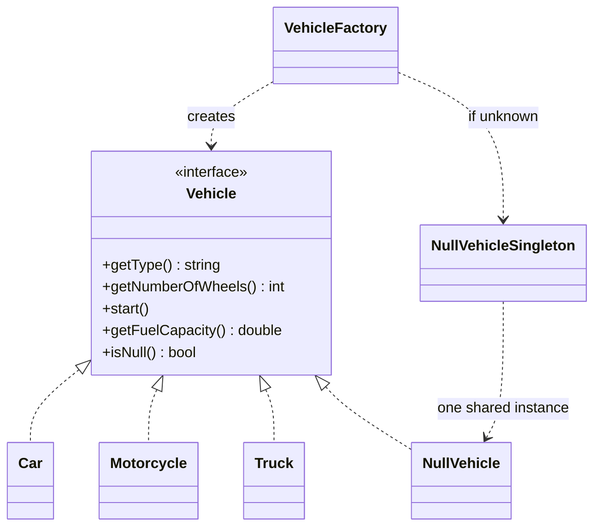

# Null Object Pattern (C++)

**Instead of returning `nullptr` for "nothing", return a real object that does nothing, so callers don't need to check.**

Our example: a vehicle factory. Asking for an unknown type gives a `NullVehicle`, with zero wheels and zero fuel, and it's safe to call.

---

## The problem

Every caller of a function that can return `nullptr` has to remember to check. Forgetting once is a crash:

```text
Vehicle* v = factory.getVehicle("V999");
if (v != nullptr) {        // repeated at every call site
    v->start();
} else {
    // handle it, again
}
```

With a null object, the caller just writes `v->start()`. Real and missing vehicles go through the same code.

## The roles

| Role | Our class | Job |
|---|---|---|
| Abstract object | `Vehicle` | The interface |
| Real objects | `Car`, `Motorcycle`, `Truck` | Do the work |
| Null object | `NullVehicle` | Same interface, neutral behavior |
| Provider | `VehicleFactory` | Returns a null object rather than `nullptr` |



## Our code

The null object implements every method with a neutral answer:

```cpp
// NullVehicle.hpp
int getNumberOfWheels() const override {
    return 0;  // No wheels - neutral behavior
}
// ...
double getFuelCapacity() const override {
    return 0.0;  // No fuel capacity
}
```

The factory never returns `nullptr`:

```cpp
// VehicleFactory.hpp
if (lowerType == "car") {
    return std::make_shared<Car>("Toyota", "Camry", 2024);
}
else if (lowerType == "motorcycle" || lowerType == "bike") {
    return std::make_shared<Motorcycle>("Honda", "CBR", 1000);
}
else if (lowerType == "truck") {
    return std::make_shared<Truck>("Volvo", 25.0);
}
else {
    // Instead of returning nullptr, return NullVehicle
    return NullVehicleSingleton::getInstance();
}
```

Callers need no special case, and neutral values make sums work. The null vehicle's 0 is the identity for addition:

```cpp
// main.cpp
double total = 0.0;
for (const auto& vehicle : vehicles) {
    // No null check needed - NullVehicle returns 0
    total += vehicle->getFuelCapacity();
}
```

`NullVehicle` has no state, so one shared instance is enough:

```cpp
// NullVehicle.hpp
static std::shared_ptr<Vehicle> getInstance() {
    static std::shared_ptr<Vehicle> instance = std::make_shared<NullVehicle>();
    return instance;
}
```

## When to use it

| Use it when | Don't, when |
|---|---|
| "Nothing" has a sensible do-nothing behavior: no-op logger, empty iterator | Absence is an error the caller must deal with |
| Many callers would otherwise repeat the same check | Callers need to act differently, and would all call `isNull` anyway |
| You want a default for an optional collaborator | A neutral value gives wrong answers, such as in averages |

| Alternative | Best for |
|---|---|
| `nullptr` | Simple code, when the check is natural |
| `std::optional` | "May be missing", where the compiler reminds callers to think about it |
| Exception | Absence is truly an error, and shouldn't pass silently |
| **Null Object** | Absence is normal, and doing nothing is correct |

| Pattern | Relationship |
|---|---|
| **Strategy** | A null object is often a do-nothing strategy. |
| **Singleton** | Stateless null objects are commonly shared, as here. |
| **Factory** | The usual place that decides to hand out a null object. |

**Say in the interview:** "It removes checks, but also removes the signal. A typo in a type name doesn't fail: it quietly gives a vehicle with no wheels. I'd use it where doing nothing is genuinely right, like a no-op logger, and throw where a missing value is a bug."

> [!WARNING]
> **Bugs this code used to have.**
> - **The cache had no lock.** With 8 threads calling `getOrCreate`, the program crashed on all 5 test runs.
> - **`toLower` passed plain `char` to `tolower`,** which is undefined for negative values such as non-ASCII bytes. It now converts through `unsigned char`.
> - **Comments contradicted the code.** `NullVehicle` said "Do nothing - silent operation" above a print. `isNull` was called the key method of the pattern, when the pattern's point is that callers rarely need it.

## Verification

From actually running the code:

```text
--- Processing Vehicle ---
NullVehicle: No vehicle available
Type: No Vehicle
Wheels: 0
Fuel Capacity: 0L
[NullVehicle] No vehicle available to start.
[NullVehicle] No vehicle available to stop.
Note: This was a null vehicle

Fleet size: 6
Total fuel capacity: 315L
Real vehicles: 4, Null vehicles: 2
Cached V001: Car
Missing V999: No Vehicle

"CAR": Car; "Bike": Motorcycle
two unknown types share one object: yes
getOrCreate unknown type: No Vehicle, and not cached
traditional, missing: nullptr

8 threads, getOrCreate, 2000 rounds, 5 runs:
    before the fix: crashed, 5 of 5 runs
    after the fix:  one id gave two objects in 0 of 2000 rounds, 5 of 5 runs
```

## Gaps

| Gap | What happens | Fix to say |
|---|---|---|
| **Typos pass silently** | `createVehicle("tuck")` returned "No Vehicle", with no error. | Throw for unknown types in a factory, and keep the null object for lookups where "not found" is normal. |
| **Neutral values skew results** | A fleet of a car, a typo and a truck has size 3 and average fuel 83.3; the real average is 125. | Filter out null objects before averaging, or don't let them into the collection. |
| **The cache ignores the type** | `getOrCreate("V1", "car")`, then `getOrCreate("V1", "truck")`, returns the car. | Reject the mismatch, or have the method take only an id. |
| **The demo still asks** (by reading) | `processVehicle` calls `isNull` to print a note. It's harmless, though a lot of `isNull` calls would mean the pattern isn't helping. | Keep `isNull` rare. |
| **`getVehicleTraditional` returns a raw pointer** (by reading) | It's there for comparison, and the pointer can outlive its cache entry. | Don't use it in real code. |
| **Three classes in `Car.hpp`** (by reading) | `Motorcycle` and `Truck` live in there too. | One header per class. |

## Test yourself

<details><summary>1. What problem does a null object solve?</summary>

Repeated `nullptr` checks, and the crash when one is forgotten. Callers treat real and missing objects the same way.
</details>

<details><summary>2. Why is sharing one <code>NullVehicle</code> safe?</summary>

It has no state, so nothing one caller does can affect another. A function-local `static` is initialized once and is thread-safe since C++11.
</details>

<details><summary>3. What's the main danger of this pattern?</summary>

It hides errors. A typo gives a harmless-looking object rather than a failure, and the mistake shows up later as a wrong number, far from its cause.
</details>

<details><summary>4. Summing fuel works. Why doesn't averaging?</summary>

0 is neutral for addition, so a sum is right. An average also divides by the count, and null objects inflate the count: 250 / 3 instead of 250 / 2.
</details>

<details><summary>5. When would you choose <code>std::optional</code> instead?</summary>

When callers should consider the missing case and may act differently. `optional` forces the question at compile time. A null object is better when doing nothing is the right behavior for everyone.
</details>

<details><summary>6. Why does <code>isNull</code> exist, if the point is not to check?</summary>

For the rare caller that must know, such as counting real vehicles, or `getOrCreate` deciding not to cache. If most callers use it, a null object is the wrong tool.
</details>

## Run it

```bash
cd lld/null_object
g++ -std=c++17 main.cpp -o null_object
./null_object
```

```text
null_object/
├── main.cpp             real and unknown vehicles, a fleet, the cache, comparison with nullptr
├── Vehicle.hpp          interface
├── Car.hpp              Car, Motorcycle, Truck
├── NullVehicle.hpp      NullVehicle, NullVehicleSingleton
└── VehicleFactory.hpp   creates vehicles; never returns nullptr, except for comparison
```
