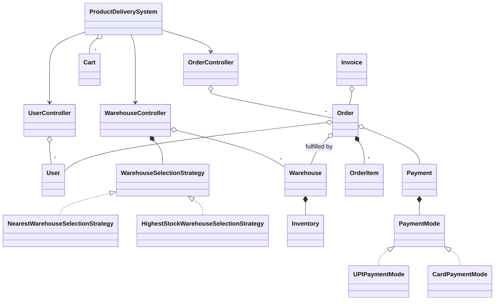
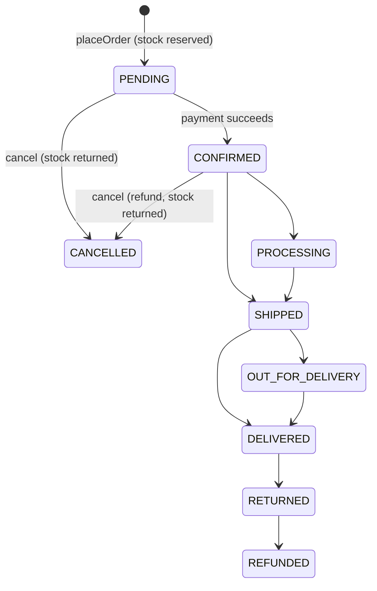

# Order Management System - Low Level Design (C++)

An e-commerce order system. A customer fills a cart and places an order; a strategy picks the warehouse, the order reserves the stock, an invoice works out what's due, and a payment confirms it. The order then moves through fulfilment, or gets cancelled with a refund and the stock returned.

This README walks the question the way you should deliver it in an interview: **Requirements -> Entities -> Class Design -> Implementation -> Extensibility**. Everything here matches the C++ code in this folder.

| Step | Time (45 min interview) | Section |
|---|---|---|
| Understand + clarify | 5 min | [1. Requirements](#1-requirements) |
| Pick the objects | 3-5 min | [2. Entities](#2-entities-and-relationships) |
| Order lifecycle, stock, strategies | 10 min | [3. Class design](#3-class-design) |
| Write `createOrder` and `processPayment` | 15-20 min | [4. Implementation](#4-implementation), [5. Verification](#5-verification) |
| "What if..." | 5+ min | [6. Extensibility](#6-extensibility) |

---

## 0. Understanding the problem

This question sounds like a list of CRUD classes. It's really about **the order of steps when money and stock both change**. Three things interviewers push on:
1. **When does stock leave the shelf?** If two customers order the last unit, only one should get it.
2. **What can each status do?** A cancelled order can't be paid; a paid order can't be paid twice; a shipped order can't be cancelled.
3. **What stays fixed once ordered?** The price agreed at checkout must not change when the catalog does, and the customer must be charged what the invoice says.

The interviewer usually opens with:

> "Design an order management system for an e-commerce site. Users add products to a cart and place orders, which are fulfilled from warehouses."

---

## 1. Requirements

### Clarifying questions

Group your questions around: **what the system does**, **what can go wrong**, **what's in scope**, and **what might change later**.

**You:** "Is there one warehouse or several?"
**Interviewer:** "Several, in different cities, each with its own stock."
> So something has to choose a warehouse, and "nearest" probably won't be the only rule.

**You:** "Can one order ship from two warehouses?"
**Interviewer:** "Keep it simple: one warehouse has to hold the whole order."
> This is a real limit. Say it out loud and offer splitting as a follow-up.

**You:** "When is the stock taken: when the order is placed, or when it's paid?"
**Interviewer:** "What do you think?"
> The key decision. At placement: otherwise two customers can both order and pay for the last unit.

**You:** "Which payment methods?"
**Interviewer:** "UPI and cards to begin with; we'll add more."
> Payment varies: a strategy.

**You:** "Are there taxes, shipping costs and discounts?"
**Interviewer:** "Yes, on an invoice. The customer pays the invoice total."

**You:** "Which statuses does an order go through?"
**Interviewer:** "Pending until paid, then confirmed, shipped and delivered. It can be cancelled until it ships, with a refund if it was paid."

**You:** "Do we need product search, reviews, or delivery partners?"
**Interviewer:** "No. Products can be passed in directly."

### Final requirements

Write this on the board before moving on:

```text
REQUIREMENTS
1. Users register with a delivery address; each user has one cart
2. Add, update and remove products in the cart; quantities must be positive
3. Place an order from the cart: a strategy picks one warehouse that holds every item
4. Placing the order reserves the stock and fixes the prices
5. An invoice adds tax and shipping and takes off any discount; payment charges that total
6. Pay by UPI or card; a failed payment leaves the order unpaid, and it can be retried
7. Status: PENDING -> CONFIRMED (paid) -> PROCESSING -> SHIPPED -> OUT_FOR_DELIVERY -> DELIVERED
8. Cancel while PENDING or CONFIRMED: refund if paid, return the stock
9. Never oversell, never charge twice, never charge a cancelled order

OUT OF SCOPE (first version)
- Splitting an order across warehouses
- Reservation expiry, partial cancellation, the returns workflow
- Product catalog and search, reviews, delivery partners
```

---

## 2. Entities and relationships

Scan the requirements for nouns, then ask of each: does it hold state or rules of its own?

| Candidate | Keep? | Why |
|---|---|---|
| `User` | Yes | Name, contact details, default address. |
| `Address` | Yes | Street and coordinates; it's used for delivery and for distance. |
| `Product` | Yes | Id, name, price, category. |
| `Cart`, `CartItem` | Yes | Items being considered, at the current price. |
| `Order`, `OrderItem` | Yes | Items agreed, at a fixed price, plus the lifecycle. |
| `Warehouse` | Yes | A location with an inventory. |
| `Inventory` | Yes | Stock per product; refuses to remove more than it holds. |
| `Payment` | Yes | One charge: amount, status, time; can be refunded. |
| `PaymentMode` | Yes (strategy) | How to charge: UPI, card. |
| `WarehouseSelectionStrategy` | Yes (strategy) | How to pick the warehouse. |
| `Invoice` | Yes | Tax, shipping, discount and the total due. |
| `UserController`, `WarehouseController`, `OrderController` | Yes | Own the collections and run the use cases. |
| `ProductDeliverySystem` | Yes (facade) | One entry point; also owns the carts. |



---

## 3. Class design

Work top-down, starting from the orchestrator. For each class ask two questions:
1. **State:** what must it remember to enforce the requirements?
2. **Methods:** what operations does the outside world need?

### ProductDeliverySystem and the controllers

| Requirement | Who owns it |
|---|---|
| "One entry point for callers" | `ProductDeliverySystem`: a singleton facade |
| "Each user has one cart" | `ProductDeliverySystem::userCarts_` |
| "A strategy picks the warehouse" | `WarehouseController` holds the current strategy |
| "Place, pay, cancel, update status" | `OrderController` |

```text
class ProductDeliverySystem {
    UserController& userController_;
    WarehouseController& warehouseController_;
    OrderController& orderController_;
    std::unordered_map<std::string, std::shared_ptr<Cart>> userCarts_; // userId -> Cart
    std::mutex cartsMutex_;
public:
    std::shared_ptr<User> registerUser(name, email, phone, address);
    std::shared_ptr<Warehouse> addWarehouse(name, address);
    void setWarehouseSelectionStrategy(std::unique_ptr<WarehouseSelectionStrategy> strategy);
    void addToCart(userId, product, quantity);
    std::shared_ptr<Order> placeOrder(userId, deliveryAddress = nullptr);
    std::unique_ptr<Invoice> generateInvoice(orderId, taxRate, shippingCost, discount);
    bool payWithUPI(orderId, upiId, pin);
    bool payWithCard(orderId, cardNumber, cardHolderName, expiryDate, cvv, cardType);
    bool cancelOrder(orderId);
    void updateOrderStatus(orderId, status);
};
```

> [!NOTE]
> **Decision: where do the use cases live?**
> - **Good: everything in one system class.** Simple, but it grows into a god class.
> - **Great (our choice): a facade over focused controllers.** Each controller owns one collection and its rules; callers see one simple interface. The cost is that the facade is mostly pass-through methods.

> [!TIP]
> **Say in the interview:** "I'd make the facade a thin entry point. The order rules live in `OrderController`, so I can explain and test them in one place."

### Order and its lifecycle

```cpp
class Order {
    std::string orderId_;
    std::shared_ptr<User> user_;
    std::vector<OrderItem> items_;      // price fixed at placement
    double totalAmount_;                // sum of the items
    double amountDue_;                  // what payment charges: the invoice total once there is one
    OrderStatus status_;                // starts PENDING
    std::shared_ptr<Address> deliveryAddress_;
    std::shared_ptr<Warehouse> fulfillingWarehouse_;
    std::shared_ptr<Payment> payment_;
public:
    void confirm();                     // after payment
    bool canMoveTo(OrderStatus next) const;
    bool moveTo(OrderStatus next);      // a fulfilment step, or false
    bool cancel();                      // only from PENDING or CONFIRMED
};
```



Steps can be skipped going forward (the demo goes from CONFIRMED straight to SHIPPED); nothing moves backward.

> [!NOTE]
> **Decision: who guards the status?**
> - **Good: the controller checks before calling a setter.** Each new caller has to remember the rules.
> - **Great (our choice): `Order` has no status setter.** `cancel` and `moveTo` refuse illegal moves themselves. `updateOrderStatus` can't send an unpaid order to DELIVERED or a shipped order back to PENDING.

> [!TIP]
> **Say in the interview:** "A public `setStatus` would make the state machine optional, so I don't offer one. The only ways to change status are named transitions that check the current one."

> [!NOTE]
> **Decision: `CartItem` or a separate `OrderItem`?**
> - **Good: reuse `CartItem` in the order.** Less code, but it reads the product's live price, so a later price change rewrites old orders.
> - **Great (our choice): `OrderItem` stores `unitPrice`, copied at placement.** The cart shows the current price; the order keeps the agreed one.

### Stock: when to take it

> [!NOTE]
> **Decision: when does stock leave the inventory?**
> - **Good: at payment.** Unpaid orders don't hold stock, but two customers can both place an order for the last unit, and the second has paid by the time you find out.
> - **Great (our choice): at placement.** The order reserves the stock in `createOrder`, and cancelling always returns it. The second customer is refused before paying. The cost is that an abandoned order holds its stock until cancelled, so a real system adds an expiry ([follow-up 3](#3-release-stock-from-abandoned-orders)).

> [!TIP]
> **Say in the interview:** "I reserve at placement because a refusal before payment is far better than a refund after it. The rule is simple: an order holds its stock from placement until it's cancelled."

```cpp
class Inventory {
    std::unordered_map<std::string, std::shared_ptr<Product>> products_;
    std::unordered_map<std::string, int> stock_; // productId -> quantity
public:
    void addProduct(std::shared_ptr<Product> product, int quantity);  // throws if quantity <= 0
    bool removeProduct(const std::string& productId, int quantity);   // false if not enough
    bool isAvailable(const std::string& productId, int quantity = 1) const;
    int getAvailableQuantity(const std::string& productId) const;
    void restock(const std::string& productId, int quantity);
};
```

### Strategies

```cpp
class WarehouseSelectionStrategy {
public:
    virtual std::shared_ptr<Warehouse> selectWarehouse(
        const std::vector<std::shared_ptr<Warehouse>>& warehouses,
        const Cart& cart,
        const Address& deliveryAddress) = 0;
    virtual std::string getStrategyName() const = 0;
};

class PaymentMode {
public:
    virtual bool processPayment(double amount) = 0;
    virtual std::string getPaymentModeName() const = 0;
    virtual bool validateDetails() const = 0;
    virtual bool refund(double amount) = 0;
};
```

> [!NOTE]
> **Decision: how does the system choose a warehouse?**
> - **Good: a fixed "nearest" rule inside `createOrder`.** Fine until the business wants another rule.
> - **Great (our choice): a strategy.** `NearestWarehouseSelectionStrategy` picks the closest warehouse that holds the whole cart; `HighestStockWarehouseSelectionStrategy` picks the one with the most of those items. `setWarehouseSelectionStrategy` swaps them at runtime.

### Final class design

```text
ProductDeliverySystem  (singleton facade)
  userCarts_, cartsMutex_, the three controllers
  registerUser, addWarehouse, setWarehouseSelectionStrategy
  addToCart, removeFromCart, clearCart, getOrCreateCart
  placeOrder, generateInvoice, payWithUPI, payWithCard, cancelOrder, updateOrderStatus

OrderController  (singleton)
  orders_, userOrders_, mutex_
  createOrder, processPayment, cancelOrder, updateOrderStatus, getOrder, getOrdersByUser

WarehouseController  (singleton)
  warehouses_, selectionStrategy_
  addWarehouse, selectWarehouse, setSelectionStrategy

UserController  (singleton)
  users_
  registerUser, getUser, updateUserAddress, removeUser

Order: items_, totalAmount_, amountDue_, status_, payment_, fulfillingWarehouse_
Cart: items_ (productId -> CartItem)
Warehouse: address_, inventory_
Inventory: products_, stock_
Payment: amount_, paymentMode_, status_
Invoice: subtotal_, taxAmount_, shippingCost_, discount_, totalAmount_
```

### Design patterns used

| Pattern | Where | Why | One line to say |
|---|---|---|---|
| Strategy (twice) | `WarehouseSelectionStrategy`, `PaymentMode` | Warehouse rules and payment methods change independently | "A new payment method is a new class; nothing else changes." |
| Facade | `ProductDeliverySystem` | One simple entry point over three controllers | "Callers don't need to know which controller does what." |
| Singleton | The system and all three controllers | One shared set of orders and warehouses | "Easy here, though it makes tests share state; `reset()` exists for that reason." |
| State-like guards | `Order::moveTo`, `Order::cancel` | The order refuses moves its status doesn't allow | "The order owns its lifecycle." |

---

## 4. Implementation

Before writing code, ask the interviewer: real code, pseudocode, or talk it through? The methods that matter are `createOrder` and `processPayment`.

### Placing an order

```cpp
// ProductDeliverySystem.hpp
std::shared_ptr<Order> placeOrder(const std::string& userId,
                                   std::shared_ptr<Address> deliveryAddress = nullptr) {
    // Held until the cart is cleared, so a double submit can't order the same cart twice
    std::lock_guard<std::mutex> lock(cartsMutex_);
    auto user = userController_.getUser(userId);
    auto cartIt = userCarts_.find(userId);
    
    if (cartIt == userCarts_.end() || cartIt->second->isEmpty()) {
        throw std::runtime_error("Cart is empty");
    }

    auto& cart = cartIt->second;
    
    // Use user's address if delivery address not provided
    if (!deliveryAddress) {
        deliveryAddress = user->getAddress();
    }
    
    if (!deliveryAddress) {
        throw std::runtime_error("Delivery address not provided");
    }

    auto order = orderController_.createOrder(user, *cart, deliveryAddress);
    cart->clear(); // Clear cart after order is created
    
    return order;
}
```

The cart is cleared only after the order exists. If no warehouse can fill it, `createOrder` throws and the customer keeps their cart.

```cpp
// OrderController.hpp
std::lock_guard<std::mutex> lock(mutex_);

// Select warehouse for fulfillment
auto& warehouseController = WarehouseController::getInstance();
auto warehouse = warehouseController.selectWarehouse(cart, *deliveryAddress);

if (!warehouse) {
    throw std::runtime_error("No warehouse available to fulfill the order");
}

std::string orderId = "ORD" + std::to_string(++orderIdCounter_);
auto order = std::make_shared<Order>(
    orderId, user, cart.getItems(), cart.getTotalValue(), deliveryAddress);

order->setFulfillingWarehouse(warehouse);

// Reserve the stock now, so two orders can't both count on the last unit.
// The strategy only returns a warehouse that holds every item.
for (const auto& item : order->getItems()) {
    warehouse->removeProduct(item.product->getProductId(), item.quantity);
}
```

The lock is what makes this safe: selecting the warehouse checks the stock, and removing it must happen before anyone else can check.

### Picking the warehouse

```cpp
// NearestWarehouseSelectionStrategy.hpp
for (const auto& warehouse : warehouses) {
    // Check if warehouse can fulfill all cart items
    bool canFulfill = true;
    for (const auto& item : cart.getItems()) {
        if (!warehouse->hasProduct(item.product->getProductId(), item.quantity)) {
            canFulfill = false;
            break;
        }
    }

    if (canFulfill) {
        double distance = warehouse->distanceTo(deliveryAddress);
        if (distance < minDistance) {
            minDistance = distance;
            nearestWarehouse = warehouse;
        }
    }
}
```

### Invoice, then payment

```cpp
// ProductDeliverySystem.hpp
if (order->getStatus() != OrderStatus::PENDING) {
    throw std::runtime_error("Invoice must be generated before payment");
}

std::string invoiceId = "INV" + std::to_string(++invoiceIdCounter_);
auto invoice = std::make_unique<Invoice>(invoiceId, order, taxRate, shippingCost, discount);
order->setAmountDue(invoice->getTotalAmount());
return invoice;

// Invoice.hpp
subtotal_ = order_->getTotalAmount();
taxAmount_ = subtotal_ * taxRate_;
totalAmount_ = std::max(0.0, subtotal_ + taxAmount_ + shippingCost_ - discount_);

// OrderController.hpp
std::lock_guard<std::mutex> lock(mutex_);

// Only an unpaid order can be charged: not twice, and not after it's cancelled
if (order->getStatus() != OrderStatus::PENDING) {
    std::cout << "Cannot pay for order " << order->getOrderId() << ": status is "
              << orderStatusToString(order->getStatus()) << "\n";
    return false;
}

std::string paymentId = "PAY" + std::to_string(++paymentIdCounter_);
auto payment = std::make_shared<Payment>(
    paymentId, order->getOrderId(), order->getAmountDue(), std::move(paymentMode));

if (payment->processPayment()) {
    order->setPayment(payment);
    order->confirm();
    return true;
}
```

A failed payment changes nothing, so the customer can retry with other details. `Payment` calls its `PaymentMode` without knowing which one it has.

### Cancelling and status updates

```cpp
// OrderController.hpp
std::lock_guard<std::mutex> lock(mutex_);
auto order = findOrder(orderId);
if (order && order->cancel()) {
    // Refund payment if already paid
    auto payment = order->getPayment();
    if (payment && payment->getStatus() == PaymentStatus::COMPLETED) {
        payment->refund();
    }
    
    // Return the items reserved at placement to warehouse inventory
    auto warehouse = order->getFulfillingWarehouse();
    if (warehouse) {
        for (const auto& item : order->getItems()) {
            warehouse->addProduct(item.product, item.quantity);
        }
    }
    
    return true;
}
return false;
```

```cpp
// Order.hpp
bool canMoveTo(OrderStatus next) const {
    switch (next) {
        case OrderStatus::PENDING:
        case OrderStatus::CONFIRMED:
        case OrderStatus::CANCELLED:
            return false;
        case OrderStatus::RETURNED:
            return status_ == OrderStatus::DELIVERED;
        case OrderStatus::REFUNDED:
            return status_ == OrderStatus::RETURNED;
        default:
            return status_ >= OrderStatus::CONFIRMED && status_ < OrderStatus::DELIVERED &&
                   next > status_;
    }
}
```

`next > status_` works because `enum class` values compare in declaration order, and the fulfilment steps are declared in order. CANCELLED sits between DELIVERED and RETURNED, which is why those cases are handled separately.

### The bugs this code used to have

> [!WARNING]
> **1. Cancelling an unpaid order created stock.** Stock was deducted at payment, but cancelling always added it back. With 5 units, placing and cancelling an order for 3 left 8. The demo's own cancellation did this.
>
> **2. Two customers could buy the last unit.** With stock 1, A and B both placed orders, both paid, and both were Confirmed. The second deduction failed and nobody checked its return value.
>
> **3. Paying twice, or paying a cancelled order, worked.** Paying twice charged twice and deducted the stock twice (10 became 6 for an order of 2). Paying a cancelled order turned it back into Confirmed.
>
> **4. A negative quantity went through.** `addToCart(-2)` produced a total of -$20, which was "paid", and stock rose from 10 to 12.
>
> **5. `updateOrderStatus` could set anything.** An unpaid order could become Delivered. A shipped order could be set back to Pending, then cancelled and refunded.
>
> **6. The charge didn't match the invoice.** The demo charged $2539.96, then printed an invoice for $2703.15. A discount larger than the bill also gave a negative total (-$82).
>
> **7. Old orders changed with the catalog.** After a price change from $10 to $99, an order's item line read $198 while its total said $20.
>
> **8. A sold-out product couldn't be restocked.** Reaching zero erased the product, so `restock` silently did nothing.

The fixes: reserve stock at placement under a lock, allow payment only from PENDING, reject non-positive quantities, replace `setStatus` with guarded moves, charge the invoice total, copy the price into `OrderItem`, and keep sold-out products listed. Lesson: **decide exactly when each shared thing changes (stock, money, status), and make every other path refuse.**

### C++ talking points

- **Meyers singleton:** `static ProductDeliverySystem instance;` inside `getInstance()`. C++11 makes its initialization thread-safe. Copying is deleted.
- **`std::unique_ptr<PaymentMode>`** is moved into `Payment`, which owns it, and `std::unique_ptr<WarehouseSelectionStrategy>` is moved into the controller. `Payment` itself is a `shared_ptr` because the order keeps it.
- **`std::shared_ptr<Product>`** is shared by carts, orders and inventories. Nothing dangles if one drops it, which is why `OrderItem` also needs its own copy of the price: the product stays live.
- **`std::lock_guard` and a private `findOrder`:** `std::mutex` isn't recursive, so public methods lock and call an unlocking helper. Calling the locking `getOrder` from `cancelOrder` would deadlock.
- **Lock order:** `placeOrder` holds `cartsMutex_` while `createOrder` takes `mutex_`. Nothing takes them the other way, so they can't deadlock.
- **`emplace_back` needs a constructor** in C++17: `OrderItem` declares one because parenthesized aggregate initialization only arrived in C++20.

### Gaps in our code (know these before the interviewer finds them)

I tested each of these by running the code, except where marked "by reading". Raising them yourself, with the fix, is a strong signal.

| Gap | What happens | Fix to say |
|---|---|---|
| **One warehouse must hold the whole order** | Product A only in W1 and B only in W2: an order for both is refused with "No warehouse available", though the stock exists. The cart is kept. | Split into one shipment per warehouse ([follow-up 1](#1-split-an-order-across-warehouses)). |
| **Abandoned orders hold stock forever** (by reading) | A PENDING order keeps its reservation until someone cancels it. | An expiry time and a sweep ([follow-up 3](#3-release-stock-from-abandoned-orders)). |
| **Returns don't do anything** | DELIVERED -> RETURNED -> REFUNDED only changes the label: the payment stayed Completed and the stock wasn't returned. | Run the refund and restock in those transitions, as `cancelOrder` does. |
| **No invoice means no tax** | ORD2 in the demo has no invoice, so it's charged the item total, $1449.98, with no tax or shipping. | Generate the invoice inside checkout, so it can't be skipped. |
| **Distance is straight-line degrees** (by reading) | `Address::distanceTo` is Euclidean on latitude and longitude, so a degree of longitude counts as much as a degree of latitude everywhere. | Haversine, or real shipping cost and time. |
| **Ties are arbitrary** (by reading) | Warehouses come from an `unordered_map`, so two at equal distance can be picked in any order. | Break ties by id or by stock. |
| **Payment runs inside the lock** (by reading) | `processPayment` holds `mutex_` during the charge. It's instant here, but a real gateway call would block every other order. | Move PENDING to PAYING under the lock, charge outside it, then lock again to record the result. |
| **Setup isn't locked** (by reading) | `addWarehouse`, `registerUser`, `setSelectionStrategy` and direct `Warehouse::addProduct` calls have no lock. This is fine while setup happens before orders begin. | Lock them, or one mutex per warehouse for stock. |
| **Card details stay in memory** (by reading) | `CardPaymentMode` keeps the full number and CVV, and `UPIPaymentMode` the PIN, for as long as the order holds its `Payment`. | Exchange them for a gateway token and keep only that. |
| **Validation is shallow** (by reading) | The card expiry only has to be 5 characters long; an expired card or "13/99" passes. | Parse it and compare with today. |
| **Failed attempts leave no record** (by reading) | A failed `Payment` is discarded, though it used up a payment id. | Keep every attempt on the order. |
| **Money is `double`** (by reading) | `203.1968` tax prints as 203.20, but the unrounded value goes into the total. | Integer cents, with a rounding rule. |

---

## 5. Verification

The outputs below are from actually running the code.

**Demo**
```text
ORD1 John, Seattle: MacBook + 2 AirPods + book       -> ships from Seattle Distribution Center
     items 2539.96 + tax 203.20 + shipping 9.99 - discount 50 = invoice $2703.15
     Processing Credit Card payment of $2703.15       -> Confirmed
ORD2 Jane, Portland: iPhone + AirPods                 -> ships from Portland Fulfillment Center
     UPI payment of $1449.98                          -> Confirmed, then Shipped
ORD3 John: 3 books, cancelled while unpaid            -> Cancelled
Order history: ORD1 Confirmed $2703.15, ORD3 Cancelled $119.97
```

**Eight threads, one unit left** (barrier start, 30 runs)
```text
1 order, stock 0  x 30 runs
```

**Stock** (separate test program)
```text
stock 5; order 3 unpaid: stock 2; cancel: stock 5
stock 1; A places: ok; B places: threw "No warehouse available to fulfill the order"
paid order cancelled: payment Refunded, stock back to 10; cancel again: refused, stock still 10
sell out, then restock(5): stock 5
```

**Payment and invoice**
```text
stock 10, order 2; pay twice: second refused; stock 8
cancel, then pay: refused, status stays Cancelled
bad UPI id: refused; retry: Confirmed
$100 order, 8% tax, $10 shipping, $5 discount: invoice total 113, charged 113
$100 order, $200 discount: invoice total 0
invoice after payment: threw "Invoice must be generated before payment"
order 2 x $10, then price changes to $99: order total 20, item line 20
```

**Status moves**
```text
shipped order cancel: refused, status Shipped
set back to PENDING: threw "Cannot move order ORD1 from Shipped to Pending"
SHIPPED -> DELIVERED: ok; -> SHIPPED again: threw "Cannot move order ORD1 from Delivered to Shipped"
unpaid order set to DELIVERED: threw "Cannot move order ORD1 from Pending to Delivered"
```

**Input and strategies**
```text
addToCart(-2): threw "Quantity must be positive"
empty cart: threw "Cart is empty"
no address: threw "Delivery address not provided"
nearest: picks Near for 1 unit; Far for 3 units (Near has too few)
highest stock: picks Far
```

---

## 6. Extensibility

If there's time left, expect "what if" questions. You usually explain where the change goes rather than code it. Junior candidates may skip this; senior candidates can get several in a row.

### 1. "Split an order across warehouses"

> "Change the strategy to return a plan: a list of warehouse and items pairs. The order keeps one shipment per warehouse, each with its own status. Reservation stays all-or-nothing: check the whole plan under the lock, then deduct. Greedy works as a start: fill from the nearest warehouse, then move outward."

```text
struct Shipment { std::shared_ptr<Warehouse> warehouse; std::vector<OrderItem> items; OrderStatus status; };
virtual std::vector<Shipment> planShipments(warehouses, cart, deliveryAddress) = 0;
```

### 2. "Add a new payment method"

> "Add a class implementing `PaymentMode` and a `payWithWallet` on the facade. `Payment` and `OrderController` don't change. To stop the facade growing a method per mode, have callers build the `PaymentMode` and pass it in."

### 3. "Release stock from abandoned orders"

> "Give each PENDING order an `expiresAt`. A periodic sweep cancels expired orders through `cancelOrder`, so the stock returns the normal way. Payment must check expiry under the same lock, so a late payment can't confirm an order the sweep just cancelled."

### 4. "Notify customers when the status changes"

> "Observer: `moveTo` and `cancel` publish a status-change event and a notification service subscribes. In production this would go through a queue, so a slow email can't hold up the order, and it should be sent only after the change is committed."

### 5. "Handle a charge when our process crashes midway"

> "Give each payment attempt an idempotency key derived from the order id, and pass it to the gateway. A retry can't charge twice: the gateway returns the first result. Record the attempt as PENDING before calling the gateway, and reconcile any stuck attempts."

### 6. "Coupons and promotions"

> "Add a `DiscountStrategy` that takes the order and returns an amount. `Invoice` receives the result, and already caps its total at zero. Validate coupons before the invoice is created, and mark single-use coupons as used in the same step as the payment."

---

## 7. What is expected at each level

**Junior.** User, product, cart, order, warehouse and payment classes; placing an order checks stock and creates the order; payment confirms it. Hints on strategies are fine.

**Mid-level.** Warehouse selection and payment as strategies, an order that guards its own transitions, and stock reserved at the right moment. Handle no stock, payment failure, double payment and cancel with refund. Know why an order stores its own prices.

**Senior.** Lead with the sequence of stock, money and status. Discuss reserve vs deduct, reservation expiry, holding locks during payment calls, idempotent charging, splitting across warehouses, and the lock scope per warehouse. Point out what the simple design gives up.

---

## 8. Test yourself

<details><summary>1. Why reserve stock at placement rather than at payment?</summary>

With deduction at payment, two customers can both order and pay for the last unit, and you find out after charging. Reserving at placement refuses the second customer before any money moves. The cost is that abandoned orders hold stock until they expire or are cancelled.
</details>

<details><summary>2. Why did cancelling an unpaid order used to create stock?</summary>

Stock was removed at payment, but cancel added it back regardless of whether payment had happened. With reservation at placement, every order has taken its stock, so cancel can always return it. A single rule replaces two paths that disagreed.
</details>

<details><summary>3. What does the lock in <code>createOrder</code> protect?</summary>

The gap between checking stock (in the strategy) and removing it. Without the lock, two threads can both see one unit and both decide to take it. The lock makes the check and the removal one step.
</details>

<details><summary>4. What stops a customer being charged twice?</summary>

`processPayment` proceeds only if the order is PENDING, and success moves it to CONFIRMED under the same lock. A second call sees CONFIRMED and refuses before creating a `Payment`.
</details>

<details><summary>5. Why does <code>Order</code> have no <code>setStatus</code>?</summary>

A public setter lets anyone skip the rules: unpaid to DELIVERED, or SHIPPED back to PENDING and then a refund. Named transitions check the current status, so the rules can't be bypassed.
</details>

<details><summary>6. Why does <code>OrderItem</code> copy the price when it already has the product?</summary>

The `shared_ptr<Product>` points at the live product, so reading its price later gives the current one, not the agreed one. Before the fix, an item line went from $20 to $198 after a price change while the total stayed $20.
</details>

<details><summary>7. Why must the invoice come before payment here?</summary>

Tax, shipping and discount are decided by the invoice, and payment charges `amountDue_`. Generating it afterwards would describe an amount different from the charge, which is what the demo used to do. So `generateInvoice` refuses anything that isn't PENDING.
</details>

<details><summary>8. Why does <code>OrderController</code> have both <code>getOrder</code> and <code>findOrder</code>?</summary>

`std::mutex` isn't recursive. `cancelOrder` already holds the lock, so calling the locking `getOrder` would deadlock. The private `findOrder` does the lookup without locking, for callers that already hold it.
</details>

<details><summary>9. A customer's cart can't be filled by any one warehouse. What happens?</summary>

`selectWarehouse` returns `nullptr`, `createOrder` throws "No warehouse available to fulfill the order", no order id is used, no stock moves, and the cart is kept because `placeOrder` only clears it after success.
</details>

<details><summary>10. Why is holding a lock during payment a problem, and how would you fix it?</summary>

A real gateway takes seconds, and every other order would wait. Under the lock, move the order to a PAYING state; release it and charge; lock again to record the result. PAYING is what stops a second charge from starting in the meantime.
</details>

<details><summary>11. Which patterns are used, and what does each buy you?</summary>

Strategy for warehouses and payment modes: new rules without touching order code. Facade: one simple entry point. Singleton: one shared set of data, at the cost of shared state in tests.
</details>

---

## 9. Run it

```bash
cd lld/order_management_system
g++ -std=c++17 main.cpp -o order_management
./order_management
```

Expected key lines:

```text
Shipping from: Seattle Distribution Center
...
║ TOTAL:                             $         2703.15 ║
...
Processing Credit Card payment of $2703.15 using card ending in ****1234...
...
Shipping from: Portland Fulfillment Center
...
Order shipped! New status: Shipped
...
Order cancelled successfully!
New status: Cancelled
...
Order: ORD1 | Status: Confirmed | Amount: $2703.15
Order: ORD3 | Status: Cancelled | Amount: $119.97
```

Timestamps change on every run, and the order of cart lines can vary because they come from an `unordered_map`.

### Files

```text
order_management_system/
├── main.cpp                                 two users, three orders: card, UPI, cancel; strategy swap
├── ProductDeliverySystem.hpp                singleton facade; owns the carts
├── OrderController.hpp                      createOrder, processPayment, cancelOrder, updateOrderStatus
├── WarehouseController.hpp                  warehouses + current selection strategy
├── UserController.hpp                       users
├── Order.hpp                                OrderItem, order state, guarded status moves
├── OrderStatus.hpp                          PENDING ... DELIVERED, CANCELLED, RETURNED, REFUNDED
├── Cart.hpp                                 CartItem, cart at live prices
├── Warehouse.hpp, Inventory.hpp             location + stock
├── WarehouseSelectionStrategy.hpp           strategy interface
├── NearestWarehouseSelectionStrategy.hpp    nearest and highest-stock strategies
├── Invoice.hpp                              tax, shipping, discount, total
├── Payment.hpp                              one charge; refund
├── PaymentMode.hpp                          payment strategy interface
├── UPIPaymentMode.hpp, CardPaymentMode.hpp  simulated payment methods
└── Product.hpp, ProductCategory.hpp, User.hpp, Address.hpp
```
