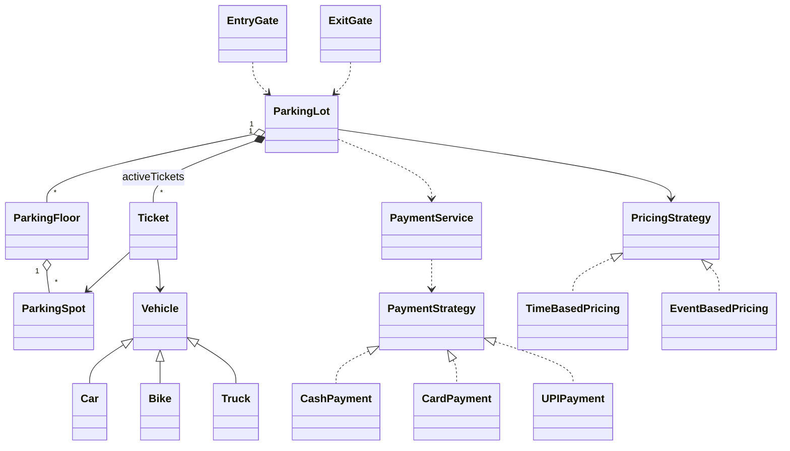

# Parking Lot - Low Level Design (C++)

A multi-floor parking lot with entry and exit gates. A vehicle drives in, gets a spot that matches its type and a ticket. On the way out it hands back the ticket, pays a fee based on the time parked, and the spot is freed.

This README walks the question the way you should deliver it in an interview: **Requirements -> Entities -> Class Design -> Implementation -> Extensibility**. Everything here matches the C++ code in this folder.

| Step | Time (45 min interview) | Section |
|---|---|---|
| Understand + clarify | 5 min | [1. Requirements](#1-requirements) |
| Pick the objects | 3-5 min | [2. Entities](#2-entities-and-relationships) |
| State + methods | 10 min | [3. Class design](#3-class-design) |
| Write the core methods | 15-20 min | [4. Implementation](#4-implementation), [5. Verification](#5-verification) |
| "What if..." | 5+ min | [6. Extensibility](#6-extensibility) |

---

## 0. Understanding the problem

The interviewer usually opens with one line:

> "Design a parking lot. Different kinds of vehicles park, the system assigns spots and charges a fee when they leave."

The trap is to start drawing classes straight away. The prompt hides several choices (how many floors, how pricing works, what "full" means, whether payment is in scope) and each one changes the design. Spend the first few minutes turning it into a concrete list.

---

## 1. Requirements

### Clarifying questions

Group your questions around: **what the system does**, **what can go wrong**, **what's in scope**, and **what might change later**.

**You:** "Who picks the spot, the driver or the system?"
**Interviewer:** "The system assigns a spot when the vehicle enters."
> This is the whole problem. If drivers picked their own spot, there would be no allocation logic to design.

**You:** "Which vehicle types do we support?"
**Interviewer:** "Bikes, cars and trucks."
> Three types means three kinds of spot. Ask the next question before assuming anything about mixing them.

**You:** "Can a bike park in a car spot if bike spots are full?"
**Interviewer:** "No, keep it strict. A vehicle only uses a spot of its own type."
> Now spot matching is a simple equality check. Note "fallback spots" as a likely follow-up.

**You:** "One floor or several? One entrance or several?"
**Interviewer:** "Multiple floors. Separate entry and exit gates."
> Multiple floors means something has to group spots. Multiple gates means two vehicles can arrive at the same moment, so concurrency matters.

**You:** "What does the driver get on entry, and what do they need on exit?"
**Interviewer:** "A ticket with a unique ID. They give the ticket ID back at the exit."

**You:** "How is the fee calculated?"
**Interviewer:** "Hourly, and the rate depends on the vehicle type. Minimum one hour. We may also want a flat rate during events."
> "Rate depends on type" and "may switch to flat event pricing" together tell you pricing will vary. That points to a strategy, not an `if` buried in the exit code.

**You:** "Is payment in scope?"
**Interviewer:** "Support cash, card and UPI, but don't build a real payment gateway. Assume payments succeed."

**You:** "What if the lot is full, or someone exits with a bad ticket?"
**Interviewer:** "Reject entry if there's no matching spot. Reject exit if the ticket is invalid or already used."
> Asking "what can go wrong?" is what interviewers look for. Two or three good failure cases beat a list of twenty.

**You:** "Lost tickets, reservations, display boards?"
**Interviewer:** "Out of scope."

### Final requirements

Write this on the board before moving on:

```
REQUIREMENTS
1. Vehicle types: BIKE, CAR, TRUCK
2. The lot has multiple floors; each floor has spots, each spot fits exactly one vehicle type
3. Entry gate: system assigns a free matching spot and issues a ticket with a unique ID
4. Exit gate: driver gives the ticket ID
     - validate the ticket
     - fee = based on hours parked and vehicle type (minimum 1 hour)
     - take payment (cash / card / UPI)
     - free the spot
5. Pricing can be switched (hourly vs flat event pricing) without changing exit logic
6. Reject entry when no matching spot is free
7. Reject exit when the ticket is invalid or already used
8. Several gates may operate at the same time

OUT OF SCOPE
- Real payment gateway, refunds
- Lost tickets, reservations / pre-booking
- Display boards, cameras, physical barrier hardware
- Parking in a spot of a different type
```

---

## 2. Entities and relationships

Look for nouns in the requirements, but don't make every noun a class. Ask of each one: **does it have state that changes, or behavior we own?**

- **ParkingLot** - something has to coordinate entry and exit: find a spot, create a ticket, track active tickets, compute the fee, take payment. This is the orchestrator and the system's public API.
- **ParkingFloor** - requirement 2 says spots are grouped by floor. A floor owns its spots and can answer "do you have a free spot for this type?"
- **ParkingSpot** - has an ID, a type, and an occupied/free state that changes. Clearly an entity.
- **Ticket** - the record of one parking session: which vehicle, which spot, when it entered. Created at entry, read at exit.
- **Vehicle** - debatable (see the decision below). We model it as a small class hierarchy `Car / Bike / Truck` because the ticket records the licence plate.
- **EntryGate / ExitGate** - thin entry points that hand requests to the lot. They exist because the requirements talk about gates, and later they're the natural place for gate-specific things like a barrier or a printer.
- **PricingStrategy** - "pricing can be switched" means the fee rule is a pluggable behavior.
- **PaymentStrategy + PaymentService** - three payment modes with the same shape: "pay this amount, succeed or fail".

> [!NOTE]
> **Decision: is Vehicle a class or an enum?**
> - **Good: just an enum.** The lot never manages a vehicle's state. All it needs is the type, to match a spot. Many reference designs stop here.
> - **Also fine (our choice): a small class hierarchy.** We keep the licence plate on the ticket, and a `VehicleFactory` builds the right subclass. The cost is a few tiny classes.

> [!TIP]
> **Say in the interview:** "The vehicle is external to our system. I only need its type for matching, so an enum is enough. I'm keeping a class because I want the licence plate on the ticket. If plates weren't needed I'd drop it to an enum."

| Entity | Responsibility |
|---|---|
| `ParkingLot` | Orchestrator and only public API. Owns floors, active tickets and the pricing strategy. Parks and unparks vehicles. |
| `ParkingFloor` | Groups spots. Finds and claims a free spot of a given type. |
| `ParkingSpot` | One space: ID, allowed vehicle type, occupied flag. Can be claimed or released atomically. |
| `Ticket` | One parking session: ID, vehicle, spot, entry time, exit time, fee. |
| `Vehicle` (`Car`, `Bike`, `Truck`) | Licence plate + type. |
| `EntryGate`, `ExitGate` | Entry points that delegate to `ParkingLot`. |
| `PricingStrategy` (`TimeBasedPricing`, `EventBasedPricing`) | Turns vehicle type + hours into a fee. |
| `PaymentStrategy` (`Cash`, `Card`, `UPI`) + `PaymentService` | Takes the payment for one mode. |



---

## 3. Class design

Work top-down, starting from the orchestrator. For each class ask two questions:
1. **State:** what must it remember to enforce the requirements?
2. **Methods:** what operations does the outside world need?

### ParkingLot

| Requirement | What ParkingLot must track |
|---|---|
| "Multiple floors" | All floors, by ID |
| "Validate the ticket at exit" | Active tickets, looked up by ticket ID |
| "Pricing can be switched" | The current pricing strategy |
| "Several gates at the same time" | One shared lot that every gate talks to |

| Need | Method |
|---|---|
| Vehicle enters | `parkVehicle(vehicle, entryTime) -> Ticket*` (nullptr if full) |
| Vehicle exits | `unparkVehicle(ticketId, exitTime, paymentMode)` |
| Set up the lot | `addFloor(floor)`, `setPricingStrategy(strategy)` |

```cpp
class ParkingLot {                                   // Singleton
    static ParkingLot* instance;
    std::unordered_map<std::string, std::shared_ptr<ParkingFloor>> floors;
    std::unordered_map<std::string, std::unique_ptr<Ticket>> activeTickets;  // ticketId -> Ticket
    std::unique_ptr<PricingStrategy> pricingStrategy;                         // default: TimeBasedPricing
public:
    static ParkingLot* getInstance();
    void addFloor(std::shared_ptr<ParkingFloor> floor);
    void setPricingStrategy(std::unique_ptr<PricingStrategy> strategy);
    Ticket* parkVehicle(std::shared_ptr<Vehicle> vehicle, std::chrono::system_clock::time_point entryTime);
    void unparkVehicle(const std::string& ticketId, std::chrono::system_clock::time_point exitTime, PaymentMode paymentMode);
};
```

Why `activeTickets` is a map keyed by ticket ID: exit receives a ticket ID string, so the lookup by ID is the main operation. A list would work at this scale, but the map says "look up by ID" in the type itself. Removing the ticket on exit is what makes a second exit with the same ticket fail.

Why the lot owns the pricing strategy: pricing is a policy of the lot, not of a ticket or a spot. Holding it here lets two lots run different pricing, and lets you swap it at runtime (`main.cpp` switches to event pricing).

Resist adding `getAvailableSpots()` or a status dashboard unless asked. They aren't in the requirements and they expose internals. (`getActiveTicketsCount()` exists only so the demo can print something.)

> [!NOTE]
> **Decision: should ParkingLot be a Singleton?**
> - **Good: a normal class you construct once and pass to the gates.** Easy to test, and you can create two lots.
> - **Our choice: Singleton (`getInstance()`).** Every gate reaches the same lot without passing it around. Interviewers often expect to hear "singleton" for this question.

> [!TIP]
> **Say in the interview:** "There's exactly one lot, so I made it a singleton for simple access from the gates. The downside is testing and hidden global state. In production I'd construct it once and inject it into the gates."

### ParkingFloor

| Requirement | What ParkingFloor must track |
|---|---|
| "Each floor has spots" | Its spots, by ID |

```cpp
class ParkingFloor {
    std::string id;
    std::unordered_map<std::string, std::shared_ptr<ParkingSpot>> spots;
public:
    void addSpot(std::shared_ptr<ParkingSpot> spot);
    std::shared_ptr<ParkingSpot> findAvailableSpot(VehicleType vehicleType);  // finds AND claims
};
```

`findAvailableSpot` both finds a free spot and claims it in one step. That matters for concurrency, covered in the next decision.

### ParkingSpot

| Requirement | What ParkingSpot must track |
|---|---|
| "Each spot fits one vehicle type" | Allowed vehicle type |
| "Assign a free spot", "free the spot" | Occupied or not |
| "Ticket references a spot" | Spot ID |

```cpp
class ParkingSpot {
    std::string id;
    VehicleType allowedType;
    std::atomic<bool> occupied{false};
public:
    bool tryOccupy();   // atomically false -> true; returns false if someone else got it first
    void release();     // occupied = false
    bool isOccupied() const;
};
```

> [!NOTE]
> **Decision: where does "occupied" live?**
> - **Good: a set of occupied spot IDs in `ParkingLot`, guarded by one mutex.** Correct, keeps occupancy as the lot's state, but every entry serializes on one lock.
> - **Great (our choice): an `std::atomic<bool>` on the spot, claimed with `compare_exchange_strong`.** Check-and-set becomes one indivisible step, so two gates can never both see the spot as free and both take it. If two gates race for the same spot, exactly one wins, and the loser simply moves on to the next spot. No lock needed for spot claiming.

> [!TIP]
> **Say in the interview:** "Occupancy lives on the spot as an atomic flag. `tryOccupy` is a compare-and-swap from false to true, so finding and claiming a spot can't race."

> [!NOTE]
> **Decision: one enum or two?** Our spot stores `VehicleType allowedType`, reusing the vehicle enum. Some designs keep a separate `SpotType` enum, because "kind of spot" and "kind of vehicle" are different ideas. Separate enums make a rule like "a bike may use a car spot" clearer later. With strict matching, one enum is simpler. Know both arguments.

### Ticket

| Requirement | What Ticket must track |
|---|---|
| "Unique ticket ID" | `id` |
| "Free the spot at exit" | The spot |
| "Fee depends on vehicle type" | The vehicle |
| "Fee based on hours parked" | Entry time (exit time and fee are filled in at exit) |

```cpp
class Ticket {
    std::string id;
    std::shared_ptr<Vehicle> vehicle;
    std::shared_ptr<ParkingSpot> spot;
    std::chrono::system_clock::time_point entryTime, exitTime;
    double fee = 0.0;
public:
    class Builder;                // setId().setVehicle().setSpot().setEntryTime().build()
    // getters, plus setExitTime() and setFee() used at exit
};
```

> [!NOTE]
> **Decision: should Ticket hold the spot, or just the spot ID?**
> - **Spot ID only:** the ticket stays a plain record and can't accidentally call methods on the spot. The lot looks the spot up when it needs it.
> - **Our choice: `shared_ptr<ParkingSpot>`.** Exit can release the spot directly with `ticket->getSpot()->release()`, with no lookup. The `shared_ptr` also guarantees the spot is still alive while the ticket exists.

> [!TIP]
> **Say in the interview:** "I hold a shared pointer to the spot so exit can free it in O(1). If I wanted tickets to be pure records I'd store the spot ID and let the lot do the lookup."

> [!NOTE]
> **Decision: where does the fee calculation live?**
> - **Good: a private `computeFee()` in `ParkingLot`.** Pricing stays with the lot. Fine while there's one rule.
> - **Great (our choice): a `PricingStrategy` interface.** `TimeBasedPricing` and `EventBasedPricing` implement it, and the lot calls whichever one is set. Adding weekend pricing means adding a class, not editing exit logic.

> [!TIP]
> **Say in the interview:** "The requirement says pricing changes, so I put it behind a strategy. If there were only one fixed rate I'd keep a simple method on the lot and not over-engineer."

### Pricing and payment

```cpp
class PricingStrategy {
public:
    virtual double calculateFee(VehicleType type, long hours) const = 0;
};
// TimeBasedPricing:  rate/hour BIKE 10, CAR 20, TRUCK 30; x1.0 up to 3h, x1.5 for 4-6h, x2.0 above 6h
// EventBasedPricing: flat BIKE 50, CAR 100, TRUCK 200

class PaymentStrategy {
public:
    virtual bool processPayment(double amount) = 0;
};
// CashPayment, CardPayment, UPIPayment (all succeed in this demo)
```

### Final class design

```text
ParkingLot (singleton)
    - floors:          unordered_map<string, shared_ptr<ParkingFloor>>
    - activeTickets:   unordered_map<string, unique_ptr<Ticket>>
    - pricingStrategy: unique_ptr<PricingStrategy>
    + parkVehicle(vehicle, entryTime) -> Ticket*
    + unparkVehicle(ticketId, exitTime, paymentMode)
    + addFloor(floor), setPricingStrategy(strategy)

ParkingFloor
    - id, spots: unordered_map<string, shared_ptr<ParkingSpot>>
    + addSpot(spot), findAvailableSpot(type) -> shared_ptr<ParkingSpot>

ParkingSpot
    - id, allowedType: VehicleType, occupied: atomic<bool>
    + tryOccupy() -> bool, release()

Ticket (built with Ticket::Builder)
    - id, vehicle, spot, entryTime, exitTime, fee

Vehicle (abstract) <- Car, Bike, Truck          - licensePlate, + getType()
Gate (abstract)    <- EntryGate, ExitGate       delegate to ParkingLot
PricingStrategy    <- TimeBasedPricing, EventBasedPricing
PaymentStrategy    <- CashPayment, CardPayment, UPIPayment;   PaymentService runs one

enum VehicleType { CAR, BIKE, TRUCK }    enum PaymentMode { CASH, CARD, UPI }
```

### Design patterns used

| Pattern | Where | Why | One line to say |
|---|---|---|---|
| Singleton | `ParkingLot::getInstance()` | One lot shared by every gate | "One lot, global access point; I'd inject it in production for testability." |
| Strategy | `PricingStrategy`, `PaymentStrategy` | Fee rule and payment mode vary independently of exit logic | "New pricing or payment mode = new class, no edits to `unparkVehicle`." |
| Factory | `VehicleFactory`, `PricingStrategyFactory`, `PaymentStrategyFactory` | Turn an enum into the right object in one place | "Callers ask for a type; the switch lives in one factory." |
| Builder | `Ticket::Builder` | Readable construction of a ticket with several fields | "Named setters instead of a long constructor." |
| Inheritance / polymorphism | `Vehicle`, `Gate` | Shared shape, type-specific `getType()` | "Each subclass reports its own type." |

---

## 4. Implementation

Before writing code, ask the interviewer: real code, pseudocode, or talk it through? For each method: **core logic first, then edge cases.** The two methods that matter are `parkVehicle` and `unparkVehicle`.

### parkVehicle (entry)

**Core logic**
1. For each floor, ask for a free spot of the vehicle's type (the floor claims it atomically).
2. If a floor returns a spot: generate a ticket ID, build the ticket, store it in `activeTickets`, return it.
3. If no floor has one: reject (return `nullptr`).

**Edge cases**
- Lot full for this type: return `nullptr` without changing any state.
- Two gates racing for the last spot: `tryOccupy` lets only one win; the other keeps searching and may get `nullptr`.

```cpp
// service/ParkingLot.hpp
Ticket* parkVehicle(std::shared_ptr<Vehicle> vehicle,
                    std::chrono::system_clock::time_point entryTime) {
    // Find available spot
    for (auto& [floorId, floor] : floors) {
        auto spot = floor->findAvailableSpot(vehicle->getType());
        if (spot) {
            std::string ticketId = generateTicketId();

            auto ticket = Ticket::Builder()
                .setId(ticketId)
                .setVehicle(vehicle)
                .setSpot(spot)
                .setEntryTime(entryTime)
                .build();

            Ticket* ticketPtr = ticket.get();
            activeTickets[ticketId] = std::move(ticket);
            // ... prints spot and ticket ID
            return ticketPtr;
        }
    }

    std::cout << "No available spot for vehicle type." << std::endl;
    return nullptr;
}
```

Finding and claiming happen together on the floor:

```cpp
// model/ParkingFloor.hpp
std::shared_ptr<ParkingSpot> findAvailableSpot(VehicleType vehicleType) {
    for (auto& [spotId, spot] : spots) {
        if (spot->getAllowedType() == vehicleType && spot->tryOccupy()) {
            return spot;
        }
    }
    return nullptr;
}

// model/ParkingSpot.hpp
bool tryOccupy() {
    bool expected = false;
    return occupied.compare_exchange_strong(expected, true);
}
```

`compare_exchange_strong(expected, true)` means: "if `occupied` is still `false`, set it to `true` and return `true`; otherwise return `false`." It's one atomic step, so no other thread can slip in between the check and the set.

Don't add "prefer spots near the entrance" or other clever allocation unless asked. It's a common follow-up, not a requirement.

### unparkVehicle (exit)

**Core logic**
1. Look up the ticket by ID. Not found: reject.
2. Record the exit time; compute hours parked (minimum 1).
3. Ask the pricing strategy for the fee.
4. Take payment with the chosen mode.
5. On success: release the spot, remove the ticket (so it can't be used again).

**Edge cases**
- Unknown ticket ID, or one already used: both are "not in `activeTickets`" and get the same rejection.
- Stayed less than an hour: charged 1 hour.
- Payment fails: the spot stays occupied and the ticket stays active, so the driver can retry.

```cpp
// service/ParkingLot.hpp
void unparkVehicle(const std::string& ticketId,
                   std::chrono::system_clock::time_point exitTime,
                   PaymentMode paymentMode) {
    auto it = activeTickets.find(ticketId);
    if (it == activeTickets.end()) {
        std::cout << "Invalid ticket ID." << std::endl;
        return;
    }

    Ticket* ticket = it->second.get();
    ticket->setExitTime(exitTime);

    // Calculate duration in hours
    auto duration = std::chrono::duration_cast<std::chrono::hours>(
        exitTime - ticket->getEntryTime()
    ).count();

    // Minimum 1 hour
    if (duration < 1) duration = 1;

    // Calculate fee
    double fee = pricingStrategy->calculateFee(
        ticket->getVehicle()->getType(),
        duration
    );
    ticket->setFee(fee);
    // ... prints duration and fee

    // Process payment
    auto paymentStrategy = PaymentStrategyFactory::get(paymentMode);
    PaymentService paymentService;

    if (paymentService.processPayment(fee, paymentStrategy.get())) {
        // Release spot
        ticket->getSpot()->release();
        // ... prints exit
        // Remove ticket
        activeTickets.erase(it);
    }
}
```

The order matters: the spot is released and the ticket erased **only after payment succeeds**. Erasing the ticket is what blocks a double exit.

### Pricing

```cpp
// strategy/pricing/TimeBasedPricing.hpp (trimmed)
double calculateFee(VehicleType type, long hours) const override {
    double baseRate = 0.0;
    switch (type) {
        case VehicleType::BIKE:  baseRate = 10.0; break;  // Rs. 10 per hour
        case VehicleType::CAR:   baseRate = 20.0; break;  // Rs. 20 per hour
        case VehicleType::TRUCK: baseRate = 30.0; break;  // Rs. 30 per hour
    }
    double multiplier = 1.0;
    if (hours > 0 && hours <= 3)      multiplier = 1.0;
    else if (hours > 3 && hours <= 6) multiplier = 1.5;  // 50% more after 3 hours
    else                              multiplier = 2.0;  // Double after 6 hours
    return baseRate * hours * multiplier;
}
```

`EventBasedPricing` ignores hours and returns a flat 50 / 100 / 200.

### C++ talking points

These are where a C++ interview goes beyond a Java/Python one. Have an answer ready for each.

- **Ownership is explicit.** The lot *owns* tickets (`unique_ptr<Ticket>` in `activeTickets`). Floors, spots and vehicles are *shared* (`shared_ptr`), because a ticket and a floor both refer to the same spot. The pricing strategy is owned by the lot (`unique_ptr`) and swapped with `std::move`.
- **`parkVehicle` returns a raw `Ticket*`.** It's a non-owning view of a ticket the lot owns. It becomes dangling as soon as that ticket is erased at exit. Returning the ticket ID (or a copy of the ticket data) is safer.
- **`std::atomic<bool>` makes `ParkingSpot` non-copyable.** That's one reason spots are held through `shared_ptr` rather than by value in a container.
- **`std::chrono`** handles time: `time_point` subtraction gives a duration, and `duration_cast<hours>` converts it.
- **Virtual destructors** on `Vehicle`, `Gate`, `PricingStrategy` and `PaymentStrategy`, because objects are deleted through base-class pointers.
- **`explicit` constructors** on single-argument classes stop accidental conversions: without it, `std::string plate = "KA-01"; Car c = plate;` would silently build a `Car` from a string.

### Gaps in our code (know these before the interviewer finds them)

I tested each of these by running the code. Raising them yourself, with the fix, is a strong signal.

| Gap | What happens | Fix to say |
|---|---|---|
| **Partial hours round down** | `duration_cast<hours>` truncates: 2 h 30 min and 2 h 59 min are both billed as **2** hours. Only the "< 1 hour" case is rounded up. | Round up: `hours = ceil(minutes / 60.0)`, or `(minutes + 59) / 60` with integers. |
| **Money is a `double`** | Floating point can't represent values like 0.1 exactly; errors creep in over many operations. | Store the smallest unit as an integer (paise / cents: `long long feePaise`), convert only for display. |
| **Ticket IDs can collide** | IDs are `"TKT-"` + a random number from 10000-99999. A repeat **overwrites** an active ticket in the map. | Use an incrementing counter (`std::atomic<long>`) or a UUID, and check before inserting. |
| **Floor order is random** | `floors` and `spots` are `unordered_map`s, so search order isn't the insertion order. The demo parks the car on **Floor2** even though Floor1 has free car spots. | Use `std::vector` (or `std::map`) to keep a predictable "fill lower floors first" order. |
| **`activeTickets` isn't thread-safe** | The spot claim is atomic, but two gates inserting into or erasing from the same `unordered_map` at once is a data race. | Guard the map with a `std::mutex` (see [concurrency](#3-two-cars-arrive-at-two-gates-at-the-same-time)). |
| **`getInstance()` isn't thread-safe** | Lazy `new` with no lock: two threads calling it first at the same time can create two lots. | Meyers singleton: `static ParkingLot instance; return &instance;` (thread-safe since C++11). |
| **Price jumps at tier boundaries** | The multiplier applies to *all* hours: a car pays Rs 60 for 3 h but Rs 120 for 4 h. | Charge tiers progressively (first 3 h at x1.0, next 3 h at x1.5, rest at x2.0), or confirm with the interviewer that the jump is intended. |
| **Returned `Ticket*` dangles after exit** | See C++ talking points. | Return the ticket ID or a value copy. |

---

## 5. Verification

Trace the code on concrete scenarios and say the state out loud after each step. This catches bugs before the interviewer does. The outputs below are from actually running the code.

**Setup (`main.cpp`)**: event pricing; Floor1 = `F1S1` (BIKE), `F1S2` (CAR), `F1S3` (CAR); Floor2 = `F2S1` (CAR), `F2S2` (TRUCK).

**1. A car, a bike and a truck enter**
```
parkVehicle(car KA-01-AB-1234)
  search floors -> a floor returns a free CAR spot, tryOccupy() false->true
  build ticket TKT-xxxxx, activeTickets = {TKT-xxxxx}
  -> "parked at spot F2S1 on floor Floor2"       (Floor2 first: unordered_map order)
parkVehicle(bike)   -> F1S1 on Floor1
parkVehicle(truck)  -> F2S2 on Floor2
State: 3 spots occupied, activeTickets has 3 tickets
```

**2. All three exit 2 hours later**
```
unparkVehicle(car ticket, entry + 2h, CARD)
  ticket found; hours = 2; EventBasedPricing -> CAR flat 100
  card payment succeeds -> F2S1.release(), ticket erased
  -> "Duration: 2 hour(s)", "Parking fee: Rs. 100"
bike  -> Rs. 50 (cash)      truck -> Rs. 200 (UPI)
State: all spots free, "Active tickets remaining: 0"
```

**3. Edge cases** (one-spot lot, time-based pricing)
```
parkVehicle(car A)    -> takes S1
parkVehicle(car B)    -> "No available spot for vehicle type."     (lot full, state unchanged)
parkVehicle(bike C)   -> "No available spot for vehicle type."     (no BIKE spot, strict matching)
unparkVehicle(A, +2h30m, CASH) -> "Duration: 2 hour(s)", "Parking fee: Rs. 40"   (rounded DOWN, see gaps)
unparkVehicle(A again)         -> "Invalid ticket ID."              (double exit blocked)
```

**Time-based price table** (CAR, Rs 20/h): 1h = 20, 2h = 40, 3h = 60, **4h = 120**, 6h = 180, 7h = 280.

---

## 6. Extensibility

If there's time left, expect "what if" questions. You usually explain where the change goes rather than code it. Junior candidates may skip this; senior candidates can get several in a row.

### 1. "Add a new pricing rule, like weekend rates"

> "Pricing is already behind `PricingStrategy`, so I add a `WeekendPricing` class and set it with `setPricingStrategy`. Nothing in `unparkVehicle` changes. If the rule depends on the date rather than duration, I'd pass the entry and exit times into `calculateFee` instead of just hours."

### 2. "Let a bike use a car spot when bike spots are full"

> "Matching is an equality check in `findAvailableSpot` today. I'd replace it with a compatibility rule: a list of acceptable spot types per vehicle, in preference order, then search each in turn."

```cpp
// BIKE -> {BIKE, CAR, TRUCK},  CAR -> {CAR, TRUCK},  TRUCK -> {TRUCK}
for (VehicleType spotType : compatibleSpots(vehicle->getType()))
    for (auto& floor : floors)
        if (auto spot = floor->findAvailableSpot(spotType)) return spot;
```

This is where a separate `SpotType` enum starts to pay off.

### 3. "Two cars arrive at two gates at the same time"

> "Claiming a spot is already safe: `tryOccupy` is a compare-and-swap, so two gates can't get the same spot. What's not safe is `activeTickets`, a plain `unordered_map` that both gates write to. I'd guard it with a mutex, holding it only around the map access, not around the spot search."

```cpp
std::mutex ticketsMutex;
// in parkVehicle, after a spot is claimed:
{
    std::lock_guard<std::mutex> lock(ticketsMutex);
    activeTickets[ticketId] = std::move(ticket);
}
// in unparkVehicle: lock around find() and erase()
```

The simplest correct alternative is one mutex around the whole `parkVehicle` / `unparkVehicle`. With a handful of gates that's perfectly fast enough; say so, then mention the finer-grained version. Also fix `getInstance()` (Meyers singleton).

### 4. "Smarter spot allocation: nearest floor, or balance floors"

> "Pull the search out of `ParkingLot` into a `SpotAllocationStrategy` with `findSpot(floors, type)`. `LowestFloorFirst` walks floors in order; `LeastBusyFloor` keeps a free-count per floor and picks the emptiest. Either way I'd switch `floors` to an ordered container so 'first' means something."

### 5. "Show free spots per floor on a display board"

> "Each floor keeps a free count per vehicle type, updated in `tryOccupy` / `release`. Display boards subscribe as observers and get notified on every change (Observer pattern), rather than polling every spot."

### 6. "Lost tickets / reservations"

> "Lost ticket: look up the active ticket by licence plate (add a plate -> ticketId map) and charge a fixed penalty or the maximum daily fee. Reservations: a spot gets a third state, RESERVED, with a reservation ID and an expiry; entry with a reservation claims that spot directly."

---

## 7. What is expected at each level

**Junior.** Break the problem into a lot, spots and tickets. Entry finds a matching spot, marks it occupied, returns a ticket; exit computes a fee and frees the spot. Basic rejections: full lot, invalid ticket. Hints on where pricing belongs are fine. A working core is what matters.

**Mid-level.** Clean separation without prompting: the lot orchestrates, the spot knows its own type and state, the ticket is a record. Handle full lot, invalid ticket and double exit. Justify choices: why a map for active tickets, why pricing is a strategy and not on `Ticket`. Discuss at least one extension (multi-floor allocation or per-type pricing).

**Senior.** Class boundaries are obvious and quick. Raise trade-offs yourself: atomic spot claiming vs a global lock, `shared_ptr` spot on the ticket vs a spot ID, singleton vs injection, one enum vs two. Spot the gaps in the table above on your own, especially concurrency on `activeTickets` and integer money. Explain the simple solution first, then when you'd reach for a pattern. Finish early and drive the extensibility discussion.

---

## 8. Test yourself

<details><summary>1. Why is <code>ParkingSpot::occupied</code> an <code>std::atomic&lt;bool&gt;</code> claimed with <code>compare_exchange_strong</code>?</summary>

So that "check it's free" and "mark it taken" are one indivisible step. With a plain `bool`, two gates can both see `false` and both assign the spot. With compare-and-swap, exactly one thread changes it from `false` to `true`; the other gets `false` back and tries the next spot.
</details>

<details><summary>2. Why is the fee calculated by a <code>PricingStrategy</code> and not by <code>Ticket</code>?</summary>

The ticket is a record of a session; it shouldn't know business rules. Pricing varies (hourly vs event), so it sits behind an interface the lot holds. New pricing means a new class, with no change to the ticket or to exit logic.
</details>

<details><summary>3. Why is <code>activeTickets</code> an <code>unordered_map</code> keyed by ticket ID?</summary>

Exit receives a ticket ID, so lookup by ID is the main operation: O(1) and it states the intent. Erasing the entry at exit is also what makes a second exit with the same ticket fail.
</details>

<details><summary>4. A car parks for 2 hours 30 minutes. How many hours does our code charge, and is that right?</summary>

2 hours. `duration_cast<hours>` truncates, and only durations under 1 hour are bumped up. Most requirements say "round up", so 3 hours is expected. Fix: `(minutes + 59) / 60`.
</details>

<details><summary>5. Why shouldn't money be a <code>double</code>?</summary>

Binary floating point can't represent most decimal fractions exactly (0.1 + 0.2 != 0.3), so totals drift. Store integer paise/cents and convert only for display.
</details>

<details><summary>6. In the demo the car was parked on Floor2 although Floor1 had free car spots. Why?</summary>

`floors` is an `unordered_map`, so iteration order isn't insertion order. Use a `vector` or `map` if "lowest floor first" matters.
</details>

<details><summary>7. What happens in <code>unparkVehicle</code> if payment fails?</summary>

Nothing is released: the spot stays occupied and the ticket stays in `activeTickets`, so the driver can retry. The exit time and fee are already written on the ticket.
</details>

<details><summary>8. Is <code>ParkingLot::getInstance()</code> thread-safe? How do you fix it?</summary>

No: two threads can both see `instance == nullptr` and both create a lot. Use a function-local static (`static ParkingLot instance; return &instance;`), whose initialization C++11 guarantees runs once.
</details>

<details><summary>9. <code>parkVehicle</code> returns a <code>Ticket*</code>. When is it unsafe to use?</summary>

After the ticket is erased at exit: `activeTickets` owns it through a `unique_ptr`, so erasing deletes it and the raw pointer dangles. Hold on to the ticket ID, not the pointer.
</details>

<details><summary>10. Two cars arrive at two entry gates at the same instant. What's protected and what isn't?</summary>

Spot claiming is protected (atomic compare-and-swap). Writes to `activeTickets` are not; concurrent insert/erase on an `unordered_map` is a data race. Add a mutex around map access (or around the whole method).
</details>

<details><summary>11. The interviewer asks for bikes to use car spots when bike spots are full. Where does the change go?</summary>

In spot search: replace the `allowedType == vehicleType` equality with a compatibility list per vehicle type, tried in order. Callers of `parkVehicle` don't change.
</details>

<details><summary>12. Why model <code>Vehicle</code> as a class instead of an enum? When would you switch?</summary>

We keep the licence plate on the ticket, so a small class carries that. If the system only ever needed the type for matching, an enum would be simpler, because the lot never manages a vehicle's state.
</details>

---

## 9. Run it

```bash
cd lld/parking_lot
g++ -std=c++17 main.cpp -o parking_lot
./parking_lot
```

Expected output (ticket IDs are random, and which car spot is used can vary):

```
Parking Car:
Vehicle KA-01-AB-1234 parked at spot F2S1 on floor Floor2
Ticket ID: TKT-46133
...
Exiting Car (Card Payment):
Duration: 2 hour(s)
Parking fee: Rs. 100
...
Active tickets remaining: 0
```

### Files

```
parking_lot/
├── main.cpp                         demo: sets up 2 floors, parks and unparks 3 vehicles
├── service/
│   ├── ParkingLot.hpp               singleton orchestrator: parkVehicle / unparkVehicle
│   └── PaymentService.hpp           runs a PaymentStrategy
├── model/
│   ├── ParkingFloor.hpp             spots of one floor, findAvailableSpot (claims atomically)
│   ├── ParkingSpot.hpp              id, allowed type, atomic occupied flag
│   ├── Ticket.hpp                   session record + Ticket::Builder
│   ├── Vehicle.hpp, Car.hpp, Bike.hpp, Truck.hpp
│   └── Gate.hpp, EntryGate.hpp, ExitGate.hpp
├── strategy/
│   ├── pricing/   PricingStrategy.hpp, TimeBasedPricing.hpp, EventBasedPricing.hpp
│   └── payment/   PaymentStrategy.hpp, CashPayment.hpp, CardPayment.hpp, UPIPayment.hpp
├── factory/       VehicleFactory.hpp, PricingStrategyFactory.hpp, PaymentStrategyFactory.hpp
└── enums/         VehicleType, PaymentMode, PricingStrategyType, GateType, PaymentStatus (not used yet)
```
