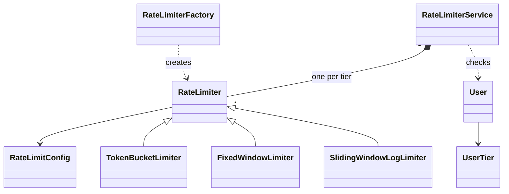

# Rate Limiter - Low Level Design (C++)

An in-memory rate limiter that decides, for every incoming request, whether a user may proceed. Each user tier (FREE, PREMIUM) gets its own limit and its own algorithm: Token Bucket, Fixed Window or Sliding Window Log. Counts are kept per user.

This README walks the question the way you should deliver it in an interview: **Requirements -> Entities -> Class Design -> Implementation -> Extensibility**. Everything here matches the C++ code in this folder.

| Step | Time (45 min interview) | Section |
|---|---|---|
| Understand + clarify | 5 min | [1. Requirements](#1-requirements) |
| Pick the objects | 3-5 min | [2. Entities](#2-entities-and-relationships) |
| State + methods, pick an algorithm | 10 min | [3. Class design](#3-class-design) |
| Write the core methods | 15-20 min | [4. Implementation](#4-implementation), [5. Verification](#5-verification) |
| "What if..." | 5+ min | [6. Extensibility](#6-extensibility) |

---

## 0. Understanding the problem

A rate limiter caps how many requests a client can make in a period of time. Under the cap, the request goes through; over it, the request is rejected. It protects a service from abuse and keeps one heavy client from starving everyone else.

The interviewer usually opens with something like:

> "Design a rate limiter. Free users get a small quota, premium users a bigger one. Support more than one rate-limiting algorithm."

This question is different from most LLD questions: the class structure is small, and the real substance is **the algorithms** (how each one counts, what it remembers per user, and where it lets too much through). Expect to explain at least two algorithms and their trade-offs, and to code one.

---

## 1. Requirements

### Clarifying questions

Group your questions around: **what the system does**, **what can go wrong**, **what's in scope**, and **what might change later**.

**You:** "What do we limit by: user, IP address, API endpoint?"
**Interviewer:** "By user. Each user belongs to a tier, FREE or PREMIUM, and the limit depends on the tier."
> This decides the key. The limit is configured per tier, but counted per user: two free users each get their own quota.

**You:** "How is a limit expressed?"
**Interviewer:** "A maximum number of requests per time window, like 5 requests per 10 seconds."

**You:** "Is there one algorithm, or should we support several?"
**Interviewer:** "Several. We'd like to pick the algorithm per tier, for example Token Bucket for free users and a sliding window for premium."
> "Several, chosen by config" means an interface with one implementation per algorithm, plus something that builds the right one from config.

**You:** "What does a check return: just allow/deny, or also how many requests are left and when to retry?"
**Interviewer:** "Allow or deny is enough for now."
> Keep the return type a `bool`. Remaining quota and retry time are a classic follow-up, so note them.

**You:** "What if a request comes from a tier we have no limit configured for?"
**Interviewer:** "Deny it. Better to block than to let unlimited traffic through."
> This is fail-closed. Some systems prefer a default limit instead (fail-open with a cap). Both are defensible; confirm which one they want.

**You:** "Will many threads call the limiter at the same time?"
**Interviewer:** "Yes, it sits in front of a multi-threaded server."
> Concurrency is in scope from the start, so every limiter must protect its per-user state.

**You:** "Single process in memory, or shared across servers?"
**Interviewer:** "Single process, in memory."
> A huge simplification: no Redis, no network coordination. Distributed rate limiting is a system design question.

**You:** "Is configuration fixed at startup, or can it change while running?"
**Interviewer:** "Set once at startup."

### Final requirements

Write this on the board before moving on:

```text
REQUIREMENTS
1. Each request comes from a user with a userId and a tier (FREE, PREMIUM)
2. Each tier has its own limit (max N requests per W seconds) and its own algorithm:
   Token Bucket, Fixed Window or Sliding Window Log
3. Limits are counted per user, not shared across the tier
4. isAllowed(user) answers allow or deny
5. A tier with no configured limit is denied
6. Safe when many threads call it at once
7. Configuration is set once at startup

OUT OF SCOPE
- Distributed limiting across servers (Redis etc.)
- Changing limits while running
- Per-endpoint limits
- Returning remaining quota / retry-after time
- Metrics, monitoring, cleanup of idle users
```

---

## 2. Entities and relationships

Look for nouns in the requirements, but don't make every noun a class. Ask of each one: **does it have state that changes, or behavior we own?**

- **Request** - external. We get a user and immediately check it. No request object to keep.
- **User** - also external: we don't manage users. But the check needs two pieces of data (id and tier), so we pass a small `User` value object instead of two loose arguments.
- **Limit configuration** - "N requests per W seconds" is a pair of numbers used together everywhere, so it gets a small value object, `RateLimitConfig`.
- **Rate-limiting algorithm** - clearly an entity. Each algorithm has its own per-user state and its own allow/deny rule. One class per algorithm, all behind one interface, `RateLimiter`.
- **Something that builds the right algorithm** - config says "TOKEN_BUCKET", someone has to turn that into a `TokenBucketLimiter`. That's `RateLimiterFactory`.
- **The entry point** - something receives the user, finds the limiter for the user's tier and asks it. That's `RateLimiterService`, the orchestrator.

| Entity | Responsibility |
|---|---|
| `RateLimiterService` | Orchestrator and public API. Maps each tier to its limiter, routes `isAllowed(user)`, denies unknown tiers. |
| `RateLimiter` (abstract) | The contract every algorithm follows: `isAllowed(userId)`. Holds the shared config. |
| `TokenBucketLimiter` | Per-user bucket of tokens that refills at a steady rate. Allows bursts up to capacity. |
| `FixedWindowLimiter` | Per-user counter that resets at the start of every window. |
| `SlidingWindowLogLimiter` | Per-user log of request times within the last window. Exact, but stores a timestamp per request. |
| `RateLimiterFactory` | Turns a `RateLimitType` + config into the right limiter. |
| `RateLimitConfig` | Value object: max requests and window length in seconds. |
| `User` | Value object: userId and tier. |
| `UserTier`, `RateLimitType` | Enums: FREE/PREMIUM; TOKEN_BUCKET/FIXED_WINDOW/SLIDING_WINDOW_LOG. |



> [!NOTE]
> **Decision: who owns the per-user state, the service or each limiter?**
> - **Good: the service keeps one map of user state.** Simple to picture, but the state looks different per algorithm (tokens and a time; a counter and a window; a list of times), so the service would need to know every algorithm's internals.
> - **Great (our choice): each limiter keeps its own per-user map.** The token bucket stores buckets, the fixed window stores counters, the sliding log stores timestamps. The service only routes. Adding an algorithm never touches the service.

> [!TIP]
> **Say in the interview:** "The service just picks the limiter for the tier. Each algorithm owns its per-user state, because that state is completely different from one algorithm to the next."

---

## 3. Class design

Work top-down, starting from the orchestrator. For each class ask two questions:
1. **State:** what must it remember to enforce the requirements?
2. **Methods:** what operations does the outside world need?

### RateLimiterService

| Requirement | What RateLimiterService must track |
|---|---|
| "Each tier has its own limit and algorithm" | A map from tier to its limiter |
| "Unknown tier is denied" | Nothing extra: a missing map entry means deny |

| Need | Method |
|---|---|
| Check a request | `isAllowed(user) -> bool` |
| Set up a tier at startup | `registerLimiter(tier, limiter)` |

```cpp
class RateLimiterService {
    std::unordered_map<UserTier, std::unique_ptr<RateLimiter>> limiters;
public:
    void registerLimiter(UserTier tier, std::unique_ptr<RateLimiter> limiter);
    bool isAllowed(const User& user);
};
```

That's the whole public API: one check, one setup method. Resist adding `getConfig()`, `getRemaining()` or `reset()` unless the interviewer asks; they aren't in the requirements.

> [!NOTE]
> **Decision: what happens for a tier with no limiter?**
> - **Good: fall back to a default limiter.** Traffic from an unexpected tier is still limited, and a config mistake doesn't block real users.
> - **Also fine (our choice): deny.** Fail-closed: nothing gets through without an explicit limit. The risk is that one missing config line blocks a whole tier.

> [!TIP]
> **Say in the interview:** "An unknown tier is denied, so nothing runs unlimited by accident. If availability matters more than strictness, I'd register a default limiter instead and log the miss."

### RateLimiter (the algorithm interface)

```cpp
class RateLimiter {
protected:
    RateLimitConfig config;            // maxRequests, windowInSeconds
public:
    explicit RateLimiter(const RateLimitConfig& config);
    virtual ~RateLimiter() = default;
    virtual bool isAllowed(const std::string& userId) = 0;
};
```

> [!NOTE]
> **Decision: pure interface, or an abstract class that holds the config?**
> - **Good: pure interface, each algorithm takes its own parameters.** A token bucket naturally wants "capacity" and "refill rate", a sliding log wants "max requests" and "window". Each class gets exactly the numbers it needs.
> - **Also fine (our choice): abstract base class holding one `RateLimitConfig`.** All three of our algorithms can be described as "N requests per W seconds", so they share one config shape. The token bucket derives its numbers from it: capacity = N, refill rate = N / W tokens per second.

> [!TIP]
> **Say in the interview:** "All my algorithms are configured the same way, N per W seconds, so the base class keeps that config. If I needed a token bucket with a burst size that differs from its rate, I'd give each algorithm its own parameters."

### RateLimitConfig and User

```cpp
class RateLimitConfig {
    int maxRequests;
    int windowInSeconds;
    // getters
};

class User {
    std::string userId;
    UserTier tier;
    // getters
};
```

Both are read-only after construction: value objects, no behavior.

### Choosing the algorithms

This is the heart of the question. Know this table cold.

| Algorithm | Per-user state | Memory per user | Bursts | Accuracy |
|---|---|---|---|---|
| **Token Bucket** | tokens (double), last refill time | O(1) | Allows a burst up to capacity, then a steady rate | Smooth average rate |
| **Fixed Window** | window number, request count | O(1) | Up to **2x** the limit across a window edge | Coarse: resets all at once |
| **Sliding Window Log** | timestamps of recent requests | O(N) for limit N | None beyond the limit | Exact over any rolling window |
| Sliding Window Counter (not implemented) | current + previous window counts | O(1) | Small, approximated | Close to exact, cheap |

- **Token Bucket:** each user has a bucket of N tokens. Each request takes one. Tokens drip back at a constant rate (N / W per second). Good when short bursts are fine but the average must hold. Used by many public APIs.
- **Fixed Window:** time is cut into blocks of W seconds. Count requests in the current block; reset the count when a new block starts. Simplest and cheapest. The weakness: N requests at the very end of one block plus N at the very start of the next all get through.
- **Sliding Window Log:** remember the time of every allowed request. On each request, drop the times older than W seconds; if fewer than N remain, allow and record. Exact, but memory grows with the limit.

```text
Fixed window edge burst (limit 5 per 2 s):

  window 1 [0s ........ 2s)  window 2 [2s ........ 4s)
                    xxxxx | xxxxx
                    1.9s  | 2.1s       -> 10 requests allowed within 0.2 s
```

### Per-algorithm state

```cpp
struct TokenBucket {                     // TokenBucketLimiter: unordered_map<string, TokenBucket>
    double tokens;
    std::chrono::steady_clock::time_point lastRefillTime;
};

struct WindowData {                      // FixedWindowLimiter: unordered_map<string, WindowData>
    long long windowStart;               // window number (seconds / window length)
    int requestCount;
};

                                         // SlidingWindowLogLimiter:
                                         // unordered_map<string, deque<long long>>  (times in ms)
```

Why `double` tokens: tokens refill continuously, so 0.5 of a token is a real state.
Why `deque` for the log: new times go on the back, expired ones come off the front, both O(1).

> [!NOTE]
> **Decision: how do tokens get refilled?**
> - **Good: a background thread adds tokens to every bucket on a timer.** Easy to picture, but it touches every user's bucket all the time, even users who left hours ago, and needs its own thread and locking.
> - **Great (our choice): refill lazily when a request arrives.** Store the last refill time; on each request, add `elapsed × rate` tokens (capped at capacity). No thread, and work happens only for users who are actually sending requests.

> [!TIP]
> **Say in the interview:** "There's no refill thread. When a request comes in I compute how many tokens accumulated since the last refill and add them, capped at the capacity."

> [!NOTE]
> **Decision: how is concurrency handled?**
> - **Good (our choice): one `std::mutex` per limiter**, held for the whole check. Simple and correct: the check-then-update can't interleave. The cost: all users of that tier wait on the same lock.
> - **Great: lock per user.** Users only block each other when they are the same user. Needs a lock per bucket plus a safe way to create buckets, which is more code.

> [!TIP]
> **Say in the interview:** "Each limiter has one mutex around the whole check, so it's correct under concurrency. If that lock became a bottleneck, I'd move to a lock per user, or shard the map so different users rarely share a lock."

### Final class design

```text
RateLimiterService
    - limiters: unordered_map<UserTier, unique_ptr<RateLimiter>>
    + registerLimiter(tier, limiter)
    + isAllowed(user) -> bool              unknown tier -> false

RateLimiter (abstract)
    # config: RateLimitConfig
    + isAllowed(userId) -> bool            pure virtual

TokenBucketLimiter : RateLimiter
    - buckets: unordered_map<string, TokenBucket>     TokenBucket { tokens, lastRefillTime }
    - mtx: mutex
    - refillTokens(bucket)

FixedWindowLimiter : RateLimiter
    - windows: unordered_map<string, WindowData>      WindowData { windowStart, requestCount }
    - mtx: mutex
    - getCurrentWindow() -> long long

SlidingWindowLogLimiter : RateLimiter
    - requestLogs: unordered_map<string, deque<long long>>
    - mtx: mutex
    - removeOldEntries(log, windowStart)

RateLimiterFactory
    + create(RateLimitType, RateLimitConfig) -> unique_ptr<RateLimiter>     static

RateLimitConfig { maxRequests, windowInSeconds }      User { userId, tier }
enum UserTier { FREE, PREMIUM }    enum RateLimitType { TOKEN_BUCKET, FIXED_WINDOW, SLIDING_WINDOW_LOG }
```

### Design patterns used

| Pattern | Where | Why | One line to say |
|---|---|---|---|
| Strategy | `RateLimiter` with three algorithms | The algorithm varies per tier; the service doesn't care which | "Each tier plugs in its own algorithm behind one interface." |
| Factory | `RateLimiterFactory::create` | Config names an algorithm; one place turns the name into an object | "Adding an algorithm is a new class plus one `case` in the factory." |
| Template method (light) | `RateLimiter` base holds config, subclasses implement `isAllowed` | Shared setup, algorithm-specific check | "The base class owns the config, subclasses own the counting." |

---

## 4. Implementation

Before writing code, ask the interviewer: real code, pseudocode, or talk it through? Most interviewers want **one** algorithm implemented fully, not all three; pick Token Bucket or Sliding Window Log unless they ask for something else. For each method: **core logic first, then edge cases.**

### RateLimiterService::isAllowed

**Core logic:** find the limiter for the user's tier, ask it about this user.
**Edge case:** no limiter for the tier: deny.

```cpp
// service/RateLimiterService.hpp
bool isAllowed(const User& user) {
    auto it = limiters.find(user.getTier());
    if (it != limiters.end()) {
        return it->second->isAllowed(user.getUserId());
    }
    return false;  // No limiter configured, deny by default
}
```

### RateLimiterFactory::create

```cpp
// factory/RateLimiterFactory.hpp
static std::unique_ptr<RateLimiter> create(RateLimitType type,
                                            const RateLimitConfig& config) {
    switch (type) {
        case RateLimitType::TOKEN_BUCKET:
            return std::make_unique<TokenBucketLimiter>(config);
        case RateLimitType::FIXED_WINDOW:
            return std::make_unique<FixedWindowLimiter>(config);
        case RateLimitType::SLIDING_WINDOW_LOG:
            return std::make_unique<SlidingWindowLogLimiter>(config);
        default:
            return std::make_unique<TokenBucketLimiter>(config);
    }
}
```

The factory returns a `unique_ptr`; the caller moves it into the service with `registerLimiter`, which then owns it.

### TokenBucketLimiter::isAllowed

**Core logic**
1. Lock.
2. First request from this user: create a bucket that starts **full** (N tokens), so a new user gets their burst right away.
3. Refill: add tokens for the time passed since the last refill, capped at N.
4. If at least one token: take it, allow. Otherwise deny.

**Edge cases**
- New user: bucket created full.
- Long idle time: refill is capped at capacity, so a user who was away for a day still gets only N.

```cpp
// limiter/TokenBucketLimiter.hpp
void refillTokens(TokenBucket& bucket) {
    auto now = std::chrono::steady_clock::now();
    auto elapsed = std::chrono::duration_cast<std::chrono::seconds>(
        now - bucket.lastRefillTime
    ).count();

    if (elapsed > 0) {
        double tokensToAdd = (elapsed * config.getMaxRequests()) /
                             static_cast<double>(config.getWindowInSeconds());
        bucket.tokens = std::min(
            static_cast<double>(config.getMaxRequests()),
            bucket.tokens + tokensToAdd
        );
        bucket.lastRefillTime = now;
    }
}

bool isAllowed(const std::string& userId) override {
    std::lock_guard<std::mutex> lock(mtx);

    // Create bucket if not exists
    if (buckets.find(userId) == buckets.end()) {
        buckets[userId] = TokenBucket();
        buckets[userId].tokens = config.getMaxRequests();
    }

    TokenBucket& bucket = buckets[userId];
    refillTokens(bucket);

    if (bucket.tokens >= 1.0) {
        bucket.tokens -= 1.0;
        return true;
    }

    return false;
}
```

Refill rate = `maxRequests / windowInSeconds` tokens per second. For FREE in `main.cpp` (5 per 10 s) that's 0.5 tokens per second. Note `elapsed` is in **whole seconds**; see the gaps table.

### FixedWindowLimiter::isAllowed

**Core logic**
1. Lock. Compute the current window number: seconds since the clock's start, divided by the window length.
2. First request from this user: create a counter.
3. If the user's stored window isn't the current one, a new window started: reset the count to 0.
4. If count < N: count it, allow. Otherwise deny.

```cpp
// limiter/FixedWindowLimiter.hpp
long long getCurrentWindow() {
    auto now = std::chrono::steady_clock::now();
    auto epoch = now.time_since_epoch();
    auto seconds = std::chrono::duration_cast<std::chrono::seconds>(epoch).count();
    return seconds / config.getWindowInSeconds();
}

bool isAllowed(const std::string& userId) override {
    std::lock_guard<std::mutex> lock(mtx);

    long long currentWindow = getCurrentWindow();

    if (windows.find(userId) == windows.end()) {
        windows[userId] = WindowData();
    }

    WindowData& data = windows[userId];

    // Reset if new window
    if (data.windowStart != currentWindow) {
        data.windowStart = currentWindow;
        data.requestCount = 0;
    }

    if (data.requestCount < config.getMaxRequests()) {
        data.requestCount++;
        return true;
    }

    return false;
}
```

Storing the window *number* instead of a start time makes "is this a new window?" a single comparison. Windows line up with the clock, not with the user's first request.

### SlidingWindowLogLimiter::isAllowed

**Core logic**
1. Lock. `windowStart = now - W seconds` (in ms).
2. First request from this user: create an empty log.
3. Pop timestamps older than `windowStart` off the front.
4. If fewer than N remain: record `now` at the back, allow. Otherwise deny.

```cpp
// limiter/SlidingWindowLogLimiter.hpp
void removeOldEntries(std::deque<long long>& log, long long windowStart) {
    while (!log.empty() && log.front() < windowStart) {
        log.pop_front();
    }
}

bool isAllowed(const std::string& userId) override {
    std::lock_guard<std::mutex> lock(mtx);

    long long now = getCurrentTimeMillis();
    long long windowStart = now - (config.getWindowInSeconds() * 1000);

    if (requestLogs.find(userId) == requestLogs.end()) {
        requestLogs[userId] = std::deque<long long>();
    }

    std::deque<long long>& log = requestLogs[userId];

    // Remove old entries outside the window
    removeOldEntries(log, windowStart);

    if (static_cast<int>(log.size()) < config.getMaxRequests()) {
        log.push_back(now);
        return true;
    }

    return false;
}
```

Only **allowed** requests are logged, so each user's deque never holds more than N entries. Denied requests don't extend the user's punishment.

### C++ talking points

- **`std::chrono::steady_clock`, not `system_clock`.** `steady_clock` only moves forward. If someone changes the system time, or it's adjusted for daylight saving, `system_clock` can jump backwards and break every elapsed-time calculation. Rate limiting needs elapsed time, never the date.
- **`std::lock_guard`** releases the mutex automatically when `isAllowed` returns, on every path, including early returns and exceptions (RAII).
- **Ownership:** the factory creates each limiter as a `unique_ptr`; `registerLimiter` takes it by value and `std::move`s it into the map. The service owns the limiters; nothing else holds them.
- **`std::unordered_map<UserTier, ...>`** works with an `enum class` key because the standard library provides `std::hash` for enums (since C++14).
- **Virtual destructor** on `RateLimiter`: limiters are destroyed through `unique_ptr<RateLimiter>`, so without it the derived destructor (and its maps) would not run.
- **`find` then `operator[]`** looks the key up twice. `auto [it, inserted] = buckets.try_emplace(userId);` does it in one lookup and tells you if the entry is new.
- **`static_cast<int>(log.size())`** avoids comparing an unsigned `size_t` with a signed `int`, which compilers warn about.
- **`std::mutex` is not copyable or movable**, so the limiter classes aren't either. That's fine: they live behind `unique_ptr` and are never copied.

### Gaps in our code (know these before the interviewer finds them)

I tested each of these by running the code. Raising them yourself, with the fix, is a strong signal.

| Gap | What happens | Fix to say |
|---|---|---|
| **Token refill counts whole seconds only** | `duration_cast<seconds>` drops the fraction, and `lastRefillTime` jumps to `now`, so the fraction is lost for good. At 1 token/s with calls 0.9 s apart, only **5 of 10** calls passed over 9 s, where about 9 should. | Measure in fractional seconds: `std::chrono::duration<double>(now - last).count()`, and update `lastRefillTime` every time. |
| **Fixed window lets 2x through at an edge** | Limit 5 per 2 s: 5 requests just before a window edge and 5 just after were **all allowed within ~200 ms**. This is the algorithm, not a bug. | "Fixed window trades accuracy for simplicity. If edge bursts matter, use sliding window log, or the sliding window counter." |
| **A zero-second window crashes** | `RateLimitConfig(5, 0)` with Fixed Window divides by zero in `getCurrentWindow()`; the process dies (`0xC0000094`, integer divide by zero). | Validate in the `RateLimitConfig` constructor: throw `std::invalid_argument` if `maxRequests <= 0` or `windowInSeconds <= 0`. |
| **Memory grows forever** | No limiter ever erases a user. Every new userId adds a map entry that stays until the program exits. | Track last access per user and evict idle users periodically, or cap the map with LRU eviction. |
| **One lock per limiter** | Correct (8 threads × 1000 calls on capacity 100 allowed **exactly 100**), but every user of a tier waits on the same mutex. | Per-user locking or a sharded map (see [concurrency](#3-scale-concurrency-to-many-users)). |
| **Only `bool` comes back** | The caller can't tell the client how much quota is left or when to retry. | Return a `RateLimitResult { allowed, remaining, retryAfterMs }` (see [follow-up 2](#2-tell-the-client-how-much-is-left-and-when-to-retry)). |
| **Unknown tier blocks everything** | Deny-by-default is safe, but one missing `registerLimiter` call silently blocks every user of that tier. | Log loudly on a miss, or register a default limiter. |
| **Windows are whole seconds** | `windowInSeconds` is an `int`, so "10 requests per 500 ms" can't be expressed. | Store the window as `std::chrono::milliseconds`. |
| **Changing tier resets the quota** | Counts live inside each tier's limiter, so a user who upgrades starts with a fresh, full quota. | Usually acceptable; if not, key a single limiter by userId and look up the tier's config per request. |

---

## 5. Verification

Trace the code on concrete scenarios and say the state out loud after each step. The outputs below are from actually running the code.

**Setup (`main.cpp`)**: FREE = Token Bucket, 5 per 10 s (capacity 5, refill 0.5 tokens/s). PREMIUM = Sliding Window Log, 20 per 10 s.

**1. Free user sends 8 requests at once**
```text
request 1: new bucket, tokens = 5; refill: elapsed 0 s, nothing added
           tokens >= 1 -> tokens = 4, ALLOWED
requests 2-5: tokens 4 -> 3 -> 2 -> 1 -> 0, ALLOWED
requests 6-8: tokens = 0, RATE LIMITED
```

**2. Premium user sends 25 requests at once**
```text
requests 1-20: log grows 0 -> 20 timestamps, ALLOWED
requests 21-25: nothing older than 10 s to remove, log size 20 = limit, RATE LIMITED
```

**3. Free user again after a 3 second wait**
```text
refill: elapsed 3 s -> 3 × 5 / 10 = 1.5 tokens; tokens = 0 + 1.5 = 1.5
request 1: tokens 1.5 -> 0.5, ALLOWED
request 2: elapsed 0 s, tokens 0.5 < 1, RATE LIMITED
request 3: RATE LIMITED
```

**4. Edge cases** (separate test program)
```text
Sliding 3 per 1 s:   5 requests -> 3 allowed; wait 1.05 s -> 3 allowed again
                     a different user right after -> 3 of 3 allowed   (counts are per user)
PREMIUM user, only FREE registered -> DENIED                          (unknown tier)
Fixed 5 per 2 s:     5 at 1.9 s + 5 at 2.1 s -> 10 allowed            (edge burst)
Token 10 per 10 s:   drained, then 10 calls 0.9 s apart -> 5 allowed  (whole-second refill, ~9 expected)
8 threads × 1000 calls, capacity 100 -> exactly 100 allowed          (mutex holds)
Fixed window of 0 s -> process crashes (divide by zero)
```

---

## 6. Extensibility

If there's time left, expect "what if" questions. You usually explain where the change goes rather than code it. Junior candidates may skip this; senior candidates can get several in a row.

### 1. "Add a new algorithm"

> "Implement `RateLimiter` in a new class with its own per-user state, add a value to `RateLimitType`, and add one `case` to the factory. The service and the existing limiters don't change."

A good one to suggest is the **Sliding Window Counter**: keep only the current and previous window counts, and estimate the rolling count.

```cpp
// estimated count over the last W seconds
double weight = 1.0 - (elapsedInCurrentWindow / windowLength);   // how much of the previous window still overlaps
double estimate = previousCount * weight + currentCount;
allowed = estimate < maxRequests;
```

O(1) memory per user like Fixed Window, without most of its edge burst.

### 2. "Tell the client how much is left and when to retry"

> "I'd return a small result object instead of a bool. HTTP APIs send these as `X-RateLimit-Remaining` and `Retry-After` headers."

```cpp
struct RateLimitResult {
    bool allowed;
    int remaining;
    long long retryAfterMs;   // 0 when allowed
};
// Token bucket, denied:   retryAfterMs = ceil((1 - tokens) / refillPerSecond * 1000)
// Sliding log, denied:    retryAfterMs = (log.front() + windowMs) - now      // when the oldest request expires
// Fixed window, denied:   retryAfterMs = time until the next window starts
```

The interface method changes from `bool isAllowed(...)` to `RateLimitResult check(...)`; each algorithm already has the numbers it needs.

### 3. "Scale concurrency to many users"

> "Today one mutex covers a whole limiter, so every user of a tier waits in line. I'd lock per user: each bucket carries its own mutex, and the map is only locked briefly to find or create the bucket."

```cpp
struct TokenBucket {
    std::mutex m;
    double tokens;
    std::chrono::steady_clock::time_point lastRefillTime;
};
std::unordered_map<std::string, std::unique_ptr<TokenBucket>> buckets;   // unique_ptr: buckets never move
std::shared_mutex mapMutex;

TokenBucket& get(const std::string& id) {
    { std::shared_lock read(mapMutex);                   // fast path: many readers at once
      if (auto it = buckets.find(id); it != buckets.end()) return *it->second; }
    std::unique_lock write(mapMutex);                    // slow path: create once
    auto& b = buckets[id];
    if (!b) b = std::make_unique<TokenBucket>(/* full */);
    return *b;
}
// isAllowed: TokenBucket& b = get(id); std::lock_guard lock(b.m); refill + take a token
```

Simpler middle ground: split users across, say, 16 shards by `hash(userId) % 16`, each shard with its own map and mutex.

### 4. "Memory keeps growing"

> "Every user ever seen stays in the map. I'd record the last access time per user and have a periodic sweep remove users idle longer than the window, since their state would have reset anyway. Alternatively an LRU cache with a fixed size."

Evicting an idle user is safe: when they come back, they look like a new user and get a full quota, which is exactly what they'd have after a long idle period anyway.

### 5. "Limit per endpoint too"

> "Key the limiter map by (tier, endpoint) instead of tier, and fall back to a per-tier default when an endpoint has no specific rule. The algorithms don't change; they still count per userId."

### 6. "Change limits without restarting"

> "Build the new limiter from the new config and swap it into the map under a lock. The simple version loses the users' current counts, which is usually acceptable. To keep them, the new limiter copies over the existing per-user state, which only works when the algorithm stays the same."

### 7. "Several servers"

> "Then the counts must live in a shared store, typically Redis: `INCR` plus `EXPIRE` for a fixed window, or a Lua script that does the token bucket check-and-update atomically. That's a system design discussion more than LLD."

---

## 7. What is expected at each level

**Junior.** Break the problem into a service that routes, an algorithm interface and at least one working algorithm. Track the right per-user state and update it correctly. Reject requests over the limit. It's fine to need the algorithm explained; what matters is implementing it correctly once you understand it.

**Mid-level.** Clean boundaries without prompting: service routes, factory creates, each algorithm owns its per-user state. Explain two algorithms and their trade-offs (burst vs. accuracy vs. memory). Handle concurrency at least with a lock around the check. Justify the factory and the strategy interface. Discuss one extension, such as retry-after or a new algorithm.

**Senior.** Raise the trade-offs yourself: lazy refill vs. a refill thread, fixed-window edge bursts, memory of the sliding log, global vs. per-user locking, fail-closed vs. a default limit. Catch edge cases: refill precision, huge idle gaps (capped by capacity), zero or negative config, unbounded memory, monotonic clocks. Finish early and drive the discussion toward per-user locking, eviction and distributed limiting.

---

## 8. Test yourself

<details><summary>1. Compare Token Bucket, Fixed Window and Sliding Window Log in one sentence each.</summary>

Token Bucket: O(1) state, allows bursts up to capacity then a steady rate. Fixed Window: O(1) state, simplest, but lets up to 2x the limit through around a window edge. Sliding Window Log: exact over any rolling window, but stores a timestamp per allowed request (O(N) per user).
</details>

<details><summary>2. Why does each limiter keep its own per-user map instead of the service keeping one?</summary>

Because the per-user state differs completely by algorithm (tokens + time, a counter + window, a deque of timestamps). Keeping it inside each algorithm lets the service stay a simple router, and adding an algorithm never changes the service.
</details>

<details><summary>3. Why is there no background thread refilling tokens?</summary>

Refill is computed lazily on each request from the elapsed time since the last refill. That avoids a thread, avoids touching idle users' buckets, and gives the same answer.
</details>

<details><summary>4. A new user's bucket starts full. Why?</summary>

So a first-time user gets their whole burst immediately. Starting empty would make every new user wait for tokens to drip in before their first request.
</details>

<details><summary>5. Limit is 5 per 2 seconds with Fixed Window. How can 10 requests pass in 200 ms?</summary>

5 at the very end of one window and 5 at the very start of the next: the counter resets at the edge. It's inherent to fixed windows; use a sliding log or sliding counter to avoid it.
</details>

<details><summary>6. Why <code>steady_clock</code> and not <code>system_clock</code>?</summary>

`steady_clock` is monotonic: it never goes backwards. `system_clock` follows wall time, which can be adjusted (NTP, manual changes), making elapsed-time maths wrong or negative.
</details>

<details><summary>7. At 1 token per second, calls arriving every 0.9 s pass only about half the time in our code. Why, and how do you fix it?</summary>

Elapsed time is cast to whole seconds and the fraction is discarded when `lastRefillTime` moves to `now`. Use `duration<double>` seconds so partial seconds count.
</details>

<details><summary>8. Why does the sliding log only store allowed requests?</summary>

So the log stays at most N long per user, and so a client who keeps hammering while blocked isn't punished further: their window still clears as their allowed requests age out.
</details>

<details><summary>9. What happens with <code>RateLimitConfig(5, 0)</code>, and what should happen?</summary>

Fixed Window divides by the window length and crashes on integer division by zero. The config should reject non-positive values in its constructor.
</details>

<details><summary>10. Is our limiter thread-safe? What's the cost?</summary>

Yes: each limiter holds one mutex for the whole check (8 threads × 1000 calls on capacity 100 allowed exactly 100). The cost is that every user of a tier is serialized on that one lock; per-user locking or sharding fixes it.
</details>

<details><summary>11. How would you return "retry after" for a denied Sliding Window Log request?</summary>

The oldest logged timestamp is the first to expire, so `retryAfterMs = (log.front() + windowMs) - now`.
</details>

<details><summary>12. A PREMIUM user is always denied in production. What's a likely cause in this design?</summary>

No limiter was registered for `PREMIUM`, and the service denies unknown tiers by default. Fail-closed is safe but should be logged so the misconfiguration is noticed.
</details>

---

## 9. Run it

```bash
cd lld/rate_limiter
g++ -std=c++17 main.cpp -o rate_limiter
./rate_limiter
```

The demo takes about 3 seconds (it waits for tokens to refill). Expected output:

```text
--- Testing FREE User (5 req/10s - Token Bucket) ---
Request 1: ALLOWED
...
Request 5: ALLOWED
Request 6: RATE LIMITED
...
--- Testing PREMIUM User (20 req/10s - Sliding Window) ---
Request 1: ALLOWED
...
Request 20: ALLOWED
Request 21: RATE LIMITED
...
--- Testing FREE User again after wait ---
Request 1: ALLOWED
Request 2: RATE LIMITED
Request 3: RATE LIMITED
```

### Files

```text
rate_limiter/
├── main.cpp                          demo: FREE = token bucket 5/10s, PREMIUM = sliding log 20/10s
├── service/
│   └── RateLimiterService.hpp        tier -> limiter map, isAllowed(user), deny unknown tiers
├── limiter/
│   ├── RateLimiter.hpp               abstract base: config + pure virtual isAllowed(userId)
│   ├── TokenBucketLimiter.hpp        per-user tokens, lazy refill
│   ├── FixedWindowLimiter.hpp        per-user count, reset each window
│   └── SlidingWindowLogLimiter.hpp   per-user deque of timestamps
├── factory/
│   └── RateLimiterFactory.hpp        RateLimitType -> limiter
├── model/
│   ├── RateLimitConfig.hpp           maxRequests, windowInSeconds
│   └── User.hpp                      userId, tier
└── enums/         UserTier (FREE, PREMIUM), RateLimitType (TOKEN_BUCKET, FIXED_WINDOW, SLIDING_WINDOW_LOG)
```
