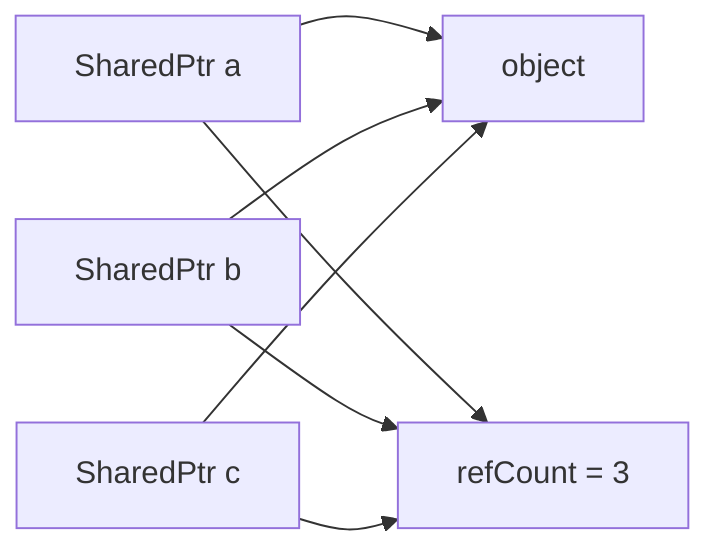

# Smart Pointers: `UniquePtr` and `SharedPtr` (C++)

Hand-written versions of `std::unique_ptr` and a thread-safe `std::shared_ptr`. "Implement a smart pointer" is a common C++ interview question, because in about 100 lines it covers ownership, the rule of five, move semantics, templates and atomics.

---

## The idea: RAII

A smart pointer ties a heap object's lifetime to a stack object: the destructor runs when the scope ends, including through an exception. So you can't forget the `delete`.

| | `UniquePtr` | `SharedPtr` |
|---|---|---|
| Owners | Exactly one | Many |
| Copy | Deleted: compile error | Allowed: count goes up |
| Move | Transfers ownership | Transfers ownership; count unchanged |
| Deletes the object when | The owner dies or is reassigned | The last owner goes |
| Extra cost | None | A heap-allocated count, and atomic operations |

**Use `UniquePtr` by default.** Share only when ownership really is shared.

---

## UniquePtr

The whole design comes down to these lines: copying would mean two owners, and so two deletes, so it's forbidden. Moving empties the source.

```cpp
// unique_ptr.cpp
explicit UniquePtr(T* p):ptr(p){} //parameterized constructor, explicit so a raw pointer can't become owned by accident

~UniquePtr() //destructor
{
    delete ptr;
}

//delete copy constructor and copy assignment operator
UniquePtr(const UniquePtr& other) = delete;
UniquePtr& operator=(const UniquePtr& other) = delete;

//move constructor
UniquePtr(UniquePtr&& other) noexcept
{
    ptr = other.ptr;
    other.ptr = nullptr;
}
```

Two details matter in the assignment:

```cpp
// unique_ptr.cpp
UniquePtr& operator=(UniquePtr&& other) noexcept
{
    if(this != &other)
    {
        //take other's pointer first: other may live inside the object we are about to delete (head = move(head->next))
        reset(other.release());
    }
    return *this;
}
// ...
void reset(T* p = nullptr) //reset method
{
    if(p == ptr) //resetting to the pointer we already own must not delete it
        return;
    T* old = ptr;
    ptr = p; //update first: deleting old may run code that reaches this pointer
    delete old;
}
```

| Method | What it does |
|---|---|
| `get()` | Look at the pointer; still owned |
| `release()` | Hand over the pointer; **the caller must now delete it** |
| `reset(p)` | Delete the current object, and own `p` |
| `operator*`, `operator->` | Use it like a pointer |
| `explicit operator bool` | `if (ptr)` |

**Why `noexcept` on moves?** While growing, `std::vector` moves its elements only if the move can't throw, or if the type can't be copied at all. So `UniquePtr` would be moved either way, but for a copyable type like `SharedPtr`, a move that might throw means a copy per element, each one touching the atomic count.

---

## SharedPtr

Every owner points at the same object, and the same counter:



The count has to be on the heap, since all the owners must see the same value, and it has to outlive whichever owner is destroyed first.

```cpp
// shared_ptr.cpp
void release() //drop this owner, delete the object when the last owner goes
{
    //fetch_sub returns the old value, so only the thread that drops the count from 1 to 0 deletes
    if(refCount && refCount->fetch_sub(1, memory_order_acq_rel) == 1)
    {
        delete ptr;
        delete refCount;
    }
    ptr = nullptr;
    refCount = nullptr;
}
// ...
//copy constructor: share ownership, increase count
SharedPtr(const SharedPtr& other)
{
    ptr = other.ptr;
    refCount = other.refCount;
    if(refCount)
        refCount->fetch_add(1, memory_order_relaxed);
}
```

### Why the atomic, and why those memory orders?

`count--` is really read, subtract, write. Two threads could both read 2 and both write 1: then nobody deletes, or with other timing, two delete. `fetch_sub` does it as one indivisible step, and returning the old value tells exactly one thread that it was the last.

| Operation | Order | Why |
|---|---|---|
| `fetch_add` | `relaxed` | You already hold a reference, so the count can't reach 0; only atomicity is needed |
| `fetch_sub` | `acq_rel` | The deleting thread must see every other thread's writes to the object first |
| `load` in `use_count` | `relaxed` | It's only a snapshot; it can be out of date by the time you read it |

**What this does and doesn't make safe:** different `SharedPtr` objects can be copied and destroyed from different threads, even when they share an object. Two threads writing the *same* `SharedPtr` variable is still a race, and the pointed-to object has no protection at all. `std::shared_ptr` works the same way.

### Assignment: copy and swap

```cpp
// shared_ptr.cpp
//copy assignment operator
SharedPtr& operator=(const SharedPtr& other)
{
    //copy first: other may live inside the object we are about to release (head = head->next)
    SharedPtr temp(other);
    swap(temp);
    return *this; //temp releases the old object here
}

//move constructor: take ownership, count stays the same
SharedPtr(SharedPtr&& other) noexcept
{
    ptr = other.ptr;
    refCount = other.refCount;
    other.ptr = nullptr;
    other.refCount = nullptr;
}

//move assignment operator
SharedPtr& operator=(SharedPtr&& other) noexcept
{
    //same reason as above, and it also makes self move assignment safe
    SharedPtr temp(std::move(other));
    swap(temp);
    return *this;
}
```

The old object is released last, when `temp` goes out of scope, and by then everything needed from `other` has been taken. There's no need for a `this != &other` check.

---

> [!WARNING]
> **Bugs this code used to have.**
>
> **1. Assigning from inside the object being replaced destroyed everything.** Both classes released the old object before reading the source. In a linked list, `head = head->next` deletes the old head, which destroys its `next` member, which is the very thing being read. The whole chain went with it. With a list of 3, popping the front should leave 2 nodes, and it left **0**, with `SharedPtr` ending up empty. This is the classic reason to do the copy first.
>
> **2. `reset(get())` used freed memory.** It deleted the object, then kept the same pointer. Reading gave garbage (a value of 5 came back as 2076788432), and `SharedPtr` then crashed on a double free.
>
> **3. `UniquePtr`'s constructor wasn't `explicit`.** Passing a raw pointer to a function taking a `UniquePtr` silently transferred ownership, and the function's return deleted it. It's now a compile error.
>
> **4. `<bits/stdc++.h>`** is GCC-only, and doesn't compile with MSVC. The files now include what they use.

---

## Verification

From actually running the code:

**Demos**
```text
unique_ptr.cpp
20
Node 1 destroyed
head is now node 2
Node 2 destroyed

shared_ptr.cpp
ptr1 count: 1
ptr1 count after 2 copies: 3
ptr1 count after copy assign: 4
ptr1 count after move: 4, ptr2 count: 0
ptr1 count after move assign: 3
10
20 count: 1, old object count: 2
Demo::func called
d1 count: 2
Demo destroyed
count after threads: 1
Demo destroyed
Node 1 destroyed
head is now node 2, count: 1
Node 2 destroyed
```

The thread test runs 8 threads, each making and destroying 100,000 copies. The count returns to 1, and the object is destroyed exactly once.

**UniquePtr** (separate test program)
```text
list 1->2->3: pop front (head = move(head->next)): alive 2, head value 2
reset(get()) keeps value: 5
self move assign: 1
empty: get nullptr; reset ok; release nullptr
release gives back 7, then get: nullptr
move assign destroys the old object: 1; end of scope: 2
raw pointer passed by accident: compile error, could not convert
```

**SharedPtr**
```text
pop front copy (head = head->next): alive 2, head value 2, count 1
pop front move (head = move(head->next)): alive 2
self copy assign: 5 count 1
self move assign: 5 count 1
assign between owners of one object: count 2
empty copy: count 0; empty reset ok; built from nullptr: count 0
reset(get()) keeps value: 5 count 1
one copy gone: destroyed 0; last owner gone: destroyed 1; after scope: destroyed 1
```

---

## Gaps

| Gap | What happens | Fix to say |
|---|---|---|
| **Cycles leak; there's no `WeakPtr`** | Two objects pointing at each other kept counts of 2, and neither destructor ran. | A `WeakPtr` that doesn't own. It needs a second count in the control block, which outlives the object. |
| **Long chains overflow the stack** | Destroying a linked list recurses once per node. `SharedPtr` handled 1,000 nodes and crashed at 100,000; `UniquePtr` handled 1,000 and crashed at 1,000,000. `std` smart pointers have the same behavior. | Give the list a destructor that unlinks nodes in a loop. |
| **Arrays use the wrong delete** (by reading) | `UniquePtr<int>(new int[3])` runs `delete`, not `delete[]`, which is undefined behavior. | A `T[]` specialization, as `std` has. |
| **No custom deleter** (by reading) | They can't manage a `FILE*` or a socket. | Add a deleter type parameter; `std::shared_ptr` stores it in the control block. |
| **No derived-to-base conversion** (by reading) | `SharedPtr<Base> b = SharedPtr<Derived>(...)` doesn't compile. | A templated converting constructor, sharing the same count. |
| **No `make_unique` or `make_shared`** (by reading) | `SharedPtr` makes two allocations: the object and the count. | A factory that allocates both together. It's faster, and safe if a constructor throws. |
| **A leak if the count can't be allocated** (by reading) | If `new atomic<unsigned int>` throws in `SharedPtr(T* p)`, `p` is never deleted. | Catch, delete `p`, and rethrow, as `std::shared_ptr` does. |
| **Null dereference isn't checked** (by reading) | `*ptr` on an empty pointer is undefined behavior. | Same as `std`, on purpose: a check would cost every use. Add an `assert` for debug builds. |
| **The moved-from state is empty** (by reading) | Using a moved-from pointer dereferences null. | Expected. Say it explicitly. |

---

## Test yourself

<details><summary>1. Why is the copy constructor of <code>UniquePtr</code> deleted?</summary>

Two copies would each delete the same object, a double free. Deleting it turns that bug into a compile error, and makes ownership transfer explicit with `std::move`.
</details>

<details><summary>2. What does <code>std::move</code> actually do?</summary>

Nothing at runtime. It's a cast to an rvalue reference, which selects the move overload. The move constructor or assignment does the work.
</details>

<details><summary>3. Why must the count be on the heap?</summary>

All owners must share one value, and any of them could be the last to survive. A member would give each owner its own copy, and a `static` would be one count across all objects.
</details>

<details><summary>4. Why check the old value from <code>fetch_sub</code>, rather than decrement and then read?</summary>

Between the decrement and the read, another thread can decrement too. Both could read 0 and both delete. `fetch_sub` returns the value from the same atomic step, so exactly one thread sees 1.
</details>

<details><summary>5. Why can <code>fetch_add</code> be relaxed, but not <code>fetch_sub</code>?</summary>

Copying requires already holding a reference, so the count can't hit zero during it, and no ordering with other data is needed. The final `fetch_sub` leads to a delete, which must see all earlier writes to the object, so it needs acquire-release.
</details>

<details><summary>6. Why does <code>head = head->next</code> break a naive assignment?</summary>

`other` lives inside the object owned by `this`. Releasing first destroys the node, and with it `other`, so the next line reads freed memory. Copy first, then release the old object.
</details>

<details><summary>7. How does copy-and-swap handle self-assignment without a check?</summary>

`temp` becomes one more owner, so the count goes up. The swap exchanges two identical values, and `temp`'s destructor brings the count back down. The object is never at risk.
</details>

<details><summary>8. What's the difference between <code>get</code>, <code>release</code> and <code>reset</code>?</summary>

`get` looks and keeps ownership. `release` gives up ownership without deleting, so the caller must delete. `reset` deletes the current object and takes a new one.
</details>

<details><summary>9. Is <code>SharedPtr</code> thread-safe?</summary>

The control block is: separate `SharedPtr` objects can be copied and destroyed concurrently. One `SharedPtr` variable written from two threads isn't, and the pointed-to object has no protection.
</details>

<details><summary>10. What's a reference cycle, and how do you break it?</summary>

A owns B and B owns A, so neither count reaches 0, and both leak. Make one direction a weak pointer, typically child to parent.
</details>

---

## Run it

```bash
cd lld/smart_pointers
g++ -std=c++17 unique_ptr.cpp -o unique_ptr
./unique_ptr
g++ -std=c++17 shared_ptr.cpp -o shared_ptr
./shared_ptr
```

On Linux, add `-pthread` when building `shared_ptr.cpp`. It uses threads.

```text
smart_pointers/
├── unique_ptr.cpp   UniquePtr<T> + demo: moves, reset, list pop
└── shared_ptr.cpp   SharedPtr<T> + demo: counts, moves, 8-thread test, list pop
```
