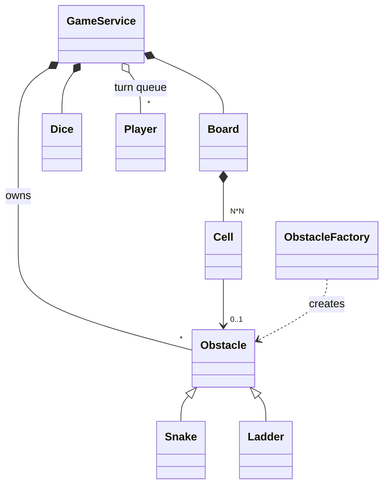

# Snakes and Ladders - Low Level Design (C++)

The board game: players take turns rolling a die and moving forward on a numbered board. Landing on a ladder's bottom climbs you up; landing on a snake's head slides you down. The first player to land exactly on the last cell wins.

This README walks the question the way you should deliver it in an interview: **Requirements -> Entities -> Class Design -> Implementation -> Extensibility**. Everything here matches the C++ code in this folder.

| Step | Time (45 min interview) | Section |
|---|---|---|
| Understand + clarify the rules | 5 min | [1. Requirements](#1-requirements) |
| Pick the objects | 3-5 min | [2. Entities](#2-entities-and-relationships) |
| State + methods | 10 min | [3. Class design](#3-class-design) |
| Write the turn logic | 15-20 min | [4. Implementation](#4-implementation), [5. Verification](#5-verification) |
| "What if..." | 5+ min | [6. Extensibility](#6-extensibility) |

---

## 0. Understanding the problem

Everyone knows the game, which is exactly the trap: everyone knows a *slightly different* version. Do you need a 6 to start? Does overshooting the last cell bounce you back? Does a 6 give an extra turn? Each rule changes the code, so the first job is to pin down which rules you're implementing.

The interviewer usually opens with:

> "Design Snakes and Ladders. Support multiple players, a configurable board, snakes and ladders."

Game questions test a different skill from service questions: modeling **game state and turns** cleanly, keeping the rules in one place, and handling the edge cases of the rules (exact landing, a jump landing on another jump, a game that can never end).

---

## 1. Requirements

### Clarifying questions

Group your questions around: **what the system does**, **what can go wrong**, **what's in scope**, and **what might change later**.

**You:** "How big is the board? Always 10 by 10?"
**Interviewer:** "Configurable: N by N, cells numbered 1 to N²."

**You:** "Where are the snakes and ladders? Random, or given?"
**Interviewer:** "Given at setup: each snake has a head and a tail, each ladder a bottom and a top."

**You:** "How many players, and how many dice?"
**Interviewer:** "Any number of players taking turns in a fixed order. The number of dice is configurable; each die is 1 to 6."

**You:** "Where do players start? Do they need a 6 to enter the board?"
**Interviewer:** "Everyone starts just off the board, at 0. No 6 needed."

**You:** "What if a roll would take a player past the last cell?"
**Interviewer:** "They don't move. You must land exactly on the last cell."
> This is the most common variant. Others bounce back by the excess; ask, because it changes one function.

**You:** "Can a ladder's top be a snake's head? If so, do you keep moving?"
**Interviewer:** "Assume they don't connect; one jump per move."
> Write this down: our code applies **one** jump per move. Notice that `main.cpp`'s own board breaks this assumption (ladder 6 -> 25, snake 25 -> 2); see the gaps.

**You:** "When does the game end?"
**Interviewer:** "As soon as the first player reaches the last cell."

**You:** "Extra turn on a 6, three 6s losing your turn, playing on for 2nd and 3rd place?"
**Interviewer:** "Out of scope. Good follow-ups though."

### Final requirements

Write this on the board before moving on:

```text
REQUIREMENTS
1. N x N board, cells 1..N^2
2. Snakes (head -> tail, goes down) and ladders (bottom -> top, goes up) are given at setup
3. Any number of players take turns in a fixed order; everyone starts at 0
4. Configurable number of dice, each 1..6; move forward by the total
5. A roll that would pass the last cell: don't move (exact landing to win)
6. Landing on a snake head or ladder bottom moves you to its other end (one jump per move)
7. The first player to land on the last cell wins and the game ends

OUT OF SCOPE
- Extra turn on 6, needing a 6 to start, three-6s penalty
- Ranking 2nd/3rd place, UI, saving games, online play
```

---

## 2. Entities and relationships

Look for nouns in the requirements, but don't make every noun a class. Ask of each one: **does it have state that changes, or behavior we own?**

- **Game** - something must hold the board, the dice and the players, run the turns and decide the winner. That's `GameService`, the orchestrator.
- **Board** - the numbered cells and where the snakes and ladders are. `Board`.
- **Cell** - one numbered square that may hold a snake or ladder. Our design gives every square a `Cell` object (see the decision below).
- **Snake, Ladder** - both "start here, end there". They share a base class, `Obstacle`, with `Snake` and `Ladder` subclasses.
- **Dice** - rolls a random total. Small, but worth a class: tests will want to replace it.
- **Player** - a name and a position that changes every turn. An entity.
- **Turn order** - not a class: a queue of players.

| Entity | Responsibility |
|---|---|
| `GameService` | Orchestrator: builds the board and dice, adds snakes, ladders and players, runs turns until someone wins. |
| `Board` | Cells 1..N², `getCell(position)`, `placeObstacle(obstacle)`, `display()`. |
| `Cell` | Position + optional `Obstacle*`. |
| `Obstacle` (abstract) | start, end, `getDestination()`, `getType()`. |
| `Snake`, `Ladder` | Concrete obstacles; destination is the other end. |
| `ObstacleFactory` | `ObstacleType` + start/end -> `Snake` or `Ladder`. |
| `Dice` | `roll()`: sum of `numDice` dice, each 1..6. |
| `Player` | Name and position. |
| `ObstacleType` | Enum: SNAKE, LADDER. |



> [!NOTE]
> **Decision: how is the board stored?**
> - **Good (simplest): a map from position to destination**, e.g. `{6: 25, 25: 2, 99: 54}`. Empty squares need no storage, and one lookup tells you where you end up.
> - **Our choice: a `Cell` object for every square, each optionally pointing to an `Obstacle`.** Lookup is still O(1) by index, the board can be drawn cell by cell, and a cell is a natural place to add other effects later ("skip a turn" squares). The cost is N² small objects, mostly empty.

> [!TIP]
> **Say in the interview:** "A map from square to destination is all the game logic needs. I modelled cells as objects because I want to draw the board and might add other kinds of squares; with 100 squares the memory doesn't matter."

> [!NOTE]
> **Decision: separate Snake and Ladder classes, or one "jump"?**
> - **Good: one `Jump { start, end }` class.** Snakes and ladders behave identically, "go from start to end"; the direction tells you which it is.
> - **Our choice: `Obstacle` base with `Snake` and `Ladder` subclasses.** The code reads like the game, the board display shows `S` or `L` from `getType()`, and each class is the natural place to check its own direction (a snake must go down). Our classes don't check it yet, which is one of the gaps.

> [!TIP]
> **Say in the interview:** "Snakes and ladders are the same mechanic, so one class would do. I kept two small subclasses for readability and so each can validate its own direction."

---

## 3. Class design

Work top-down, starting from the orchestrator. For each class ask two questions:
1. **State:** what must it remember to enforce the requirements?
2. **Methods:** what operations does the outside world need?

### GameService

| Requirement | What GameService must track |
|---|---|
| "N x N board with snakes and ladders" | The board |
| "Configurable number of dice" | The dice |
| "Players take turns in a fixed order" | A queue of players |
| Cleanup of created snakes and ladders | The list of obstacles it created |

| Need | Method |
|---|---|
| Set up | `GameService(boardDimension, numDice = 1)`, `addSnake(head, tail)`, `addLadder(bottom, top)`, `addPlayer(player)` |
| Play | `startGame()` runs turns until someone wins |
| Show the board | `displayBoard()` |

```cpp
class GameService {
    Board* board;
    Dice* dice;
    std::queue<Player*> players;
    std::vector<Obstacle*> obstacles;          // for cleanup
    int calculateNewPosition(int current, int roll);
    void playTurn(Player* player);
public:
    GameService(int boardDimension, int numDice = 1);
    ~GameService();                             // deletes board, dice, obstacles
    void addPlayer(Player* player);
    void addSnake(int head, int tail);
    void addLadder(int bottom, int top);
    void displayBoard();
    void startGame();
};
```

> [!NOTE]
> **Decision: how is turn order kept?**
> - **Good: a vector of players and a `currentIndex`**, advanced with `(i + 1) % n`.
> - **Great (our choice): a `std::queue`.** Take the front player, play, push them to the back. Turn order is the data structure itself, and dropping a player (for example one who has finished, in a "play for 2nd place" variant) is simply not pushing them back.

> [!TIP]
> **Say in the interview:** "Turns rotate through a queue: pop the front player, play their turn, push them to the back. If they won, I don't push them back."

> [!NOTE]
> **Decision: run the whole game in one call, or one turn at a time?**
> - **Our choice: `startGame()` loops until someone wins.** Perfect for a console demo; the whole flow is visible in one method.
> - **Great: a turn-at-a-time API with explicit state.** `playNextTurn()` plays one turn and returns what happened, and a `GameState` enum (NOT_STARTED, IN_PROGRESS, FINISHED) says where the game is. A UI, a network player or a test can then drive the game step by step and ask its state.

> [!TIP]
> **Say in the interview:** "For the demo the loop lives in `startGame`. For a real UI I'd expose one turn at a time and keep a game-state enum, so the caller controls the pace and illegal calls (a move after the game is over) can be rejected."

### Board and Cell

```cpp
class Board {
    int size;                                   // N * N
    std::vector<Cell*> cells;                   // index 0 unused, cells[1..size]
public:
    explicit Board(int dimensions);
    ~Board();                                   // deletes the cells
    int getSize() const;
    Cell* getCell(int position);                // nullptr if out of range
    void placeObstacle(Obstacle* obstacle);     // on the cell at obstacle->getStart()
    void display();
};

class Cell {
    int position;
    Obstacle* obstacle;                         // nullptr if none
public:
    void setObstacle(Obstacle* obs);
    Obstacle* getObstacle() const;
    bool hasObstacle() const;
};
```

Positions are 1-based to match the board, so index 0 of `cells` is left unused.

### Obstacle, Snake, Ladder

```cpp
class Obstacle {
protected:
    int start, end;
public:
    virtual int getDestination() const = 0;
    virtual ObstacleType getType() const = 0;
};
class Snake  : public Obstacle { /* head -> tail: getDestination() returns end, type SNAKE */ };
class Ladder : public Obstacle { /* bottom -> top: getDestination() returns end, type LADDER */ };

class ObstacleFactory {
public:
    static Obstacle* create(ObstacleType type, int start, int end);
};
```

### Dice and Player

```cpp
class Dice {
    int numDice;
    std::random_device rd;
    std::mt19937 gen;
    std::uniform_int_distribution<> dis;        // 1..6
public:
    explicit Dice(int numDice = 1);
    int roll();                                 // sum of numDice rolls
};

class Player {
    std::string name;
    int position;                               // 0 = off the board
};
```

### Final class design

```text
GameService
    - board: Board*,  dice: Dice*,  players: queue<Player*>,  obstacles: vector<Obstacle*>
    + GameService(boardDimension, numDice = 1),  ~GameService()
    + addSnake(head, tail),  addLadder(bottom, top),  addPlayer(player)
    + displayBoard(),  startGame()
    - playTurn(player),  calculateNewPosition(current, roll)

Board
    - size: int (N*N),  cells: vector<Cell*> (1-based)
    + getSize(),  getCell(pos) -> Cell*,  placeObstacle(obstacle),  display()

Cell        - position, obstacle: Obstacle*       + setObstacle, getObstacle, hasObstacle
Obstacle (abstract) <- Snake, Ladder
            # start, end                          + getDestination(), getType()
ObstacleFactory     + create(type, start, end) -> Obstacle*            static
Dice        - numDice, rd, gen (mt19937), dis(1..6)                    + roll()
Player      - name, position                      + getName, getPosition, setPosition
enum ObstacleType { SNAKE, LADDER }
```

### Design patterns used

| Pattern | Where | Why | One line to say |
|---|---|---|---|
| Factory | `ObstacleFactory::create` | One place turns a type into a `Snake` or `Ladder` | "Setup code says 'snake from 99 to 54' and the factory builds it." |
| Polymorphism (template method, light) | `Obstacle` with `getDestination()` / `getType()` | The turn logic treats snakes and ladders alike | "`playTurn` asks the obstacle where to go, without caring which kind it is." |
| Composition | `GameService` owns `Board`, `Dice`, obstacles | Clear lifetime: the game owns its parts | "The game owns the board and dice; players are passed in." |

---

## 4. Implementation

Before writing code, ask the interviewer: real code, pseudocode, or talk it through? The methods worth writing are `playTurn`, `calculateNewPosition` and the game loop in `startGame`.

### calculateNewPosition

**Core logic:** current + roll. **Edge case:** past the last cell -> stay put.

```cpp
// service/GameService.hpp
int calculateNewPosition(int current, int roll) {
    int newPos = current + roll;
    if (newPos > board->getSize()) {
        return current;  // Can't move beyond the board
    }
    return newPos;
}
```

To switch to the "bounce back" rule you'd change only this function: `return size - (newPos - size);`.

### playTurn

**Core logic**
1. Roll the dice.
2. Work out the new position (stay if it would overshoot).
3. If that cell has a snake or ladder, move to its destination.
4. Save the position on the player.

**Edge cases**
- Overshoot: no move.
- Only one jump is applied, even if the destination holds another snake or ladder.

```cpp
// service/GameService.hpp
void playTurn(Player* player) {
    int diceRoll = dice->roll();
    int currentPos = player->getPosition();
    int newPos = calculateNewPosition(currentPos, diceRoll);

    std::cout << player->getName() << " rolled " << diceRoll
              << " and moved from " << currentPos << " to " << newPos;

    Cell* cell = board->getCell(newPos);
    if (cell && cell->hasObstacle()) {
        Obstacle* obs = cell->getObstacle();
        int finalPos = obs->getDestination();

        if (obs->getType() == ObstacleType::SNAKE) {
            std::cout << " -> SNAKE! Sliding down to " << finalPos;
        } else {
            std::cout << " -> LADDER! Climbing up to " << finalPos;
        }
        newPos = finalPos;
    }

    player->setPosition(newPos);
    std::cout << std::endl;
}
```

`getCell` returns `nullptr` for position 0 or anything off the board, and the `cell &&` check guards against it.

### startGame (the game loop)

**Core logic:** take the front player, play their turn, check for a win, otherwise push them to the back.

```cpp
// service/GameService.hpp
while (!players.empty()) {
    Player* currentPlayer = players.front();
    players.pop();

    playTurn(currentPlayer);

    if (currentPlayer->getPosition() == board->getSize()) {
        std::cout << "\n🎉 " << currentPlayer->getName()
                  << " WINS! 🎉" << std::endl;
        return;
    }

    players.push(currentPlayer);  // Add back to queue for next turn
}
```

The win check comes **after** the jump, so a snake on the last cell would send the player back down (see the gaps). With no players, the loop never runs and `startGame` returns.

### Setting up obstacles

```cpp
// service/GameService.hpp
void addSnake(int head, int tail) {
    auto* snake = ObstacleFactory::create(ObstacleType::SNAKE, head, tail);
    obstacles.push_back(snake);
    board->placeObstacle(snake);
    std::cout << "Added Snake: " << head << " -> " << tail << std::endl;
}

// model/Board.hpp
void placeObstacle(Obstacle* obstacle) {
    int start = obstacle->getStart();
    if (start >= 1 && start <= size) {
        cells[start]->setObstacle(obstacle);
    }
}
```

`GameService` keeps every obstacle in `obstacles` so its destructor can delete them; the board's cells only point to them.

### Drawing the board

Real boards zig-zag: row 1 goes left to right (1..10), row 2 right to left (20..11), and so on. `display()` prints from the top row down and flips the direction on odd rows:

```cpp
// model/Board.hpp
for (int row = dim - 1; row >= 0; row--) {
    bool leftToRight = (row % 2 == 0);

    for (int col = 0; col < dim; col++) {
        int position;
        if (leftToRight) {
            position = row * dim + col + 1;
        } else {
            position = row * dim + (dim - col);
        }
        // ... prints position with S or L marker
    }
}
```

### C++ talking points

- **Member initialization order.** `Dice` declares `rd` before `gen`, so `gen(rd())` in the constructor's initializer list is safe. Members are initialized in **declaration order**, not the order you write them in the initializer list. Swap the declarations and `gen` would be seeded from an uninitialized `rd`.
- **Random numbers done right:** one `std::mt19937` seeded once from `std::random_device`, and `std::uniform_int_distribution<>(1, 6)`. `rand() % 6` is biased and has a poor generator.
- **Rule of three.** `GameService` and `Board` own raw pointers and delete them in their destructors, but don't delete or define copying. A copy shares the pointers, and both destructors delete them (see gaps). Either delete the copy constructor and copy assignment, or hold the members as `std::unique_ptr`, which makes the class move-only automatically.
- **Ownership:** `GameService` owns the board, the dice and the obstacles. Players are owned by the caller (`main` creates them on the stack), and the game only keeps `Player*`.
- **Virtual destructor** on `Obstacle`, because snakes and ladders are deleted through `Obstacle*`.
- **`std::vector<Cell*>` with index 0 unused** keeps positions 1-based. `std::vector<Cell>` by value would avoid 100 separate allocations entirely.
- **`explicit` constructors** on `Board`, `Cell`, `Dice` and `Player` stop accidental conversions like `Player p = std::string("Alice")`.

### Gaps in our code (know these before the interviewer finds them)

I tested each of these by running the code, except where marked "by reading". Raising them yourself, with the fix, is a strong signal.

| Gap | What happens | Fix to say |
|---|---|---|
| **Jumps don't chain** | `main.cpp` itself has ladder 6 -> 25 and snake 25 -> 2. In the demo, Bob rolled 6, climbed to 25, and **stayed on the snake's head**; his next turn started from 25. | Either validate at setup that no jump ends on another jump's start, or apply jumps in a loop (with a guard against cycles). |
| **Snakes and ladders aren't validated** | A snake going **up** (5 -> 14) was accepted; a snake added on cell 10 silently **replaced** the ladder already there; a ladder starting at 30 on a 16-cell board printed "Added Ladder" but was never placed. | In `addSnake` / `addLadder`: check the range, the direction (head > tail, bottom < top), and that the start cell is free; throw `std::invalid_argument` otherwise. |
| **A snake on the last cell means nobody can win** | With a snake on the final cell, landing there sends you down. A one-player game ran **541,361 turns in 3 seconds** without a winner before it was killed. | Reject obstacles on the first and last cells; optionally cap the number of turns. |
| **Copying `GameService` corrupts the heap** | `GameService b = a;` copies the raw pointers; both destructors delete the same board and dice. The test crashed with `0xC0000374` (heap corruption). | Delete the copy constructor and copy assignment, or use `std::unique_ptr` members. Same for `Board`. |
| **Dice can't be replaced in tests** | `roll()` isn't virtual and the seed is random, so a test can't force a roll; testing "ladder at 6" needed repeated random games. | A `Dice` interface injected through the constructor (`LoadedDice` for tests), or a constructor that takes a seed. |
| **The whole game is one call** (by reading) | `startGame()` runs to the end; nothing can play one turn or ask the state. Calling it again carries on with the losing players, since the winner was removed from the queue. | `playNextTurn()` returning the move, plus a `GameState` enum that blocks moves after FINISHED. |
| **Raw `new` / `delete` everywhere** (by reading) | Cells, obstacles, board and dice are all manually managed; the factory returns a raw owning pointer. | `std::unique_ptr` from the factory and as members; cells by value. |

---

## 5. Verification

Trace the code on concrete scenarios and say the state out loud after each step. The outputs below are from actually running the code; dice are random, so your run will differ.

**Setup (`main.cpp`)**: 10 x 10 board, one die. Snakes 99->54, 70->55, 52->42, 25->2, 95->72. Ladders 6->25, 11->40, 60->85, 46->90, 17->69. Players Alice, Bob, Charlie.

**1. The board as drawn** (bottom row left to right, zig-zag upwards):
```text
100   99S  98   97   96   95S  94   93   92   91
 81   82   83   84   85   86   87   88   89   90
 ...
 20   19   18   17L  16   15   14   13   12   11L
  1    2    3    4    5    6L   7    8    9   10
```

**2. First turns of a real run**
```text
queue: [Alice, Bob, Charlie], all at 0
Alice rolled 4 and moved from 0 to 4                       cell 4 empty
Bob rolled 6 and moved from 0 to 6 -> LADDER! Climbing up to 25
                                                           cell 25 has a snake, but only one jump applies
Charlie rolled 5 and moved from 0 to 5
Alice rolled 4 and moved from 4 to 8
Bob rolled 1 and moved from 25 to 26                       Bob stayed on 25 last turn (no chaining)
```

**3. The end of the same game**
```text
Alice rolled 2 and moved from 79 to 81
Bob rolled 6 and moved from 94 to 100                      exactly 100 -> win check passes
🎉 Bob WINS! 🎉                                            game ends; 86 turns in total
```

**4. Over 30 games**: 19 to 118 turns (median 47). Wins: Alice 11, Bob 10, Charlie 9.

**5. Edge cases** (separate test program)
```text
4-cell board, at 3, rolls 6 / 4 / 2      -> "moved from 3 to 3" each time       (exact landing)
then a 1                                 -> reaches 4, wins
ladder 6->25 + snake 25->2               -> "Climbing up to 25", next turn "moved from 25"   (no chaining)
snake on the last cell                   -> 541,361 turns in 3 s, no winner     (never ends)
ladder 10->15 then snake 10->3           -> board shows 10S                     (ladder overwritten)
snake 5->14                              -> accepted, shown as 5S               (snake going up)
ladder 30->2 on a 16-cell board          -> "Added Ladder: 30 -> 2", not placed
no players                               -> startGame returns immediately
copy of GameService                      -> heap corruption 0xC0000374
```

---

## 6. Extensibility

If there's time left, expect "what if" questions. You usually explain where the change goes rather than code it. Junior candidates may skip this; senior candidates can get several in a row.

### 1. "A ladder can lead onto a snake: keep moving"

> "Apply jumps in a loop until the player lands on a plain square. To avoid an infinite loop from a cycle (ladder A->B, snake B->A), either reject cycles at setup or stop after a few hops."

```cpp
int resolveJumps(int pos) {
    for (int hops = 0; hops < board->getSize(); hops++) {      // guard against cycles
        Cell* cell = board->getCell(pos);
        if (!cell || !cell->hasObstacle()) return pos;
        pos = cell->getObstacle()->getDestination();
    }
    throw std::logic_error("snake/ladder cycle");
}
```

### 2. "Add house rules: extra turn on a 6, three 6s lose the turn, need a 6 to start"

> "These all live in the turn logic, so I'd pull them into a `RuleSet` (Strategy) that `playTurn` consults: `canEnter(roll)`, `getsExtraTurn(roll)`, `onOvershoot(pos, roll)`. Standard rules and house rules are then different `RuleSet` classes, and the game loop doesn't change."

### 3. "Keep playing for 2nd and 3rd place"

> "When a player finishes, record their rank and simply don't push them back into the queue. The game ends when one player is left. The queue design makes this a two-line change."

### 4. "Drive it from a UI or over the network"

> "Replace the loop with `TurnResult playNextTurn()` that plays one turn and returns the roll, the move and any jump, plus a `GameState` (NOT_STARTED, IN_PROGRESS, FINISHED). The UI calls it when the player clicks 'roll'. Moves after FINISHED are rejected."

```cpp
enum class GameState { NOT_STARTED, IN_PROGRESS, FINISHED };
struct TurnResult { std::string player; int roll, from, to; bool jumped; bool won; };
```

### 5. "Test it deterministically"

> "Make `Dice` an interface and pass it into the constructor. Tests pass a `LoadedDice` that returns a fixed sequence, so 'land exactly on the ladder at 6' or 'overshoot from 98' is a one-line setup."

```cpp
class IDice { public: virtual ~IDice() = default; virtual int roll() = 0; };
class LoadedDice : public IDice {
    std::vector<int> rolls; size_t i = 0;
public:
    explicit LoadedDice(std::vector<int> r) : rolls(std::move(r)) {}
    int roll() override { return rolls[i++ % rolls.size()]; }
};
```

### 6. "Generate a random board"

> "Pick random start and end cells, rejecting any that touch the first or last cell, any start that's already taken, any end that's another jump's start, and any wrong direction. The same validation as the fix for the gaps, run in a loop until enough obstacles are placed."

### 7. "Other special squares, like 'skip a turn'"

> "Generalize `Obstacle` into a `CellEffect` with `apply(player, game)`. Snakes and ladders move the player; a skip-turn square sets a flag on the player. The cell already holds one effect pointer, so the board doesn't change."

---

## 7. What is expected at each level

**Junior.** Board, player, dice, snake and ladder as classes; a turn moves the player, applies a snake or ladder, and the first player on the last cell wins. Handle overshooting. Hints about where the turn logic should live are fine.

**Mid-level.** Clear responsibilities (game runs turns, board knows squares, obstacles know destinations), a clean turn loop with a queue, and the rule edge cases: exact landing, start at 0, win only on the last cell. Ask about rule variants up front. Discuss validation of the board or one extension like extra turns.

**Senior.** Raise the hidden problems yourself: chained jumps and cycles, an unwinnable board, invalid or overlapping obstacles, non-deterministic dice making the game untestable, ownership and the rule of three. Propose a turn-at-a-time API with a game state for a UI, and a `RuleSet` strategy for house rules.

---

## 8. Test yourself

<details><summary>1. What happens when a roll would take a player past the last cell?</summary>

`calculateNewPosition` returns the current position: the player doesn't move. They need the exact number to land on the last cell. Switching to "bounce back" would change only that function.
</details>

<details><summary>2. Why is turn order a <code>std::queue</code>?</summary>

Pop the front player, play, push them to the back: the rotation is the data structure. Not pushing a player back removes them, which suits "play on for 2nd place" without index juggling.
</details>

<details><summary>3. A ladder ends on a snake's head. What does our code do, and what are the two fixes?</summary>

It applies one jump only, so the player stops on the snake's head (seen in the demo: ladder 6 -> 25, snake at 25). Fix by rejecting such boards at setup, or by applying jumps in a loop with a cycle guard.
</details>

<details><summary>4. Why can a board with a snake on the last cell never be won?</summary>

The win check runs after the jump: landing on the last cell slides the player down, so nobody's position ever equals the last cell. Our test ran over 500,000 turns in 3 seconds without a winner. Reject obstacles on the first and last cells.
</details>

<details><summary>5. What validation should <code>addSnake</code> and <code>addLadder</code> do?</summary>

Start and end within the board and not on the first or last cell; snakes go down, ladders go up; the start cell is free; ideally no end lands on another start. Today none of this is checked: a snake going up is accepted and a second obstacle silently replaces the first.
</details>

<details><summary>6. Why is copying a <code>GameService</code> dangerous, and how do you fix it?</summary>

It owns raw pointers and deletes them in its destructor, but the default copy shares them, so both objects delete the same board and dice (our test: heap corruption). Delete the copy operations or hold the members in `std::unique_ptr`.
</details>

<details><summary>7. In <code>Dice</code>, why does it matter that <code>rd</code> is declared before <code>gen</code>?</summary>

Members are initialized in declaration order. `gen(rd())` uses `rd`, so `rd` must already exist. If `gen` were declared first, it would be seeded from an uninitialized `random_device`.
</details>

<details><summary>8. How would you make the game testable?</summary>

Inject the dice through an interface; tests pass a `LoadedDice` with a fixed sequence of rolls, so every scenario (ladder at 6, overshoot, win) is reproducible.
</details>

<details><summary>9. Why might you replace <code>startGame()</code> with <code>playNextTurn()</code> and a <code>GameState</code>?</summary>

A UI or network game needs to play one turn per user action and know whether the game is running or over. A state enum also lets the game reject moves after it has finished.
</details>

<details><summary>10. How is the zig-zag board layout drawn?</summary>

Rows are printed from the top down; even rows (counting from the bottom, starting at 0) go left to right, odd rows right to left. Position = `row * dim + col + 1` or `row * dim + (dim - col)` depending on the direction.
</details>

<details><summary>11. Snake and Ladder do exactly the same thing in code. Why keep two classes?</summary>

Readability and a home for direction checks; the display also shows S or L. A single `Jump` class is equally valid, and a plain map from square to destination is all the game logic strictly needs.
</details>

<details><summary>12. How would you add "a 6 gives another turn"?</summary>

After playing a turn, if the roll was 6 (and the player didn't win), don't rotate: let the same player go again, perhaps with a limit of three 6s in a row. Cleanest as part of a `RuleSet` strategy that the turn loop consults.
</details>

---

## 9. Run it

```bash
cd lld/snakes_and_ladder
g++ -std=c++17 main.cpp -o snakes_and_ladder
./snakes_and_ladder
```

Expected output (the dice are random, so the moves and the winner change every run):

```text
=== Board Layout ===
100   99S  98   97   96   95S  94   93   92   91
...
  1    2    3    4    5    6L   7    8    9   10
S = Snake, L = Ladder

=== Game Started! ===
First to reach 100 wins!

Alice rolled 4 and moved from 0 to 4
Bob rolled 6 and moved from 0 to 6 -> LADDER! Climbing up to 25
...
Bob rolled 6 and moved from 94 to 100

🎉 Bob WINS! 🎉
```

On a Windows console the 🎉 may show as odd characters; that's only the console's text encoding.

### Files

```text
snakes_and_ladder/
├── main.cpp                       demo: 10x10 board, 5 snakes, 5 ladders, 3 players
├── service/GameService.hpp        owns board, dice, obstacles; turn queue; playTurn; startGame
├── model/
│   ├── Board.hpp                  cells 1..N*N, placeObstacle, zig-zag display
│   ├── Cell.hpp                   position + optional obstacle
│   ├── Obstacle.hpp               abstract: start, end, getDestination, getType
│   ├── Snake.hpp, Ladder.hpp      concrete obstacles
│   ├── Dice.hpp                   numDice dice, mt19937 + uniform 1..6
│   └── Player.hpp                 name + position (0 = off the board)
├── factory/ObstacleFactory.hpp    SNAKE / LADDER -> object
└── enums/ObstacleType.hpp         SNAKE, LADDER
```
