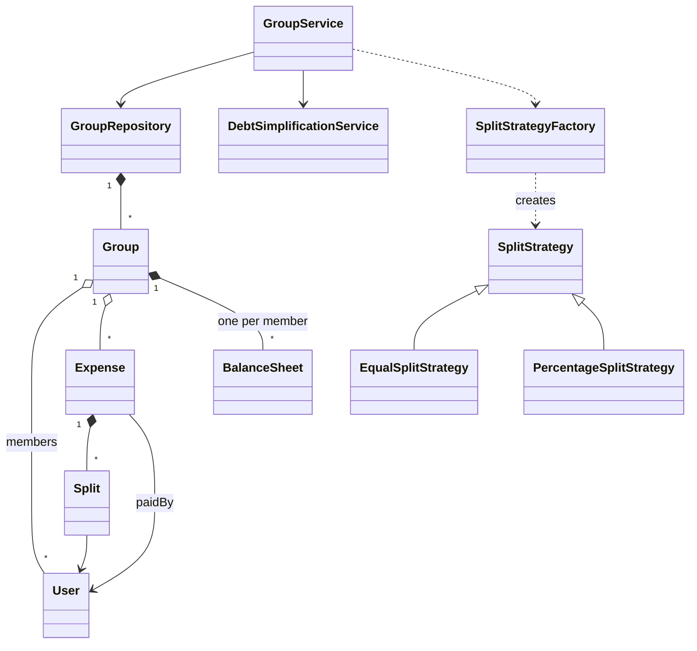

# Splitwise - Low Level Design (C++)

An expense-sharing app: friends form a group, someone pays for something, the cost is split between the people involved, and the app keeps track of who owes whom. At the end it suggests a short list of payments that settles everyone up.

This README walks the question the way you should deliver it in an interview: **Requirements -> Entities -> Class Design -> Implementation -> Extensibility**. Everything here matches the C++ code in this folder.

| Step | Time (45 min interview) | Section |
|---|---|---|
| Understand + clarify | 5 min | [1. Requirements](#1-requirements) |
| Pick the objects | 3-5 min | [2. Entities](#2-entities-and-relationships) |
| State + methods, balance model | 10 min | [3. Class design](#3-class-design) |
| Write the core methods | 15-20 min | [4. Implementation](#4-implementation), [5. Verification](#5-verification) |
| "What if..." | 5+ min | [6. Extensibility](#6-extensibility) |

---

## 0. Understanding the problem

Four friends go on a trip. Alice pays the hotel, Bob pays dinner, Charlie the cab, Dave the activities. Each bill is shared by everyone. Splitwise answers two questions: **"how much does each person owe or get back?"** and **"what's the fewest payments that settles it?"**

The interviewer usually opens with:

> "Design Splitwise. Users can create groups, add expenses, split them different ways, and see balances."

The core of this question is the **balance model**: how adding one expense updates everyone's numbers, and how those numbers turn into "X pays Y". The split types are a textbook Strategy, and debt simplification is a small algorithm question hidden inside the design question.

---

## 1. Requirements

### Clarifying questions

Group your questions around: **what the system does**, **what can go wrong**, **what's in scope**, and **what might change later**.

**You:** "Are expenses always inside a group, or can two people share an expense directly?"
**Interviewer:** "Always inside a group. A group has members and its own expenses."
> Balances are then per group: what Bob owes Alice on the Goa trip is separate from their flatmate group.

**You:** "Who pays an expense? Can several people pay one bill?"
**Interviewer:** "One payer per expense."
> One payer keeps the update simple: the payer is owed by every other participant.

**You:** "How can an expense be split?"
**Interviewer:** "Equally, or by percentage. We may add more ways later, like exact amounts."
> "More later" means split logic should be pluggable: one interface, one class per split type.

**You:** "Does everyone in the group share every expense?"
**Interviewer:** "No, each expense lists its own participants, a subset of the group."

**You:** "What do users need to see?"
**Interviewer:** "For each person: how much they paid, what their share of costs was, and their net. Also who owes whom."
> Two views: a **net** number per person, and **pairwise** debts between people. Design the data so both are cheap to show.

**You:** "Should we suggest how to settle up?"
**Interviewer:** "Yes. Suggest a small set of payments that clears all balances."
> Debt simplification. Ask whether it must be the *minimum* number of payments; the exact minimum is an NP-hard problem, so "small" is the realistic target.

**You:** "What if the percentages don't add up to 100, or someone outside the group is in a split?"
**Interviewer:** "Assume callers pass valid input for now, but mention how you'd validate."
> Our code doesn't validate, and the gaps table shows exactly what goes wrong. Bring it up yourself.

**You:** "Recording a repayment, editing or deleting expenses, currencies, persistence?"
**Interviewer:** "Out of scope for now."

### Final requirements

Write this on the board before moving on:

```text
REQUIREMENTS
1. Users belong to groups; a group has members and expenses
2. An expense has a description, an amount, ONE payer, and a list of participants
3. Split types: EQUAL, PERCENTAGE (more types later)
4. Adding an expense updates balances immediately
5. Show per user: total paid, total share, net balance, and pairwise "who owes whom"
6. Simplify debts: suggest a small set of payments that settles the group

OUT OF SCOPE
- Validating split input (discussed as a gap)
- Recording repayments, editing or deleting expenses
- Multiple payers per expense, currencies, persistence, notifications
```

---

## 2. Entities and relationships

Look for nouns in the requirements, but don't make every noun a class. Ask of each one: **does it have state that changes, or behavior we own?**

- **User** - an id and a name. We don't manage users here, but expenses and balances refer to them.
- **Group** - clearly an entity: it owns its member list, its expenses and everyone's balances within the group.
- **Expense** - a record of one bill: who paid, how much, and how it was split. Created once, not changed afterwards.
- **Split** - one person's share of one expense: (user, amount). A small value object; an expense holds a list of them.
- **Balance** - per user per group, we need running totals (paid, share) and pairwise amounts. That's `BalanceSheet`.
- **Split type** - each type calculates shares differently: interface `SplitStrategy`, one class per type, plus a factory that picks one from a `SplitType` enum.
- **Something that runs the use cases** - create a group, add an expense, show balances, simplify. That's `GroupService`, the orchestrator.
- **Where groups live** - `GroupRepository` stores groups by id, so the service doesn't care how they're stored.
- **Debt simplification** - an algorithm over balances, kept in its own `DebtSimplificationService`.

| Entity | Responsibility |
|---|---|
| `GroupService` | Orchestrator and public API: `createGroup`, `addMember`, `addExpense`, `printBalances`, `simplifyDebts`. |
| `GroupRepository` | Owns all groups (`unique_ptr`), `save` and `findById`. |
| `Group` | Members, expenses, and one `BalanceSheet` per member. |
| `Expense` | id, description, amount, payer, list of `Split`s. |
| `Split` | One participant's share: user + amount. |
| `BalanceSheet` | One user's numbers in one group: total paid, total share, and a map "other user -> amount". |
| `SplitStrategy` (abstract) | `split(amount, participants, metadata) -> vector<Split>`. |
| `EqualSplitStrategy`, `PercentageSplitStrategy` | Equal shares; shares from a userId -> percentage map. |
| `SplitStrategyFactory` | `SplitType` -> strategy object. |
| `DebtSimplificationService` | Turns net balances into a short list of "X pays Y". |
| `User` | id, name. |



> [!NOTE]
> **Decision: compute balances when asked, or keep them up to date?**
> - **Good: store only expenses; compute balances from them whenever someone asks.** One source of truth, nothing to keep in sync. But every "show balances" walks every expense of the group.
> - **Great (our choice): keep running balance sheets, updated as each expense is added.** Adding an expense costs one pass over its splits; reading balances is instant. Expenses are still stored, so balances can be rebuilt or an expense reversed later.

> [!TIP]
> **Say in the interview:** "Reads are far more common than writes, so I update each member's balance sheet when an expense is added, and keep the expense list as the record of what happened."

---

## 3. Class design

Work top-down, starting from the orchestrator. For each class ask two questions:
1. **State:** what must it remember to enforce the requirements?
2. **Methods:** what operations does the outside world need?

### GroupService

| Requirement | What GroupService must track |
|---|---|
| "Groups have members and expenses" | Where groups are stored: the repository |
| "Expense ids" | A running expense counter |
| "Simplify debts" | The simplification service |

| Need | Method |
|---|---|
| Create a group | `createGroup(name, members) -> groupId` |
| Add a member | `addMember(groupId, user)` |
| Add an expense | `addExpense(groupId, description, amount, paidBy, participants, splitType, metadata = {})` |
| Show balances | `printBalances(groupId)` |
| Suggest payments | `simplifyDebts(groupId)` |

```cpp
class GroupService {
    GroupRepository& repository;                       // injected, must outlive the service
    DebtSimplificationService simplificationService;
    int expenseCounter = 0;
public:
    explicit GroupService(GroupRepository& repo);
    std::string createGroup(const std::string& name, const std::vector<User*>& members);
    void addMember(const std::string& groupId, User* user);
    void addExpense(const std::string& groupId, const std::string& description,
                    double amount, User* paidBy, const std::vector<User*>& participants,
                    SplitType splitType,
                    const std::unordered_map<std::string, double>& metadata = {});
    void printBalances(const std::string& groupId);
    void simplifyDebts(const std::string& groupId);
};
```

`metadata` carries split-type-specific input: for PERCENTAGE it's userId -> percentage. EQUAL ignores it.

### Group, Expense, Split

```cpp
class Group {
    std::string id, name;
    std::vector<User*> members;
    std::vector<Expense*> expenses;
    std::unordered_map<std::string, BalanceSheet> balanceSheets;   // userId -> sheet
public:
    void addMember(User* user);                   // also creates an empty sheet for the user
    void addExpense(Expense* expense);
    BalanceSheet& getBalanceSheet(const std::string& userId);
};

class Expense {
    std::string id, description;
    double amount;
    User* paidBy;
    std::vector<Split> splits;
};

class Split {
    User* user;
    double amount;
};
```

### BalanceSheet

This is the heart of the design. One sheet per member, per group.

| Requirement | What BalanceSheet must track |
|---|---|
| "How much they paid" | `totalPaid` |
| "What their share of costs was" | `totalExpense` |
| "Their net" | Derived: `totalPaid - totalExpense` |
| "Who owes whom" | `balances`: other userId -> amount |

```cpp
class BalanceSheet {
    double totalPaid = 0.0;
    double totalExpense = 0.0;
    std::unordered_map<std::string, double> balances;   // userId -> balance
public:
    void addPaid(double amount);
    void addExpense(double amount);
    double getNetBalance() const;                       // totalPaid - totalExpense
    void updateBalance(const std::string& userId, double amount);
    const std::unordered_map<std::string, double>& getBalances() const;
};
```

**Sign convention.** In Alice's sheet, `balances["u2"] = +500` means *Bob owes Alice 500*. A negative value means Alice owes that person. Every pairwise entry has a mirror: if Alice's sheet says +500 for Bob, Bob's sheet says -500 for Alice.

**Net vs pairwise.** A positive net means the group owes you money overall; negative means you owe. Nets across a group always add up to zero (money isn't created), which is the best sanity check you can do in an interview. Pairwise balances say who owes whom *directly*; nets throw that away and are what simplification uses.

### SplitStrategy

```cpp
class SplitStrategy {
public:
    virtual std::vector<Split> split(double totalAmount,
                                     const std::vector<User*>& participants,
                                     const std::unordered_map<std::string, double>& metadata) = 0;
};
// EqualSplitStrategy:      everyone gets totalAmount / participants.size()
// PercentageSplitStrategy: each participant gets totalAmount * metadata[userId] / 100

class SplitStrategyFactory {
public:
    static std::unique_ptr<SplitStrategy> get(SplitType type);    // EQUAL, PERCENTAGE
};
```

> [!NOTE]
> **Decision: where does the "how to split" logic live?**
> - **Good: a `switch` on the split type inside `addExpense`.** Fine for two types, but every new type edits the service's busiest method.
> - **Great (our choice): `SplitStrategy` with one class per type, picked by `SplitStrategyFactory`.** `addExpense` just asks the strategy for the splits. An EXACT split is a new class and one `case` in the factory.

> [!TIP]
> **Say in the interview:** "Splitting is a strategy: the service asks 'give me the shares' and doesn't care how they're computed. A new split type is a new class, not a change to `addExpense`."

> [!NOTE]
> **Decision: how does a strategy get its extra input?**
> - **Our choice: one generic `metadata` map (userId -> number) for every strategy.** One signature for all strategies; PERCENTAGE reads percentages from it, EQUAL ignores it, a future EXACT split would read amounts from it.
> - **Great: typed input per split type**, for example the caller builds the `Split` list itself for EXACT, or passes a `PercentageSplitInput`. The meaning of each number is explicit and each type can validate its own input.

> [!TIP]
> **Say in the interview:** "A generic map keeps one interface for all split types. The cost is that a number's meaning depends on the split type, so each strategy has to validate it."

### DebtSimplificationService

```cpp
class DebtSimplificationService {
public:
    void simplifyDebts(Group* group);    // prints "X pays Y: Rs. N" lines
};
```

> [!NOTE]
> **Decision: how to turn balances into payments?**
> - **Good: pay pairwise debts as they are.** Correct, but the demo trip needs 6 payments.
> - **Great for an interview (our choice): greedy on nets.** Put creditors and debtors in two max-heaps; repeatedly match the largest creditor with the largest debtor for `min(credit, debt)` and push back whoever has something left. Each step settles at least one person, so it needs **at most n - 1 payments** and runs in O(n log n). The demo needs 2.
> - **Exact minimum: a search over subsets.** The true minimum is NP-hard (it depends on splitting people into groups whose balances cancel). It's feasible only for small groups, with a bitmask DP over 2^n subsets. Greedy isn't always minimal: in our tests it used one extra payment in about 9% of random 6-person cases.

> [!TIP]
> **Say in the interview:** "I settle on net balances with a greedy match of the biggest creditor and the biggest debtor. It's at most n - 1 payments and O(n log n). The exact minimum is NP-hard; for small groups I could search subsets that sum to zero, but greedy is what's expected here."

### Final class design

```text
GroupService
    - repository: GroupRepository&,  simplificationService,  expenseCounter
    + createGroup(name, members) -> groupId
    + addMember(groupId, user)
    + addExpense(groupId, desc, amount, paidBy, participants, splitType, metadata = {})
    + printBalances(groupId),  simplifyDebts(groupId)

GroupRepository
    - groups: unordered_map<string, unique_ptr<Group>>
    + save(unique_ptr<Group>),  findById(id) -> Group*

Group
    - id, name, members: vector<User*>, expenses: vector<Expense*>
    - balanceSheets: unordered_map<userId, BalanceSheet>
    + addMember(user), addExpense(expense), getBalanceSheet(userId) -> BalanceSheet&

BalanceSheet
    - totalPaid, totalExpense, balances: unordered_map<userId, double>     (+ = they owe me)
    + addPaid, addExpense, getNetBalance, updateBalance, getBalances

Expense { id, description, amount, paidBy: User*, splits: vector<Split> }
Split   { user: User*, amount }
User    { id, name }

SplitStrategy (abstract)  <- EqualSplitStrategy, PercentageSplitStrategy
    + split(amount, participants, metadata) -> vector<Split>
SplitStrategyFactory      + get(SplitType) -> unique_ptr<SplitStrategy>          static
DebtSimplificationService + simplifyDebts(group)                                greedy on nets

enum SplitType { EQUAL, PERCENTAGE }
```

### Design patterns used

| Pattern | Where | Why | One line to say |
|---|---|---|---|
| Strategy | `SplitStrategy` with Equal / Percentage | Split rules vary; `addExpense` shouldn't change per type | "New split type, new class." |
| Factory | `SplitStrategyFactory::get` | `SplitType` enum -> strategy object in one place | "The service names a type, the factory builds it." |
| Repository | `GroupRepository` | Hides how groups are stored; swap the map for a database later | "The service asks for a group by id and doesn't know where it lives." |
| Service layer | `GroupService`, `DebtSimplificationService` | Use cases and algorithms live outside the data classes | "Models hold data, services run the use cases." |

---

## 4. Implementation

Before writing code, ask the interviewer: real code, pseudocode, or talk it through? The methods that matter are `addExpense` (the balance update) and `simplifyDebts`. Write those two well; the rest is plumbing.

### addExpense

**Core logic**
1. Find the group; stop if it doesn't exist.
2. Ask the strategy for the splits (one share per participant).
3. Store the expense in the group.
4. Payer's sheet: `totalPaid += amount`.
5. For each split: the participant's `totalExpense += share`. If the participant isn't the payer, record the pairwise debt both ways: payer's sheet `+share` for the participant, participant's sheet `-share` for the payer.

**Edge cases**
- Unknown group: print "Group not found!" and change nothing.
- The payer is also a participant: their share counts toward their own `totalExpense`, but no pairwise entry with themselves.

```cpp
// service/GroupService.hpp
void addExpense(const std::string& groupId, const std::string& description,
                double amount, User* paidBy, const std::vector<User*>& participants,
                SplitType splitType,
                const std::unordered_map<std::string, double>& metadata = {}) {

    Group* group = repository.findById(groupId);
    if (!group) {
        std::cout << "Group not found!" << std::endl;
        return;
    }

    // Get split strategy and calculate splits
    auto strategy = SplitStrategyFactory::get(splitType);
    std::vector<Split> splits = strategy->split(amount, participants, metadata);

    // Create expense
    std::string expenseId = "E" + std::to_string(++expenseCounter);
    auto* expense = new Expense(expenseId, description, amount, paidBy, splits);
    group->addExpense(expense);

    // Update balance sheets
    BalanceSheet& payerSheet = group->getBalanceSheet(paidBy->getId());
    payerSheet.addPaid(amount);

    for (const Split& split : splits) {
        BalanceSheet& participantSheet = group->getBalanceSheet(split.getUser()->getId());
        participantSheet.addExpense(split.getAmount());

        // Update inter-user balances
        if (split.getUser()->getId() != paidBy->getId()) {
            payerSheet.updateBalance(split.getUser()->getId(), split.getAmount());
            participantSheet.updateBalance(paidBy->getId(), -split.getAmount());
        }
    }
    // ... prints "Added expense: ..."
}
```

Cost per expense: O(number of participants). Nets stay in sync because the payer gains `amount` and the participants lose shares that add up to `amount`, **as long as the shares add up to the amount** (see gaps).

### The split strategies

```cpp
// strategy/EqualSplitStrategy.hpp
std::vector<Split> splits;
double perPerson = totalAmount / participants.size();

for (User* user : participants) {
    splits.emplace_back(user, perPerson);
}

return splits;

// strategy/PercentageSplitStrategy.hpp
std::vector<Split> splits;

for (User* user : participants) {
    auto it = metadata.find(user->getId());
    if (it != metadata.end()) {
        double percentage = it->second;
        double amount = (totalAmount * percentage) / 100.0;
        splits.emplace_back(user, amount);
    }
}

return splits;
```

A participant with no percentage in `metadata` is skipped silently, and nothing checks that the percentages add up to 100.

### simplifyDebts

**Core logic**
1. Collect each member's net balance; skip anyone within 0.01 of zero.
2. Positive nets go into a max-heap of creditors, negative ones (made positive) into a max-heap of debtors, both ordered by amount.
3. While both heaps have someone: pop the largest creditor and the largest debtor, the debtor pays `min(credit, debt)`, and whoever still has more than 0.01 left goes back into their heap.

**Edge cases**
- Everyone is settled: the heaps are empty, nothing is printed.
- Floating-point dust: the 0.01 threshold stops tiny leftovers from producing "pays Rs. 0.0000001" lines.

```cpp
// service/DebtSimplificationService.hpp
// Separate into creditors (positive) and debtors (negative)
auto cmp = [](std::pair<std::string, double>& a, std::pair<std::string, double>& b) {
    return std::abs(a.second) < std::abs(b.second);
};

std::priority_queue<std::pair<std::string, double>,
                   std::vector<std::pair<std::string, double>>,
                   decltype(cmp)> creditors(cmp), debtors(cmp);

for (auto& [name, balance] : balances) {
    if (balance > 0) {
        creditors.push({name, balance});
    } else if (balance < 0) {
        debtors.push({name, -balance});  // Store as positive for easier calculation
    }
}

// Match creditors with debtors
while (!creditors.empty() && !debtors.empty()) {
    auto creditor = creditors.top(); creditors.pop();
    auto debtor = debtors.top(); debtors.pop();

    double amount = std::min(creditor.second, debtor.second);

    std::cout << debtor.first << " pays " << creditor.first
              << ": Rs. " << amount << std::endl;

    creditor.second -= amount;
    debtor.second -= amount;

    if (creditor.second > 0.01) {
        creditors.push(creditor);
    }
    if (debtor.second > 0.01) {
        debtors.push(debtor);
    }
}
```

Why it terminates in at most n - 1 payments: every payment fully settles the creditor, the debtor, or both, and the last payment always settles both.

### C++ talking points

- **Ownership:** `GroupRepository` owns groups (`unique_ptr<Group>`) and hands out non-owning `Group*`. Users are owned by the caller (`main` creates them on the stack) and everyone else holds `User*`. Expenses are created with `new` and never deleted (see gaps).
- **`GroupService` holds a `GroupRepository&`**: dependency injection through the constructor. The repository must outlive the service.
- **`unordered_map::operator[]` inserts a default value** when the key is missing. `Group::getBalanceSheet` uses it, so asking for a non-member's sheet silently creates one. That's the root of two of the gaps; use `find` or `at` when a missing key is an error.
- **`std::priority_queue` with a lambda comparator** needs `decltype(cmp)` as the third template argument and the lambda passed to the constructor. The comparator should take `const&` parameters; it works here because the queue calls it on non-const elements.
- **Structured bindings** (`for (auto& [name, balance] : balances)`) unpack pairs and map entries.
- **Comparing doubles with a tolerance** (`std::abs(x) > 0.01`) instead of `== 0`, because sums of shares like 33.333... leave tiny leftovers.
- **Default argument** `metadata = {}` lets EQUAL callers skip it.
- **Unused parameter warning:** `EqualSplitStrategy::split` ignores `metadata`; mark it `[[maybe_unused]]` or leave the parameter unnamed.

### Gaps in our code (know these before the interviewer finds them)

I tested each of these by running the code, except where marked "by reading". Raising them yourself, with the fix, is a strong signal.

| Gap | What happens | Fix to say |
|---|---|---|
| **Percentages aren't validated** | 1000 paid by Alice with percentages 50 + 30 (80%) and Charlie left out: nets came out Alice +500, Bob -300, Charlie 0, adding up to **+200**. 200 of the bill belongs to nobody, and Charlie is skipped silently. | Reject unless percentages sum to 100 (within a tolerance) and every participant has one. Throw `std::invalid_argument`. |
| **Non-members can be in a split** | Xavier, not in the group, shared a 300 bill: he got a hidden balance sheet with -100, but simplification only looks at members, so it settled **only 100 of Alice's +200**. | Check payer and participants are members before splitting; use `find` instead of `operator[]` in `getBalanceSheet`. |
| **Re-adding a member wipes their balance** | Bob owed 100; `addMember(Bob)` again listed him **twice** and reset his sheet: nets became Alice +100, Bob 0, Bob 0. His debt vanished. | Ignore (or reject) a user who is already a member. |
| **Empty participant list** | An EQUAL expense with no participants credits the payer the full amount and **nobody owes it** (nets add up to +100). | Reject an expense with no participants, and a non-positive amount. |
| **Money is a `double`** | 100 split three ways gives 33.333333… each, and the nets add up to -1.4e-14 instead of 0. | Store paise as integers. Split 100.00 three ways as 33.34 + 33.33 + 33.33: give the leftover paise to the first participants. |
| **Simplification isn't always minimal** | Over 1642 random 6-person balance sets, greedy used **more payments than the minimum in 152** (about 9%). Example: balances -9, +8, +6, -8, +3 -> greedy pays 4 times, the minimum is 3. | Say it: greedy guarantees at most n - 1; the exact minimum is NP-hard, solvable for small groups by searching subsets that sum to zero. |
| **Expenses are never freed** (by reading) | `addExpense` creates each `Expense` with `new`; `Group` keeps raw `Expense*` and never deletes them. | Store `std::vector<std::unique_ptr<Expense>>`, or `std::vector<Expense>` by value. |
| **Random group ids can collide** (by reading) | Ids are `"G"` + a random number 1000-9999. A repeat makes `save` **replace an existing group**, destroying it. | Use an incrementing counter or a UUID. |
| **No "settle up" operation** | A repayment can be faked as an expense paid by the debtor, split 100% to the creditor (tested: both nets return to 0), but the history then shows a fake "expense". | Add `recordPayment(groupId, from, to, amount)` (see [follow-up 2](#2-record-a-repayment-settle-up)). |

---

## 5. Verification

Trace the code on concrete scenarios and say the state out loud after each step. The outputs below are from actually running the code.

**Setup (`main.cpp`)**: group "Trip to Goa" with Alice (u1), Bob (u2), Charlie (u3), Dave (u4). All four share every expense.

**1. Alice pays the hotel, 4000, EQUAL**
```text
splits: 1000 each
Alice:   paid 4000, share 1000
Bob, Charlie, Dave: share 1000 each
pairwise: Alice +1000 for each of u2, u3, u4;  each of them -1000 for u1
```

**2. Bob pays dinner, 2000, EQUAL** -> 500 each. Alice's entry for Bob: +1000 - 500 = **+500** (Bob still owes Alice 500 net between the two of them).

**3. Charlie pays the cab, 800, PERCENTAGE 25/25/25/25** -> 200 each.
**4. Dave pays water sports, 1200, EQUAL** -> 300 each.

**Result** (matches the hand calculation: everyone's share is 1000 + 500 + 200 + 300 = 2000):
```text
            paid    share    net      pairwise (from the program output)
Alice       4000    2000   +2000      owed by u3 800, u4 700, u2 500
Bob         2000    2000       0      owed by u4 200, u3 300; owes u1 500
Charlie      800    2000   -1200      owes u4 100, u2 300, u1 800
Dave        1200    2000    -800      owed by u3 100; owes u2 200, u1 700
                         sum = 0

pairwise payments needed: 6     (u3->u1, u4->u1, u2->u1, u3->u2, u4->u2, u3->u4)

=== Simplified Debts ===
Charlie pays Alice: Rs. 1200     creditors {Alice 2000}, debtors {Charlie 1200, Dave 800}
Dave pays Alice: Rs. 800         -> 2 payments instead of 6
```

**Edge cases** (separate test program)
```text
Percentages 50 + 30, 1000 paid by Alice   -> nets +500, -300, 0, sum +200        (not validated)
100 split equally by 3                    -> 33.33333333 each, sum of nets -1.4e-14
Equal split, no participants              -> Alice +100, nobody owes it
Non-member Xavier in a 300 split          -> Xavier -100 hidden; simplify: "Bob pays Alice 100" only
Bob re-added to the group                 -> listed twice, his -100 reset to 0
Settle up as a 100% expense to Alice      -> both nets back to 0                 (workaround works)
Unknown group id                          -> "Group not found!"
Greedy vs minimum, 1642 random cases      -> greedy worse in 152; e.g. 4 payments vs 3
```

---

## 6. Extensibility

If there's time left, expect "what if" questions. You usually explain where the change goes rather than code it. Junior candidates may skip this; senior candidates can get several in a row.

### 1. "Add an EXACT split"

> "A new `ExactSplitStrategy` that reads each participant's amount from `metadata` and checks they add up to the total, plus `EXACT` in `SplitType` and one `case` in the factory. `addExpense` doesn't change."

```cpp
class ExactSplitStrategy : public SplitStrategy {
    std::vector<Split> split(double total, const std::vector<User*>& participants,
                             const std::unordered_map<std::string, double>& amounts) override {
        double sum = 0;
        std::vector<Split> splits;
        for (User* u : participants) { double a = amounts.at(u->getId()); sum += a; splits.emplace_back(u, a); }
        if (std::abs(sum - total) > 0.01) throw std::invalid_argument("exact amounts must add up to the total");
        return splits;
    }
};
```

### 2. "Record a repayment (settle up)"

> "When Bob pays Alice back, it isn't an expense. I'd add `recordPayment(groupId, from, to, amount)`: it moves the pairwise entries toward zero and adjusts the nets, and is stored as a `Settlement` so the history shows a payment, not a fake bill."

```cpp
void recordPayment(Group& g, User* from, User* to, double amount) {
    g.getBalanceSheet(from->getId()).addPaid(amount);            // from's net goes up
    g.getBalanceSheet(to->getId()).addExpense(amount);           // to's net goes down
    g.getBalanceSheet(to->getId()).updateBalance(from->getId(), -amount);
    g.getBalanceSheet(from->getId()).updateBalance(to->getId(), amount);
}
```

That's exactly what the "100% expense" workaround did, given a proper name and its own record.

### 3. "Validate input"

> "Each strategy validates its own input (percentages add up to 100, exact amounts add up to the total, every participant has a value), and `addExpense` checks the payer and participants are members and the amount is positive, before touching any balance. Validate first, then mutate, so a bad expense never leaves balances half-updated."

### 4. "Edit or delete an expense"

> "Every expense keeps its splits, so deleting one means applying the same update with the signs flipped. Editing is delete plus add. Without stored splits this would be impossible, which is why the expense list is kept even though balances are precomputed."

### 5. "Find the true minimum number of payments"

> "For small groups, search subsets: the minimum is (number of people with a non-zero balance) minus (the most groups you can split them into where each group's balances add to zero). A bitmask DP over 2^n subsets finds it, fine up to about 15-20 people."

### 6. "Several people pay one bill"

> "Replace `paidBy` with a map payer -> amount paid. Each payer's `totalPaid` goes up by their part, and pairwise debts are split in proportion to what each payer covered."

### 7. "Many users at once"

> "Lock per group: all updates for one group take that group's mutex, so `addExpense` updates all the sheets atomically and two groups never block each other. With a database behind the repository, one expense becomes one transaction."

---

## 7. What is expected at each level

**Junior.** Users, groups, expenses and splits as classes; adding an expense updates who owes what; equal and percentage splits work. Showing net balances correctly matters most. Hints about separating the split logic are fine.

**Mid-level.** Split types as a Strategy without prompting; a clear balance model (paid, share, net, pairwise) with a sign convention you can explain; the "nets add up to zero" check. Implement greedy simplification and explain why it needs at most n - 1 payments. Discuss one extension such as EXACT split or settle up.

**Senior.** Raise validation and money precision yourself (paise as integers, distributing the leftover paise), the hidden-sheet problem from `operator[]`, ownership of expenses. Know that the minimum number of payments is NP-hard and what greedy guarantees. Discuss editing expenses by reversal, concurrency per group, and how the repository maps to a database.

---

## 8. Test yourself

<details><summary>1. What's in a <code>BalanceSheet</code>, and what does a positive entry in its <code>balances</code> map mean?</summary>

Total paid, total share (`totalExpense`), and a map other userId -> amount. In Alice's sheet, `balances["u2"] = +500` means Bob owes Alice 500; negative means Alice owes that person.
</details>

<details><summary>2. Walk through what <code>addExpense</code> changes when Alice pays 300 split equally between Alice, Bob and Charlie.</summary>

Splits are 100 each. Alice: paid +300, share +100. Bob and Charlie: share +100 each. Pairwise: Alice +100 for Bob and +100 for Charlie; Bob -100 for Alice; Charlie -100 for Alice. Nets: Alice +200, Bob -100, Charlie -100, sum 0.
</details>

<details><summary>3. Why keep running balance sheets instead of computing balances from the expense list each time?</summary>

Balances are read far more often than expenses are added. Updating sheets costs O(participants) per expense and makes every read instant. The expense list is still kept for history and for reversing an expense.
</details>

<details><summary>4. What's the quickest correctness check for a group's balances?</summary>

All net balances must add up to zero: every rupee one person is owed, someone else owes. In our tests, unvalidated percentages broke this (sum +200).
</details>

<details><summary>5. How does the greedy simplification work, and what does it guarantee?</summary>

Max-heaps of creditors and debtors by amount; repeatedly the largest debtor pays the largest creditor `min(credit, debt)`, and whoever has a remainder goes back. Each payment settles at least one person, so at most n - 1 payments, in O(n log n).
</details>

<details><summary>6. Is greedy always optimal? What's the exact problem?</summary>

No. In our tests it used an extra payment in about 9% of random 6-person cases (e.g. 4 vs 3). The minimum is n minus the maximum number of disjoint groups whose balances sum to zero, which is NP-hard in general; a bitmask DP solves small groups.
</details>

<details><summary>7. Why is splitting a Strategy, and how do you add EXACT?</summary>

The split rule varies but `addExpense` shouldn't. EXACT: a new `ExactSplitStrategy` that reads amounts from `metadata` and checks they sum to the total, a new enum value, and one factory case.
</details>

<details><summary>8. A user who isn't in the group is included in a split. What happens in our code?</summary>

`getBalanceSheet` uses `unordered_map::operator[]`, which silently creates a sheet for them. Their debt is recorded but `simplifyDebts` only iterates members, so it's never settled. Validate membership and use `find`/`at`.
</details>

<details><summary>9. How should 100 rupees be split three ways?</summary>

Not as 33.333... doubles. Work in paise: 10000 / 3 = 3333 remainder 1, so one person pays 3334 and two pay 3333 (33.34 + 33.33 + 33.33 = 100.00).
</details>

<details><summary>10. How would you record "Bob paid Alice back 500"?</summary>

A `recordPayment(from, to, amount)` that raises Bob's paid total, raises Alice's share total, and moves their pairwise entries toward zero, stored as a settlement rather than an expense.
</details>

<details><summary>11. How would you delete an expense?</summary>

Apply its stored splits again with the signs flipped (payer's paid total down, each share down, pairwise entries reversed), then remove it from the list.
</details>

<details><summary>12. Why does <code>GroupRepository</code> exist when the service could hold the map itself?</summary>

It separates storage from use cases. Today it's an in-memory map; later it can be a database without changing `GroupService`. It also makes ownership clear: the repository owns groups through `unique_ptr`.
</details>

---

## 9. Run it

```bash
cd lld/splitwise
g++ -std=c++17 main.cpp -o splitwise
./splitwise
```

Expected output (the group id is random):

```text
Group 'Trip to Goa' created with ID: G4610

--- Adding Expenses ---
Added expense: Hotel Stay - Rs. 4000 (paid by Alice)
Added expense: Dinner - Rs. 2000 (paid by Bob)
Added expense: Cab Ride - Rs. 800 (paid by Charlie)
Added expense: Water Sports - Rs. 1200 (paid by Dave)

=== Balances for Group: Trip to Goa ===
Alice:
  Total Paid: Rs. 4000
  Total Expense: Rs. 2000
  Net Balance: Rs. 2000
  -> Owes from u3: Rs. 800
...
=== Simplified Debts ===
Charlie pays Alice: Rs. 1200
Dave pays Alice: Rs. 800
```

"Owes from u3: Rs. 800" means user u3 (Charlie) owes Alice 800. The order of the pairwise lines can vary between runs.

### Files

```text
splitwise/
├── main.cpp                          demo: 4 friends, 4 expenses, balances, simplified debts
├── service/
│   ├── GroupService.hpp              createGroup, addMember, addExpense, printBalances, simplifyDebts
│   └── DebtSimplificationService.hpp greedy creditor/debtor matching with two max-heaps
├── repository/GroupRepository.hpp    owns groups, findById
├── model/
│   ├── Group.hpp                     members, expenses, one BalanceSheet per member
│   ├── BalanceSheet.hpp              totalPaid, totalExpense, pairwise balances
│   ├── Expense.hpp                   id, description, amount, paidBy, splits
│   ├── Split.hpp                     user + amount
│   └── User.hpp                      id + name
├── strategy/
│   ├── SplitStrategy.hpp             abstract split(amount, participants, metadata)
│   ├── EqualSplitStrategy.hpp
│   └── PercentageSplitStrategy.hpp
├── factory/SplitStrategyFactory.hpp  SplitType -> strategy
└── enums/SplitType.hpp               EQUAL, PERCENTAGE
```
