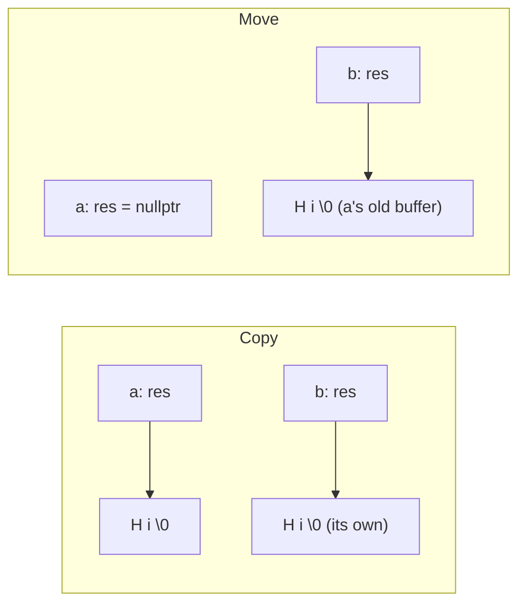

# String Class (C++)

A hand-written string that owns its own memory. "Implement a string class" is a classic C++ interview question, because it's the smallest example that needs the **rule of five**, and every member shows a separate idea.

---

## The problem

A class with a raw pointer gets the wrong copy by default: the compiler copies the pointer, not the characters.

```text
String a = "Hi";
String b = a;       // default copy: both point at the same buffer
                    // both destructors delete[] it: double free
```

So a class that owns a resource must define what copying, moving and destroying mean.

## The rule of five

If you write one of these, you almost certainly need all five:

| Member | When it runs | What ours does |
|---|---|---|
| Destructor | Object dies | Frees the buffer |
| Copy constructor | `String b = a;` | New buffer, copies characters |
| Copy assignment | `b = a;` | Copy and swap |
| Move constructor | `String b = std::move(a);` | Steals the buffer |
| Move assignment | `b = std::move(a);` | Frees its own, steals the other's |

The design has two fields: `char *res`, a buffer ending in `'\0'`, and `unsigned int len`. Keeping the length means `length()` doesn't have to scan.



## Our code

**Construct and deep copy.** Each gets its own buffer, with room for the terminator:

```cpp
// string.cpp
String(const char *ch) //parameterized constructor
{
    if(!ch) //strlen would crash on a null pointer: treat it as empty
        ch = "";
    len = strlen(ch);
    res = new char[len + 1];
    strcpy(res, ch);
}
String(const String &other) //copy constructor
{
    len = other.len;
    res = new char[len + 1];
    strcpy(res, other.res ? other.res : "");
}
```

**Move.** Copying a pointer is O(1), compared with O(n) for the characters. The source must be left safe to destroy, and `delete[] nullptr` does nothing:

```cpp
// string.cpp
String(String &&other) noexcept //move constructor
{
    res = other.res;
    len = other.len;
    other.res = nullptr;
    other.len = 0;
}
```

**Copy and swap.** This is the idiom worth knowing:

```cpp
// string.cpp
String& operator=(const String &other) //better copy assignment operator with CAS(copy and swap idiom)
{
    String temp(other);
    swap(*this, temp);
    return *this;
}
```

`string.cpp` keeps the earlier version in a comment, for comparison. Copy and swap wins on three counts:

| Property | Why it holds |
|---|---|
| Exception safety | If `new` throws, it throws while building `temp`, before `*this` has changed |
| Self-assignment | `a = a` copies, swaps and destroys the copy, with no check needed |
| No repeated code | Assignment reuses the copy constructor and destructor |

**Why `noexcept`?** `std::vector` only moves its elements while growing if the move can't throw. Otherwise it copies them, one allocation each.

**Why are `<<` and `>>` friends, and not members?** The left operand of `cout << s` is the stream, so a member of `String` can't work. They're friends so they can read `res` directly.

## Which function runs?

From `main` in `string.cpp`:

```cpp
// string.cpp
String str1;//default constructor
String str2 = "Hello";//parameterized constructor
String str3 = str1;//copy constructor  String str3(str1) same thing
str3 = str2;//copy assignment operator
```

```cpp
// string.cpp
String str6 = std::move(str2); //move constructor
```

An `=` in a declaration is construction, while an `=` on an existing object is assignment.

> [!WARNING]
> **Bugs this code used to have.**
> - **`String(nullptr)` crashed:** `strlen(nullptr)` caused a segfault. It now gives an empty string.
> - **A failed read wiped the string.** `operator>>` assigned even when the stream had failed, so a `String` holding "keep" became empty at end of input. It now keeps its value.
> - **The demo showed almost nothing.** It printed one line, then read input and moved strings without showing the results. It now prints what happened.

## Verification

From actually running the code (with `word` as input):

```text
Hello 5
word 4
Hello, moved-from length: 0
Hello, moved-from length: 0
```

Edge cases, in a separate test program:

```text
deep copy: b Hello, a changed
self copy assign: Hello 5
self move assign: Hello 5
moved-from: [] length 0; target Hello
copy of moved-from: []
assign to moved-from: reused
default: [] length 0
copy of default: []
swap: yy x
read: alpha beta lengths 5 4; read at end of input leaves [keep]
empty literal: length 0
String(nullptr): length 0
```

## Gaps

| Gap | What happens | Fix to say |
|---|---|---|
| **Two kinds of empty** (by reading) | A default string has a 1-byte buffer; a moved-from one has `res == nullptr`. So every method must handle both, as `<<` and the copy constructor do. | Have moved-from strings point at a shared static `""`, or give the default constructor null too. |
| **Very little API** (by reading) | No `operator+`, `==`, `[]`, `c_str`, `substr` or iterators. | The usual follow-ups: `operator[]` with const and non-const overloads, `operator+` built on `operator+=`. |
| **Length is `unsigned int`** (by reading) | `strlen` returns `size_t`, so a string over 4 GB would be truncated. | Use `size_t`. |
| **Embedded nulls are cut off** (by reading) | `strcpy` and `strlen` stop at the first `'\0'`. | Use `memcpy` with the length, and a constructor that takes one. |
| **No small-string optimization** (by reading) | Every non-moved string allocates, even for 1 character. | Store short strings inside the object, as real `std::string` does. |
| **`>>` goes through `std::string`** (by reading) | It relies on the class it's imitating. | Read one character at a time, and grow the buffer geometrically. |
| **Input is an implicit conversion** (by reading) | `String str2 = "Hello"` works because the constructor isn't `explicit`. That's handy here, as with `std::string`, but it also allows hidden allocations. | Fine for a string; say you considered it. |
| **`strcpy` is a known risk** (by reading) | It's safe here, because the buffer is always sized first. | `memcpy(res, ch, len + 1)` states the size. |

## Test yourself

<details><summary>1. What goes wrong without a custom copy constructor?</summary>

The default copies the pointer. Two objects share one buffer, so a change through one appears in the other, and both destructors free it: a double free.
</details>

<details><summary>2. Why <code>new char[len + 1]</code>?</summary>

Room for the terminating `'\0'`. `len` counts the characters only, and without the extra byte `strcpy` writes past the end.
</details>

<details><summary>3. What's the rule of five, and the rule of zero?</summary>

Rule of five: if you manage a resource, define destructor, both copies and both moves. Rule of zero: better still, build classes from members that manage themselves (`std::string`, `std::vector`, smart pointers), and define none of them.
</details>

<details><summary>4. Why set <code>other.res = nullptr</code> after moving?</summary>

`other` still runs its destructor. If it kept the pointer, it would free the buffer that now belongs to the target.
</details>

<details><summary>5. Why is copy and swap exception-safe?</summary>

The only step that can throw is building the temporary, and at that point `*this` is untouched. The swap can't fail, so the object is either fully updated or unchanged.
</details>

<details><summary>6. Why is the old assignment in the comment, with its self-check, weaker?</summary>

It changes `len` before the `new` that might throw, which leaves the object inconsistent if it does. It also duplicates the copy constructor's logic. Copy and swap has neither problem.
</details>

<details><summary>7. Does <code>String s = "Hi"; s = "Bye";</code> use copy or move assignment?</summary>

Move. `"Bye"` converts to a temporary `String`, a temporary binds to `String&&`, and the move assignment takes its buffer.
</details>

<details><summary>8. What can you safely do with a moved-from <code>String</code>?</summary>

Destroy it, or assign to it. Here `length()`, `<<` and copying are safe too, because each handles a null `res`. The test program does all of them.
</details>

## Run it

```bash
cd lld/string
g++ -std=c++17 string.cpp -o string
echo word | ./string
```

The demo reads one word from input, so without the `echo` it waits for you to type one.

```text
string/
└── string.cpp   the String class and a demo of each special member
```
