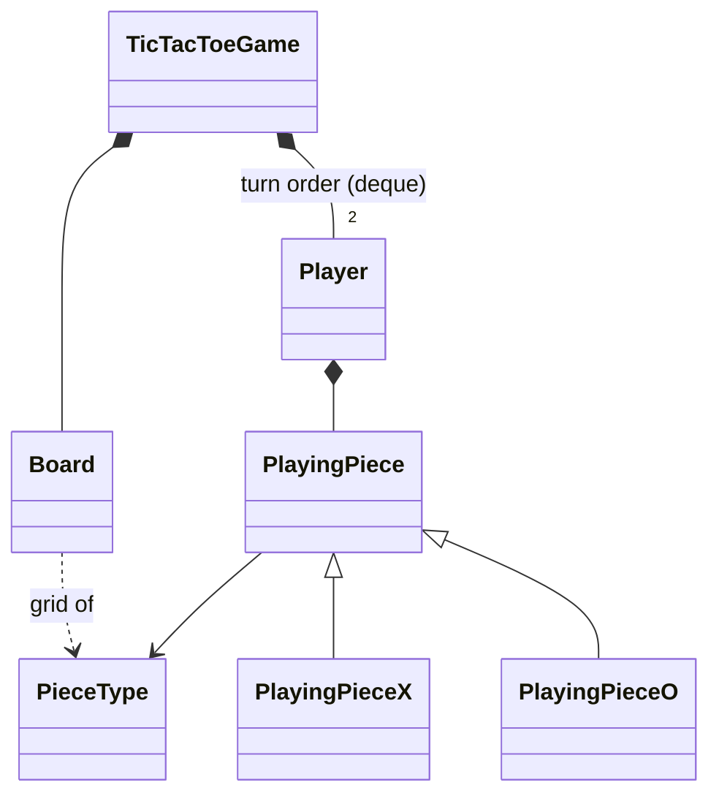

# Tic Tac Toe - Low Level Design (C++)

Two players take turns placing X and O on an N x N board (3 x 3 by default). Filling a whole row, column or diagonal with your symbol wins; a full board with no winner is a draw. Invalid moves are rejected without costing the player their turn.

This README walks the question the way you should deliver it in an interview: **Requirements -> Entities -> Class Design -> Implementation -> Extensibility**. Everything here matches the C++ code in this folder.

| Step | Time (45 min interview) | Section |
|---|---|---|
| Understand + clarify the rules | 5 min | [1. Requirements](#1-requirements) |
| Pick the objects | 3-5 min | [2. Entities](#2-entities-and-relationships) |
| State, game state, win check | 10 min | [3. Class design](#3-class-design) |
| Write `makeMove` and the win check | 15-20 min | [4. Implementation](#4-implementation), [5. Verification](#5-verification) |
| "What if..." | 5+ min | [6. Extensibility](#6-extensibility) |

---

## 0. Understanding the problem

Everyone knows the game, so the design is the whole point. Interviewers use it to see whether you can keep the pieces small and honest: a board that knows cells, players that know their symbol, and a game that enforces turns and decides when it's over. The two places that separate good answers from average ones are **how the game's state is modelled** (in progress, won, draw) and **how a win is detected efficiently**.

The interviewer usually opens with:

> "Design Tic Tac Toe. Two players, a board, detect wins and draws. Make the board size configurable."

---

## 1. Requirements

### Clarifying questions

Group your questions around: **what the system does**, **what can go wrong**, **what's in scope**, and **what might change later**.

**You:** "Is the board always 3 x 3?"
**Interviewer:** "Make it N x N, 3 by default."

**You:** "On an N x N board, do you need all N in a line to win, or some K in a row?"
**Interviewer:** "The whole line: a full row, column or diagonal."
> Good to ask: "K in a row" (Connect Four, Gomoku) needs a different win check. Note it as a follow-up.

**You:** "Two players, X and O? Who goes first?"
**Interviewer:** "Two players. The first player is X and moves first."

**You:** "How does a move arrive? Does the caller say which player is moving?"
**Interviewer:** "The caller just gives a row and a column; the game knows whose turn it is."
> That makes "moving out of turn" impossible by construction: `makeMove(row, col)` always plays for the current player.

**You:** "How does the game end?"
**Interviewer:** "A complete line wins immediately. A full board without a winner is a draw."

**You:** "What about a cell that's taken, a position off the board, or a move after the game ended?"
**Interviewer:** "Reject them, and the same player tries again. Nothing should break."
> Rejecting a move must not pass the turn on. That decides where the turn switch goes in the code.

**You:** "Undo, an AI opponent, several games at once, a real UI?"
**Interviewer:** "Out of scope. Print the board to the console."

### Final requirements

Write this on the board before moving on:

```text
REQUIREMENTS
1. N x N board (default 3); cells start empty
2. Two players: player 1 is X and moves first, player 2 is O; they alternate
3. makeMove(row, col) places the current player's symbol
4. A full row, column or diagonal of one symbol wins immediately
5. A full board with no winner is a draw
6. Reject (and keep the same player's turn): off-board position, taken cell, any move after the game is over
7. Show the board after each move and the result at the end

OUT OF SCOPE
- K-in-a-row on bigger boards, undo, AI, several games at once, a real UI
```

---

## 2. Entities and relationships

Look for nouns in the requirements, but don't make every noun a class. Ask of each one: **does it have state that changes, or behavior we own?**

- **Game** - enforces turns, applies moves, decides win or draw. The orchestrator: `TicTacToeGame`.
- **Board** - the grid of cells and the rules about it: in range, empty, full. `Board`.
- **Cell** - just a value in the grid (X, O or empty). Not a class: an enum value in a 2-D vector.
- **Player** - a name and a symbol. `Player`.
- **Symbol / piece** - X or O. Our code has an enum `PieceType` *and* a small class hierarchy `PlayingPiece` with `PlayingPieceX` / `PlayingPieceO` (see the decision below).
- **Move** - a (row, col) pair passed to `makeMove`. No class needed.

| Entity | Responsibility |
|---|---|
| `TicTacToeGame` | Orchestrator: players and turn order, `makeMove`, win and draw detection, game over, move count. |
| `Board` | N x N grid of `PieceType`; `placePiece`, `isCellEmpty`, `isFull`, row/column/diagonal views, `displayBoard`. |
| `Player` | Name + owned `PlayingPiece`. Move-only. |
| `PlayingPiece` (+ `PlayingPieceX`, `PlayingPieceO`) | Holds a `PieceType`, gives its symbol and name. |
| `PieceType` | Enum: X, O, EMPTY, plus `pieceToChar` / `pieceToString`. |



> [!NOTE]
> **Decision: is a piece a class, or just an enum?**
> - **Good: just the enum.** `PieceType::X` / `PieceType::O` is all the game logic needs; the board stores enum values and the player stores one.
> - **Our choice: enum plus a `PlayingPiece` class with X and O subclasses.** It leaves room for pieces that differ in more than their symbol (a custom symbol, colour, a special rule). Today the subclasses add nothing: their `getSymbol()` returns the same character the base class already derives from the enum.

> [!TIP]
> **Say in the interview:** "The board only needs an enum per cell. I wrapped the piece in a small class so players can have custom pieces later; if that never comes, the enum alone is simpler."

---

## 3. Class design

Work top-down, starting from the orchestrator. For each class ask two questions:
1. **State:** what must it remember to enforce the requirements?
2. **Methods:** what operations does the outside world need?

### TicTacToeGame

| Requirement | What the game must track |
|---|---|
| "N x N board" | The board, owned |
| "They alternate; X first" | The players, in turn order |
| "Game ends on win or draw" | Whether it's over, and who won (if anyone) |
| "Show the result" | Number of moves made |

| Need | Method |
|---|---|
| Set up | `TicTacToeGame(boardSize = 3)`, `initializePlayers(name1, name2)` |
| Play | `makeMove(row, col) -> bool` |
| Run a scripted game | `playWithMoves(moves) -> Player*` (winner or nullptr) |
| Ask about the game | `isGameOver()`, `isDraw()`, `getWinner()`, `getCurrentPlayer()`, `getMoveCount()` |
| Play again | `reset()` |

```cpp
class TicTacToeGame {
    std::unique_ptr<Board> board;
    std::deque<std::unique_ptr<Player>> players;   // front() = whose turn it is
    bool gameOver;
    Player* winner;                                // nullptr while playing, and on a draw
    int moveCount;
    bool isWinningLine(const std::vector<PieceType>& line) const;
    bool checkWinner(int row, int col, PieceType piece);
public:
    TicTacToeGame(int boardSize = 3);
    void initializePlayers(const std::string& player1Name, const std::string& player2Name);
    void addPlayer(std::unique_ptr<Player> player);
    bool makeMove(int row, int col);
    Player* playWithMoves(const std::vector<std::pair<int, int>>& moves);
    bool isGameOver() const;  bool isDraw() const;  Player* getWinner() const;
    void reset();
};
```

> [!NOTE]
> **Decision: how is the game's state represented?**
> - **Good (our choice): a `bool gameOver` plus a `Player* winner`.** Playing = not over; won = over with a winner; draw = over without one (`isDraw()` derives it). Works, but the three states are spread over two fields that must be kept consistent.
> - **Great: a `GameState` enum** `{ IN_PROGRESS, WON, DRAW }` plus the winner. One field says exactly where the game is, a switch over it can't miss a case, and adding a state later (PAUSED, ABANDONED) is one enum value.

> [!TIP]
> **Say in the interview:** "I track game over and the winner; a draw is 'over with no winner'. In a bigger game I'd use a GameState enum so the states can't contradict each other."

> [!NOTE]
> **Decision: how is turn order kept?**
> - **Good: two players and an index**, `current = 1 - current` after each move.
> - **Our choice: a `std::deque` of players, rotated after each valid move** (move the front to the back). The front is always whose turn it is, and the same code works for any number of players. The rotation only happens after a move succeeds, so an invalid move keeps the same player's turn.

### Board

| Requirement | What the board must track |
|---|---|
| "N x N, cells start empty" | `size` and a grid of `PieceType`, all EMPTY |
| "Full board is a draw" | How many cells are filled, so "full" is O(1) |

```cpp
class Board {
    int size;
    std::vector<std::vector<PieceType>> grid;
    int filledCells;
public:
    explicit Board(int size = 3);
    bool isCellEmpty(int row, int col) const;     // false when off the board
    bool placePiece(int row, int col, PieceType piece);   // rejects off-board and taken cells
    PieceType getPiece(int row, int col) const;
    bool isFull() const;                          // filledCells >= size * size
    std::vector<PieceType> getRow(int row) const;
    std::vector<PieceType> getColumn(int col) const;
    std::vector<PieceType> getMainDiagonal() const;
    std::vector<PieceType> getAntiDiagonal() const;
    void displayBoard() const;
    void reset();
};
```

The board validates moves (range and emptiness) itself, so the game can't put a piece where it doesn't belong.

### Player and PlayingPiece

```cpp
class Player {
    std::string name;
    std::unique_ptr<PlayingPiece> playingPiece;   // owned
public:
    Player(const std::string& name, std::unique_ptr<PlayingPiece> piece);
    Player(Player&&) noexcept;  Player& operator=(Player&&) noexcept;    // move-only
    Player(const Player&) = delete;  Player& operator=(const Player&) = delete;
    PieceType getPieceType() const;  char getSymbol() const;
};

class PlayingPiece {
protected:
    PieceType pieceType;
public:
    explicit PlayingPiece(PieceType type);
    virtual char getSymbol() const;               // derived from the enum
    virtual const char* getName() const;
};
// PlayingPieceX / PlayingPieceO: fix the type to X / O
```

> [!NOTE]
> **Decision: how is a win detected?**
> - **Good: scan the whole board after every move** (every row, column and both diagonals). Correct and easy, O(N²) per move.
> - **Our choice: check only the lines through the cell just played**: its row, its column, and a diagonal only if the cell is on it. O(N) per move. Our version copies each line into a small vector first, which is fine for 3 x 3.
> - **Great: keep counters.** One counter per row, per column and per diagonal; add +1 for X and -1 for O. A counter reaching +N or -N is a win. O(1) per move and no copying. (For "K in a row" instead of a full line, count matching cells outward from the move in each of 4 directions, as in Connect Four.)

> [!TIP]
> **Say in the interview:** "Only the lines through the last move can have changed, so I check just those, which is O(N). If moves had to be O(1), I'd keep a running sum per row, column and diagonal and check for plus or minus N."

### Final class design

```text
TicTacToeGame
    - board: unique_ptr<Board>,  players: deque<unique_ptr<Player>>  (front = current)
    - gameOver: bool,  winner: Player*  (nullptr = none),  moveCount: int
    + initializePlayers(name1, name2),  addPlayer(player)
    + makeMove(row, col) -> bool,  playWithMoves(moves) -> Player*
    + isGameOver(), isDraw(), getWinner(), getCurrentPlayer(), getMoveCount(), reset()
    - checkWinner(row, col, piece),  isWinningLine(line)

Board
    - size, grid: vector<vector<PieceType>>, filledCells
    + isCellEmpty, placePiece, getPiece, isFull, getRow, getColumn,
      getMainDiagonal, getAntiDiagonal, displayBoard, reset

Player           - name, playingPiece: unique_ptr<PlayingPiece>      (move-only)
PlayingPiece     - pieceType                    <- PlayingPieceX, PlayingPieceO
enum PieceType { X, O, EMPTY }
```

### Design patterns used

| Pattern | Where | Why | One line to say |
|---|---|---|---|
| Composition | Game owns Board and Players; Player owns its piece | Clear lifetimes with `unique_ptr` | "The game owns everything it plays with." |
| Polymorphism (light) | `PlayingPiece` with X and O subclasses | Room for custom pieces | "Pieces are a small hierarchy, though an enum would do today." |
| (Not really) Factory, Strategy, State | `main.cpp`'s comment names them | There's no factory class, the win check is a fixed method, and state is a bool | "To make the win rule a real Strategy, I'd put it behind a `WinRule` interface (full line vs K in a row)." |

---

## 4. Implementation

Before writing code, ask the interviewer: real code, pseudocode, or talk it through? The methods that matter are `makeMove` and the win check.

### makeMove

**Core logic**
1. Reject if the game is over or there are no players.
2. The current player is the front of the deque.
3. Ask the board to place their piece; if it refuses (off board, taken), return `false` **without** switching turns.
4. Count the move and show the board.
5. If this move completes a line: the current player wins, the game is over.
6. Else if the board is full: draw, game over.
7. Else rotate the deque so the next player is in front.

**Edge cases**
- A move after the game ended: rejected, nothing changes.
- A win on the very last empty cell: the win check runs **before** the draw check, so it's a win, not a draw.

```cpp
// TicTacToeGame.hpp
bool makeMove(int row, int col) {
    if (gameOver) {
        std::cout << "Game is already over!" << std::endl;
        return false;
    }

    if (players.empty()) {
        std::cout << "No players in the game!" << std::endl;
        return false;
    }

    // Get current player
    auto& currentPlayer = players.front();
    PieceType piece = currentPlayer->getPieceType();
    // ... prints whose turn it is

    // Try to place the piece
    if (!board->placePiece(row, col, piece)) {
        return false;
    }

    moveCount++;
    // ... prints the move and the board

    // Check for winner
    if (checkWinner(row, col, piece)) {
        winner = currentPlayer.get();
        gameOver = true;
        // ... prints the winner
        return true;
    }

    // Check for draw
    if (board->isFull()) {
        gameOver = true;
        // ... prints the draw
        return true;
    }

    // Switch to next player (rotate deque)
    players.push_back(std::move(players.front()));
    players.pop_front();

    return true;
}
```

### Placing a piece

```cpp
// Model/Board.hpp
bool placePiece(int row, int col, PieceType piece) {
    if (row < 0 || row >= size || col < 0 || col >= size) {
        std::cout << "Invalid position! Row and column must be between 0 and "
                  << (size - 1) << std::endl;
        return false;
    }

    if (!isCellEmpty(row, col)) {
        std::cout << "Cell (" << row << ", " << col << ") is already occupied!" << std::endl;
        return false;
    }

    grid[row][col] = piece;
    filledCells++;
    return true;
}
```

`filledCells` makes `isFull()` a single comparison instead of a scan of the grid.

### The win check

**Core logic:** only lines through `(row, col)` can be new wins. Check its row, its column, the main diagonal if `row == col`, and the anti-diagonal if `row + col == size - 1`. A line wins when its first cell isn't empty and every cell equals the first.

```cpp
// TicTacToeGame.hpp
bool isWinningLine(const std::vector<PieceType>& line) const {
    if (line.empty()) return false;

    PieceType first = line[0];
    if (first == PieceType::EMPTY) return false;

    return std::all_of(line.begin(), line.end(),
        [first](PieceType p) { return p == first; });
}

bool checkWinner(int row, int col, PieceType piece) {
    int size = board->getSize();

    // Check row
    if (isWinningLine(board->getRow(row))) {
        return true;
    }

    // Check column
    if (isWinningLine(board->getColumn(col))) {
        return true;
    }

    // Check main diagonal (if on it)
    if (row == col) {
        if (isWinningLine(board->getMainDiagonal())) {
            return true;
        }
    }

    // Check anti-diagonal (if on it)
    if (row + col == size - 1) {
        if (isWinningLine(board->getAntiDiagonal())) {
            return true;
        }
    }

    return false;
}
```

The `piece` parameter isn't used (the compiler warns about it): `isWinningLine` compares cells to the line's first cell instead. That's what lets a player win with another player's pieces if two players share a symbol (see gaps).

The counter version, for comparison:

```cpp
// rows[N], cols[N], diag, antiDiag start at 0;  v = +1 for X, -1 for O
rows[r] += v;  cols[c] += v;
if (r == c) diag += v;
if (r + c == N - 1) antiDiag += v;
bool won = std::abs(rows[r]) == N || std::abs(cols[c]) == N
        || std::abs(diag) == N || std::abs(antiDiag) == N;
```

### C++ talking points

- **`Player` is move-only.** It owns its piece through `unique_ptr`, so copying is deleted. The hand-written move constructor and move assignment do exactly what `= default` would generate.
- **Rotating a `deque<unique_ptr<Player>>`:** `push_back(std::move(front()))` then `pop_front()` moves the *pointer*, never the `Player` object. That's why `winner`, a raw `Player*` taken from `currentPlayer.get()`, stays valid.
- **Non-owning raw pointer** for `winner`: the game owns players through `unique_ptr`; everyone else gets `Player*`.
- **`std::all_of` with a capturing lambda** (`[first](PieceType p) { return p == first; }`) states "every cell equals the first" directly.
- **2-D grid** built with `grid.resize(size, std::vector<PieceType>(size, PieceType::EMPTY))`.
- **Structured bindings** in `playWithMoves`: `for (const auto& [row, col] : moves)`.
- **`EMPTY` as a value of the enum** keeps cells a plain enum; `std::optional<PieceType>` would be the alternative ("no piece" without a fake piece type).
- **Virtual destructor** on `PlayingPiece`, since players hold it as `unique_ptr<PlayingPiece>`.

### Gaps in our code (know these before the interviewer finds them)

I tested each of these by running the code, except where marked "by reading". Raising them yourself, with the fix, is a strong signal.

| Gap | What happens | Fix to say |
|---|---|---|
| **The "Draw" demo is actually a win** | `main.cpp`'s game 4 is labelled "Draw Game", but its moves give O the whole first column: **Hannah wins after 8 moves**. No demo ever shows a draw. (The code is right; the move list is wrong.) | Use a real draw sequence, e.g. (1,1) (0,0) (0,1) (2,1) (0,2) (2,0) (1,0) (1,2) (2,2), which I tested: draw after 9 moves. |
| **Players aren't validated** | `addPlayer` accepted a third player who also plays X; that player **won by completing a row with player A's X's**. Calling `initializePlayers` twice puts **4 players** in the rotation. | Exactly two players, distinct symbols, set up once (throw otherwise). And check the line against the mover's symbol (`piece`), not just "all equal". |
| **Board size isn't validated** | Size -1 threw `std::length_error` ("cannot create std::vector larger than max_size()"). Size 0 makes a board that is already "full" but rejects every move, so the game can never end. | Require `size >= 1` (realistically `>= 3`) in the constructor; throw `std::invalid_argument`. |
| **Game logic prints to the console** (by reading) | `makeMove` prints the turn, the board and the result itself, so a UI, a network game or a test can't use it quietly. | Return a `MoveResult` (accepted? win? draw? reason) and let the caller render. |
| **Win check copies lines** (by reading) | Every move builds up to four `std::vector`s. Irrelevant on 3 x 3, wasteful on big boards. | Counters per row, column and diagonal: O(1) per move, no allocation. |
| **No early draw** (by reading) | The game only ends as a draw when the board is full, even when no line can be completed any more. | Optional: a line is "dead" once it holds both X and O; draw when every line is dead. |
| **The winner starts the next game** | No rotation happens after a winning move, so after `reset()` the previous winner moves first again. | Rotate on `reset()` (or let the loser start), if the interviewer cares about fairness. |

---

## 5. Verification

Trace the code on concrete scenarios and say the state out loud after each step. The outputs below are from actually running the code.

**1. Game 1: Alice (X) wins on the top row**
```text
deque [Alice, Bob]
Alice (0,0)  placed; row 0 = X,_,_  no win; not full -> rotate [Bob, Alice]
Bob   (1,0)  placed; no win         -> [Alice, Bob]
Alice (0,1)                         -> [Bob, Alice]
Bob   (1,1)                         -> [Alice, Bob]
Alice (0,2)  row 0 = X,X,X -> win: winner = Alice, gameOver = true (no rotation)
"Game ended in 5 moves", "Winner: Alice"
```

**2. Game 4, labelled "Draw Game"**
```text
George X (1,1)   Hannah O (0,0)   George X (0,1)   Hannah O (2,1)   George X (0,2)
Hannah O (0,0)   "Cell (0, 0) is already occupied!"  -> false, still Hannah's turn
Hannah O (1,0)   George X (1,2)
Hannah O (2,0)   column 0 = O,O,O -> "Hannah WINS!"   "Game ended in 8 moves"
                 the last move in the list, (2,2), is never played
```

**3. Invalid moves (`demonstrateInvalidMoves`)**
```text
Mike X (1,1)     placed
Nancy O (1,1)    "Cell (1, 1) is already occupied!"         still Nancy's turn
Nancy O (5,5)    "Invalid position! Row and column must be between 0 and 2"
Nancy O (0,0)    placed
```

**4. Other demos**: game 2 Diana wins on column 2 (6 moves), game 3 Eve on the main diagonal, game 6 Kevin on the anti-diagonal, game 5 Ivan wins a 4 x 4 board on the full top row (7 moves).

**5. Edge cases** (separate test program)
```text
(1,1) (0,0) (0,1) (2,1) (0,2) (2,0) (1,0) (1,2) (2,2)   -> draw after 9 moves
X completes a row on the 9th move (board full)          -> X wins, isDraw = false
move after the game is won                              -> rejected, move count unchanged
third player C also plays X                             -> C wins using A's X's
initializePlayers twice                                 -> 4 players in rotation
board size -1                                           -> std::length_error thrown
board size 0                                            -> "full", every move rejected, never over
reset() after Alice wins                                -> Alice moves first again
```

---

## 6. Extensibility

If there's time left, expect "what if" questions. You usually explain where the change goes rather than code it. Junior candidates may skip this; senior candidates can get several in a row.

### 1. "Win with K in a row on a bigger board"

> "The full-line check no longer works. From the cell just played, count matching pieces outward in each of four directions (horizontal, vertical, two diagonals), adding both sides; K or more wins. That's the Connect Four check, O(K) per move."

```cpp
const int dirs[4][2] = {{0, 1}, {1, 0}, {1, 1}, {1, -1}};
for (auto [dr, dc] : dirs) {
    int count = 1;
    for (int s : {1, -1})                         // both directions
        for (int r = row + s * dr, c = col + s * dc;
             inBounds(r, c) && grid[r][c] == piece; r += s * dr, c += s * dc)
            count++;
    if (count >= K) return true;
}
```

### 2. "Add undo"

> "Keep a stack of moves (row, col, player). Undo pops the last one, clears that cell, decrements `filledCells`, rotates the turn back, and clears game over and the winner. If I used counters for the win check, undo subtracts the move's +1 or -1."

### 3. "Add a computer opponent"

> "Make 'choose a move' a strategy: `HumanPlayer` takes input, `RandomAI` picks any empty cell, `MinimaxAI` searches the game tree (fine on 3 x 3, which has under 10! move orders). The game asks the current player for a move instead of receiving it from outside."

### 4. "Use a proper game state"

> "Replace `gameOver` + `winner` with `GameState { IN_PROGRESS, WON, DRAW }` and keep `winner` only for WON. `makeMove` starts with `if (state != IN_PROGRESS) return false;` and `isDraw()` becomes `state == DRAW`."

### 5. "Many games at once (online)"

> "A `GameManager` maps game id to `TicTacToeGame`; each request names its game. Each game gets its own mutex so two players' moves on the same game can't interleave. Remove the console printing from the game and return a `MoveResult` the server can send back."

### 6. "Three players"

> "The deque already rotates any number of players; add a third symbol to `PieceType`, give each player a distinct piece, and check lines against the mover's own symbol."

---

## 7. What is expected at each level

**Junior.** A board, two players and a game that alternates turns, rejects bad moves, and detects a win on rows, columns and diagonals plus a draw on a full board. Hints on where the turn switch belongs (after a valid move) are fine.

**Mid-level.** Clean split between board rules (range, empty, full) and game rules (turns, end of game). Check only the lines through the last move and explain the complexity. Handle a move after the game ended and a win on the last cell. Discuss one extension such as K in a row or undo.

**Senior.** Model game state explicitly, offer the O(1) counter check, keep I/O out of the game logic, validate players and board size, and explain ownership (`unique_ptr` players, raw `Player*` for the winner). Discuss AI via a strategy, undo via a move stack, and concurrency for online play.

---

## 8. Test yourself

<details><summary>1. Why does an invalid move keep the same player's turn?</summary>

The deque is only rotated at the end of `makeMove`, after the piece was placed and the game didn't end. If `placePiece` refuses, `makeMove` returns `false` before reaching the rotation.
</details>

<details><summary>2. Which lines does the win check look at after a move at (row, col)?</summary>

Its row and its column, the main diagonal only if `row == col`, and the anti-diagonal only if `row + col == size - 1`. No other line can have changed.
</details>

<details><summary>3. Why is the win checked before the draw?</summary>

A move can fill the last empty cell and complete a line at the same time. Checking the win first reports it as a win (tested: X wins on the 9th move, `isDraw()` is false).
</details>

<details><summary>4. How would you make the win check O(1) per move?</summary>

Keep a sum per row, per column and per diagonal; add +1 for X and -1 for O on each move. If the touched row, column or diagonal reaches +N or -N, that player has won.
</details>

<details><summary>5. What's wrong with <code>bool gameOver</code> + <code>Player* winner</code>, and what's better?</summary>

Three states (playing, won, draw) are spread over two fields that must agree. A `GameState` enum names the state directly, and switch statements over it can't miss one.
</details>

<details><summary>6. Why can <code>winner</code> be a raw pointer even though players keep moving around the deque?</summary>

The deque holds `unique_ptr<Player>`. Rotating moves the smart pointer from front to back; the `Player` object itself never moves, so its address stays valid.
</details>

<details><summary>7. A third player who also plays X joins. What goes wrong?</summary>

`addPlayer` doesn't check, and `isWinningLine` only checks that a line is all the same symbol. That player can complete a line made of another player's X's and win. Validate two players with distinct symbols, and compare the line to the mover's symbol.
</details>

<details><summary>8. The demo called "Draw Game" ends with a winner. Is the code wrong?</summary>

No: the moves give O the whole first column, so O correctly wins after 8 moves. The demo's move list is wrong. A real draw is (1,1) (0,0) (0,1) (2,1) (0,2) (2,0) (1,0) (1,2) (2,2).
</details>

<details><summary>9. How does the check change for "K in a row" on a big board?</summary>

From the last move, count matching pieces in both directions along each of the four directions; K or more wins. That's O(K) per move and also covers Connect Four.
</details>

<details><summary>10. How would you add undo?</summary>

Push every move on a stack; undo pops it, empties the cell, decrements `filledCells`, rotates the turn back and resets the game-over state (and the counters, if used).
</details>

<details><summary>11. Why is <code>Player</code> move-only?</summary>

It owns its piece through `unique_ptr`, which can't be copied. Two players sharing one piece object wouldn't make sense anyway.
</details>

<details><summary>12. Why is printing inside <code>makeMove</code> a design smell?</summary>

It ties game rules to the console. A UI, a server or a test wants the result as data. Return a `MoveResult` and render it outside the game.
</details>

---

## 9. Run it

```bash
cd lld/tic_tac_toe
g++ -std=c++17 main.cpp -o tic_tac_toe
./tic_tac_toe
```

It plays six scripted games and an invalid-move demo. Expected key lines:

```text
Alice's turn (X)
Placed X at (0, 0)
...
🎉 Alice WINS! 🎉
  Game ended in 5 moves
  Winner: Alice
...
GAME 4: Draw Game
...
🎉 Hannah WINS! 🎉            (the "draw" demo actually ends in a win, see gaps)
...
Nancy's turn (O)
Cell (1, 1) is already occupied!
```

The board is drawn with box-drawing characters and the output uses emoji; on a Windows console these can show as odd characters. That's only the console's text encoding.

### Files

```text
tic_tac_toe/
├── main.cpp                    six scripted games + invalid-move demo
├── TicTacToeGame.hpp           orchestrator: turn deque, makeMove, win/draw check, reset
└── Model/
    ├── Board.hpp               N x N grid of PieceType, placePiece, isFull, line views, display
    ├── Player.hpp              name + owned PlayingPiece (move-only)
    ├── PlayingPiece.hpp        base: piece type, symbol, name
    ├── PlayingPieceX.hpp, PlayingPieceO.hpp
    └── PieceType.hpp           X, O, EMPTY + to-char / to-string
```
