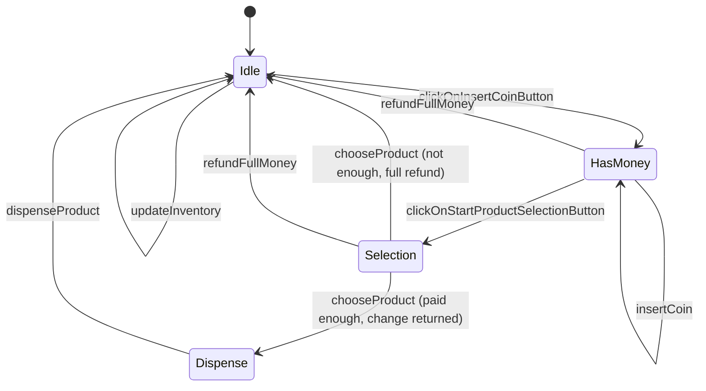
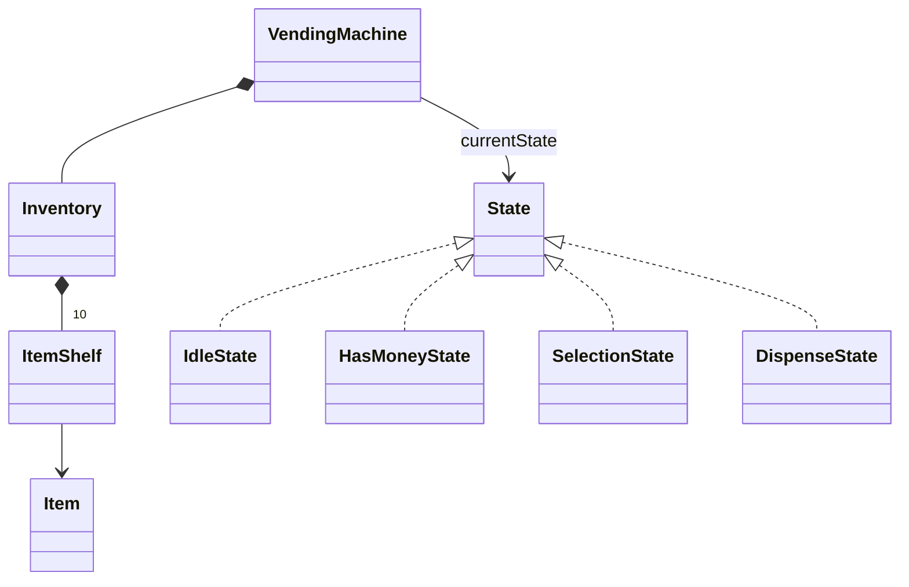

# Vending Machine - Low Level Design (C++)

A coin-operated vending machine with ten slots. The user presses "insert coin", drops coins, presses "select product", and enters a slot code. If they paid enough, the machine gives change and dispenses the item; if not, it refunds everything. The machine's behaviour depends entirely on which step it's in, which makes this **the** textbook State pattern question.

This README walks the question the way you should deliver it in an interview: **Requirements -> Entities -> Class Design -> Implementation -> Extensibility**. Everything here matches the C++ code in this folder.

| Step | Time (45 min interview) | Section |
|---|---|---|
| Understand + clarify | 5 min | [1. Requirements](#1-requirements) |
| Pick the objects, draw the states | 3-5 min | [2. Entities](#2-entities-and-relationships) |
| State interface + each state | 10 min | [3. Class design](#3-class-design) |
| Write the transitions | 15-20 min | [4. Implementation](#4-implementation), [5. Verification](#5-verification) |
| "What if..." | 5+ min | [6. Extensibility](#6-extensibility) |

---

## 0. Understanding the problem

The same button does different things at different times. "Select product" means nothing before you've paid; inserting a coin makes no sense while an item is dropping out. Writing this as one class full of `if (state == ...)` checks works for two states and collapses at five.

The interviewer usually opens with:

> "Design a vending machine. Users insert coins, pick a product, get the product and their change."

What they're looking for: a clear **state diagram** first, then the **State pattern** to implement it, plus sensible handling of money (integers, change, refunds) and stock.

---

## 1. Requirements

### Clarifying questions

Group your questions around: **what the system does**, **what can go wrong**, **what's in scope**, and **what might change later**.

**You:** "What's the user's flow, step by step?"
**Interviewer:** "Press 'insert coin', insert one or more coins, press 'select product', enter the product code. The machine dispenses and returns change."
> Write the flow down: it *is* the state diagram. Idle -> has money -> selecting -> dispensing -> idle.

**You:** "Which coins are accepted?"
**Interviewer:** "Penny 1, nickel 5, dime 10, quarter 25 cents. No notes or cards."
> Prices and payments are whole cents, so money can be plain integers: no floating point anywhere.

**You:** "How are products identified, and how many of each?"
**Interviewer:** "Ten slots with codes 101 to 110. Each slot holds one product with a price; once it's sold, the slot is sold out until restocked."

**You:** "What if the user hasn't paid enough?"
**Interviewer:** "Refund everything they put in and go back to the start."

**You:** "And if they paid too much?"
**Interviewer:** "Return the difference as change. Assume the machine always has enough change."
> That assumption removes coin-counting from the core design. Note it; "what if it can't make change?" is a classic follow-up.

**You:** "Can the user cancel?"
**Interviewer:** "Yes, any time after inserting money and before the product drops: full refund."

**You:** "What about pressing buttons in the wrong order, or a bad or sold-out code?"
**Interviewer:** "Reject the action clearly; don't corrupt the machine."

**You:** "Who restocks, and when?"
**Interviewer:** "An operator, only while the machine is idle."

**You:** "Notes, cards, a display, several users at once?"
**Interviewer:** "Out of scope."

### Final requirements

Write this on the board before moving on:

```text
REQUIREMENTS
1. Flow: insert-coin button -> insert coins -> select-product button -> enter code -> dispense
2. Coins: PENNY 1, NICKEL 5, DIME 10, QUARTER 25 (cents)
3. Slots 101..110, each holding one product with a price; sold out after one sale
4. Paid < price: refund all coins, back to idle
5. Paid > price: return the difference as change (machine has unlimited change)
6. Cancel (refund) is possible after inserting money and before dispensing
7. Actions in the wrong state, unknown codes and sold-out slots are rejected
8. Restocking only while idle

OUT OF SCOPE
- Notes / cards, tracking the machine's own coins for change
- Display, several users, remote management
```

---

## 2. Entities and relationships

Look for nouns in the requirements, but don't make every noun a class. Ask of each one: **does it have state that changes, or behavior we own?**

- **Vending machine** - holds the current state, the inserted coins and the inventory. In State-pattern terms it's the **context**: it delegates every action to its current state.
- **State** - one class per step of the flow: `IdleState`, `HasMoneyState`, `SelectionState`, `DispenseState`, all implementing `State`.
- **Coin** - a fixed set of values: enum `Coin`, with the value in cents as the enum's number.
- **Inventory, slot, product** - `Inventory` owns ten `ItemShelf`s (code, item, sold-out flag); `Item` is a product type and price; `ItemType` is an enum.
- **Buttons** - not classes: they're the methods of `State` (`clickOnInsertCoinButton`, ...).

The state diagram is the most important thing to draw:



| Entity | Responsibility |
|---|---|
| `VendingMachine` | Context: current state, inserted coins, inventory. `getState()`, `setState()`, coin list helpers. |
| `State` (interface) | Every user and operator action: insert-coin button, selection button, insert coin, choose product, change, dispense, refund, restock. |
| `IdleState` | Waits. Allows the insert-coin button and restocking. Clears the coin list when entered from another state. |
| `HasMoneyState` | Accepts coins; allows the selection button and a full refund. |
| `SelectionState` | Accepts a product code: checks price, returns change or refunds, moves on. Allows a full refund. |
| `DispenseState` | Hands out the product, marks the slot sold out, returns to Idle. |
| `Inventory`, `ItemShelf`, `Item` | Ten shelves (code 101..110, item, sold out); look up, add, mark sold out. |
| `Coin`, `ItemType` | Enums: coin value in cents; COKE, PEPSI, JUICE, SODA. |



> [!NOTE]
> **Decision: State pattern, or an enum and switch statements?**
> - **Good: an enum `MachineState` and a `switch` in every action.** Fine for two or three states. Each new state means editing every method, and the rules for one state are spread across the whole class.
> - **Great (our choice): the State pattern.** One class per state; each decides what every action means in that state and which state comes next. All the rules for "has money" live in `HasMoneyState`. Adding a state (say, MAINTENANCE) is a new class, not an edit to every method.

> [!TIP]
> **Say in the interview:** "The machine's behaviour depends on where it is in the flow, so each step is a State class and the machine just forwards every button press to its current state. Transitions live inside the states."

---

## 3. Class design

Work top-down, starting from the context. For each class ask two questions:
1. **State:** what must it remember to enforce the requirements?
2. **Methods:** what operations does the outside world need?

### VendingMachine (the context)

| Requirement | What VendingMachine must track |
|---|---|
| "Behaviour depends on the step" | The current state |
| "Refund all coins", "paid vs price" | The coins inserted so far |
| "Slots 101..110" | The inventory, owned |

```cpp
class VendingMachine {
    std::shared_ptr<State> currentState;
    std::unique_ptr<Inventory> inventory;
    std::vector<Coin> coinList;
public:
    VendingMachine();                                      // Idle, 10 empty shelves
    std::shared_ptr<State> getState() const;               // returned by value (see C++ notes)
    void setState(std::shared_ptr<State> state);
    Inventory* getInventory();
    std::vector<Coin>& getCoinList();
    void clearCoinList();
    void addCoin(Coin coin);
};
```

Callers never act on the machine directly; they act on its state: `machine.getState()->insertCoin(machine, Coin::QUARTER)`.

### State (the interface)

```cpp
class State {
public:
    virtual void clickOnInsertCoinButton(VendingMachine& machine) = 0;
    virtual void clickOnStartProductSelectionButton(VendingMachine& machine) = 0;
    virtual void insertCoin(VendingMachine& machine, Coin coin) = 0;
    virtual void chooseProduct(VendingMachine& machine, int codeNumber) = 0;
    virtual int getChange(int returnChangeMoney) = 0;
    virtual std::shared_ptr<Item> dispenseProduct(VendingMachine& machine, int codeNumber) = 0;
    virtual std::vector<Coin> refundFullMoney(VendingMachine& machine) = 0;
    virtual void updateInventory(VendingMachine& machine, std::shared_ptr<Item> item, int codeNumber) = 0;
};
```

What each state allows (everything else throws `std::runtime_error`):

| Action | Idle | HasMoney | Selection | Dispense |
|---|---|---|---|---|
| insert-coin button | -> HasMoney | (no-op) | throws | throws |
| insert coin | throws | add coin | throws | throws |
| selection button | throws | -> Selection | (no-op) | throws |
| choose product | throws | throws | check price -> Dispense or refund -> Idle | throws |
| refund | throws | refund -> Idle | refund -> Idle | throws |
| dispense | throws | throws | throws | dispense -> Idle |
| restock | add item | throws | throws | throws |

> [!NOTE]
> **Decision: how are actions that a state doesn't allow handled?**
> - **Our choice (Good): every state implements all 8 methods; the invalid ones throw** with a message naming the state. Explicit, but most of each state class is boilerplate (the compiler reports 38 unused parameters), and exceptions become normal control flow (paying too little throws after refunding).
> - **Great: a base class whose methods all reject by default**, so each state overrides only the actions it allows; and return a result (`accepted` / `rejected` + reason) instead of throwing for everyday cases like "not enough money".

> [!TIP]
> **Say in the interview:** "In my version every state implements every action and rejects the invalid ones. I'd move the rejections into a default base class so each state only writes what it actually supports."

> [!NOTE]
> **Decision: do states hold a pointer to the machine, or get it passed in?**
> - **Good: each state stores a `VendingMachine*`** set when it's created. Shorter method signatures.
> - **Great (our choice): the machine is passed into every call** (`VendingMachine& machine`). States hold no data at all, so there's no ownership cycle between the machine and its states, and any state object could be shared or reused.

### Inventory, ItemShelf, Item, Coin

```cpp
class Inventory {
    std::vector<ItemShelf> inventory;                      // codes 101, 102, ...
public:
    explicit Inventory(int itemCount);
    void addItem(std::shared_ptr<Item> item, int codeNumber);    // only into a sold-out shelf
    std::shared_ptr<Item> getItem(int codeNumber);               // throws if unknown or sold out
    void updateSoldOutItem(int codeNumber);
};

class ItemShelf { int code; std::shared_ptr<Item> item; bool soldOut; };
class Item      { ItemType type; int price; };                   // price in cents

enum class Coin { PENNY = 1, NICKEL = 5, DIME = 10, QUARTER = 25 };
inline int getCoinValue(Coin coin) { return static_cast<int>(coin); }
```

> [!NOTE]
> **Decision: how is money represented?**
> - **Good: a `double` amount in dollars.** Readable, but 0.1 + 0.2 isn't exactly 0.3 in binary floating point, and change calculations drift.
> - **Great (our choice): integer cents.** Each `Coin`'s enum value *is* its value in cents, prices are `int` cents, and every sum and difference is exact.

### Final class design

```text
VendingMachine (context)
    - currentState: shared_ptr<State>,  inventory: unique_ptr<Inventory>,  coinList: vector<Coin>
    + getState() -> shared_ptr<State>,  setState(state)
    + getInventory(),  getCoinList(),  addCoin(coin),  clearCoinList()

State (interface)  <- IdleState, HasMoneyState, SelectionState, DispenseState
    + clickOnInsertCoinButton(m),  clickOnStartProductSelectionButton(m)
    + insertCoin(m, coin),  chooseProduct(m, code),  getChange(amount)
    + dispenseProduct(m, code) -> Item,  refundFullMoney(m) -> coins,  updateInventory(m, item, code)

Inventory      - inventory: vector<ItemShelf>     + addItem, getItem, updateSoldOutItem
ItemShelf      - code, item: shared_ptr<Item>, soldOut
Item           - type: ItemType, price (cents)
enum Coin { PENNY=1, NICKEL=5, DIME=10, QUARTER=25 }    enum ItemType { COKE, PEPSI, JUICE, SODA }
```

### Design patterns used

| Pattern | Where | Why | One line to say |
|---|---|---|---|
| State | `State` + four state classes, `VendingMachine` as context | Behaviour depends on the step in the flow; each step owns its rules and transitions | "The machine forwards every action to its current state; states decide what happens next." |
| (Composition) | Machine owns inventory; inventory owns shelves | Clear ownership | "The machine owns its stock." |

---

## 4. Implementation

Before writing code, ask the interviewer: real code, pseudocode, or talk it through? Draw the state diagram, then write the transitions; the one with real logic is `SelectionState::chooseProduct`.

### Transitions are tiny

```cpp
// VendingMachine.cpp
void IdleState::clickOnInsertCoinButton(VendingMachine& machine) {
    machine.setState(std::make_shared<HasMoneyState>());
}

void HasMoneyState::clickOnStartProductSelectionButton(VendingMachine& machine) {
    machine.setState(std::make_shared<SelectionState>());
}

std::vector<Coin> HasMoneyState::refundFullMoney(VendingMachine& machine) {
    std::cout << "Returned the full amount back in the Coin Dispense Tray" << std::endl;
    auto coins = machine.getCoinList();
    machine.setState(std::make_shared<IdleState>(machine));
    return coins;
}
```

`IdleState(machine)` clears the machine's coin list in its constructor, so every path back to Idle (refund or sale) leaves no money behind. The refund copies the coins *before* that happens, so it can return them.

```cpp
// States/HasMoneyState.hpp
void insertCoin(VendingMachine& machine, Coin coin) override {
    std::cout << "Accepted the coin: " << getCoinValue(coin) << std::endl;
    machine.addCoin(coin);
}
```

### chooseProduct (the real logic)

**Core logic**
1. Look up the product by code (throws if the code is unknown or the slot is sold out).
2. Add up the inserted coins.
3. Paid less than the price: refund everything (back to Idle) and report "Insufficient amount".
4. Paid more: return the difference as change.
5. Enter the Dispense state, then dispense.

**Edge cases**
- Unknown or sold-out code: the lookup throws **before** any state change, so the machine stays in Selection holding the coins. The user can pick another code or ask for a refund.
- Exact payment: no change.

```cpp
// VendingMachine.cpp
void SelectionState::chooseProduct(VendingMachine& machine, int codeNumber) {
    // Get the item
    auto item = machine.getInventory()->getItem(codeNumber);

    // Calculate total paid amount
    int paidByUser = 0;
    for (const auto& coin : machine.getCoinList()) {
        paidByUser += getCoinValue(coin);
    }

    // Compare with item price
    if (paidByUser < item->getPrice()) {
        std::cout << "Insufficient Amount. Product price: " << item->getPrice()
                  << ", You paid: " << paidByUser << std::endl;
        refundFullMoney(machine);
        throw std::runtime_error("Insufficient amount");
    } else {
        if (paidByUser > item->getPrice()) {
            getChange(paidByUser - item->getPrice());
        }
        // Enter Dispense first, then dispense; dispensing moves the machine back to Idle
        auto dispenseState = std::make_shared<DispenseState>();
        machine.setState(dispenseState);
        dispenseState->dispenseProduct(machine, codeNumber);
    }
}
```

### Dispensing

```cpp
// VendingMachine.cpp
std::shared_ptr<Item> DispenseState::dispenseProduct(VendingMachine& machine, int codeNumber) {
    std::cout << "Product has been dispensed" << std::endl;
    auto item = machine.getInventory()->getItem(codeNumber);
    machine.getInventory()->updateSoldOutItem(codeNumber);
    machine.setState(std::make_shared<IdleState>(machine));
    return item;
}
```

### The bug this code used to have

> [!WARNING]
> Until this version, **the machine could sell only one item**. `chooseProduct` did `machine.setState(std::make_shared<DispenseState>(machine, codeNumber))`, and the `DispenseState` constructor dispensed immediately, which set the state to Idle. Then the outer `setState` ran and put **DispenseState** back. The log even printed "Currently Vending machine is in IdleState" last. After the first sale every action threw ("Insert coin button cannot be clicked in Dispense state"), including refunds and restocking. The demo hid it because it only buys once.

The fix: the `DispenseState` constructor no longer does any work; `chooseProduct` enters Dispense first and then asks it to dispense, which moves on to Idle. The lesson for interviews: **a constructor shouldn't trigger a state transition**, because whoever is constructing the object will set the state again afterwards. Do the transition, then the work.

### C++ talking points

- **Breaking the include cycle.** States need the machine (`VendingMachine&`), and the machine needs `State`. `State.hpp` only forward-declares `class VendingMachine;`, the state headers declare the methods that change state, and the bodies live in `VendingMachine.cpp`, where every class is complete. That's why the program is built from **two** `.cpp` files.
- **`getState()` returns `shared_ptr` by value**, on purpose. In `machine.getState()->refundFullMoney(machine)` the temporary copy keeps the current state alive while its own method calls `setState(...)` and drops the machine's reference to it. If `getState()` returned a raw pointer, the state would delete itself mid-call. The fix uses the same trick: the local `dispenseState` keeps the Dispense state alive while it switches the machine to Idle.
- **New state object per transition** (`std::make_shared<HasMoneyState>()`). States hold no data, so you could also keep one instance of each in the machine and avoid the allocations; both are fine.
- **`enum class Coin` with explicit values**: the enum's underlying value is the coin's worth in cents, so `static_cast<int>(coin)` is the value.
- **`std::runtime_error`** reports invalid actions; `main` wraps everything in `try` / `catch (const std::exception& e)`.
- **`std::unique_ptr<Inventory>`** for owned stock; items are `shared_ptr<Item>` because the shelf and the buyer may both hold one.

### Gaps in our code (know these before the interviewer finds them)

I tested each of these by running the code, except where marked "by reading". Raising them yourself, with the fix, is a strong signal.

| Gap | What happens | Fix to say |
|---|---|---|
| **Change is a number, not coins** | `getChange` prints "Returned the change ...: 21" and returns 21. The machine doesn't know which coins it has, so it can't refuse a purchase it can't make change for. | Keep a coin count per denomination; compute change greedily (largest coin first), check it's possible before dispensing, and add inserted coins to the machine's stock. |
| **Each slot holds one item** | After one sale the slot is sold out (tested: buying a sold-out slot throws "Item already sold out"). Real slots hold several. | Give `ItemShelf` a quantity; sold out when it reaches 0. |
| **Exceptions for normal outcomes** | Paying too little refunds, then **throws** "Insufficient amount"; an unknown or sold-out code throws "Invalid code" / "Item already sold out". Callers must catch every action. | Return a result (`accepted`, `rejected` with a reason, change returned) and keep exceptions for real faults. |
| **A bad code keeps the money in Selection** | Choosing code 999 left the machine in Selection holding the 10 cents; a refund then worked. Reasonable, but the user must know to pick again or cancel. | Same as above: return "invalid code, choose again or cancel" explicitly. |
| **Every state implements every action** | 8 methods per state, most of them `throw`; compiling with warnings reports **38 unused parameters**. | Base class with default "not allowed in this state" implementations; states override only what they allow. |
| **The demo fills shelves directly** (by reading) | `fillUpInventory` in `main.cpp` writes to the shelves itself instead of calling `updateInventory`, skipping the "only while idle" rule. Its comment also says "product 102 (PEPSI)", but 102 is COKE; the code buys 104, which is PEPSI. | Stock through `updateInventory` in the Idle state; fix the comment. |

---

## 5. Verification

Trace the code on concrete scenarios and say the state out loud after each step. The outputs below are from actually running the code.

**Setup (`main.cpp`)**: slots 101-103 COKE 12, 104-105 PEPSI 9, 106-107 JUICE 13, 108-110 SODA 7.

**1. Buy PEPSI (104) with a nickel and a quarter**
```text
Idle      clickOnInsertCoinButton          -> HasMoney        coins []
HasMoney  insertCoin(NICKEL)               "Accepted the coin: 5"     coins [5]
HasMoney  insertCoin(QUARTER)              "Accepted the coin: 25"    coins [5, 25]
HasMoney  clickOnStartProductSelectionButton -> Selection
Selection chooseProduct(104): price 9, paid 30
          "Returned the change in the Coin Dispense Tray: 21"
          -> Dispense: "Product has been dispensed", slot 104 sold out
          -> Idle (coins cleared)
Inventory: 104 "Available: No", everything else "Yes"
```

**2. A second purchase** (the case the old code failed)
```text
before the fix: first sale ok, then "Insert coin button cannot be clicked in Dispense state";
                refund and restock also threw: the machine was stuck in Dispense
after the fix:  second sale ok, machine back in Idle, restocking allowed again
```

**3. Edge cases** (separate test program)
```text
pay 5 for a 12-cent item      -> refund, back to Idle, then throws "Insufficient amount"
code 999                      -> throws "Invalid code"; stays in Selection, still holding 10
                                 then refund: 1 coin returned, Idle
sold-out slot                 -> throws "Item already sold out"; stays in Selection holding 25
insert a coin while Idle      -> "You cannot insert coin in idle state"
choose a product while Idle   -> "You cannot choose product in idle state"
refund while Idle             -> "You cannot get refund in idle state"
exact payment (10 + 1 + 1 for 12) -> no change line, slot sold out
restock an occupied slot      -> "Item already present at this location"
restock code 500              -> "Invalid code number"
```

---

## 6. Extensibility

If there's time left, expect "what if" questions. You usually explain where the change goes rather than code it. Junior candidates may skip this; senior candidates can get several in a row.

### 1. "What if the machine can't make change?"

> "Track the machine's coins per denomination. Before dispensing, compute change greedily from the largest coin down; if it can't be made exactly, refund instead of selling. Inserted coins go into the machine's stock once the sale completes. For US coins greedy is always optimal; for arbitrary coin sets you'd need a small dynamic-programming check."

```cpp
std::map<Coin, int, std::greater<>> stock;        // QUARTER first
std::optional<std::vector<Coin>> makeChange(int amount) {
    std::vector<Coin> out;
    for (auto& [coin, count] : stock) {
        int use = std::min(count, amount / getCoinValue(coin));
        out.insert(out.end(), use, coin);
        amount -= use * getCoinValue(coin);
    }
    if (amount != 0) return std::nullopt;         // can't make change
    return out;                                   // commit by decrementing stock
}
```

### 2. "Slots with several items"

> "`ItemShelf` gets a `quantity`. Dispensing decrements it; `isSoldOut()` is `quantity == 0`. Restocking adds to the quantity instead of requiring an empty shelf."

### 3. "Accept notes or cards"

> "Put payment behind a `PaymentMethod` interface (coins, notes, card) with `authorize(amount)` and `refund()`. The HasMoney state becomes 'payment in progress'; card payments don't need change at all."

### 4. "A maintenance mode for the operator"

> "A new `MaintenanceState`: entered from Idle with an operator key, allows restocking and emptying the coin box, rejects all customer actions, and returns to Idle. That's the payoff of the State pattern: one new class, no edits to the other states beyond the transition into it."

### 5. "Cancel automatically if the user walks away"

> "Record when the machine left Idle. A timer (or a check on every action) refunds and returns to Idle after, say, 60 seconds without a selection."

### 6. "Alert when stock runs low"

> "Have `Inventory` notify observers when a slot sells out or drops below a threshold (Observer pattern); a restocking service subscribes."

### 7. "Simplify the flow"

> "Real machines don't need an 'insert coin' button: inserting a coin while Idle can itself move to HasMoney. With the State pattern that's a change to one method, `IdleState::insertCoin`."

---

## 7. What is expected at each level

**Junior.** Identify the states and draw the diagram; implement the happy path (insert coins, select, dispense, change) and the not-enough-money refund. Hints on using the State pattern instead of `if` chains are fine.

**Mid-level.** A clean State pattern: context delegates, each state owns its transitions, invalid actions are rejected per state. Integer cents for money. Handle unknown and sold-out codes and cancellation. Discuss one extension: making real change or slot quantities.

**Senior.** Raise the weak spots yourself: change as a number with no coin stock, exceptions as control flow, boilerplate in every state, slot capacity of one, and the transition-order trap the original code fell into. Explain the C++ lifetime detail (a state replacing itself while its method runs) and the include-cycle structure. Discuss a maintenance state, payment methods as a strategy, and timeouts.

---

## 8. Test yourself

<details><summary>1. Draw the state diagram.</summary>

Idle --insert-coin button--> HasMoney --insert coin--> HasMoney --selection button--> Selection --choose product, enough--> Dispense --> Idle. Selection --not enough--> Idle (refund). HasMoney / Selection --refund--> Idle. Idle --restock--> Idle.
</details>

<details><summary>2. Why the State pattern instead of an enum and switch statements?</summary>

Each state's rules live in one class instead of being spread over a switch in every method. A new state is a new class, and the transitions are explicit inside the states.
</details>

<details><summary>3. Why did the old code get stuck after one sale?</summary>

`setState(make_shared<DispenseState>(...))` evaluates the argument first: the `DispenseState` constructor dispensed and set Idle, then the outer `setState` overwrote it with Dispense, where every action throws. Don't let a constructor trigger a transition.
</details>

<details><summary>4. Why does <code>getState()</code> return a <code>shared_ptr</code> by value?</summary>

The caller's temporary copy keeps the state object alive during the call. A state's method often calls `setState(...)`, which drops the machine's reference; without the copy the object would be destroyed while its own method is still running.
</details>

<details><summary>5. Why are states given the machine as a parameter instead of storing a pointer to it?</summary>

They then hold no data, there's no machine-to-state-to-machine ownership cycle, and a state object could be reused or shared.
</details>

<details><summary>6. How is money represented, and why?</summary>

Integer cents: each `Coin` enum value is its value in cents and prices are `int`. Sums and change are exact, unlike `double` dollars.
</details>

<details><summary>7. The user chooses a sold-out slot. What state is the machine in afterwards, and where is their money?</summary>

Still Selection, still holding the coins: the lookup throws before any transition. They can choose another code or ask for a refund.
</details>

<details><summary>8. How would you make real change and refuse sales you can't make change for?</summary>

Keep a count of each coin. Compute change greedily from the largest coin; if the amount can't be reached exactly, refund instead of selling. Add the inserted coins to stock when a sale completes.
</details>

<details><summary>9. Why does building the program need two <code>.cpp</code> files?</summary>

The state transitions are defined in `VendingMachine.cpp`, where both the machine and all states are fully declared. That breaks the include cycle between `VendingMachine.hpp` and the state headers.
</details>

<details><summary>10. How would you add a maintenance mode?</summary>

A `MaintenanceState` reachable from Idle with an operator action; it allows restocking and emptying coins, rejects customer actions, and returns to Idle. No other state changes except the transition into it.
</details>

<details><summary>11. Why is "paying too little throws" a design smell?</summary>

Not having enough money is a normal outcome, not an error. Callers must wrap every action in `try`/`catch`. Returning a result with a reason is clearer.
</details>

<details><summary>12. How would you cut the boilerplate of every state implementing all eight actions?</summary>

Give the base class default implementations that reject the action ("not allowed in this state"); each state overrides only the actions it supports.
</details>

---

## 9. Run it

```bash
cd lld/vending_machine
g++ -std=c++17 main.cpp VendingMachine.cpp -o vending_machine
./vending_machine
```

Both `.cpp` files are needed: the state transitions are defined in `VendingMachine.cpp`. Expected output (inventory tables shortened):

```text
--- User clicks Insert Coin Button ---
Currently Vending machine is in HasMoneyState

--- User inserts coins ---
Accepted the coin: 5
Accepted the coin: 25

--- User clicks Product Selection Button ---
Currently Vending machine is in SelectionState

--- User selects product 102 (PEPSI - 9 cents) ---
Returned the change in the Coin Dispense Tray: 21
Currently Vending machine is in DispenseState
Product has been dispensed
Currently Vending machine is in IdleState

=== Inventory ===
...
Code: 104 | Item: PEPSI | Price: 9 | Available: No
...
```

### Files

```text
vending_machine/
├── main.cpp                  fills the shelves, buys PEPSI (104) with 30 cents
├── VendingMachine.hpp        context: current state, coins, inventory
├── VendingMachine.cpp        constructor + all state transitions (breaks the include cycle)
├── States/
│   ├── State.hpp             interface: the 8 actions
│   ├── IdleState.hpp         insert-coin button, restock
│   ├── HasMoneyState.hpp     insert coins, selection button, refund
│   ├── SelectionState.hpp    choose product, change, refund
│   └── DispenseState.hpp     dispense, back to Idle
├── Inventory.hpp             10 shelves, codes 101..110
├── ItemShelf.hpp             code, item, sold out
├── Item.hpp, ItemType.hpp    product type + price
└── Coin.hpp                  PENNY 1, NICKEL 5, DIME 10, QUARTER 25
```
